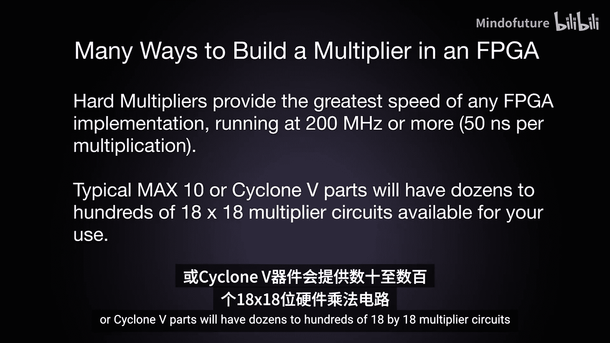
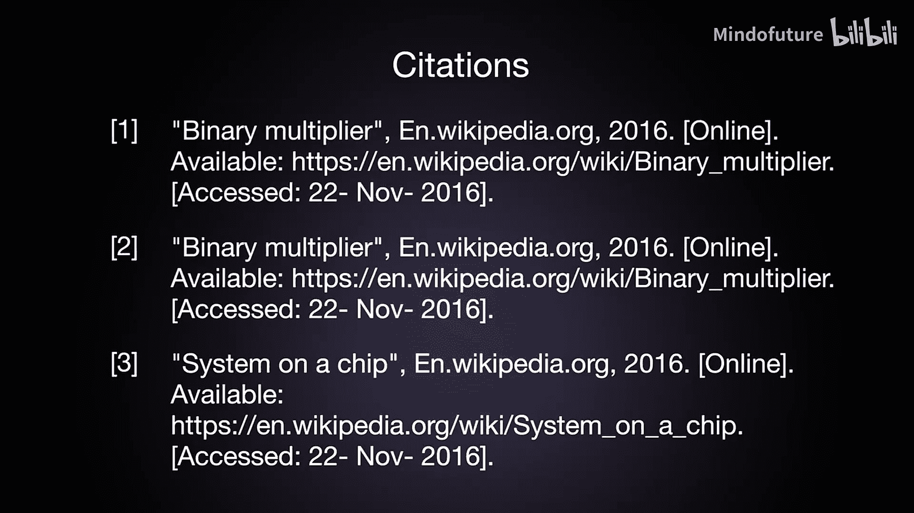

# 嵌入式系统FPGA设计入门：P09：乘法器设计 🧮

在本节课中，我们将要学习在FPGA中设计乘法器的不同方法。乘法是数字逻辑或算术逻辑单元中的常见功能，但其电路实现可能非常复杂。我们将探讨各种实现方式的优缺点，并了解为何现代FPGA中的硬核乘法器通常是首选方案。

## 乘法器设计的挑战

上一节我们介绍了FPGA的基本逻辑单元。本节中我们来看看如何用这些单元构建乘法器。两个数字相乘是一个常见的数字逻辑功能，但可能需要大量的电路资源。多年来，这一直是设计人员面临的一个问题。

幸运的是，在FPGA内部有多种实现乘法器电路的方法。

## 使用基本门电路构建乘法器

既然加法器可以用门电路构建，我们是否也能用门电路构建乘法器呢？答案是肯定的。

以下是一个例子：一个2位乘以2位的二进制乘法器。通常，我们可以使用**阵列乘法器**来用门电路构建乘法器。其工作原理类似于手工乘法，包括**部分积生成**和**部分积求和**两个步骤。

但是，所需门电路的数量随着位数n的增加而呈**n²**增长。因此，对于超过4位乘以4位的乘法，顺序设计比加法器乘法器更高效。

## FPGA中实现乘法器的主要方法

以下是几种在FPGA中构建乘法器的主要途径：

*   **组合电路**：速度快，但占用面积大。
*   **顺序移位相加（状态机方法）**：面积小，但速度慢。
*   **专用算法（如布斯算法、数据乘法器或华莱士树乘法器）**：速度快且面积小，但设计复杂。
*   **使用存储器作为查找表**：简单，但扩展性差（不适用于大位数）。
*   **上述方法的组合**。
*   **硬核乘法器模块**：如果FPGA内部集成了此类模块，在大多数情况下这是最佳解决方案。

## 深入探讨顺序移位相加法

考虑顺序移位相加的状态机方法。对于超过4位乘以4位的乘法，这种方法在面积上比组合乘法器更小，但速度更慢，因为移位和相加需要**2n**个时钟周期。

## 查找表法的应用场景

对于较小的输入，使用存储器进行乘法是一个不错的解决方案。例如，一个4位乘以4位的乘法可以通过使用一个具有8位地址的存储器来实现。

地址位`a[7:4]`可以表示乘数，而`a[3:0]`表示被乘数。存储器需要**2⁸**或**256**个存储位置。虽然存储单元相对廉价，但超过8位乘以8位后，所需的存储器会变得过于庞大和昂贵。

## 硬核乘法器的优势

硬核乘法器提供了任何FPGA实现中最快的速度，运行频率可达**200 MHz**或更高，即每次乘法仅需**50纳秒**。

典型的Max 10或Cyclone V等器件会提供数十到数百个可用的**18位 x 18位**乘法器电路供用户使用。

## 总结

本节课中我们一起学习了数字乘法器的设计。创建数字乘法器是一个具有挑战性的设计问题，大多数解决方案都有明显的缺点。在FPGA中实现乘法器有多种方法，包括组合电路、顺序电路或状态机、专用算法（如布斯算法等）、存储器以及硬核乘法器模块。

许多FPGA包含多个硬核乘法器模块，支持非常快速的18位 x 18位乘法，这为在数字逻辑中实现乘法器提供了可能是最佳的解决方案。