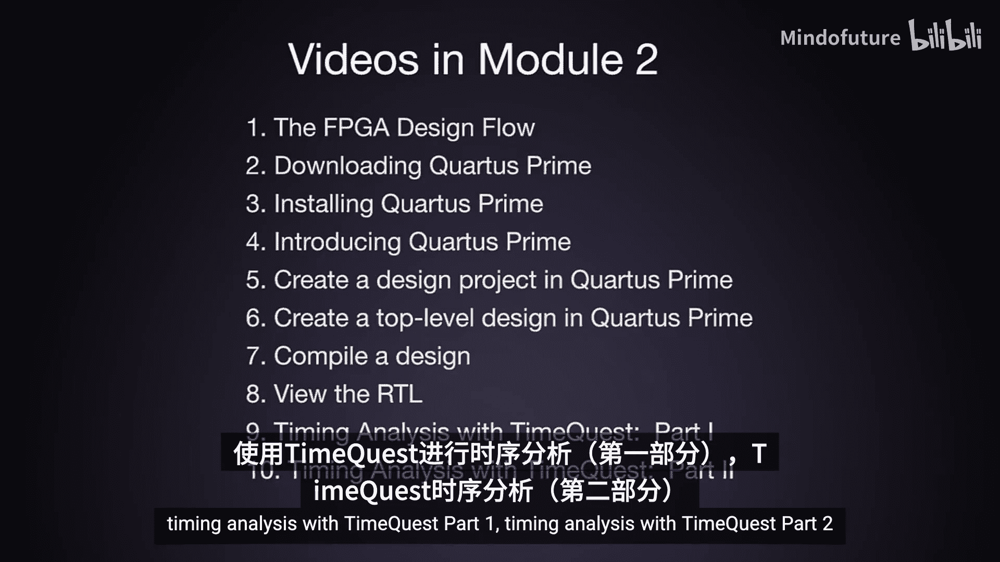

# 【科罗拉多大学】嵌入式系统-FPGA-设计入门-｜-intro-fpga-design-embedded-systems-p10-P10_02_01_01_1-FPGA设计流程--BV19Tu6zGEMD_p10-

Welcome to the FPGA design flowlow and example design In the first module。

 we introduce programmbo logic devices and the FPGA in module 2。

 we use Cors Prime to work through a sample FPGA design using the design flow shown here。

You will be learning by doing The design begins with the design entry。

 continues with simulation to verify the logic as implemented as expected。

 and then the tool will perform synthesis also called mapping to map the logic to the device architecture。

Next， the tool would create the internet connection between cells by placing and routing or fitting of the design。

Timing analysis using static timing tools is then required to assure there are no setup or whole violations in the design。

Running another simulation after fitting is done is a good practice and it can uncover timing issues。

If analysis confirms proper operation of the circuit。

 the next step is to use the tool to create a programming file。

 which is then downloaded into the FHG device for testing。

There are lots of ways to create an FGA design to describe the logic that it implements。

Cors Prime provides a number of methods for schematic entry， including schematic capture。

 import of IP P blocks， HDL text entry， including VHDL， Veril log and system Vlog。

 state machine entry。And import of EF files。We will show you that you can use multiple methods of defining the design in the same project and that these methods can be mixed and matched。

Cortis Prime's analysis and synthesis module checks the design source file for errors。

 builds a database that puts all the design files in a hierarchy。

 synthesizes and optimizes the logic design and maps the design logic to device resources。

Fitting the design into the smallest possible part is a principal design challenge in FPGA design。

Cortis Prime allows control of the fitting process by choice of fitting approaches。

 including balanced， high performance for speed， low power and small area。

Cors Prime can provide several views of a design in pictures representing different aspects of the design。

Picture representations of the design from RTL viewer or the technology mapp viewer can give you confidence in your design implementation and design techniques and help you develop an intuitive sense of the design。

 particularly if you are an experienced hardware designer。

The chip planner provides a picture of the chip showing the use of the design resources this view can be very helpful in locating problem areas during debugging。

Synchronization is fundamental to reliable FPGA designs。 The synchronizing signal is the clock。

Static timing analysis can determine if there are violations of timing requirements relative to the clock；

 it is the primary tool for achieving time en closure， a necessity for any and all FPGA designs。

The timequest timing analyzer uses a set of equations to calculate Slack and also to determine Fmax。

 an important metric in FPGA performance， it can be guided by a set of rules known as constraints which also help the fitter to optimize the timing driven design。

We will learn how to write effective constraints to improve the FMX。

Model SimM is a powerful simulation tool integrated with Corus Prime。

 it can create accurate timing diagrams of all the signals in the design。

 as well as stimulus signals for testing。We will use this tool to test and better understand the operation of our example design。

Results will be displayed as a timing diagram like the one shown。 In summary。

 we will learn about the F PJ design flow by doing an example design in detail using Cortis Prime。

Videos in this module will cover the FPG design flow， downloading Corus Prime。

 installing Cortus Prime， introducing Cortius Prime， create a design project in Corus Prime。

 create a top level design in Corus Prime， compile a design， view the RTL。

 timing analysis with time Que Part 1， timing analysis with time Que Part 2。

 and simulate an FPG design with Model Sim。

