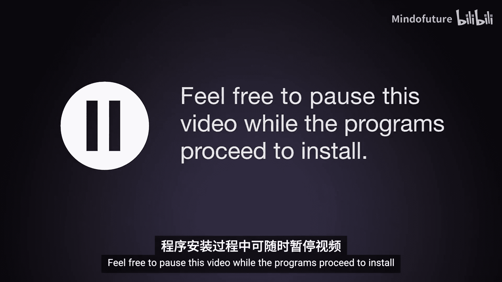
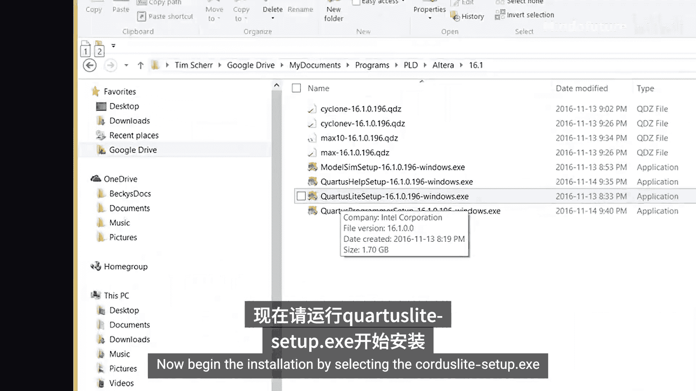

# 【科罗拉多大学】嵌入式系统-FPGA-设计入门-｜-intro-fpga-design-embedded-systems-p11-P11_02_02_01_3-安装Quartus-Prime--BV19Tu6zGEMD_p11-

This video will guide you through installing the Aria Cors Prime Development Suite version 16。1。

This presentation will help you install Otiro's State of the art FPGA design tool Cors Prime this is a very powerful tool that we will use throughout the course to explore the world of FPGA designs。

There are a number of steps in this installation， Please follow them carefully to avoid any frustration。

 Feel free to pause this video while the programs proceed to install Now begin the installation by selecting the Quas light setup。

 EX。

Click through the installation dialog boxes， use the default installation directory for best results。

When you get to the select components screen， leave all components checked。

Hit next and the installation will begin， provided that you have enough hard drive space。

 about 14 gigabytes。Once installation is complete， hit finish to start。

When complete a device driver installation may run。

 allowow this to finish and you are done with Cortius Prime installation。

You may see a dialogue that gives you the opportunity to purchase Corus。

 do not select that unless you want to。Instead， run Corus prime。

You should see this window as Cortius Prime runs， if not。

 click on the Corus Prime De icon or in your start menu。Before you use Corus Prime。

 you need to also install the Corus help and the Corus programmer next up is the Cors Helpp。

After starting the Cors Help set up AXE， you should see this setup screen， then click Next。

Choose a directory to install Cortius Prime help， the default is usually the safest。

Now you are ready to install， provided you have enough memory。You'll see this when installing。

And done， you are finished with the Cors Help installation。

After starting the Corus program or set doexXE you should see this setup screen， click Next。

Acept the software license on the next screen and click Next。

 choose the directory to install Cors Prime programmer， the default is usually the safest。

Now you are ready to install， provided that you have enough memory。You're done。

 you can close any other programs at launch once you click finishish if you add any problems with installation。

 more help is available at Altra。com support。

All installations are now complete and you are ready to begin an FBGA design and Corus Prime。

