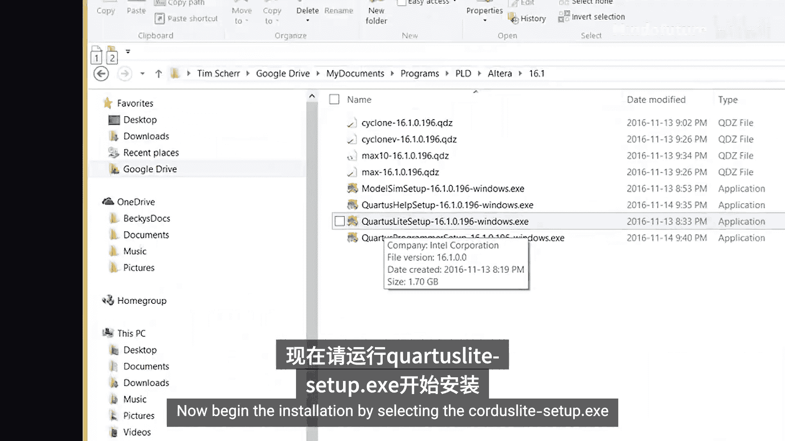

# 嵌入式系统与FPGA设计入门：P11：安装Quartus Prime 🛠️

在本教程中，我们将逐步指导您完成英特尔（Altera）Quartus Prime开发套件版本16.1的安装过程。Quartus Prime是一款强大的FPGA设计工具，我们将在课程中持续使用它来探索FPGA设计的世界。

## 概述 📋

安装过程包含几个关键步骤，请仔细遵循以避免出现问题。在程序安装过程中，您可以随时暂停本教程。整个安装需要约14GB的硬盘空间。

## 安装Quartus Prime主程序

首先，我们需要安装Quartus Prime开发环境的核心部分。

1.  找到并运行安装程序 `QuartusSetup.exe`。
2.  按照安装向导对话框的提示进行操作。
3.  为获得最佳效果，建议使用默认的安装目录。
4.  当进入“选择组件”界面时，请保持所有组件为勾选状态。
5.  点击“下一步”，安装将开始。请确保您的硬盘有足够空间。
6.  安装完成后，点击“完成”以启动程序。此时可能会运行设备驱动安装，请允许其完成。

至此，Quartus Prime主程序安装完毕。您可能会看到一个购买选项的对话框，除非您需要，否则无需选择。接下来，请运行Quartus Prime。如果程序没有自动启动，您可以在开始菜单或桌面上找到 `Quartus Prime` 图标并点击它。

在开始使用Quartus Prime之前，我们还需要安装两个重要组件：Quartus帮助文档和编程器。

## 安装Quartus帮助文档

上一节我们安装了主程序，本节我们来安装帮助文档，它对于学习和查阅功能至关重要。

1.  运行Quartus帮助文档的安装程序 `QuartusHelpSetup.exe`。
2.  您将看到安装向导界面，点击“下一步”。
3.  为帮助文档选择一个安装目录，通常使用默认目录最安全。
4.  确认有足够内存后，即可开始安装。您将看到安装进度界面。
5.  安装完成后，Quartus帮助文档的安装就结束了。

## 安装Quartus编程器

安装好帮助文档后，接下来我们需要安装Quartus编程器，它用于将设计配置到FPGA芯片中。

1.  运行Quartus编程器的安装程序 `QuartusProgrammerSetup.exe`。
2.  您将看到安装向导界面，点击“下一步”。
3.  在下一个屏幕上接受软件许可协议，然后点击“下一步”。
4.  为编程器选择一个安装目录，同样建议使用默认目录。
5.  确认有足够内存后，开始安装。
6.  安装完成后，您可以关闭其他程序。点击“完成”后，安装程序可能会启动相关应用。

如果您在安装过程中遇到任何问题，可以在英特尔（Altera）官方网站的支持页面 `Altera.com/support` 找到更多帮助信息。

## 总结 ✅

本节课中，我们一起完成了Quartus Prime开发套件的完整安装。您现在已经成功安装了：
*   Quartus Prime主程序
*   Quartus帮助文档
*   Quartus编程器

所有安装现已完成，您已经准备好开始在Quartus Prime中进行FPGA设计了。