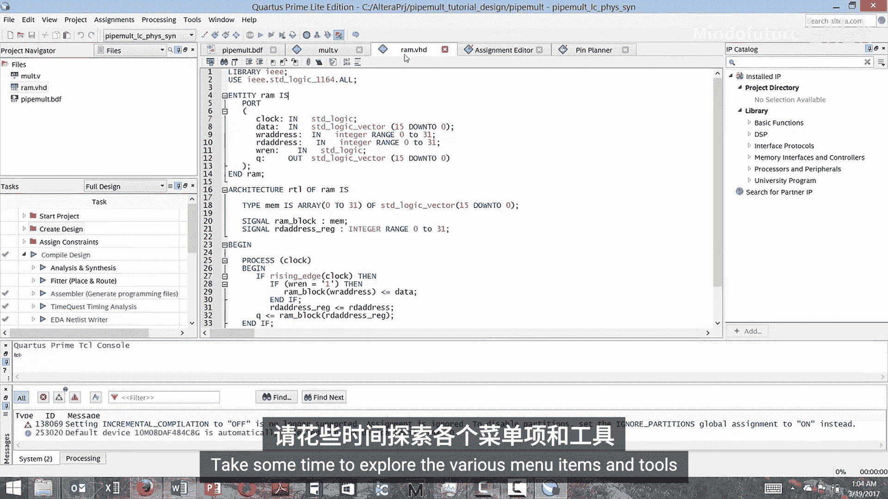

# 【科罗拉多大学】嵌入式系统-FPGA-设计入门-｜-intro-fpga-design-embedded-systems-p12-P12_02_02_02_4-Quartus-Prime简介--BV19Tu6zGEMD_p12-

Let's start Cortius Prime。

As with many development tools， it presents a variety of windows that perform different functions。

At the start， the center window includes buttons for the new Project Wiizard， Open project。

 and a number of links to helpful AlTro webp pages。

Let's open a recent project to help show the functionality of this tool。Normally。

 after a design is being compiled， the center window shows the compilation report。

 which shows the results of the compilation including pin out and logic utilization。

This report will have important performance and debugging information。

In the upper left corner is the project navigator。 All designs organized as projects。

 The hierarchy is shown， but we can also look at。The project files。The design units。

The IP components。And design revisions。Back at the hierarchy window。If we click on the top level。

 the underlying structure will expand and we can see the various components in the design。

On the lower left is the design flow window， also called the task window。

It includes all the steps in the FPG design flow， including analysis of the design entry。

Synthesis or mapping。Place and route or fitting。Assembling which creates the programming files。

Timing analysis and netless writing which creates postfi simulation files。

Analysis examines the source files of the design for syntax and logical errors。

Synthesis translates the design into device specific logic primitives。

It uses constraints to guide creation of the postynesis netlist。

The fitter uses constraints to guide how it places logic into the FPGALEs and how it connects the routes between the elements。

It creates the post fit net list。The asssembbller generates the programming and configuration files。

The Time Ques's timing analyzer performed static timing analysis to determine timing margin of the design。

 also known as timing closure if successful。It also determines the maximum possible clock frequency or FMax。

Any one of these steps can be run on its own， provided that prior steps have been run。

The tire flow can also be run all at once by using full compilation。

These steps can also be run from icons on the toolbar。Or from the processing menu。

As compilation is run。The task window shows the status of the compilation。

The message window is found at the bottom of the screen。

Red messages indicate errors which will halt compilation。

 green messages are informational and blue messages are warnings。

Tickle script commands can also be entered in the message window。On the right is the IP catalog。

 which lists all the IP cores available from AlTra if closed the IP catalog can be reopened from the view menu。

To create a design， you would select new from the file menu。

 click the new fileile button in the toolbar， or double click createreate a new design in the task window。

The new file dialog box appears with many choices for design entry。

Design entry can be achieved using schematic entry， HDL and BHL Valog or system Vo via text editor。

The state machine editor。Or system creation using the Kis system editor。

The entire design need not use only one type of design entry， but can mix and match these methods。

Schematics are often useful as top level design entry。BHDL and V files can be made into black boxes。

 which can be inserted as blocks in the schematic， and then IP course can be included as well and connected to these custom blocks。

The state machine editor can be used to create state machines。

 which will then generate HDL code to represent the state machine。Now。

 if we double click on the top level， the schematic editor opens automatically showing pipemt。bdf。

If we go back to the files view in the project Navigator。

 we see Ver log and VHDL files representing the multiplier and the RA respectively。

Double clicking on these files opens them in the center window so you can see the underlying source code。

The builtt in text editor is opened whenever VHDL Vo files are opened。

You can use this editor to edit and save these files。

The edit menu allows control of the editing process。

The View menu allows you to control which windows are displayed。

Any window can be detached to allow more detailed viewing and then reattached later。

The project menu allows you to control projects， you can add or remove files。

 add or delete revisions， archive projects， and generate Power play early power estimation。

The assignments menu is particularly powerful， it allows you to change the device。

You can also see the devices that are used on various development boards， including my two favorites。

 the B microcromax 10。And the Odyssey max 10。The Settings dialog box allows control over many aspects of the project。

 including files。Compilation settings。EDA tool settings for。Design entry。Simulation。Compilr settings。

 which is particularly interesting as it controls performance and the power of the design。

And options for many tools。The assignment editor is one method of making pin assignments。

The pin planner also allows definition of pin assignments with a picture view of the device。

The processing menu allows control over the compilation process and access to the PowerP Power Analyr tool。

The Tool menu is the Swiss Armyni of Cortis Prime。It allows you to run RTL or gate level simulations。

Launch the Time Ques timing Anar。Launch any of a half a dozen design advisors。

Start the chip planner or design Partition planner。

The chip planner presents a graphical view of the device resources。

 it can show routing connections and also display fan in and fan out。

View any of the net list viewers。 The net viewers are very useful to help understand what the synthesizer and fitter did to your design。

 Sometimes the results may surprise you。You can start the signal tap Lo analyzer。

Start the programmer。Launch any of the several system debugging tools。

Launch the NOS to So processor software build environment。

Launch the CUSis system editor KUSis simplifies complex system design。

 allowing design at the block diagram level and easily includes IP cores in a hierarchical design。

Customize and set options for Corus Prime。Next， the Windows menu shows the active Windows。

The Help menu provides many avenues for getting help， including access to tutorials。As you can see。

 Cors Prime is a feature rich design environment。 Take some time to explore the various menu items and tools。

 After some time you will find your use of the tool become intuitive and very powerful。

Now that we have become familiar with all that Cortis Prime has to offer in our next video we will create our first FPGA design。

