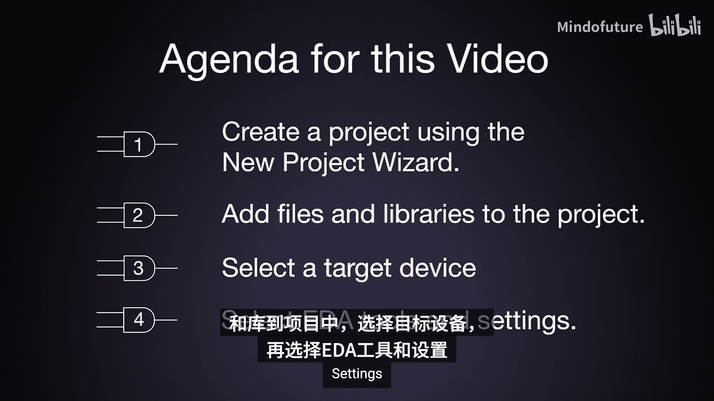
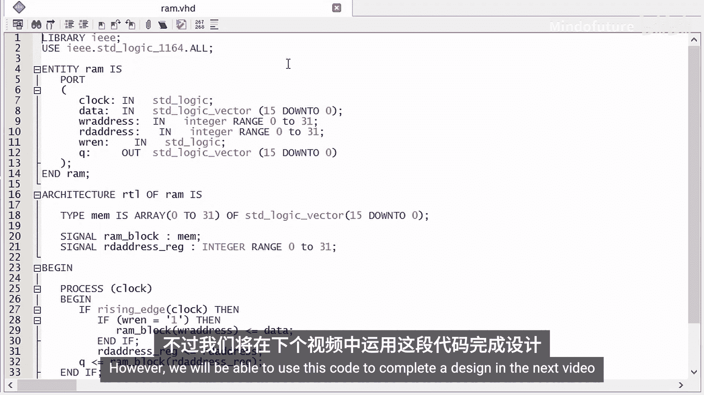

# 【科罗拉多大学】嵌入式系统-FPGA-设计入门-｜-intro-fpga-design-embedded-systems-p13-P13_02_02_03_5-在Quartus-Prime中创建设计项目--BV19Tu6zGEMD_p13-

In this presentation you will learn how to create a project in Cortius Prime as the first step to creating an FPGA design。

Design files are provided so you can follow along and perform each step along the way if you haven't already you can download the file and installation instructions below this video The files are also available in this week's course materials。

Feel free to pause the video as you enter commands incorus Prime。Here's the agenda for this video。

 We will first create a project using the new Project Wizard。

And then add files and libraries to the project， select a target device。

 and then select EDA tools and settings。

Open Corus prime if you have not already。You should have installed the example project files in the Ccol backslash shelterter or Project backslash pipepe Ms QP16 under1 directory。

 if not， stop and do this now。Next， we will show you how to create a new Cors Prime project using the new Project Wizard。

We'll use this pipeline multiplier project to show you how to create a smatic design。

To open the new project wizard， click the file menu。Then click on the new Project Wiizard。

The introduction page now appears。Click next。For the project directory。

 change the name of the directory where you installed the example project。

 here it is Ccolon backslash Aleriro project。Backaglash pipe multilt QP 16 under1， backlash gommatic。

Type pipe mut for the project name。And then press the enter key。

Also type pipemt for the top level design entity， although it may have already autofilled this name for you。

You can change the top level to match the name in your top of a design file if you like， click next。

You can create an empty project or use a project template which can help you start quickly for this example。

 use an empty project to see how it works from scratch。Click next。Next。

 we will add source files to the design， browse to locate the RamM。

bhD file within the project directory。Select the RA dotvhD file。Click open and add RamM。

bhd to the project。To include library directories that contain user defined or vendor supplied megafunctions。

Block symbol files and other source files， we click the user Librs button。

We can use absolute or relative path names for a library we want to add。

 we add the Megafunctionctions Project library to the Pipe malt project。

Use the global library name with location CCO and Bachelass Intel FPG under Light， Baches 16。1。

 Bachelash Cors， Bchela libraries， Blash Megafunctions。

Click next to continue to the next page of the wzard。Select Max 10 for the device family。

You can use the package， pin count and speed selections to narrow down the choices。

 select FB GA for the package 484 for the pin count and speed grade 8。Finally。

 we select the 10 m08 DA F 484 C8 G ES part number。

This defines the project part to be the same as the FPGA for the B micromax 10 development kit。

 which you can use later as a target for this design。Click next to continue。

We can run other EDA tools from within Cortus， the EDA settings page allows you to specify the tools you want to use for synthesis。

 simulation and timing analysis for this project， for simulation select Model Sim D Altra and for the format。

 select VHDL。All other default EA tool settings will work fine， so accept these by clicking next。

The summary shows the essential information about the design project。

It is good to review it to make sure the entries are correct。

Click finishinish to complete the project creation。

The project name is now displayed in the top title bar。

 and the project entity appears in the hierarchy tab of the project Navigator window。

You are now ready to create design files for this project。

 which will be the subject of the next video。A word about projects。

Corts organize all the files needed to create an FPGA design into projects。

 Cortius Prime is a number of ways to manage projects。

 You can use Cortius Prime to Arch a project by selecting archive project from the project menu。

Arive files have a dot QAR extension。You choose what files to include in the archive。

Typical use is to compress the project for sharing with others。

 you can also copy the project to another location on a server or in the cloud using the copy project command。

To view Un open design files in the project， we click the files tab in the Project Navigator。

Itlists the design files in the project。Double click the RA。vHD file to open it in the text editor。

The Ramdot VHD file opens in the text editor。 The Corus Prime text editor is a good editor for entering HDL designs with line numbering。

 syntax coloring and template insertion。Use the insert template command to insert HDL， tickle。

 or megafunction templates into the design files。For now。

 you need not worry about how this BHDL code works。

 that would be the subject of course two in this specialization。However。

 we will be able to use this code to complete a design in the next video。

In this video you have learned how to create a project in Corus Prime。

How to select a target device for your project。How to add files and libraries to your project。

In the next video， we will discover how to finish the design entry for this project。

