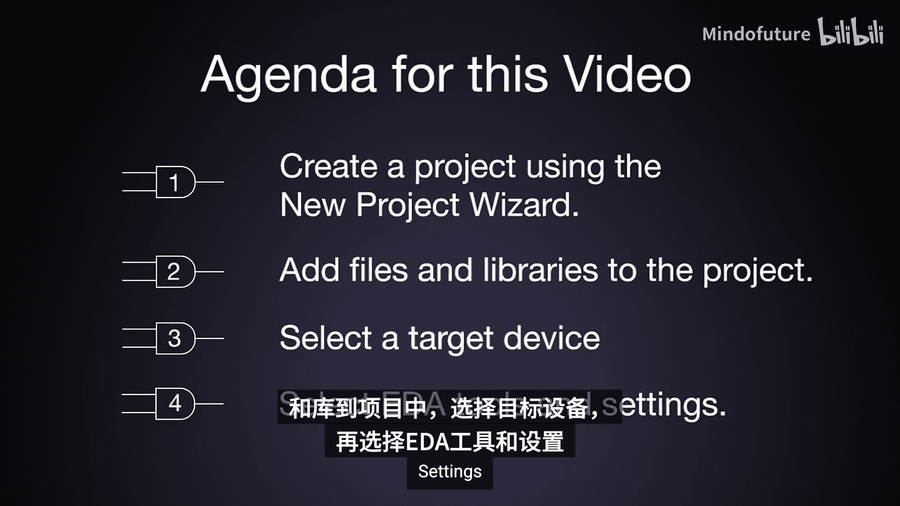
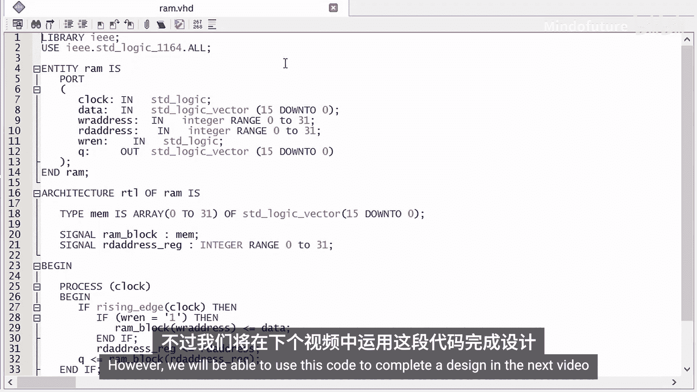
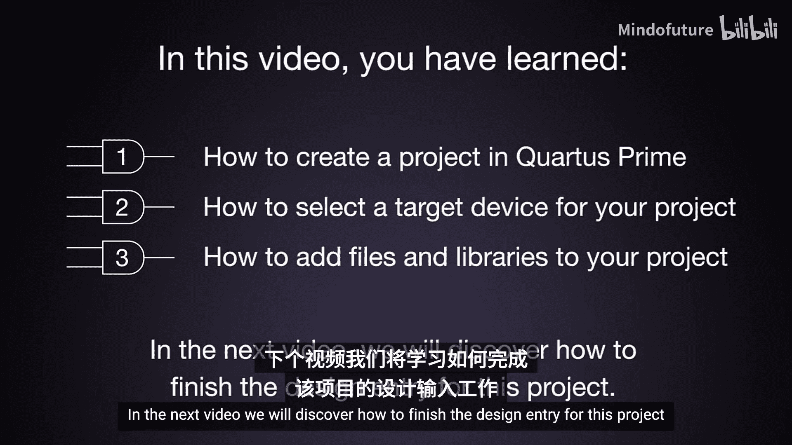

# 嵌入式系统FPGA设计入门：P13_02_02_03_5：在Quartus Prime中创建设计项目 🚀

在本节课中，我们将学习如何在Quartus Prime软件中创建一个新的设计项目。这是进行FPGA设计的第一步，我们将通过一个流水线乘法器项目来演示整个过程。

我们提供了设计文件，你可以跟随视频逐步操作。如果你还没有下载文件，可以在视频下方找到下载链接和安装说明。这些文件也包含在本周的课程材料中。

在Quartus Prime中输入命令时，可以随时暂停视频。以下是本视频的议程。

我们将首先使用新建项目向导创建一个项目。
然后向项目中添加文件和库，选择目标器件。
最后选择EDA工具并进行设置。

如果你还没有打开Quartus Prime，请先打开它。你应该已经将示例项目文件安装在 `C:\altera\project\pipe_mult_QP16_1` 目录下。如果没有，请先完成这一步。

接下来，我们将展示如何使用新建项目向导创建一个新的Quartus Prime项目。我们将使用这个流水线乘法器项目来演示如何创建一个原理图设计。

要打开新建项目向导，请点击“文件”菜单，然后点击“新建项目向导”。此时会出现介绍页面，点击“下一步”。

对于项目目录，请将路径更改为你安装示例项目的目录，这里是 `C:\altera\project\pipe_mult_QP16_1\schematic`。输入 `pipe_mult` 作为项目名称，然后按回车键。同时，将顶层设计实体也命名为 `pipe_mult`，软件可能已经为你自动填充了这个名字。你也可以根据需要更改顶层实体名称以匹配你的设计文件。完成后，点击“下一步”。

你可以创建一个空项目，或者使用项目模板来快速启动。对于本例，我们使用空项目，以便从头了解其工作原理。点击“下一步”。

接下来，我们将向设计添加源文件。浏览到项目目录内的 `ram.vhd` 文件。选择 `ram.vhd` 文件，点击“打开”，将 `ram.vhd` 添加到项目中。

为了包含包含用户定义或供应商提供的宏功能、块符号文件和其他源文件的库目录，我们点击“用户库”按钮。我们可以为要添加的库使用绝对或相对路径名。我们将 `Megafunctions` 项目库添加到 `pipe_mult` 项目中。使用全局库名称和位置：`C:\intelFPGA\16.1\quartus\libraries\megafunctions`。点击“下一步”继续向导的下一页。

选择 `MAX 10` 作为器件系列。你可以使用封装、引脚数和速度等级选项来缩小选择范围。选择 `FBGA` 封装，`484` 引脚，速度等级 `8`。最后，我们选择 `10M08DAF484C8GES` 这个具体型号。这定义了项目所用的器件与B micromax 10开发套件上的FPGA相同，你之后可以将此设计定位到该开发板。点击“下一步”继续。

我们可以在Quartus内部运行其他EDA工具。EDA设置页面允许你指定用于本项目综合、仿真和时序分析的工具。对于仿真，选择 `ModelSim-Altera`，格式选择 `VHDL`。所有其他默认的EDA工具设置都可以正常工作，因此点击“下一步”接受它们。

摘要页面显示了设计项目的基本信息。最好检查一下以确保条目正确。点击“完成”以完成项目创建。

现在，项目名称显示在顶部标题栏中，项目实体出现在项目导航器窗口的层次结构选项卡中。你现在已准备好为此项目创建设计文件，这将是下一个视频的主题。

关于项目的一些说明：Quartus将所有创建FPGA设计所需的文件组织到项目中。Quartus Prime有多种管理项目的方式。你可以通过从“项目”菜单中选择“归档项目”来归档项目。归档文件的扩展名为 `.qar`。你可以选择将哪些文件包含在归档中。通常用于压缩项目以便与他人共享。你也可以使用“复制项目”命令将项目复制到服务器或云上的另一个位置。

要查看项目中已打开的设计文件，我们在项目导航器中点击“文件”选项卡。它列出了项目中的设计文件。双击 `ram.vhd` 文件以在文本编辑器中打开它。

`ram.vhd` 文件在文本编辑器中打开。Quartus Prime文本编辑器是一个很好的编辑器，用于输入HDL设计，具有行号、语法着色和模板插入功能。使用“插入模板”命令将HDL、Tcl或宏功能模板插入到设计文件中。目前，你无需担心这段VHDL代码如何工作，这将是本专业课程第二部分的主题。然而，我们将能够在下一个视频中使用这段代码来完成一个设计。

在本视频中，你学习了如何在Quartus Prime中创建一个项目，如何为你的项目选择目标器件，以及如何向你的项目添加文件和库。

在下一个视频中，我们将探索如何完成此项目的设计输入。

