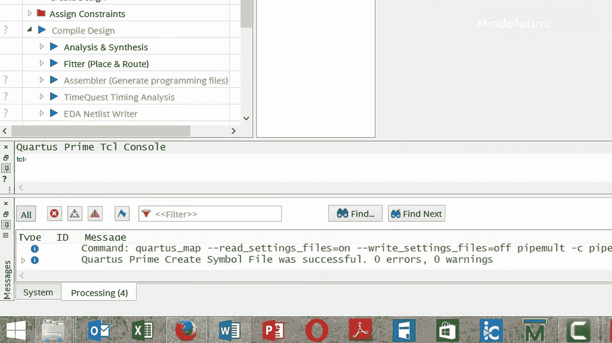
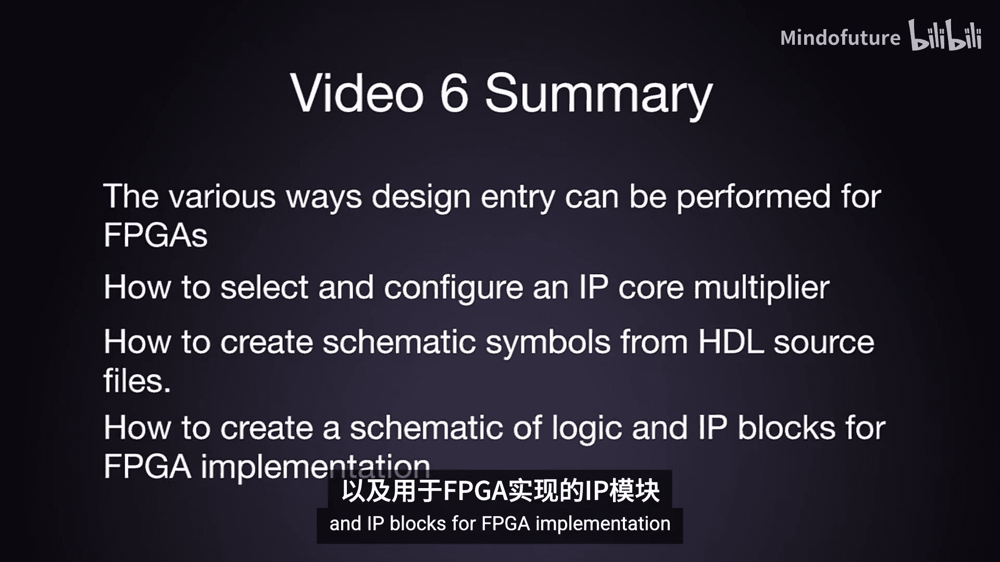

# 【科罗拉多大学】嵌入式系统-FPGA-设计入门-｜-intro-fpga-design-embedded-systems-p14-P14_02_02_04_6-在Quartus-Prime中完成设计--BV19Tu6zGEMD_p14-

In this presentation， you will be introduced to the methods used to create FPGA designs in Corus Prime。

 including schematic capture， import of IP blocks， HDL text entry。

 including VHDL V log and system Vlog， state Ma entry， and import of EF files。

How to select one of these methods to use and the design will be demonstrated Design files are provided below and in this week's materials so that you can follow along and perform each step along the way If you haven't already。

 please download them now。Feel free to pause the video as you enter commands intocorus Prime。

Here's the agenda for this video。Create a schematic file for the top level of design。

 and then we're going to create a schematic symbol from an IP core multiplier。

Then we're going to create a schematic symbol from an HDL file and wire are the symbols together and then to the device pins。

Open Corus Prime if you have not already。You should have installed the example project files in the CCO and backlash。

 OterRA， PRJ， backlash， pipepe Mlts， QP 16 under one directory。

If we're going to create a new schematic or block design file。

 we would click the file menu and new file。In this case， we will work with an existing schematic。

 where let's review the options we have in the new file dialo。

The Cortis Prime software supports a number of different file formats for design entry。

For Textbase using HDLs， it supports all the HDL V log standards and much of system V log extensions。

For schematic based entry， it includes a schematic editor which can be used to create block diagrams or circuit diagrams。

You can quickly create state machines using the state Ma editor。

Cortis Prime also includes a memory editor to create Intel standard hex files or memory initialization files MIF。

 to initialize RAs or RAMms in your design。You can also import ET files from three party tools into Corus Prime。

To create a new schematic， we would select the block diagram schematic file。

 but clickCancel instead as we don't want to create a new schematic。

 instead we will work with an existing schematic to save time。

We will create our first design using the schematic design editor included in Corus Prime。

You can create designs from standard design blocks like gates， flipfls， IO pins， etc。

 you can also place blocks of Altra IP or other IP in your design。Once you have placed the logic。

 you connect the parts together using wires and buses。

 although most design entry is now done with HDLs， the schematic at the top level helps to document the design and makes it easy to connect many high levell blocks together。

You can convert schematics into HDL code or create black blocks。

 simple files out of HDL files for instantiation into a schematic。Next。

 we will open a block design file using the Cortis Prime schematic editor。From the file menu。

 select open。Then select Pipemt。bdf and click open。

The schematic or block editor allows inclusion of logic block functions into the design by depiction of logic symbols representing logic devices。

 HDL files， IP cores， and schematics。Blocks are rectangular shapes that represent design entities and their port signals。

 the block editor provides the tools to create a block diagram including all the connections using wires。

 nodes， and buses。The symbol editor allows you to view and edit symbols in the block diagram that represent design entities including mega functions。

 design files， primitives like this D fliplipflop， or IP core。Now we will create a block symbol。

Do this by creating a custom multiplier from the IP corere catalog。

IP cores are prem design blocks which can be customized in Corus Prime。

IP can represent anything from simple logic to more complicated blocks like PLLs or DDR memory controllers。

Most courses are free available in Corus Prime， if the IP catalog is not visible。

 select it from the To menu。Or the view menu。In the IP catalog window on the right， under library。

 look under basic blocks。Arithmetic for LPM under Mt and select it by double clicking。

In the Sa IP variation dialo that appears set the IP variation file name to Mt by adding Mt to the end of the file path。

 which should match the project directory。Select the HDL and hit OK。

The LPM under multit megawiizard parameter dialog box should open。

Set the width of the data AA and data B buses to8 bits and accept the defaults for all other settings。

Click next。On the next page， note that there is a choice to use logic elements or dedicated multipliers to implement the multiplier。

 except all defaults and click next to continue。On the next page select yes。

 I want output latency of and specify two clock cycles。Click next to continue。Again。

 click next to continue。On the summary page， which is the last page of the megawiizard。

 be sure to check multilt。bsF for a schematic symbol file output。

Click finishinish to create the multiplier。If it then asks if you want to add the IP file to the project。

 click on yes。Now， if you look at the files tab in the project Navigator。

 you should see the addition of the MOT QIP file。Back in the main Corus window to insert the multiplier into pipepem。

bdf， we double click inside the block editor to open the symbol dialog box。

We clickMlt in the project folder and then click OK。

Now you should have the symbol inside the block editor。

Place the symbol so that the clock and data inputs line up。

Click in the empty space in this schematic editor， this places the custom megafunction in the block editor。

Hit control S to save pipepemt。bdf。Next， we will create a block symbol file from an HDL file。

Here we will add a symbol for a VHDL file to infer a single port 32 by 16 bit synchronous RAM。

Click the file menu to open the RamM。vhD file。After selecting RA。vhD。

 click open to open it in the text editor。Then click the file menu again， point to create update。

 and then click on createreate symbol files for current file。

You should then see that the createate S file was successful in the message window。

Then double click in the schematic editor to open the symbol editor dialog box。

We click RAM in the project F and then click OK。Now you should have the symbol inside the block editor。

Place the symbol inside the Ram box， even though the ports do not line up with the schematic with the right and just two line grids from the box edge。

 we will fix this presently。On an aleror device， a pin is a physical input。

 output or bidirectional or power pin。In block editor schematics。

 pins are inputs or outputs of a symbol。Pins are connected to blocks with conduits and to symbols with node and bus connectors。

We can assign a logic bus to specific pin numbers in the schematic editor we use conduits。

 nodes and buses to connect symbols and blocks。The drawing tool automatically chooses the appropriate line style when you draw from a symbol stub or a block border。

We will now connect the Ram clock。From the View menu， zoom in to view only about half the circuit。

Dragging the mouse from the RA symbol to the clock one input symbol creates a node line connection。

 draw the line one grid to the left。Then down 10 grids and then to the left until it intersects the clock signal wire node。

Click in any empty space in the schematic to complete the connection。Next。

 connect the data input of the RA to the results of the multiplier。Draw one segment。

 two grids out from the Ram， then add an up segment and then go to the left just to the edge of the multiplier result。

Then connect the right address bus from the Ram by going out three， up two， and then left three。

Connect the Read address bus by going left three and down one and then left three。Finally。

 connect the RA signal by going left for。Up 4。And then left two。

Connect the RAM output to the D flip flop input。Next。

 create an output bus connection to pins on the device。

Double click in the editor empty space and the symbol Ed dialog box will open。

Select the last directory in the list， which should be the library with mega functions， etc。

Click on Priitives and then on pin and select outputput。Click O to add the output port。

Double click on the output port symbol and change the pin names to。Q bracket0 dot dot15。

 close bracket。Move the output symbol to connect the D flip flop output to output pins。

Select the View menu and zoom in to fit in the window。

Your schematic should look like the one on the screen， If so， congratulations。

 you have completed the design entry portion of this design。

It's not as difficult as you might have assumed to create a fairly complex circuit。

Your end result should look something like this。In this video you have learned the various ways design entry can be performed for FGAs。

 how to select and configure an IP core multiplier。

 how to create schematic symbols from HDL source files。

 how to create a schematic of logic and IP blocks for FGA implementation。

