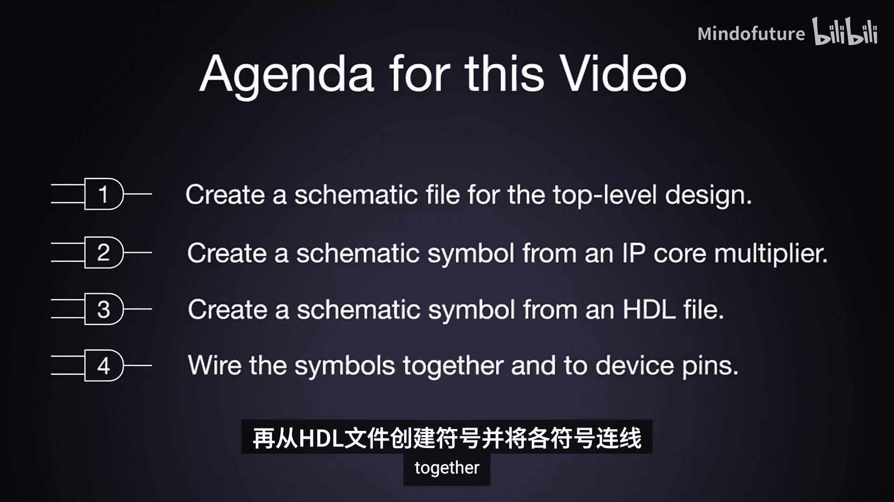
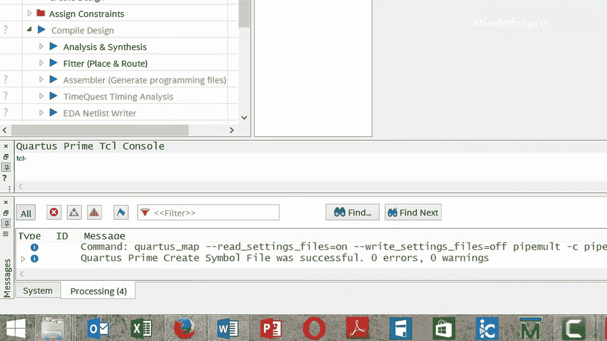
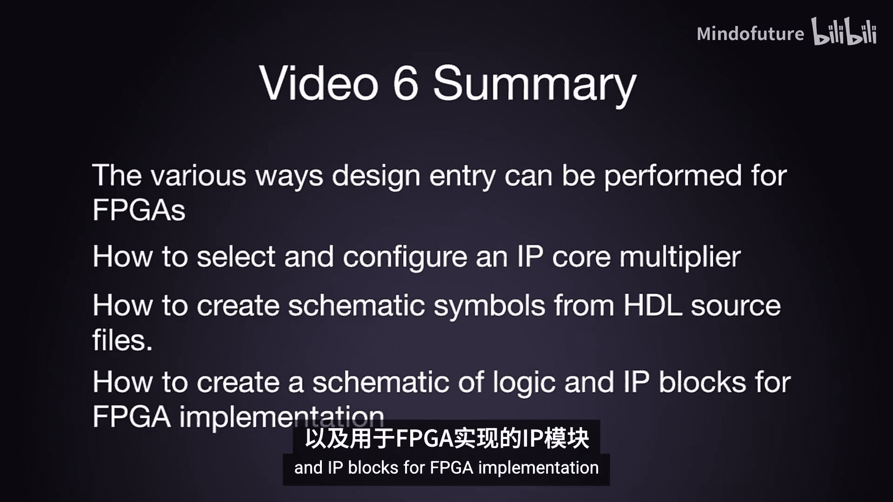

# 嵌入式系统-FPGA设计入门：P14：在Quartus Prime中完成设计

## 概述

在本节课中，我们将学习在Quartus Prime软件中创建FPGA设计的多种方法。我们将重点介绍原理图捕获、IP核导入、HDL文本输入（包括VHDL、Verilog和SystemVerilog）、状态机编辑器以及导入第三方文件。课程将通过一个具体的设计实例，演示如何选择和使用这些方法，并完成从创建顶层原理图到连接设备引脚的完整流程。

---

## 创建顶层原理图文件

首先，我们需要为设计创建一个顶层原理图文件。原理图编辑器允许我们通过图形化的逻辑符号来表示和连接设计中的各个模块，这对于文档化和连接高级设计模块非常有用。

以下是创建和操作原理图的基本步骤：

1.  **打开Quartus Prime**：确保已安装示例项目文件，并打开项目目录 `C:\Altera_PRJ\pipe_mult\QP16`。
2.  **打开现有原理图**：从“文件”菜单中选择“打开”，然后选择 `pipe_mult.bdf` 文件并打开。
3.  **理解原理图编辑器**：该编辑器允许通过描绘代表逻辑器件、HDL文件、IP核和原理图的符号来包含逻辑块功能。块是代表设计实体及其端口信号的矩形形状。

---

## 从IP核创建原理图符号

上一节我们打开了原理图编辑器，本节中我们来看看如何将预设计的IP核模块添加到原理图中。IP核是可以在Quartus Prime中定制的预设计模块，从简单逻辑到复杂的PLL或DDR内存控制器都有。

以下是添加IP核符号的步骤：

1.  **打开IP目录**：如果IP目录窗口不可见，请从“工具”或“视图”菜单中打开它。
2.  **选择IP核**：在右侧的IP目录窗口中，依次展开“Library” -> “Basic Functions” -> “Arithmetic”，找到“LPM_MULT”并双击。
3.  **配置IP核**：在弹出的“MegaWizard Plug-In Manager”对话框中，将输出文件命名为 `mult`。将数据A和数据B的宽度设置为8位，并接受其他所有默认设置。
4.  **设置输出延迟**：在后续页面中，选择“Yes, I want an output latency of”，并指定为2个时钟周期。
5.  **生成符号**：在最后的摘要页面，确保勾选“mult.bsf”（原理图符号文件输出），然后点击“Finish”完成创建。当询问是否将IP文件添加到项目时，选择“是”。
6.  **插入符号**：回到原理图编辑器，双击空白区域打开符号对话框。在“Project”文件夹下找到并选择 `mult` 符号，点击“OK”将其放入原理图中，并放置在合适位置。按 `Ctrl+S` 保存 `pipe_mult.bdf` 文件。

---

## 从HDL文件创建原理图符号

除了使用IP核，我们还可以将编写的HDL代码转换为原理图符号。这允许我们将文本描述的设计模块直观地集成到顶层原理图中。

以下是创建HDL符号的步骤：

1.  **打开HDL文件**：从“文件”菜单中打开 `ram.vhd` 文件。这是一个用于推断单端口32x16位同步RAM的VHDL文件。
2.  **创建符号文件**：在文本编辑器中打开该文件后，再次点击“文件”菜单，选择“Create/Update” -> “Create Symbol Files for Current File”。
3.  **确认创建成功**：在消息窗口中应看到“Create Symbol File was successful”的提示。
4.  **插入符号**：回到原理图编辑器，双击空白区域打开符号对话框。在“Project”文件夹下找到并选择 `ram` 符号，点击“OK”将其放入原理图中。

---

## 连接符号与设备引脚

现在我们已经将乘法器IP核和RAM模块的符号放入了原理图，接下来需要将它们相互连接，并连接到FPGA设备的物理引脚上。在原理图中，我们使用导线、总线和节点进行连接。

以下是连接各个部分的步骤：

1.  **连接RAM时钟**：首先放大视图以便操作。从RAM符号的时钟端口拖动鼠标，绘制一条导线连接到原理图中已有的时钟输入节点。
2.  **连接数据输入**：将RAM的数据输入端口连接到乘法器的结果输出端口。
3.  **连接地址总线**：分别连接RAM的写地址和读地址总线到相应的信号源。
4.  **连接写使能信号**：连接RAM的写使能信号。
5.  **连接RAM输出**：将RAM的数据输出端口连接到一个D触发器的输入。
6.  **添加输出引脚**：双击原理图空白处，在符号对话框中选择“Primitives” -> “Pin” -> “output”，添加一个输出端口符号。双击该符号，将引脚名称改为 `q[15..0]`。
7.  **连接输出**：将D触发器的输出连接到刚添加的输出引脚符号上。
8.  **检查最终原理图**：完成后，你的原理图应与示例类似。这表明你已成功完成了该设计的输入部分。

---

## 总结

本节课中，我们一起学习了在Quartus Prime中进行FPGA设计输入的多种方式。我们实践了如何选择和配置一个IP核乘法器，如何从HDL源文件创建原理图符号，以及如何通过原理图将逻辑模块和IP核连接起来，最终映射到FPGA的物理引脚上。这个过程展示了即使对于相对复杂的电路，使用图形化工具进行设计输入也并非难事。