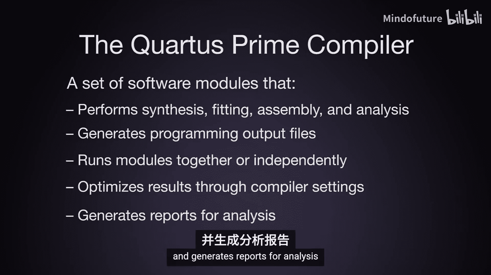
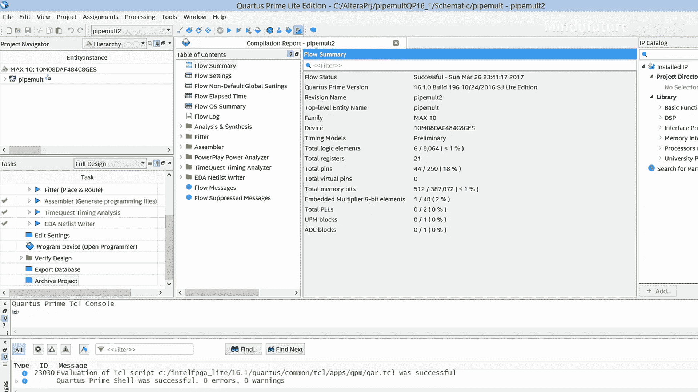
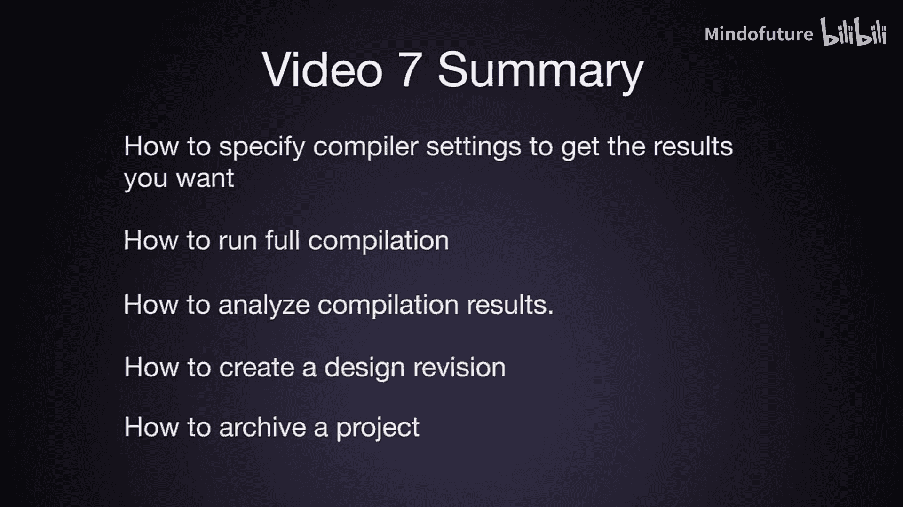

# 【科罗拉多大学】嵌入式系统-FPGA-设计入门-｜-intro-fpga-design-embedded-systems-p15-P15_02_03_01_7-设计编译--BV19Tu6zGEMD_p15-

In this presentation， you will compile an FPGA design in Corus Prime。

Design files are provided so that you can follow along and perform each step along the way。

 Feel free to pause the video as you enter commands intocorus Prime。

Here's what we will cover in this video。First how to specify compiler settings to get the results you want。

Second， how to run full compilation， third， how to analyze compilation results。

Forourth how to create a design revision， and lastly， how to archive a project。

OpenCus Prime if you have not already， you should have the example project files complete through design entry at this point。

The Cors Prime compiler is a set of software modules that performs synthesis fitting。

 assembly and analysis， generates programming output files， runs modules together or independently。

 optimizes results through compiler settings。And generates reports for analysis。

You can run all the steps in the design flow all at once or separately。

You can instruct the compiler to apply a variety of techniques such as timing driven compilation。

 which can optimize device resources and increase the speed of your design。

Corts Prime includes a variety of tools to analyze compilation results like the chip planner。

The compilation report appears automatically during compilation in the central window。

System and processing messages appear in the messaging window。

The task window dynamically displays the progress of compilation。

Many of the commands associated with the compiler are in the processing menu。

You can run the entire compilation process at once by clicking on the Start compilation command or clicking on the Triangle icon in the toolbar。

You can also run the modules one at a time using their individual commands。

 either from the processing menu or directly from the task window。

The compiler's analysis and synthesis module checks the design source files for errors。

 builds a database that puts all the design files in a hierarchy。

 and then synthesizes and optimizes the logic design and maps the design logic to the device resources。

The fitter module places the logic into the logic cells and creates the routes between the logic。

The asmbler completes project processing by fitting the logic cells。

 pin assignments and routes into a device programming image in the form of one or more programming files。

The static timing analyzer analyzes and validates the timing performance of the design。

You must complete synthesis and fitting before you can run full timing analysis。 however。

 you can run early timing estimates before the fitting to help determine constraints。

The EDA netlist writer generates netlists for use by EDA tools。

Cors Prime also has an incremental compilation flow that allows you to only compile portions of the design which can reduce compilation time。

We will now prepare the Pipe Mo project for a full compilation by using commands found in the assignment menu。

The device entry allows you to specify the target device， as you did in the new project wizard。

 so it's possible to change the device after the project has been defined。

We don't want to change this， so hit cancel。Next with the Settings dialog box。

 we can control compilation processing。Click on Settings in the assignment menu。

The compilation process Ses page allows you to set options that affect compilation speed。

 including the number of processors to use and which tools run in a full compilation。

More important is the compiler settingsttings page， which allows you to control the fitting process。

Here you can choose between a balanced approach or have the compiler optimized for performance to increase speed。

Or for power to lower power consumption。Or for area to make the amount of logic used smaller。

Fitting the logic for a design in the smaller part is often an objective of the design and is sometimes difficult。

Fitting the design in the smallest possible part is a principal design challenge in FPGA design。

For now， we will leave this as balanced。The EA tool settings include simulation settings。

That allow you to force a simulation to run after compilation or to prepare a particular test bench for use in simulation。

Another page worth looking at is the Power play Power Anar page。

Here we can turn on the Power play Power Anar， which will give us postfi power estimations。

Select run Power play Power analyzer Do compilation and click OK。

Settings can also be modified by the use of scripts。From the file menu， select open。

Change the file type to all files。Select the PipeMt。qsF file and click open。

Scroll down to the bottom of the docQSF file。Here you will see tickle commands that control all the compiler settings。

When you enter settings either from the GuUI interface or by typing Tle commands in the Tickle console。

 these settings will be stored in the dot QSF file or Corus settings file。

Point to the utility windows on the View menu and then click Tle consoles to open the tickle console。

Any of the commands listed in the dot QSF file could have been entered here。

 quarterss can be entirely controlled from the tickle command line。Next， let's compile the design。

Close the dot QF file by clicking the X in the upper right corner。

Double click on pipepe malt in the project Navigator hierarchy。

 and the schematic should appear if it isn't shown already。From the processing menu。

 select Start compilation。This will run a full compilation and may take a few seconds to several minutes depending upon your computer's capabilities。

Notice that progress of the compilation is shown in the task window and the system and processing messages automatically appear in the messages window。

Also， the results of the compilation are displayed in the compilation report window。

As each step is completed successfully。You should see a comforting green check mark besides each process step in the task window。

If errors are encountered， the step will be colored red。Green is good， red is bad。

 unless you're colorblind， in which case， just look for the check mark。

We will break here until the compilation is complete。Okay， so now what just happened？

After compilation， we can view a representation of the project's hierarchy。

 files and design units in the project Navigator。Let's explore what we can do with the project navigator。

 The entire hiery of the project is shown once the project is analyzed。

 at least after analysis and elaboration， the first step of synthesis。

The project is made of the top level design entity and any other files or entities that are referenced by the top level or any other file in the hierarchy。

Right click to locate the entity and other tools in Corus Prime， which is known as cross probing。

We can also see all the files in the design。The design units。A list of IP components。

Where we find our multiplier and a list of revisions。Currently， there is only one revision。

Later in this video， you will learn how to make small changes and create other revisions of this design。

The compilation report provides detailed information about the current compilation。

When the report first opens， the flow summary report provides information about the final status of the compilation。

 the current revisions of the court of software， the top level entity name。

 the current target device， and the total number of logic cells， pins， memory。

 multipliers and PLLs used in the device。Other compilation reports provide information about other aspects of the compilation。

 including device resource usage and detailed timing information。

You can select the report you want to display in the left pane of the compilation window。

In particular， click on the Time Que timing Anar Report En。

Then click on the slow twelve00 millivvolt，85 degrees c model，And then on the FMAC summary。

This tells you the maximum speed the clock can operate at in this design under these conditions。

Slow meaning the slow end of the characteristic speed statistics for the device。1we200 millvolt。

 the core voltage and 85 degrees C the operating temperature。

You should see something in the range of 160 mehertz for FMX in this case。However。

 if you click on the slow 85 degrees C model again， and then on the next entry。

 the slow 1200 millivvolt 0 degrees C model， then Fmax is higher about 170 meHz。Does this make sense？

It claims the speed of the FPG is faster when it is cold。

 which is consistent with what we know of semiconductor performance。

 Fmax is a critical metric used to evaluate FPGA performance and is determined by the timing analyzer。

You may also want to look at the setup and hold summary reports The slack is the timing margin the device has for the stated parameter。

Positive slack numbers indicate time en closure， negative numbers， a setup or whole violation。

 which will be highlighted in red when they occur。We will take a closer look at the timing analyzer in a later video in this module。

We can experiment with the compiler settings and design rules known as constraints by using revisions to compare compilation results。

In the project Navigator window， click on the right tab and select revisionvisions。

When we create a revision， the Cortis Prime software creates a separate Corus setting file QSF。

 which contains all the settings and assignments related to that revision and places it in the top level directory for the design。

The revision dialog box allows you to select a revision for the current project and then make edits to that revision。

A check mark or revision name in bold。Indicates the current revision。To open the revision dialog box。

 click revisionions on the project menu。To create a new revision based on an existing revision。

 we double click new revision in the revisions dialog box。In the createate revision dialog box。

 type pipepe Mt2 for the revision name， select pipepe mallt as the revision that we want to base the new revision on。

And then click OK to close the Create revision dialog box。

It may take a minute or so for the new revision to be established。

Let's now change the way this revision is compiled。From the assignmentigns menu， click on Settings。

Select compiler settings and change the setting from balanced to performance A。

Click and apply and then OK。To complete the change。Back in the project Navigator。

 click on compileile All。This will take some time as both revisions are compiled。Alternatively。

 you can compile only the new revision by right clicking on the new revision in the list。

 you may want to stop the video now to wait for the compilation to complete。

You should now see the Pipemt 2 compilation report， If not。

 right click on Pipemt 2 in the project Navigator and set it as the current revision。

 Exp the time Que timing analyzer report and look at the Fmax for each model as before。

You should see that the FM has increased from the original revision as we might expect。

To compare the revisions from the project menu select revisions， and then click on compareare。

The Compare revisions dialog box should appear。Click on the results tab if it is not already selected and click on each heading to expand it。

This report can be exported as a dot CSV spreadsheet。We've done a lot of work at this point。

 save the project by clicking on the Save project in the file menu。

Let's also save what we have done in an archive which compresses the project to save space and allows it to be more easily shared with colleagues and tech support。

To create a project archive from the project menu， select Arch or double click Arch in the task window。

If you don't see this in the task window， set the tab in the task window to full design。

The archiveive project dialog box should appear， click Arch All revisions and then archive。

If you look in the project directory， you should see that Pipemt。 QAR has been created。

To restore a project from the project menu， select Restore Archived project。In summary。

 Cortis Prime has the project management features and compilation controls to help your project be successful。

Your end result should look something like this。In this video。

 you have learned how to specify compiler settings to get results you want。

How to run full compilation， how to analyze compilation results。

How to create a design revision and how to archive a project。

