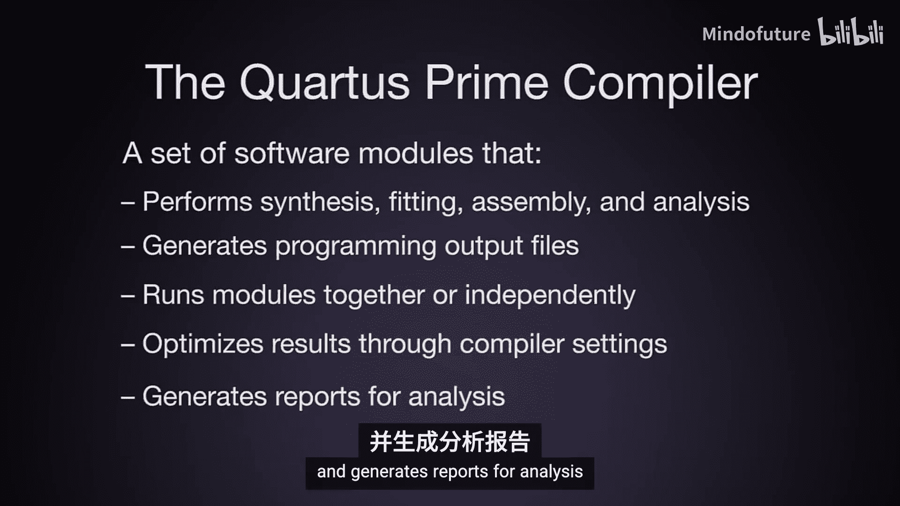
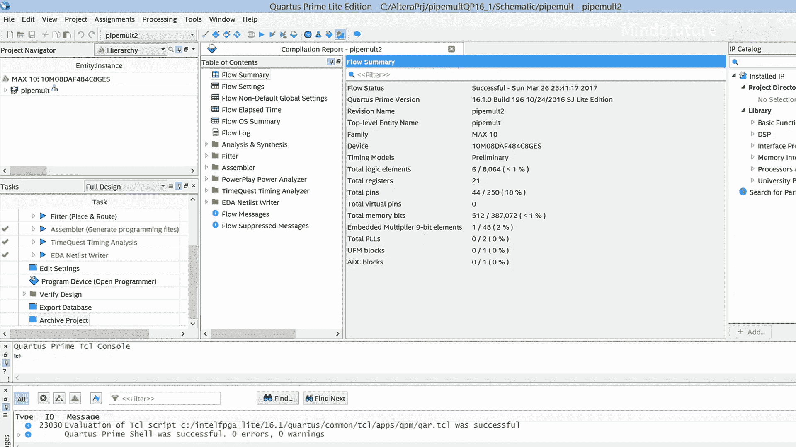
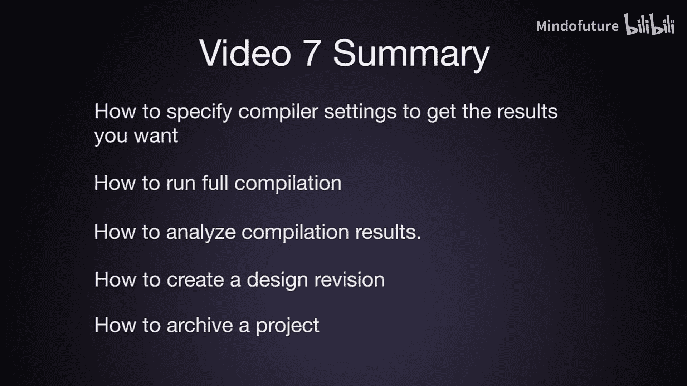

# 嵌入式系统FPGA设计入门：P15：设计编译 🚀

在本节课中，我们将学习如何在Quartus Prime软件中编译一个FPGA设计。我们将从准备设计文件开始，逐步完成编译设置、执行完整编译、分析结果、创建设计修订版本，最后归档项目。

## 编译器概述

上一节我们介绍了设计输入，本节中我们来看看如何将设计转化为可以在FPGA上运行的编程文件。Quartus Prime编译器是一套软件模块，它执行以下任务：
*   **综合**：将设计源文件转换为门级网表。
*   **布局布线**：将逻辑映射到目标FPGA的具体逻辑单元并连接它们。
*   **汇编**：生成用于配置FPGA的编程文件。
*   **分析**：验证设计的时序和功耗等性能。

你可以一次性运行所有步骤，也可以分步独立运行。编译器允许你应用多种优化技术，例如**时序驱动编译**，以优化资源使用和提高设计速度。

## 准备编译设置

在开始编译之前，我们需要配置编译器以获得期望的结果。这些设置主要通过“Assignments”菜单进行。

以下是关键设置步骤：

1.  **指定目标器件**：在“Assignments”菜单中选择“Device”。这通常已在创建项目时设置好，但可以在此修改。本教程中我们保持默认设置。
2.  **配置编译器设置**：在“Assignments”菜单中选择“Settings”。在“Compiler Settings”页面，你可以控制布局布线过程的优化目标：
    *   **Balanced**：平衡性能、功耗和面积。
    *   **Performance**：优化设计运行速度。
    *   **Power**：优化以降低功耗。
    *   **Area**：优化以减少逻辑资源使用。
3.  **启用功耗分析**：在“Settings”对话框的“PowerPlay Power Analyzer”页面，勾选“Run PowerPlay Power Analyzer during compilation”，以便在编译后获得功耗估算。
4.  **了解设置文件**：所有编译器设置都保存在项目的 `.qsf` 文件中。你可以通过“File” -> “Open”打开此文件查看，或通过“View” -> “Utility Windows” -> “Tcl Console”使用Tcl命令进行修改。

## 执行完整编译

设置完成后，即可开始编译。确保在“Project Navigator”中双击顶层设计实体（例如 `pipe_malt`）以打开原理图。

从“Processing”菜单中选择“Start Compilation”，或点击工具栏上的三角形图标。编译过程将在“Task”窗口中显示进度，在“Messages”窗口中显示系统信息。编译报告会自动在中央窗口打开。

编译成功完成后，每个步骤旁会出现绿色的对勾。

## 分析编译结果

编译完成后，我们可以通过多种工具分析结果。

**项目导航器**：显示项目的完整层次结构、所有设计文件和单元。你可以右键点击实体，使用“Locate”功能在原理图或平面布局图中定位它，这称为交叉探测。

**编译报告**：提供当前编译的详细信息。报告左侧窗格列出了所有可用的报告类别。

以下是需要关注的关键报告：

*   **Flow Summary**：显示编译状态、器件型号、资源使用情况（逻辑单元、引脚、存储器等）。
*   **Timing Analyzer Report**：提供时序分析结果。点击“Slow 1200mV 85C model”下的“Fmax Summary”，可以查看设计在该工艺角下的最大时钟频率。公式 **Fmax** 是评估FPGA性能的关键指标。
*   **Setup & Hold Summary**：查看建立时间和保持时间裕量。**Slack** 表示时序裕量，正数表示满足时序要求，负数（标红）表示时序违规。

## 创建与比较设计修订

为了比较不同编译器设置或约束下的效果，我们可以创建设计修订。

1.  在“Project”菜单中选择“Revisions”打开修订对话框。
2.  点击“Create”创建新修订。输入修订名（如 `pipe_malt2`），并选择基于哪个现有修订。
3.  为新修订更改编译器设置（例如，将优化目标从“Balanced”改为“Performance”）。
4.  编译新修订。你可以在“Project Navigator”的“Revisions”标签页中右键点击该修订，选择“Compile”。
5.  编译完成后，在“Project” -> “Revisions” -> “Compare”中比较两个修订的结果。比较报告可以导出为CSV文件。

## 归档项目

完成工作后，建议保存并归档项目，以便分享或备份。

1.  使用“File” -> “Save Project”保存项目。
2.  使用“Project” -> “Archive”或双击“Task”窗口中的“Archive”任务。
3.  在对话框中选择“Archive all revisions”并点击“Archive”。这将在项目目录中生成一个 `.qar` 压缩文件。
4.  如需恢复项目，使用“Project” -> “Restore Archived Project”。

## 总结

本节课中我们一起学习了Quartus Prime FPGA设计编译的全过程。我们掌握了如何指定编译器设置以优化性能、功耗或面积；如何执行完整编译并监控进度；如何利用编译报告和项目导航器分析资源使用和时序结果；如何通过创建设计修订来对比不同编译策略的效果；以及最后如何归档项目以便管理。这些是完成FPGA设计流程的关键步骤。