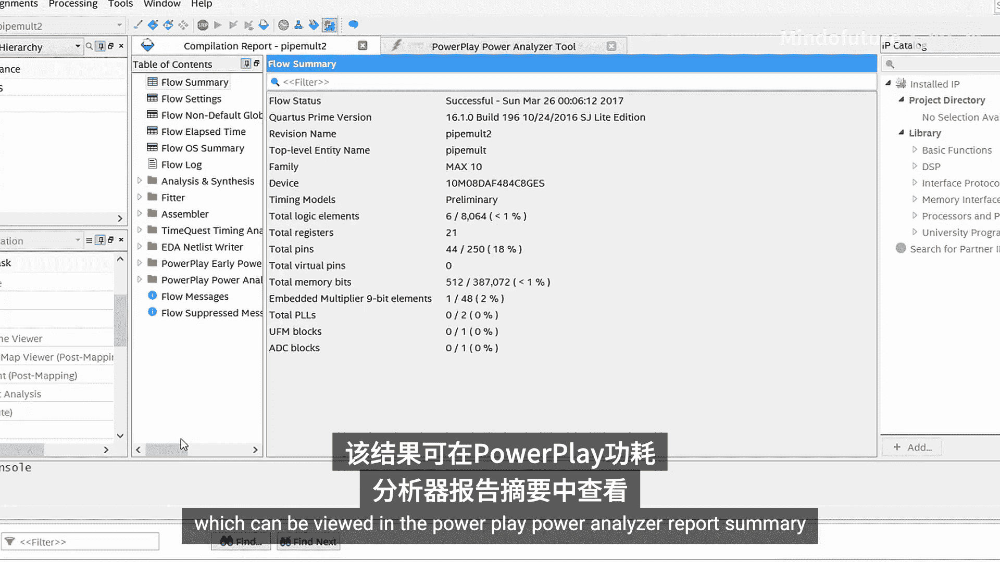

# 【科罗拉多大学】嵌入式系统-FPGA-设计入门-｜-intro-fpga-design-embedded-systems-p16-P16_02_03_02_8-查看RTL--BV19Tu6zGEMD_p16-

In this presentation， you'll use the RTL， technology viewers and chip planner to analyze an FPGA design in Corus Prime。

Youll use design files from the previous video， compile a design in Corus Prime so that you can follow along and perform each step along the way。

Feel free to pause the video as you enter commands into Court' Prime。

Here's what we'll cover in this video， we will view a design at the RTL level。

 view a design at the technology level， analyze the design using the chip planner。

 and then analyze a design with a Power play power analyzer。

Open Cortius Prime and open the Pipe Ma project。You should have the example project files complete through compilation at this point。

Cors prime gives you a number of tools that can be used to analyze the results of the design。

 You should have a good idea of how your design should turn out。

 but sometimes the compiler will give you some unexpected results。

 FPJ designers use the analysis tools to confirm the design result is what they expected。

One group of tools used for analysis are the viewers under the To menu， click onNelist Viewers。

You will see that there are four different viewing tools available， the RTL viewer。

 the technology map post mapping viewer， the technology map postfitting viewer。

 and the state machine viewer。The netless viewers are graphical tools that let you see the results of synthesis and also place and route。

 you can also access them in the task window by expanding the analysis or fitter sections。

The RTL VR lets you view the design purely from a logic design perspective and gives the simplest schematic representation of the design。

It can be used to verify your design entry and your logic。

The tool is available after analysis and elaboration from the tools menu。

 selectNelist Viewers RTL viewer。The viewer displays the multiplier。

 RA and D flip fl register on the output， much like your schematic。The input ports are on the left。

 and the Q output port is on the right。 You can examine what components make up each of the main blocks by expanding the netless navigator on the left pane。

You will see the listings of instances， primitives， and ports。If you click on the ports triangle。

 it expands to show inputs and outputs。Clicking on inputs expands all the input ports。

If you click on data， it will expand to show each bit in the bus。

Click the ports triangle again to collapse this tree。If you click on instances。

 you will see the multiplier in the RAIP instances。

Keep clicking on the multiplier instance on each level until the entire tree is expanded。

You will see that the multiplier is made of two atomic units that are primitives in the FPJ architecture。

Click on the Ins triangle to collapse this tree。Now in the schematic。

 click on the plus sign in the upper right corner of the malt inst block。

This block will then expand to show the LPM underMt component。

Click on the plus sign to expand the component。It expands again to show a primitive。

Click on the plus sign again to expand to the atomic pieces。

 the Mac under Mlt1 and the Mac under out two blocks。

This shows you the most basic level of the multiplier instance。As you did this。

 the netless navigators should have expanded as well。

Click the minus signs in the blocks until you have returned to the main RTL view。

Now click the plus sign in the upper right corner of the RAM block。It shows three primitive blocks。

 the synchronous RA block itself， and a read address register and output register。

Click the Min sign to return to the top level view。On the upper menu。

 clickFile and then close to close the RTL viewer。The technology map viewer post mapping lets you view the design after synthesis back in the main Cor prime window from the tools menu。

 selectNeless viewers， technology mapp viewer post mapping。

Now you see how the design has been mapped to the EGA primitives。

 including every buffer for each input and output to a pin。Obviously， there's a lot more detail here。

 However， you will find that the view of the multiplier and the Ram are very similar to the RTL viewer。

 except that each primitive is enumerated。On the upper menu。

 clickF and then close to close the technology map viewer。

The technology map post fittingtting viewer lets you view the design after fitting。

Back in the main Cors Prime window from the tools menu， select Nelist viewers。

 technology mapp viewer post fittingtting。Click the View menu， zoom in to see the results。

Scroll down to the bottom。Here you see the addition of the JTag and configuration interfaces。

 the TMS， TD I， T clock and other signals。There is even more detail in this view。

 although it's not too different from the others for this relatively simple design。

 close the viewer as before。Since there are no state machines in this design。

 the state machine viewer isn't very helpful， so we will skip it for now。Next。

 let's look at the chip plantter。Click on the To menu， then the chip planner。

The chip planner provides a visual display of device resources laid out as they are on the device。

 it can be used for analysis to create a design floor plan and to implement engineering change orders or ECs in your design。

Integration with other Cors prime tools allows you to locate a particular design entity or timing path on the actual location on the target device。

You can use the chip planner in conjunction with the Re property editor to change connections between resources and make post compilation changes。

This requires a detailed knowledge of the design and the device architecture。

 such changes are eliminated the next time the design is compiled。

 so they are generally used for manual improvements or fixes just prior to device programming。

In general， I don't recommend the creation of post compilation changes。

Usually you can get the compiler to produce the results you want without time consuming manual intervention as the routing algorithms are now very sophisticated。

Most of the time， we will use the chip planner for analysis to understand how the design has been placed and to look for the cause of timing issues。

The level of detail shown on the chip planner depends on the current zoom level。

 as well as the mode selected in the Layer settings tab in the upper right hand corner。

Zoom in by using control space， zoom out with Shi control space。

Generally the logic array blocks or labs are colored blue， the DSP blocks are a white column。

 and the RAM blocks are a tanN column。Towards the bottom of the display。

 you will see some blocks are darker in color than others。

The chip planner uses a gradient color scheme in which the color becomes darker as the utilization of a resource increases。

You may see some darker blocks in the lower right corner if you zoom in until these blocks fill the screen。

 the layout becomes more apparent。Clicking on the individual blocks creates a circuit diagram picture in the no properties window on the right side of the screen。

Here we see a RAM block and then a lab used as a register output。

The chip planner has two editing modes， assignment and EC。

The assignment mode allows us to make changes that are applied by the fitter during the next place and route operation。

Typically， these changes include pin assignments and location assignments。

You can make these assignments in the location assignments window in the lower right hand corner。

The EC mode allows us to make post compilation changes like logic placement or routing that are not retained after the next compilation。

You can use the chip planner to examine fan in and fan out of specific device resources。

Click on the Use RAM block。You can see the fan out by clicking on the generaterate fan Out icon on the toolbar or by using the View menu and selecting generaterate fanan Out。

The routes from the RA block outputs now appear。Zoom out until you see the pins that are the destinations for these outputs。

Click on the Ram block again to reselect it Now clear these routes by using View Clear unselected connections。

Now generate fanning routes to the RA with view， generate fanning connections。

You can zoom in or out to examine these more closely。

Click file and then close to close the chip planner。

The Early Power estimator or EPE is a spreadsheet analysis tool that enables early power estimation based on device and package selection。

 resource utilization and operating conditions。Although the models within the estimator are very accurate。

 accurate results overall require estimates of the device clock speeds and routing that are probably not perfect。

Later estimates post fitting using actual routing and placement information in the Corus Prime PowerPo Power Anar will be considerably more accurate。

However， it's good to get an early estimate because the circuit board power supply designer will need this information in order to size the power supply。

The EPE is available from www。altra。com/sup/supportres/ operationeration and testing/ power/ powerpowerplay。

ht， as is a wealth of information about Altro's Power play tools。To download the EPE。

 find the max 10 listing and click download under the spreadsheet To column。

You may need to update your copy of Excel to work with this tool。

When you have downloaded the max 10 under EP。xls， store it in the project directory。

Data for the EPE can be entered manually or imported from a previous project or imported from a partially completed design。

This allows you to estimate your power budget for every power supply voltage early in the design cycle before all design files are complete and allows for quick analysis of the effect design changes will have on the power consumption of your project。

To import the data on the project menu， click generate Power play Early Power estimator file。

 which will create a file with a design revision name。Early underpower。csv。

To import this data to the EPE， open the EPE and click importmport CSV found at the middle of the main tab。

Browse to a PowerP EPE file generated from the Corus2 software and click open。

If the file is imported， click OK， clicking OK acknowledges the import is complete。

Now you should see power consumption from the logic， RA， DSP， IO。

 and clock blocks in the middle of the screen。The calculations used to reduce these results are given in detail in the tabs at the bottom。

The default power consumption display is typical， but for power supply design。

 we'd like to look at maximum to get current estimates for each voltage you must select maximum for the power characteristics on the left。

Click on the cell and a down arrow appears， select maximum。

Then click on the box underneath the power railil configuration on the right and select dual S。

You will then see the current for the 1。2 and 2。5 volt rails。

Clicking on the select Power Reg button below this takes us to another sheet where we can enter the power supply regulator input voltages。

In my case， the clock is assumed to be 100 megahertz， yielding a power consumption of 82。

55 millwatts。The clock frequency can be edited directly in each of the tabs to explore the effects of different clock speeds。

Once you have completed a design。You can use the Corus Prime Power play Para analyzelyzr tool to get a better estimate of the power consumption。

This tool is very easy to use， requiring very little user input。Under the Pro menu in Corus Prime。

 select Power play， Power Anar tool。The best estimationim accuracy is achieved using signal activity from gateit level simulations。

However， if you don't have simulation output， you can use vectorless estimation。To do this。

 scroll down the center Power play analyzer window and hit start。After it runs。

 you should see the message， Corus Prime Power Play Paralyzizer was successful in the message window。

Just above that message， it tells the total power estimate for the design， in my case， 53。4 milli。

This is a typical power consumption you can run the analyzer again with it set to maximum by clicking on the cooling solution and temperature button or settings from the assignment menu and then clicking on operating settings and conditions and choosing maximum from the Power characteristicss pullll down menu。

Then you should see something closer to 80 millwatts。

 which can be viewed in the PowerP Power Analyr Report summary。

In this video， you have learned how to view an FPJ design using the RTL viewer。

How to view an FPJ design using the technology viewer？

How to analyze an FPG design using the chip planner and how to determine early power estimates using the Power play power analyzer。

