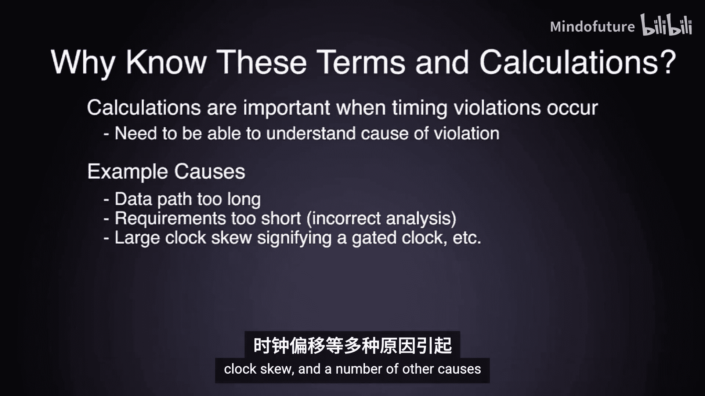
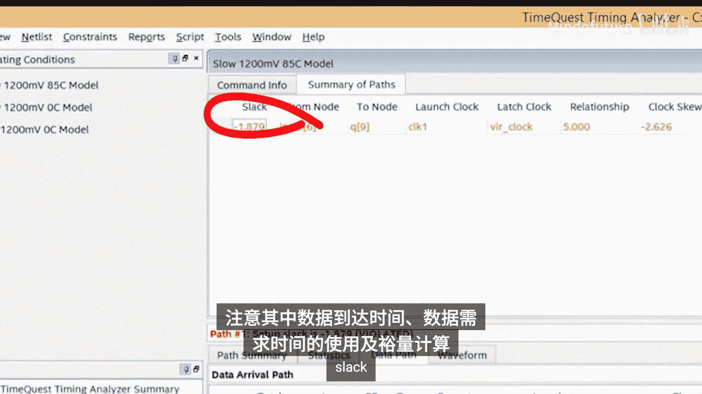
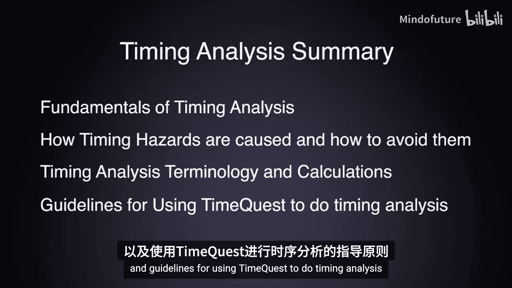

# 【科罗拉多大学】嵌入式系统-FPGA-设计入门-｜-intro-fpga-design-embedded-systems-p17-P17_02_03_03_9-TimeQuest时序分析（一）--BV19Tu6zGEMD_p17-

In this presentation， you will learn the fundamentals of timing analysis。

 including the calculations and terminology used by the Time Ques timing Anar。

Here's what we'll cover in this video。 Fundamentals of timing analysis。

Timing hazards and how to avoid them。Timing， analysis， terminology and calculations。

Using time quests to do timing analysis。Clocks are fundamental to modern digital electronics。

 They provide synchronization， which is necessary for error free data transfer。

As data on a digital line transitions from one value to another during the transition time。

 the data value will be incorrect。We need to wait until the data is stable before using it。

The synchronizing signal is the clock。Data must be stable before and after the cock edge to be reliably transferred。

 If not properly synchronized， there will be a host of design issues like hazards。

 which are unexpected or undesired signals， like en golf。 You just don't want to go there。

Metaability， a condition caused by timing violations and flipflop outputs leading to erroneous data。

Race conditions， which lead to violations that occur， depending on operating conditions。

 bugs a come and go， a primary cause of gray hair in engineers。

Clock skew another unexpected source of violations。

Statatic hazards occur as a consequence of unequal delays in logic。

 This diagram shows the use of a carna map or k map to minimize the logic for a particular logic function。

Can you tell where there might be a problem with this circuit because of path delays。

Analysis of the circuit using a timing diagram reveals the generation of a run pulse during which time the output of logic circuit does not match what is expected from the logic equation。

 If B and C are always one， we would expect F to always be a1。

 It's not because of the delays present。One way to remove the hazard is through additional logic as shown here with the addition of another ant gate。

 However， a better method is the use of flip flops and synchronous design。

 which allows data transfer only on a clock edge when the data is correct and stable。

Here is the fundamental synchronous circuit that static timing analyzers can analyze。

Clock A and clock B may have a common source， but the path delays may be different。

 particularly in FPGs where routing can be changed。

We need to have some common terminology when we talk about timing analysis。

A launch edge is the clock that activates the source register and a Reg register path。

A latch edge is the clock age that activates the destination register and captures the data。

Time quest measures performance by analyzing delays between timing path， launch and latch edges。

Setup time is the minimum time the data signal must be stable before the clock edge。

Whole time is the minimum time the data signal must be stable after the clock edge。

If these minimum times are not met， we have a setup or whole violation。

 which will lead to possible data errors or metatability of the flipflop register。Together。

 the setup time and the whole time form a data required window。

 the time around a clock edge in which data must be stable。

The data arrival time is the time for data to arrive at a destination register's D input from the common clock edge。

In equation form， the data arrival time is equal to the launch edge plus T clock A plus T clock to out plus T data。

The general concept is to compare the time when the data arrives with the time the clock arrives to see if there is a setup or whole violation。

The clock arrival time is the time for data to arrive at a destination register's clock input from the common clock edge。

The clock arrival time is equal to the latch edge plus the delay in clock B。

Do you think the delay in the clock path helps or hurts？

Can it cause a violation of timing requirements？Data required time for setup is the minimum time required for the data to get latched into the destination register。

The data required time setup is equal to the clock arrival time， minus the time of setup。

The setup time of or the T of SU is a fundamental requirement of all flip flop devices and is specified in FG data sheets。

 This value will vary from one FPGA family to another。

The data required time for hold is the minimum time required for the data to get latched into the destination register。

Data required time hold。Is equal to the clock arrival time plus T of H or the time of hold。

Typical hold times for FPGA flip flops are often zero or1 nanosecond。

The setup Sck is the margin by which the setup timing requirement is met。

Seep Slack is equal to data required time minus the data arrival time。

Such slack can also be expressed as clock period plus the delay in clock B plus T of S U minus T of clock A。

 minus T of clock out minus t data。Now that the delay in the clock B path actually makes the setup margin larger。

So sometimes delay can be a good thing。However， the delay in the clock A path hurts us。

 as does the logic and flip flop clock to delays。The whole slack is the margin by which the whole timing requirement is met。

Hold Slack is equal to the data arrival time minus the data required time。

 just the opposite of the setup Slack calculation。Holdd slack is equal to t clock of a plus t clock out plus t datata minus the t clock of B minus the time of hold。

Here the delay in clock B hurts us， but the delay in clock A helps us。

Given requirements in the form of clock and delay constraints entered by the designer。

 time qui can generate information used by the fitter to adjust the routing delays to meet all the requirements。

When all timing requirements are met， this status is known as timing closure。

Achieving time en closure can be one of the most difficult challenges in EGA design。

 which is why so much time and effort are spent on timing analysis。

IO timing analysis uses the same slacklack equations as there is still data transfer between two registers with set up and hold requirements。

This shows the input delay case。 The net time of arrival for inputs of the data relative to the clock is known as input delay。

 The net delay time for outputs is known as output delay。Why know these terms and calculations？

Understanding the calculations is important when timing violations occur as you need to know the cause of the violation before you can fix it。

Violations can be caused by routing paths that are too long， insufficient constraint definitions。

 clock skew， and a number of other causes。

Timing analysis helps us find the root cause of these violations。

TimeQut Anar uses these equations to calculate Slack and also to determine FMax an important metric in FPGA performance。

The terminology we have learned is used in the timing reports。

 so it is important to have the terms in your mind before reading the reports。

Here's an example timing report。Note the use of the data arrival time， data required time。

 and calculation of the Slack， which is negative in this case， indicating a setup violation。

How do we use time quest for timing analysis？Here are the basic steps to using the time Que timing analyzer。

 First， generate a timing net list。And her SD C constraints。

You can do this by creating or reading in an SDC file， which is a recommended method。

Or you can constrain the design directly in the console。

You update the timing net list next and then generate timing reports and save the timing constraints。

Here are some guidelines for using timing constraints。 General。

 the user must enter constraints for all paths to fully analyze the design。

 This is because the timing analyzer only performs slackck analysis on constrained design paths。

Constraints guide the fitter to place and route in the design in order to meet timing requirements。

My recommendation constrain all passs， or at least the clocks in the IO。

This is not as difficult a task as it may sound， because while cards can help to signals and group them together。

 A single generalized constraint can cover many paths， even all paths in an entire clock domain。

We use Time Que to analyze our pipe M project in the next video。In this video。

 you have learned fundamentals of timing analysis， how timing hazards are caused and how to avoid them。

 timing analysis， terminology and calculations and guidelines for using time quests to do timing analysis。

