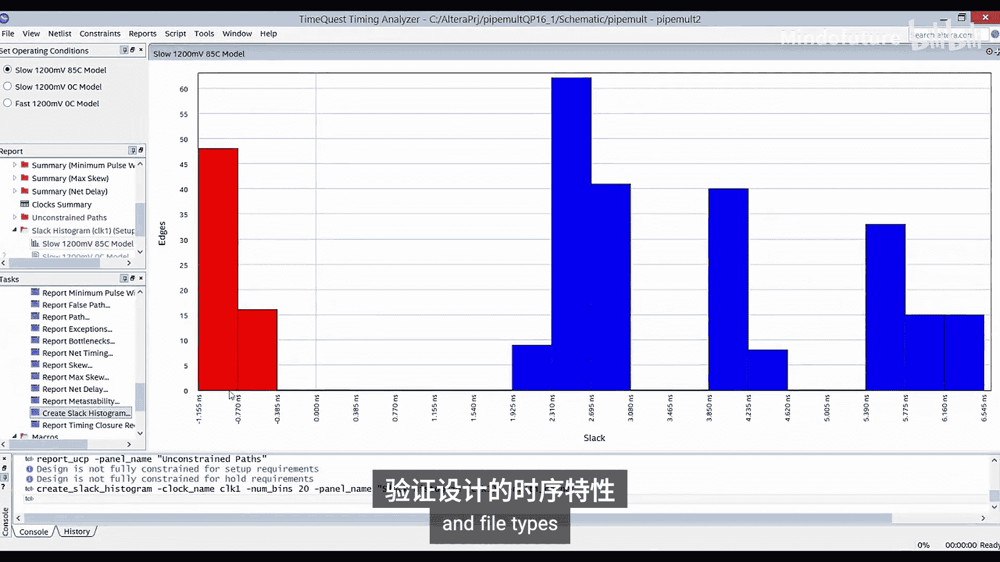
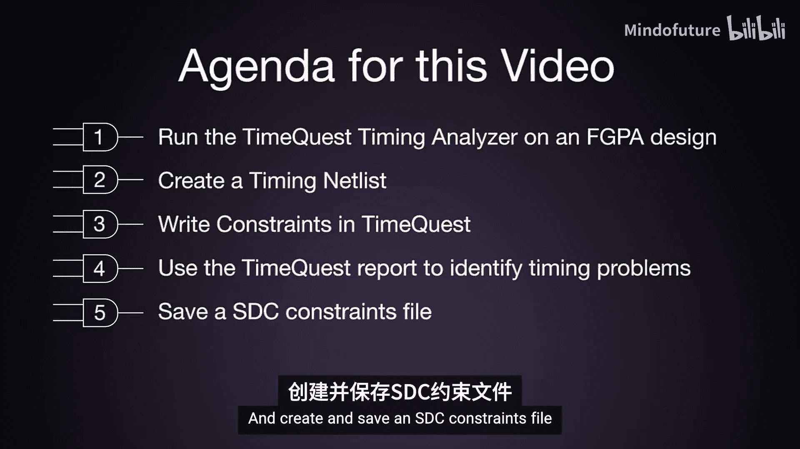
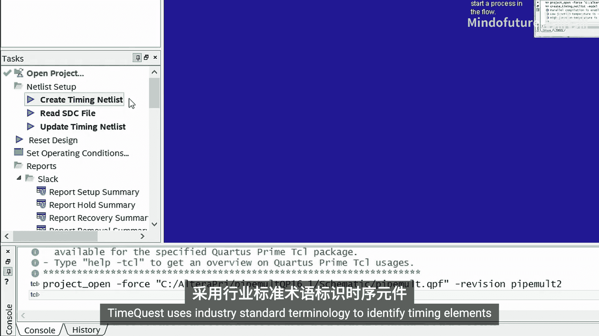
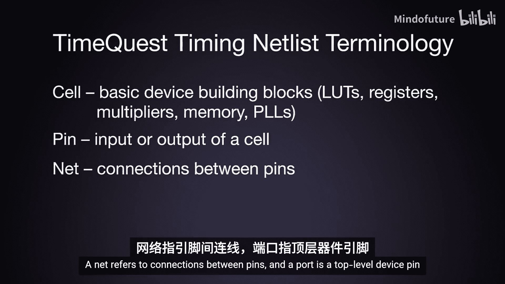
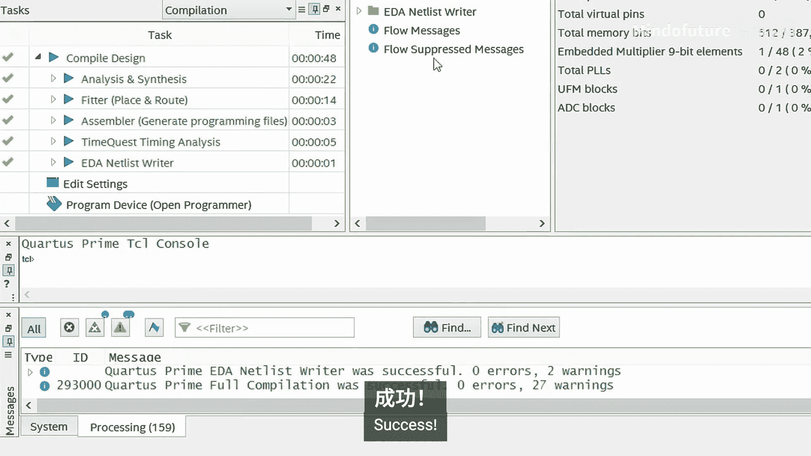
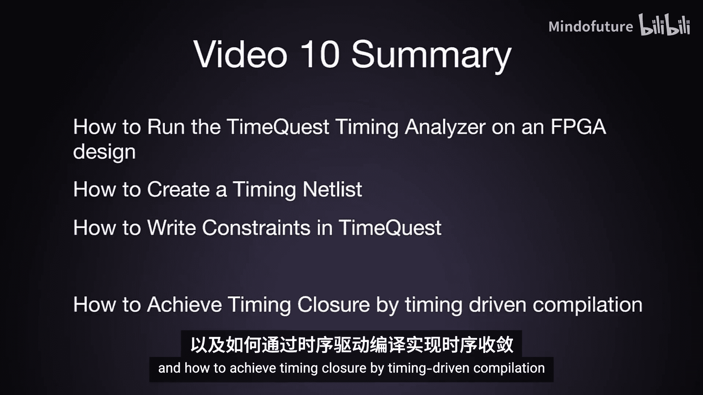

# 【科罗拉多大学】嵌入式系统-FPGA-设计入门-｜-intro-fpga-design-embedded-systems-p18-P18_02_03_04_10-TimeQuest时序分析（二）--BV19Tu6zGEMD_p18-

In this presentation， you will learn how to use the Time Que timing Anar to constrain， analyze。

 and report the timing performance of all the logic in your design。

The Time Quest Tim Anar is a tool that validates timing in all of your design using industry standard analysis methodologies and file types。

You will use design files from the previous video， analyze the design in Corus Prime so that you can follow along and perform each step along the way。

Feel free to pause the video as you enter commands into Portus Prime。

Here's what we will cover in this video， Run the time Que timing analyzer on an FPGA design。

Create a timing net list， write constraints and time Que。

 use timequest reports to resolve timing problems， and create and save an SDC constraints file。

 achieve time enclosure by timing driven compilation。

Open Cortis Prime and open the Pipe Mt project。You should have the example project files complete through compilation at this point。

On the Tos menu， click Time Ques timing Anar。Look at the layout of the analyzer。

 The task pane provides quick access to common functions in the time Que workflow。

 The report pane lists reports generated by the analyzer。The view pane shows the selected reports。

The console displays SDC or tickle commands executed in the GuUI or command line interface。

To use the timequest analyzer， you must first create a timing net list。

 The timing net list is composed of the names of all sorts and destination timing elements in the design。

 as well as minimum and maximum timing path delay information。

Time Ques derives the net list from compilation results。

TimeQuestt uses industry standard terminology to identify timing elements。

In time quest。A cell is a basic device building block。

Including lots or registers or multipliers or memory or PLLs。A pin is an input or output of a cell。

A net refers to connections between pins and a port is a top level device pin。

To generate the timing Ne list， click the Nelist menu and then create timing Ne list。

The Cate timing Nelist dialog box opens， which allows you to pick the input net list and the speed model to use。

Select post fit for the input and slow corner for the speed。

To completely verify the timing and a design， you should always run all the models to be certain they all pass。

You will see a green check mark in the task window when the net list is complete。

The next task is to create a clock constraint。You can tell the timing analyzer the clock frequency requirement。

 and this will be used first to analyze whether the goal has been met and later to drive the fitting process to try to achieve this goal。

As we have seen， the clock period is an integral part of the setup time calculation。As it shrinks。

 the setup margin will shrink。 At some point， there will be no more margin。

 and the design is running at its maximum frequency denoted by Fmax。

At a clock constraint by clicking the Consts menu and then click createreate C。

The Cate clock dialog box opens where you can enter CLK1 for the clock name and set the period to  eight nanoseconds。

To set the targets， click on the browse button to the right of the box and the target name Finder opens。

To select the type of signals to find， click on the down arrow of the collection list in the upper left corner。

Select Giports to view all the port names and then just below that click on list。

Then select the clock1 clock signal name and click the right arrow button to add it to the select Nas list and then click OK。

Back in the CateC dialog， click Run。The clocklock1 clock is created and the SDC command equivalent also appears in the console。

You can also enter SDC commands by typing them directly into the console。

To update the timing net list with a clock constrain information。

 we double click Update timing Nelist in the task pane。When complete。

 we see another pleasing green check mark。We can now report clock timing by double clicking report clocks in the task pane under the diagnostics folder。

In addition to constraining the clock， we also want to constrain the inputs and the outputs。

The timing analyzer knows all the internal timing delays but does not have any information about timing delays external to the device。

 so we need to provide this by defining the input delay and the output delay。

The input delay is the net sum of all external delays。

 typically consisting of the delay from the common clock source to the external device flipflop。

 plus the flipflop clock to delay， plus the delay in the PCB traces to the FG input minus the delay from the common clock source to the FGA clock input。

To be accurate， you would need measurements or models of the PCB delay and data sheet information for the external device that drives the inputs。

Typically， the input delay is a few nanoseconds， although it can be negative。

The maximum delay is usually a little more than the minimum delay。

We will now use the set input De command to set a maximum input delay of three nanoseconds and a minimum delay of two nanoseconds to both eight bit input buses。

 data A and data B with respect to clock1。Click the Consts menu and then set input De。

Click the clock name， list down arrow and click clock1。

Select the maximum input delay option and type three nanoseconds as the delay value。

Click the browserow button as before to find the data port names。SelectGports from the collection。

 pull down and then click List。Type data asterisk and hit enter in the filter box in the upper right hand corner to filter out only the data buses。

Click on list to list them， then click OK and then click Run to set the input delay。

The view payinge background turns yellow to indicate the timing net list is now out of date。

Before we update the net list， we can add the minimum input delay directly in the console with a couple of keystrokes。

Click on the tickickle prompt in the console and then hit the up arrow。

This will replicate the previous set input delay command。

Then change the max to min and the three to two to add a two nanosecond minimum input delay。

In a similar fashion， we can quickly add an output delay a two nanoseconds maximum and one nano a secondd minimum by typing in the commands using Q asterisk as the target。

To verify our entry， we can see a report listing the new IL constraints by double clicking report SDC in the task pane。

This also updates the timing net list。We can see a list of the constraints in the report pane under SDC assignments set input De。

Next， let's look at a number of summary reports， including unconstrained paths， a Slack histogram。

 and individual path timing。First， generate summary reports by double clicking report all summaries in the task pane under the macros folder at the bottom。

You may see red indicating a setup violation we'll deal with this later next， under diagnostics。

 double click on the report onconstrained paths to view a report that lists all paths and whether they are constrained。

You should see that some input ports are unconstrained。Now in the report pane， click on SumSe。

The summary setup report shows a slack value of minus 0。859。

 which indicates that the timing requirements are not met。To achieve positive slack。

 we could add one nano ased to the clock period。To investigate further。

 click the reports menu and then custom reports and then click。

Create Slack histogram to create a Slack histogram that illustrates the Slack results。

In the dialog box that appears， click the clock name list down arrow and select clock1。

 then click OK。We see clearly that a number of signals are in violation。Now。

 to look at specific passs， we click on the reports menu again and then custom reports report timing。

In this dialog box， click on the down arrow next to the from clock box and select clock1。

Then click report timing。We then see the data arrival path and data required path calculations。

We see there is too much delay in the memory output to the Q9 register input。

We will fix this by running a timing driven compilation。

 which optimizes placement of logic to meet your timing requirements。

To perform timing driven compilation， we will save constraints into an SDC file。

 recompile the design， and then view time Que results。

To save the constraints we've defined in an SDC file first from the Conts menu and time Que。

Click right STC file。The right SDC file should open。

Delete the dot out that is in the file name and click O。

Click X in the upper right corner to close time Que and return to Corus prime。

To start a timing driven compilation， we click the processing menu and start compilation。

After compilation is complete， click OK。In the console window。

 we see the timequest runs with no errors。Success。The report in the compilation report window may still be read。

 but this is because we have some unconstrained paths。

 The slow 85 degree model has positive slack and an Fm of 128 MHz。

 and the other models have no violations as well。To remove the remaining unconstrained paths。

 start time quest again。Click the Consts menu and then set input De。Click the clock name。

 list down arrow and select clock1。Select the maximum input De option and type  three and nanoseconds as the delay value。

Click the browse button as before， to find the port names。

Select gettports from the collection pull down and then click List。

Scroll down past the Q signals in the list， select the next signal， which is read address zero。

 and then scroll to the bottom and shift and click on WREN。

Click on the right arrow to move these signals to the select box on the right。

 there should be 11 signals， so this includes all the unconstrained signals。

Click OK and then click Run to set the input delay。

Add the minimum input delay directly in the console with a couple of keystrokes。

Click on the tickle prop in the console and then hit the up arrow。

This will replicate the previous set input delay command。Then change the max to men。

And the three to two to add a two nanosecond minimum input delay。

Generate summary reports by double clicking report all summaries in the task pane under the macros folder。

Note that none of the summary reports are colored red next， under diagnostics。

 double click on the report on constrained paths to view a report that lists all path and whether they are constrained。

You should see that none of the paths are unconstrained， so we have achieved our objective。

To save the constraints we defined in an SDC file， first from the Conts menu and Time Que。

 click Right SDC file。The right SDC file should open。

 delete the dot out that is in the file name and click OK。

Click the X in the upper right hand corner to close time Que and return to Cortius prime。

To start a timing driven compilation， we click the processing menu and start compilation。

After the compilation is complete， click ok。In the console window。

 we see that time Que runs with no errors， success。

In this video， you have learned how to run the time Que timing analyzer and FPGA design。

 how to create a timing net list， how to write constraints and time Que。

How to use timequest reports to resolve timing problems。

And how to achieve timing closure by timing driven compilation。

