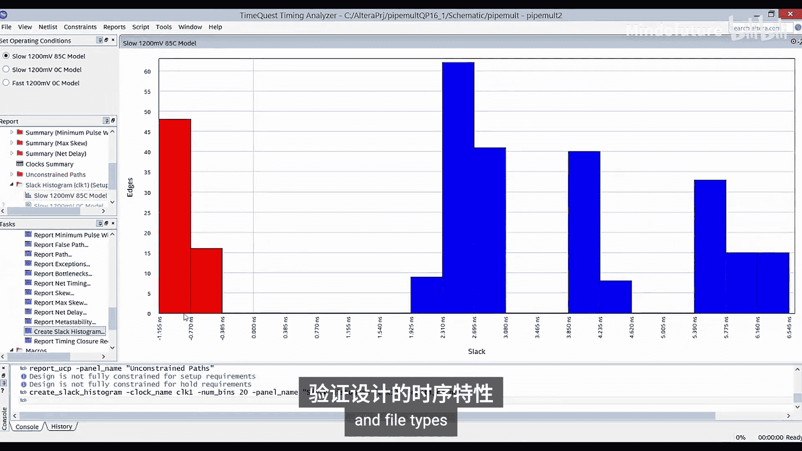
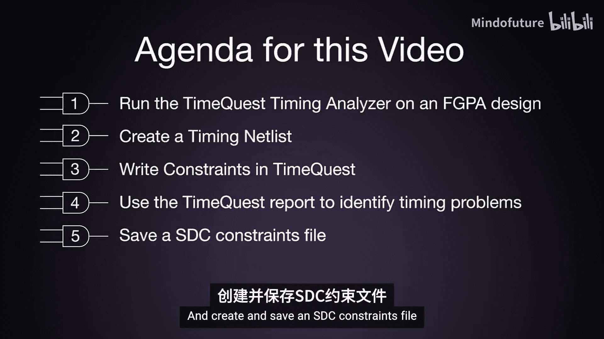
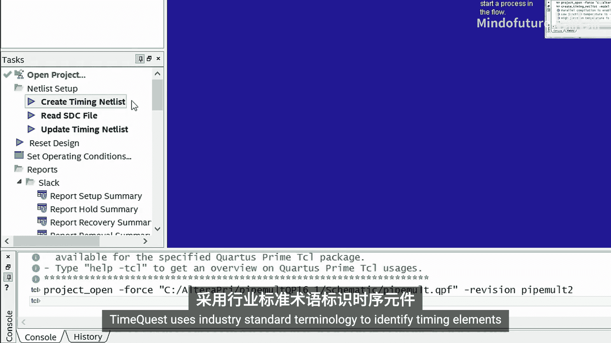
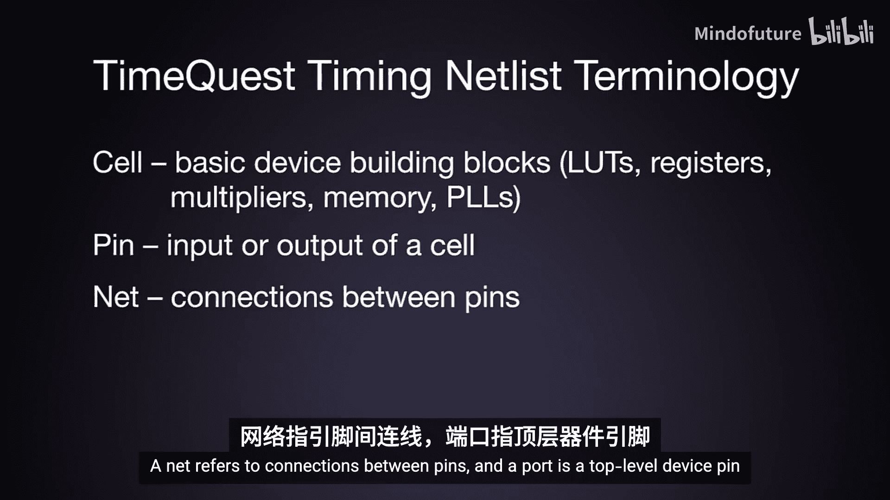
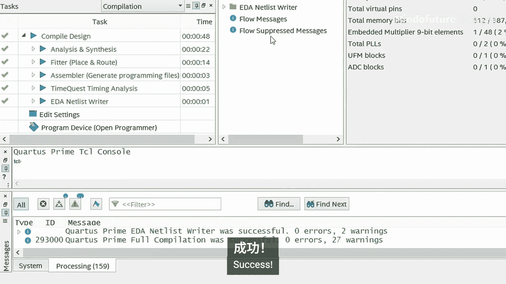
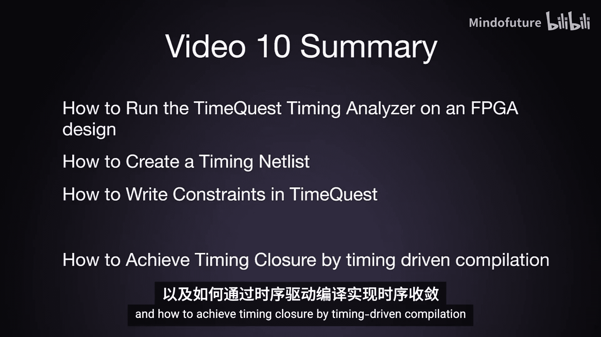

# 嵌入式系统FPGA设计入门：P18：TimeQuest时序分析（二）⏱️

在本节课中，我们将学习如何使用TimeQuest时序分析器来约束、分析并报告设计中所有逻辑的时序性能。

TimeQuest时序分析器是一个工具，它使用行业标准的分析方法和文件类型来验证您设计中的所有时序。

我们将使用上一个视频中的设计文件，在Quartus Prime中进行分析，以便您可以跟随操作并执行每个步骤。在向Quartus Prime输入命令时，您可以随时暂停视频。

以下是本视频将涵盖的内容：
*   在FPGA设计上运行TimeQuest时序分析器。
*   创建时序网表。
*   在TimeQuest中编写约束。
*   使用TimeQuest报告来解决时序问题。
*   创建并保存SDC约束文件。
*   通过时序驱动编译实现时序收敛。

---

## 启动TimeQuest并创建时序网表

首先，打开Quartus Prime并打开Pipe_Mt项目。此时，您应该已完成示例项目文件的编译。

在“Tools”菜单中，点击“TimeQuest Timing Analyzer”。观察分析器的布局：
*   **任务窗格**：提供对TimeQuest工作流程中常用功能的快速访问。
*   **报告窗格**：列出分析器生成的报告。
*   **视图窗格**：显示选中的报告。
*   **控制台**：显示在GUI或命令行界面中执行的SDC或Tcl命令。

要使用TimeQuest分析器，必须首先创建一个时序网表。时序网表由设计中所有源和目的时序元件的名称，以及最小和最大时序路径延迟信息组成。TimeQuest从编译结果中推导出网表。

TimeQuest使用行业标准术语来标识时序元件：
*   **Cell**：基本器件构建块，包括逻辑单元、寄存器、乘法器、存储器或PLL。
*   **Pin**：单元的输入或输出。
*   **Net**：引脚之间的连接。
*   **Port**：顶层器件引脚。

以下是创建时序网表的步骤：
1.  点击“Netlist”菜单，然后点击“Create Timing Netlist”。
2.  “Create Timing Netlist”对话框打开，允许您选择输入网表和要使用的速度模型。
3.  为输入选择“post-fit”，为速度选择“slow corner”。为了完全验证设计的时序，您应该始终运行所有模型以确保它们都通过。
4.  网表创建完成后，您将在任务窗口中看到一个绿色的对勾标记。

---

## 创建时钟约束

接下来，我们需要创建时钟约束。您可以告知时序分析器时钟频率要求，这将首先用于分析目标是否达成，随后用于驱动适配过程以尝试实现此目标。

正如我们所见，时钟周期是建立时间计算的重要组成部分。随着周期缩短，建立时间裕量也会缩小。在某个临界点，将不再有裕量，此时设计运行在其最大频率，即 **Fmax**。

以下是创建时钟约束的步骤：
1.  点击“Constraints”菜单，然后点击“Create Clock”。
2.  “Create Clock”对话框打开，您可以输入`CLK1`作为时钟名称，并将周期设置为8纳秒。
3.  要设置目标，点击框右侧的浏览按钮，打开“Target Name Finder”。
4.  要选择要查找的信号类型，点击左上角集合列表的下拉箭头，选择“get_ports”以查看所有端口名称，然后点击下方的“List”。
5.  选择`clock1`时钟信号名称，点击右箭头按钮将其添加到“Selected Names”列表中，然后点击“OK”。
6.  回到“Create Clock”对话框，点击“Run”。`clock1`时钟被创建，等效的SDC命令也会出现在控制台中。

您也可以通过直接在控制台中输入SDC命令来添加约束。

为了用时钟约束信息更新时序网表，我们在任务窗格中双击“Update Timing Netlist”。完成后，我们会看到另一个令人愉悦的绿色对勾。现在，我们可以通过双击任务窗格“Diagnostics”文件夹下的“Report Clocks”来报告时钟时序。

---

## 约束输入和输出

除了约束时钟，我们还需要约束输入和输出。时序分析器知道所有内部时序延迟，但没有任何关于器件外部时序延迟的信息，因此我们需要通过定义输入延迟和输出延迟来提供这些信息。

**输入延迟**是所有外部延迟的净总和，通常包括从公共时钟源到外部器件触发器的延迟、触发器时钟到输出的延迟、PCB走线到FPGA输入的延迟，减去从公共时钟源到FPGA时钟输入的延迟。为了精确，您需要PCB延迟的测量值或模型，以及驱动输入的外部器件的数据手册信息。通常，输入延迟为几纳秒，但也可能为负值。最大延迟通常比最小延迟稍大一些。

现在，我们将使用`set_input_delay`命令，为两个8位输入总线`dataA`和`dataB`，相对于`clock1`，设置3纳秒的最大输入延迟和2纳秒的最小输入延迟。
1.  点击“Constraints”菜单，然后点击“Set Input Delay”。
2.  点击时钟名称列表下拉箭头，选择`clock1`。
3.  选择“Maximum input delay”选项，并输入`3 ns`作为延迟值。
4.  像之前一样点击浏览按钮查找数据端口名称。从集合下拉列表中选择“get_ports”，然后点击“List”。
5.  在右上角的过滤框中输入`data*`并按回车，以仅过滤出数据总线。
6.  点击“List”列出它们，然后点击“OK”，接着点击“Run”来设置输入延迟。

此时，视图窗格的背景变为黄色，表示时序网表现在已过期。

在更新网表之前，我们可以通过几个按键在控制台中直接添加最小输入延迟：
1.  点击控制台中的Tcl提示符，然后按向上箭头键。这将复制之前的`set_input_delay`命令。
2.  然后将`max`改为`min`，将`3`改为`2`，以添加2纳秒的最小输入延迟。

以类似的方式，我们可以通过输入命令，使用`Q*`作为目标，快速添加2纳秒最大和1纳秒最小的输出延迟。

为了验证我们的输入，可以通过双击任务窗格中的“Report SDC”来查看列出新I/O约束的报告。这也会更新时序网表。我们可以在报告窗格的“SDC assignments -> set_input_delay”下看到约束列表。

---

## 查看时序报告

接下来，让我们查看一些摘要报告，包括未约束路径、裕量直方图和单个路径时序。
1.  首先，通过双击任务窗格底部“Macros”文件夹下的“Report All Summaries”来生成摘要报告。您可能会看到红色，表示存在建立时间违规，我们稍后会处理。
2.  接下来，在“Diagnostics”下，双击“Report Unconstrained Paths”以查看列出所有路径及其是否被约束的报告。您应该看到一些输入端口未被约束。
3.  现在，在报告窗格中，点击“Summary”。摘要建立时间报告显示裕量值为-0.859，这表明时序要求未满足。为了获得正裕量，我们可以将时钟周期增加1纳秒。
4.  为了进一步调查，点击“Reports”菜单，然后“Custom Reports”，接着点击“Create Slack Histogram”以创建说明裕量结果的裕量直方图。在出现的对话框中，点击时钟名称列表下拉箭头，选择`clock1`，然后点击“OK”。我们清楚地看到许多信号存在违规。
5.  现在，要查看特定路径，我们再次点击“Reports”菜单，然后“Custom Reports -> Report Timing”。在此对话框中，点击“From clock”框旁边的下拉箭头，选择`clock1`，然后点击“Report Timing”。随后，我们看到数据到达路径和数据需求路径的计算。我们发现从存储器输出到`Q9`寄存器输入的延迟过大。

---

## 通过时序驱动编译修复时序问题

我们将通过运行时序驱动编译来修复此问题，该编译会优化逻辑布局以满足您的时序要求。

为了执行时序驱动编译，我们需要将约束保存到SDC文件中，重新编译设计，然后查看TimeQuest结果。

以下是保存约束到SDC文件的步骤：
1.  首先，在TimeQuest的“Constraints”菜单中，点击“Write SDC File”。“Write SDC File”对话框应打开。
2.  删除文件名中的`.out`，然后点击“OK”。
3.  点击右上角的“X”关闭TimeQuest并返回Quartus Prime。

要启动时序驱动编译：
1.  点击“Processing”菜单，然后“Start Compilation”。
2.  编译完成后，点击“OK”。在控制台窗口中，我们看到TimeQuest运行没有错误，表示成功。编译报告窗口中的报告可能仍然是红色的，但这是因为我们还有一些未约束的路径。慢速85度模型具有正裕量，Fmax为128 MHz，其他模型也没有违规。

---

## 移除剩余未约束路径

为了移除剩余的未约束路径：
1.  再次启动TimeQuest。
2.  点击“Constraints”菜单，然后“Set Input Delay”。
3.  点击时钟名称列表下拉箭头，选择`clock1`。
4.  选择“Maximum input delay”选项，并输入`3 ns`作为延迟值。
5.  像之前一样点击浏览按钮查找端口名称。从集合下拉列表中选择“get_ports”，然后点击“List”。
6.  在列表中向下滚动经过Q信号，选择下一个信号`read_address[0]`，然后滚动到底部，按住Shift键并点击`wren`。
7.  点击右箭头将这些信号移动到右侧的选择框中（应该有11个信号，这包括了所有未约束的信号）。
8.  点击“OK”，然后点击“Run”来设置输入延迟。
9.  通过几个按键在控制台中直接添加最小输入延迟：点击控制台中的Tcl提示符，按向上箭头键复制命令，然后将`max`改为`min`，`3`改为`2`。

现在，生成摘要报告：
1.  双击任务窗格“Macros”文件夹下的“Report All Summaries”。请注意，所有摘要报告都没有红色标记。
2.  接下来，在“Diagnostics”下，双击“Report Unconstrained Paths”以查看列出所有路径及其是否被约束的报告。您应该看到没有路径是未约束的，因此我们已经实现了目标。

最后，再次将约束保存到SDC文件并重新编译：
1.  从TimeQuest的“Constraints”菜单中，点击“Write SDC File”。删除文件名中的`.out`，然后点击“OK”。
2.  点击右上角的“X”关闭TimeQuest并返回Quartus Prime。
3.  点击“Processing”菜单，然后“Start Compilation”。
4.  编译完成后，点击“OK”。在控制台窗口中，我们看到TimeQuest运行没有错误，表示成功。

---

## 总结

在本视频中，您学习了：
*   如何在FPGA设计上运行TimeQuest时序分析器。
*   如何创建时序网表。
*   如何在TimeQuest中编写约束。
*   如何使用TimeQuest报告来解决时序问题。
*   如何通过时序驱动编译实现时序收敛。