# 【科罗拉多大学】嵌入式系统-FPGA-设计入门-｜-intro-fpga-design-embedded-systems-p19-P19_02_03_05_11-使用ModelSim进行设计仿真--BV19Tu6zGEMD_p19-

In this presentation， you will learn how to use the Mentor graphicics Model SIimM Simulator to simulate the logic in your FPGA design。

Model Sim is a very powerful tool。This is only an introduction to what it can do for you to help verify the correctness of your design。

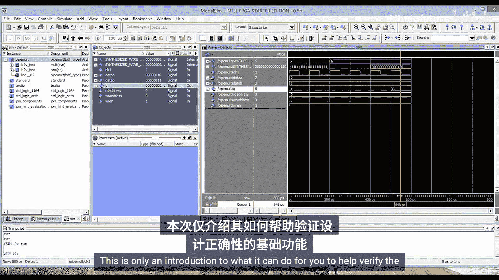

You will use design files from a previous video analyzed timing with time Que as the starting point for simulation。

 you should have a project called pipepeMt available when you open Corus Prime。

Feel free to pause the video as you enter commands and observe the tool actions。

Here are some tasks we complete during this video。First。

 convert a schematic BF file into a VHDL file for simulation。

Then we'll start model Sim from Corus Prime， We'll add signals to the waveform window。

 We'll create a stimulus to drive inputs in the simulation and will verify logic design by thoughtful design of test cases applied in the simulation。

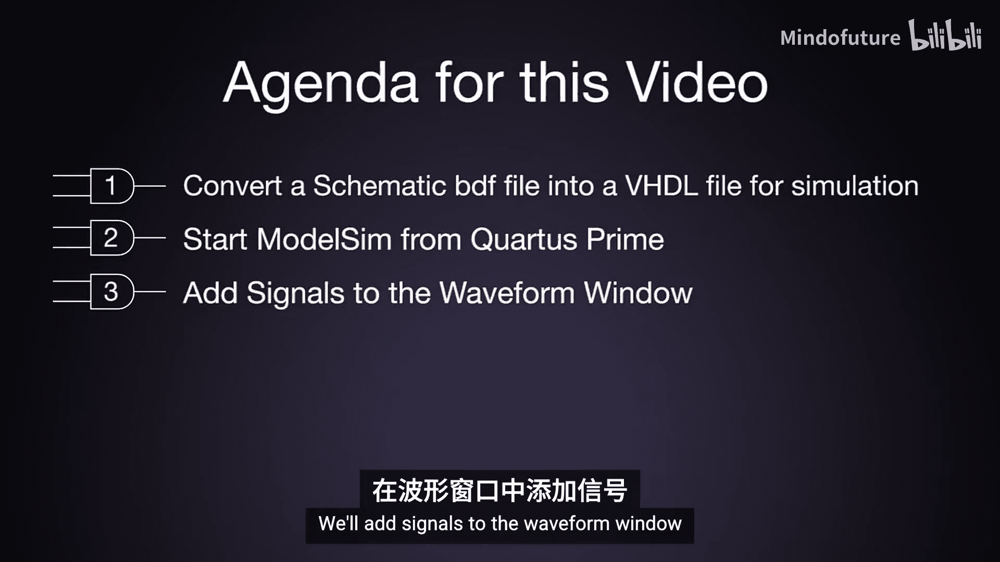

Open Cortius Prime and open the Pipe malt project。You should have the example project files complete through timing analysis at this point。

If you double click on the Pi Mt item in the Hierarchy tab of Project Navigator。

 the PiMt schematic should appear。The simulator cannot simulate the circuit in schematic form。

 so youll need to convert this schematic to an HDL file。Fortunately。

 Cortis Prime has the facility to do this。Click on the file menu and then create update。

 then create HDL design from current file。Select V HDDL in the dialog box and click OK。

In the message window， you should see the messageCus Prime create VHDL file was successful。

Now when you double click on the PipeMlten in the project Navigator， a VHDL file， pipepemt。

vhd should appear in the editor window。If we look at the code in this file。

 the entity includes all the input and output ports as we would expect。

The architecture consists of a multiplier and a Ram component and signals or wires to tie them together and to the output register。

We can now use this version of the design to perform stimulation。 However。

 it is not part of the project until we add it to do so。

 go to the project menu and click add remove files in the project。In the dialog box it opens。

 click on the browserow button to the right of the file name box。Select Pipemt。vhd and click open。

Click applyly and then click OK。Go to the files tab of the Project Navigator and confirm that Pipemt。

bhd is now included in the project。Right click on PipeMt。vhD and click on set as top level En。

Right click on PipeMt。bdf and click on Remove file from Project。

Double click on analysis and synthesis in the task window。After this completes， pipepemt。

 VHD is now the top level of the design。To verify that the simulator is prepared for use。

 click on the assignments menu and then settings， then EDA tool settings on the left pane of the settingstting dialog box。

Model SM Altra should be the tool name for a simulation， and VHDL should be the format， if not。

 click on the down arrow of each setting to select these parameters。

Click on OK to Close the settingstting dialog box。Now click on the To menu and then all the way down to options。

In the Options dialog box， select general EDA tool optionss。

Confirm the path name to the tool executable in the Model Sim Altra box at the bottom。

 or click on the browse button on the right of the Model Sim Altra box and browse to the path for the Model Syim executable。

If you did the standard installation， it will be in the C colon backlash Intel LPG under light。

Backlash 16。1 backlash model Sim under A E， backlash win 32 A L O folder with file name Model Sim dot E X E。

 Click O。On the To menu， select Run simulation and then click on RTL simulation。

The Model SIim Intel FPGA starter Edition software tool should appear。

At the top of this window is a set of pull down menus， including file， edit， view， compile， simulate。

 add， library， tools， layout， bookmarks， window and help。

Below this is a toolbar with a variety of icons。If you hover over the icon。

 the action associated with it will be displayed。Below the toolbar is a set of windows。

 including the library window on the left， the objects window on the upper right。

 the processes window on the lower right and the transcript window at the bottom。

 These windows will change depending on the activities of the simulator and other windows will appear。

The library window includes all of the primitive models for the Alerura EPGA family supported by the tools as well as standard HDL libraries and IP component libraries。

There should be among these libraries， a library called work。Which includes our pipe mo entity。

Right click on this entity and select Sim。There will likely be a message in the transcript window saying that there is an error loading the design。

 This is a result of a tight mismatch between the Ram dot VHD and pipemt dot VHD definition of write address and read address。

As you can see， the conversion program from schematic to VHDL does not work perfectly。Fortunately。

 in this case， the fix is fairly simple。Return to Cortis Prime and in the project Navigator on the files tab。

 double click on both pipepemt。bhD and RamM。bhD。In the RamD BHD file。

 select all the ports from the clock through the Q output and hit C C to copy these lines。

We are now going to duplicate exactly the RA entity ports in the component decor in the pipemt。

vhD file switch to the pipemt。vhd tab。Scroll down to the RA component declaration。

 select the porch from the clock to queue as before and hit control V to paste。

Now there should be no tight mismatches between entity and component。However。

 there will still be a tight mismatch in the pipemt entity ports to correct this。

 select the right address and read address port lines from the RAM component， copypy them。

 and then paste over the same ports in the top level pipe malt entity。Hit control S to save pipem。

bHD。Return to modelsim。In the work library， right click on the Pipe M En and select recompile。

You to see a message in the transcript window that indicates no errors。 Now。

 right click again on the pipe Molt and select simulateulate。 This time， the simulation should start。

 and you will see the Vim prompt in the transcript window。

The Obs window now lists all the signals within pipeMt。To see the simulation results。

 we will now open the wave window by selecting view from the top menu and then scroll down and click on Wa。

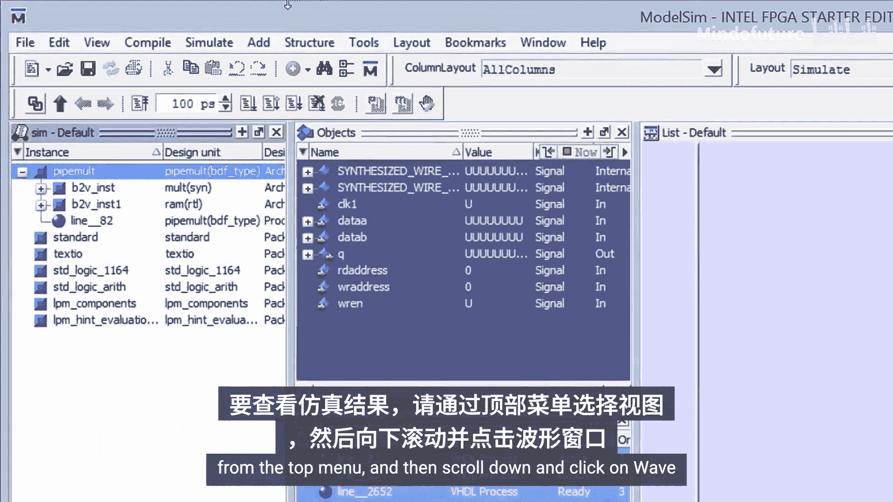

The wave window appears。Typically， the default time scale is 100 picoconds。

Now to add signals to the wave window， click on the objects window。

 hit C A to select them all and then drag these over to the wave window and release them there to place them in the left pane。

Now， we need to create some stimulus or test vectors to test this logic design。

 There are several ways to do this。 The most efficient is to write a test bench。

 a wrapper HDL code that creates external devices that create the signals to the input ports of the device under test。

Test benches will be discussed in detail in course3 of the specialization。

Another way to create stimulus is to enter it manually into Model SIM。

 which is the method we will use now。To create a clock。

 right click on the clock1 signal at the top of the list and scroll down to clock。

The defined clock dialog box should appear。The default duty cycle is 50% and the default period is 100 simulation time units。

 which are picooseds in the example here。The time scale can easily be changed。

 but this is usually set at the beginning of the simulation using simulate then start simulation。

 Currently， simulations can run for 100 units as indicated in the center of the top row of icons。

 You can edit the units here directly to change the simulation time， but not the time scale。

Except all the defaults and click O。

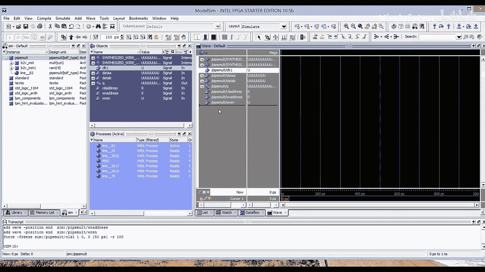

Right click on the RA signal and select force in the force selected signal dialog box。

 change the value from u to1 and click OK。Right click on the data A signal and select force in the force selected Sign dialog box change the value to binary 2 written as60s followed by a 1 and a0。

 click O。Right click on the Data B signal and select force。In the four selected signal dialog box。

 change the value to binary 3 written as six zeros followed by two ones。Click， O。

Leave the addresses at zero and the other signals are derived outputs。

 so we don't need to define them。

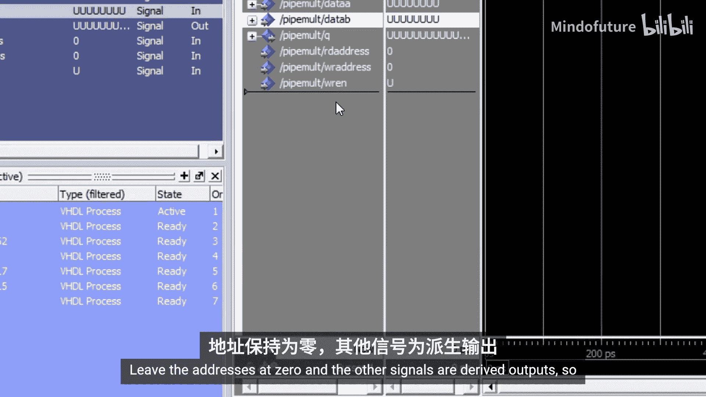

Now from the top menu， select Simulate， then run， and then run 100。

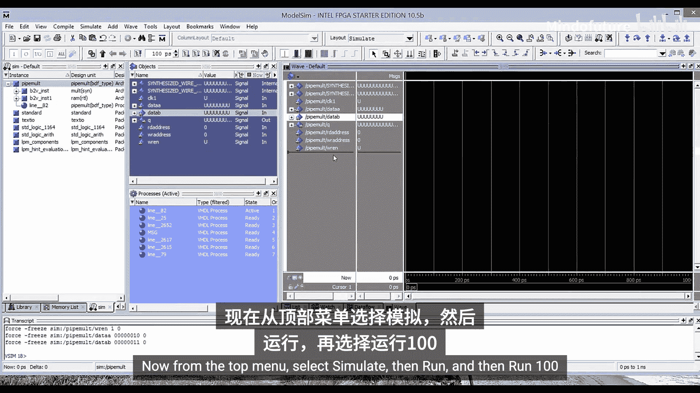

The simulation runs for 100 time units。You should see one period of the clock and values for the other signals。

The Q output is in red because it is unknown as it has no active driver yet。

You can run another00 units by clicking on the icon to the left of the time box at the center top。

 which looks like a document with a down arrow next to it。

Do this and you will see a second clock period。Do this again to get a third period。

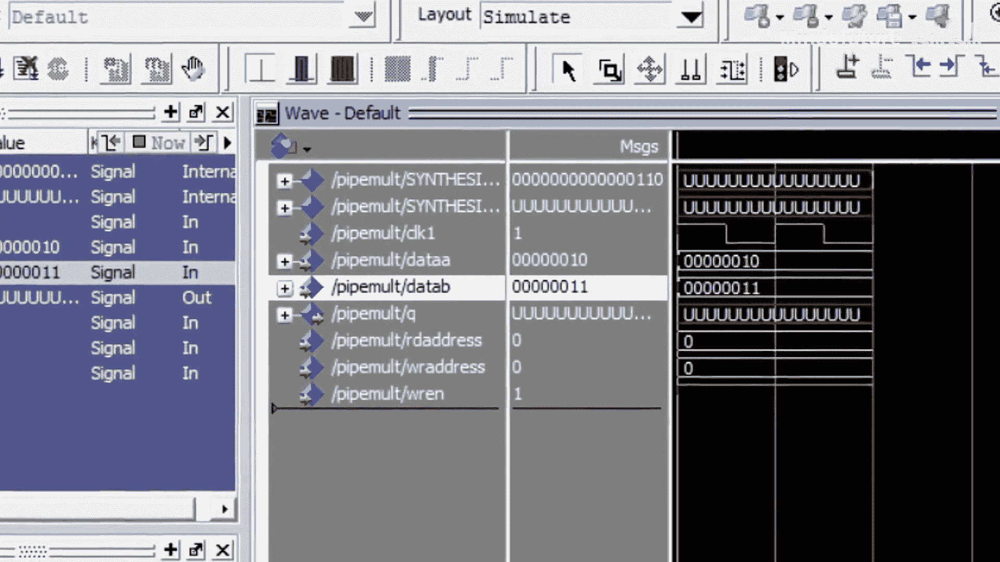

At the bottom of the wave window is a cursor， which you can move to a particular simulation time。

 move it to about 250 picoseconds。

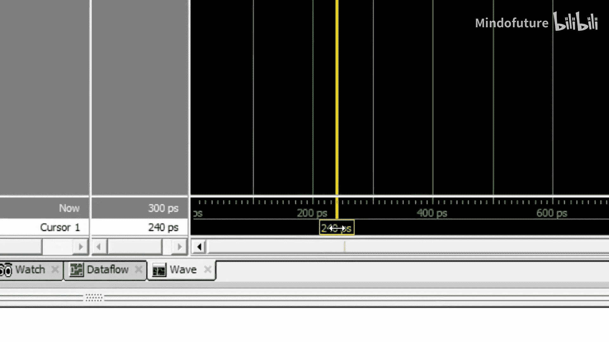

At this point in time， one of the synthesized signals is now driven with the value of binary 6。

 this is the multiplier output。We can see this better by changing the radex of the values by right clicking on the values and selecting radex and then decimal for data A。

 data B， and the last three outputs。Hit the run button to simulate 100 units a couple more times。

The multiplier output has been stored in the RA， and now the RA output is being driven。

Run one more time and now the Q outputs to the pins of the device are now being driven。

You can see from the timing diagram that it takes two clock cycles to do the multiply。

 two cycles to store and read from the RA， and then one cycle to register the output。

You can measure time differences by adding another cursor。

 do this by right clicking on the bottom black space below the existing cursor and selecting new cursor。

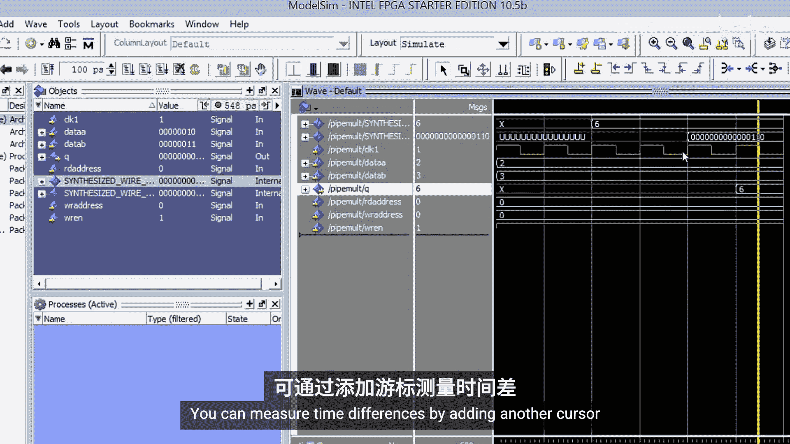

The difference in time is now displayed between the cursors。Next， let's change the rent value to0。

 the data A value to 255。

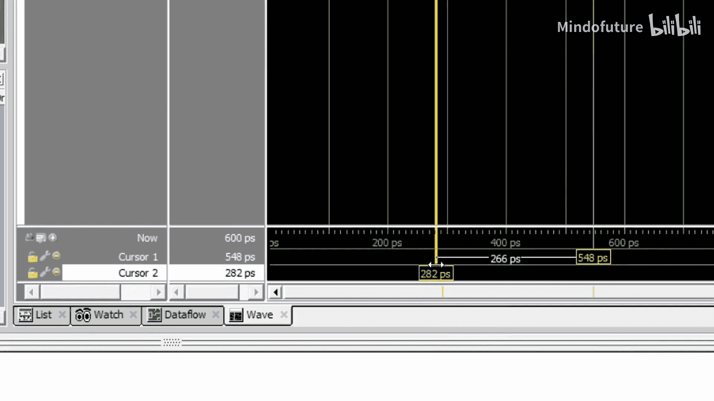

Right click on the red signal in the list， select force and then enter0 for the value and click OK。

Right click on the data A， select force and then enter eight ones for the value and click OK。

We see data A displayed as minus1 and the multiplier output as 765。Does this make sense？

Data A is being displayed as a twos complement number， but the multiplier output is 16 B。

 so it is unsigned。 right click on data A and select radix unsigned。Now it is listed as 255。

Is 255 times 3 equal to 765。 Yes， our multiplier appears to be working。

It run three more times to propagate the result to the output。

Notice that the output does not change to 765。 This is because the RA signal is set to 0。

 so the multiplier result is not being written to the RA。Force ran to one again， as before。

Hit run four more times and the output result changes to 765。At this point。

 the beginning of the simulation can no longer be seen on the screen。

 you can adjust this by right clicking on the wayform blackspace and selecting Zoom full from the many Zoom options。

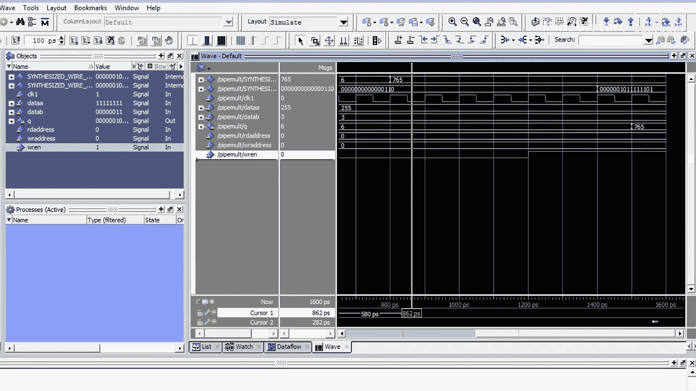

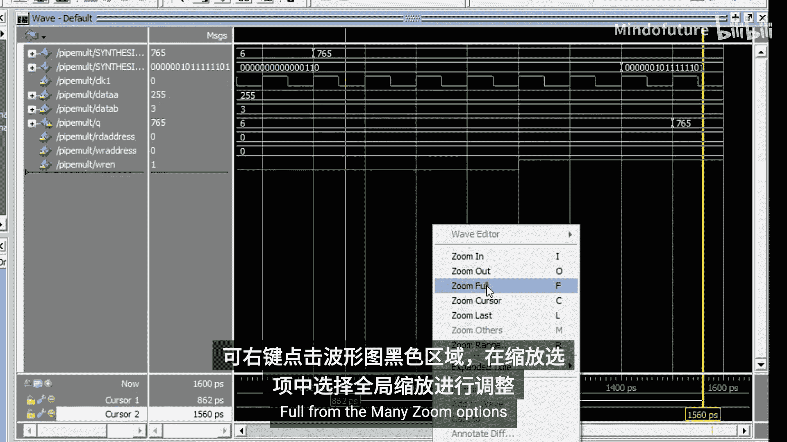

Now change data B to 255。Hit run six more times。If you didn't change the data B radix。

 it appears as minus1 and the multiplier output is minus 511。Now。

 this would be true if we are mixing uns and sign representations of numbers。

Change the reds of data B and the last three outputs to unsigned。 The value displayed is now 65025。

 which is correct。If you look at the lower left portion of the screen below the transcript window。

 you see the total simulation time， in this case， 2200 picoseconds。

This is an R TL simulation at the register transfer level。

 It does not include any time delay or propagation delay information in the circuit models。

 The purpose of this simulation is to verify correctness of the logic。

 sequencing and of more top level calculations。 simulation with timing information is also done post fitting known as the timing simulation or gate level simulation。

 We will look at gate level simulations in a later class。

You can save the simulation results to save the waveform as an image。 click in the waveform window。

 and then click on file， then export， and then image。

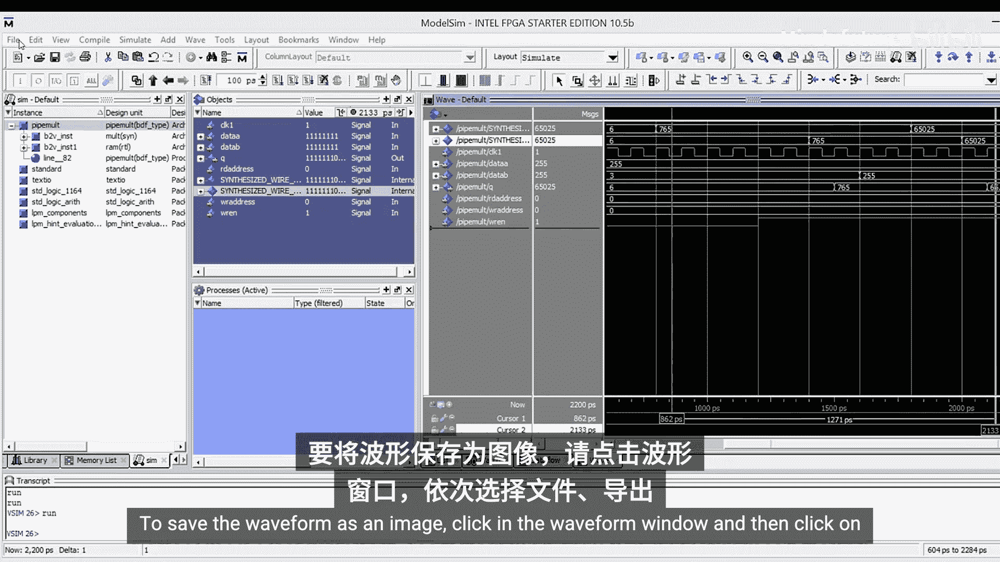

Type pipe mo wave to save the bump file。If you click in the objects window。

 you can save the list is a text file from the file menu in a similar fashion。Finally。

 you can right click on the transcript window and hit select all to save the commands used to create the simulation。

 which can later be rerun as a script。After select all。

 select copypy and then paste into your favorite text editor。

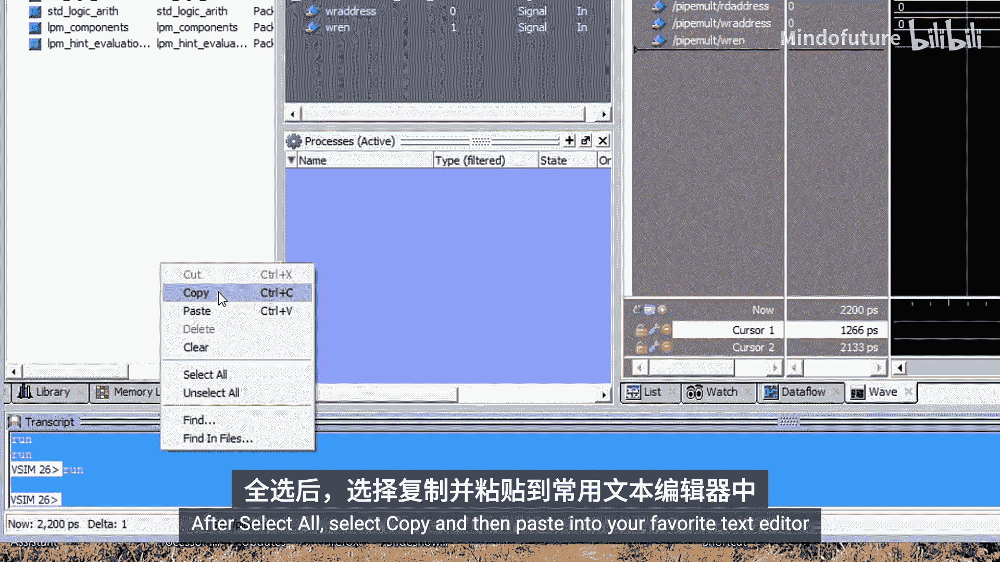

Let's look at some of the results we achieved in this session。

Initially， remember when you started the simulation。

 the display looked like this with signals in the waveform window。

 but no timing information as of yet。Gradually we added signals until we could verify that the logic was working at least for some test cases。

Finally， we added several more test cases， learned how to add cursors and make timing measurements。

 and how the choice of raix impacts the presentation of the data。

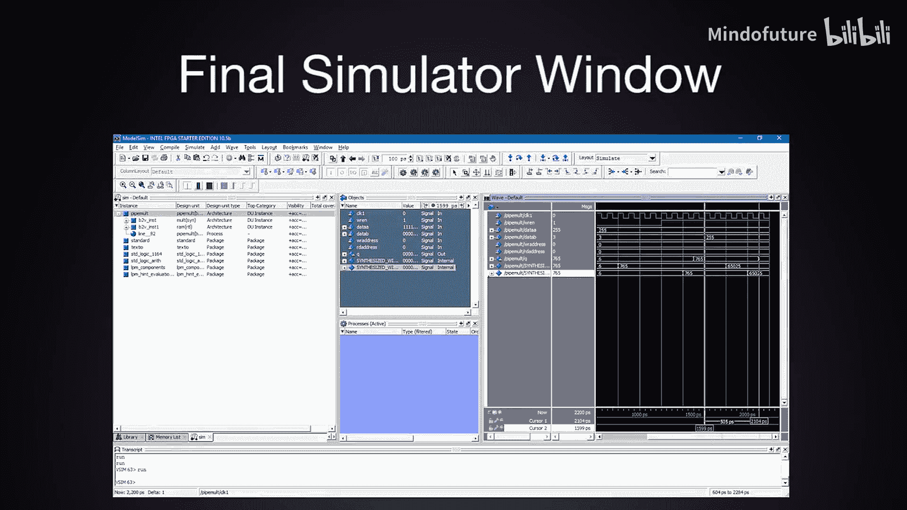

In this video， you have learned how to convert a schematic BDF file into a VHDO file for simulation。

 how to start and configure model SIim， how to add signals to the waveform window。

 how to create stimulus to drive inputs in the simulation。

 and how to verify logic design by thoughtful design of test cases applied in simulation。

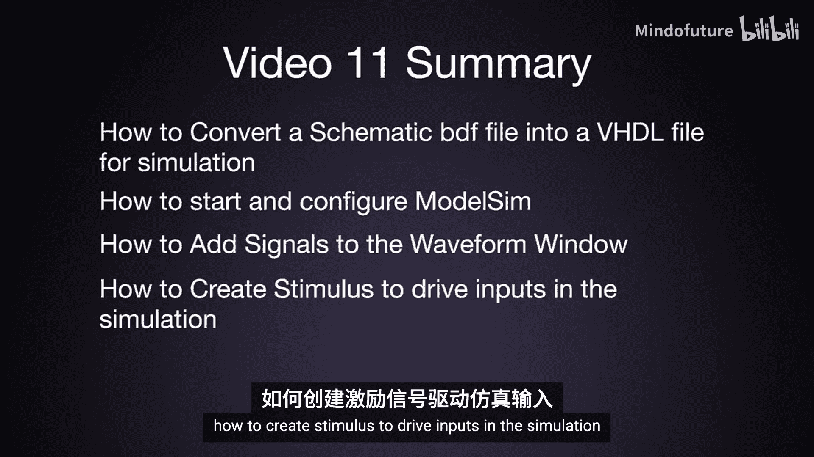