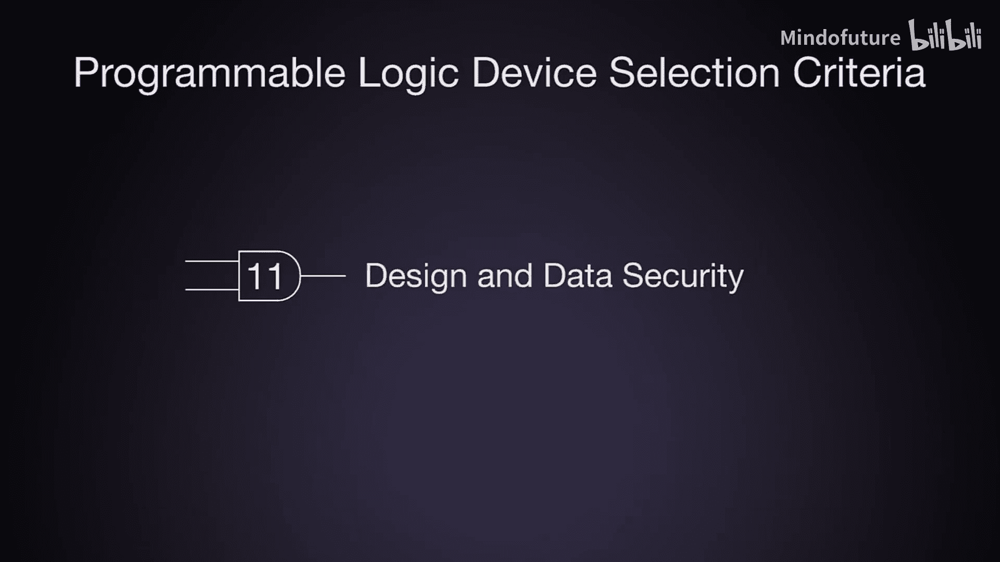

# 【科罗拉多大学】嵌入式系统-FPGA-设计入门-｜-intro-fpga-design-embedded-systems-p20-P20_03_01_01_1-多种类型的FPGA--BV19Tu6zGEMD_p20-

Let's take a closer look at FPGA architecture to see how these devices are put together and why。

In the first module we introduced programmable logic devices in the FPGA in module2。

 we used Cortus Prime to work through a sample FPGA design。In this module。

 we will extend our knowledge of FPGA capabilities so that we can choose the right one when working on a design。

Designing digital devices is a creative process， much like cooking up a new recipe or painting a new picture。

To be proficient， we need to know what ingredients are available to make our new creation。Xlinks。

 Alta， microcrosemi and lattice all make great programmable logic devices。

 but none of them will work for every application， each vendor has their specialties。

Have you ever wondered why use this one instead of that one？

If so you're in luck because we are going to answer this question in this module。

 we will look at a set of criteria to evaluate these devices to help us decide which one is best for a particular application。

What are the essential capabilities that we need to get from an FPGA First it needs to provide ample amounts of logic。

The more the better as the value tends to rise faster than costs as FPGAs get large。

Smaller FG processed geometries usually translate into higher logic density。

 the amount of logic is measured a number of ways。System gates， logic elements， slices， macrocell。

 labs， ALMs， etc ce。 Of course if the part costs too much for a design budget。

 then the benefits from the logic device won't be accrued。

 so cost and particularly cost per gate is important。

Another essential FPGA characteristic is processing speed。

 often measured by the maximum clock frequency or FMX Spe is also important in the IO as well as the fabric。

In direct opposition to speed is the requirement for low power consumption。

 MPPGs consume considerable power both when operating at high frequencies。

 but also as the part does nothing， it draws static power。

Depending on architecture and the configuration memory type。

 power consumption can vary from microwatts to hundreds of watts。

Reprogram mobility is also dependent on the configuration memory type。

SRM and flash or reprogrammable， antifuses is not。Reprogrammability makes development much easier as new designs can be programmed into the same part over and over again。

In addition to internal capabilities， external interfaces to the FPGA are also important。

 modern FPGAs can be tied to a large variety of IO types。

One measure of value is the cost per IO and the IO density relative to the logic on a part。

Another way to increase the value of an FPGA is by inclusion of hard IP cores。

 like those for memory DSP blocks， transceivers， and even hard processors。Some devices。

 particularly CPLDs and smaller EGAs， are structured so that the timing is deterministic。

 it remains consistent for a function even as the part is rerouted based on a new design。

In some applications like safety critical designs， reliability is a major concern measured by the fit rate or mean between failure。

Enurance of the configuration memory can be an issue for long lifetime products and is an important parameter in flash based EGAs。

Increasingly important is the ability to protect design information held in the FPGA bit pattern and also the data that travels through the FPGA。

In summary， here is the programmable logic device selection criteria we will use as we survey available FPGA devices and technology from all the major vendors。

There are 11 criteria。Reprogrammability or configuration memory type。Size or logic density。

 the amount of logic in system gates or LEs or slices or ALMs。Cost per logic gate。

Speed or maximum clock frequency。Power consumption， both static and dynamic。

Cost per I O relative to I density。Hard IP available on the chip， like memory， DSP blocks。

 transceives， etc。Deterministic timing where timing is consistent in every implementation。

Reliability measured by the fit rate。Enurance， a number of programming cycles and years of retention。

And design and data security。

