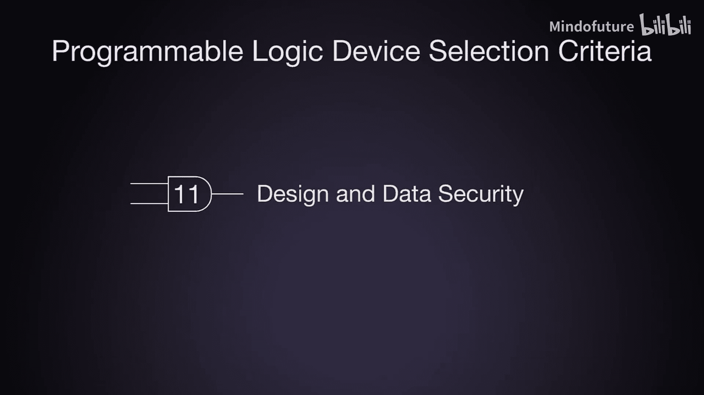

# 嵌入式系统FPGA设计入门：P20：多种类型的FPGA

在本节课中，我们将深入学习FPGA的架构，了解这些设备是如何构建的以及其背后的原理。我们将探讨如何根据一系列关键标准来评估和选择适合特定应用的FPGA。

在第一模块中，我们介绍了FPGA这类可编程逻辑器件。在第二模块，我们使用Cortus Prime工具完成了一个FPGA设计示例。在本模块中，我们将扩展对FPGA能力的认识，以便在设计时能做出正确的选择。

设计数字设备是一个创造性的过程，类似于构思新食谱或创作新画作。为了精通此道，我们需要了解有哪些“原料”可供我们创造新设计。赛灵思、阿尔特拉、美高森美和莱迪思等公司都生产优秀的可编程逻辑器件，但没有一款器件能适用于所有应用，每家厂商都有其专长领域。

你是否曾疑惑，为什么选择这款FPGA而不是那款？如果是，那么你很幸运，因为本模块将解答这个问题。我们将学习一套评估这些器件的标准，以帮助我们决定哪一款最适合特定的应用。

## 评估FPGA的关键标准

那么，我们需要从FPGA中获取哪些核心能力？以下是评估时必须考虑的11个关键标准。

### 1. 可重编程性与配置存储器类型
首先，FPGA需要具备可重编程能力，这取决于其配置存储器的类型。SRAM和闪存型FPGA是可重编程的，而反熔丝型则不可。可重编程性使得开发过程更加便捷，因为可以将新设计反复编程到同一器件中。

### 2. 规模与逻辑密度
FPGA必须提供充足的逻辑资源。通常，逻辑资源越多越好，因为随着FPGA规模增大，其价值增长往往快于成本增长。更小的制造工艺几何尺寸通常意味着更高的逻辑密度。逻辑数量有多种衡量方式，例如：
*   **系统门数**
*   **逻辑单元**
*   **切片**
*   **宏单元**
*   **逻辑阵列块**
*   **自适应逻辑模块**

### 3. 每逻辑门成本
当然，如果器件的成本超出了设计预算，那么逻辑器件带来的优势就无法实现。因此，成本，尤其是**每逻辑门成本**，是一个重要考量因素。

### 4. 速度与最大时钟频率
处理速度是FPGA的另一项基本特性，通常以**最大时钟频率**来衡量。速度的重要性不仅体现在内部逻辑上，也体现在输入/输出接口的性能上。

### 5. 功耗
与高速要求直接对立的是低功耗的需求。FPGA在高频运行时功耗可观，即使在空闲状态下也会消耗静态功率。根据架构和配置存储器类型的不同，功耗范围可以从微瓦到数百瓦不等。

### 6. 每I/O成本与I/O密度
除了内部能力，FPGA的外部接口同样重要。现代FPGA可以支持多种I/O类型。衡量其价值的一个指标是**每I/O成本**，以及相对于芯片上逻辑资源的**I/O密度**。

### 7. 硬核IP资源
提升FPGA价值的另一种方式是在芯片内集成硬核知识产权模块，例如：
*   **存储器块**
*   **数字信号处理块**
*   **高速收发器**
*   **甚至硬核处理器**

### 8. 确定性时序
某些器件，特别是CPLD和较小的FPGA，其结构使得时序具有确定性。这意味着即使基于新设计对器件进行重新布线，特定功能的时序也能保持一致。这在某些对时序要求严格的应用中至关重要。

### 9. 可靠性
在一些如安全关键型设计中，可靠性是主要关注点，通常以**失效率**或**平均故障间隔时间**来衡量。

### 10. 耐久性
对于长寿命产品，配置存储器的耐久性可能成为一个问题。这是基于闪存的FPGA的一个重要参数，包括**可编程周期数**和**数据保持年限**。

### 11. 设计与数据安全性
日益重要的是保护存储在FPGA位流文件中的设计信息，以及流经FPGA的数据的能力。

## 总结

本节课中，我们一起学习了评估和选择FPGA的11项关键标准。从可重编程性和逻辑密度，到成本、速度、功耗、接口、硬核资源、时序确定性、可靠性、耐久性以及安全性，这些标准为我们全面考察各大厂商的FPGA设备和技术提供了清晰的框架。掌握这些标准，将帮助你在未来的嵌入式系统设计中，为特定应用选出最合适的可编程逻辑器件。

