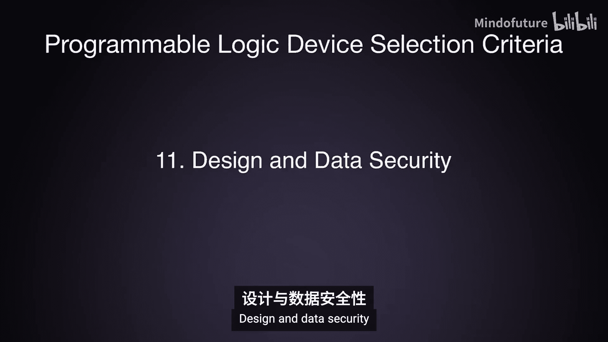
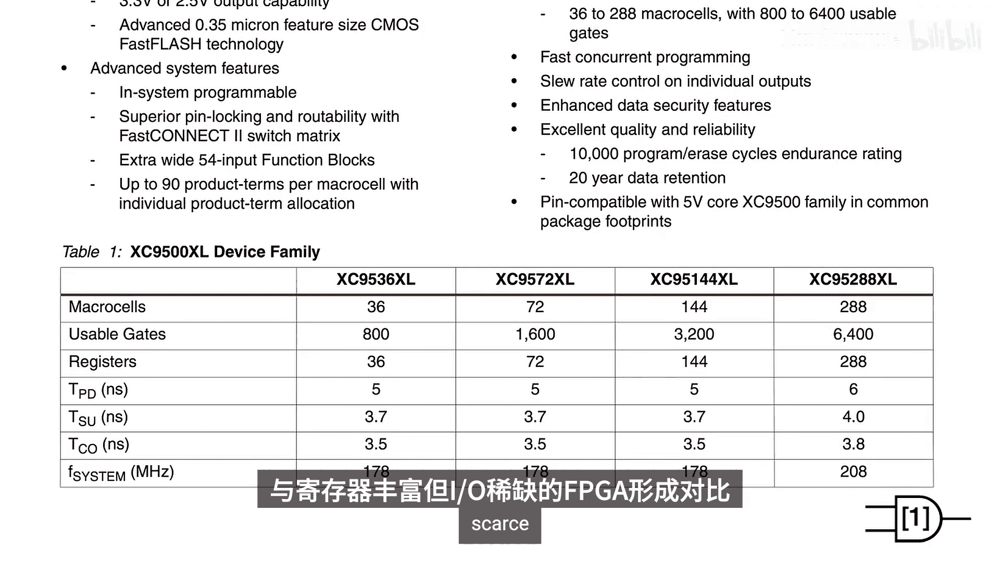
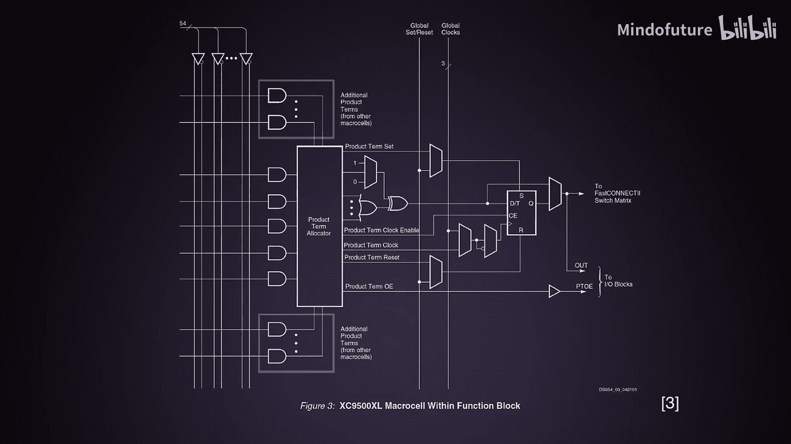
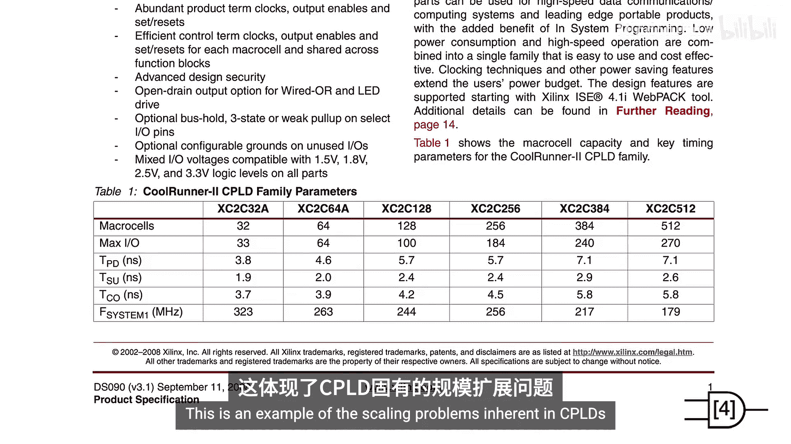

# 【科罗拉多大学】嵌入式系统-FPGA-设计入门-｜-intro-fpga-design-embedded-systems-p21-P21_03_02_01_2-Xilinx-CPLD架构--BV19Tu6zGEMD_p21-

In this video， we will start our survey of modern programmable logic devices beginning with CPLDs from XylelinkX。

We will use the programmable logic device selection criteria we established earlier to evaluate these devices to reiterate there are 11 criteria。

 size or logic density， which is the amount of logic in system gates or LEs or slices or ALMs。

Cost per logic gate。Speed， which is the maximum clock frequency。Power consumption。

 static and dynamic。Reprogrammability。Cost per IO or I density。Hard IP available on chip like memory。

 DSP blocks， transceives， etc ce。Deterministic timing。

Where the timing is consistent in every implementation。

Reliability which can be measured by the fit rate。Enurance。

 which is the number of programming cycles and years of retention。Design and data security。

Here's the Zillinks XC 9500 XL CPLD Family Data sheet， which you can find on the Zionlinks。

com website。Why do you look at the data sheet generally。

 we are trying to determine if we can use this part in our design by looking at its specified performance characteristics。

I'd like to highlight some of the significant characteristics of this device that relate directly to our selection criteria。

Deterministic timing， five nanosecond pin to pin delay。5 volt IO say that with Augustto。

 these parts are used as voltage translators， especially in automotive applications where much legacy equipment still runs on5 volts。

I myself have used an NE9572 X in the design of an industrial product for this very reason。

This is a device with flash cells for routing， it is reprogrammable。20 years data retention is good。

 as is 10，000 programming cycles endurance。Note the limit in the amount of logic， 288 macrocell。

 6400 gates， 288 footflps。The speed is also limited to 208 megahertz。

This device has up to 192 IO pins， so lots of IO per register almost one to one。

 this is an IO rich device unlike an FPGA which be register rich and IO scarce。

Here is an overall top level view of the architecture。

Up to 288 macro cells are connected through the routing matrix to the IO。

The next figure shows a more detailed view of the macro cell architecture。

 the macroce can add up to the 54 signals， and then or together five of these plus phi from an adjacent macroce。

 which may itself have an additional number for other macroce。Choice of clock， enables， resets。

 et cetera， are programmable。 They're either local or global。

 The macrocell has only two outputs to the IO blocks。

Here's the Xillinkx Cool Runner2 CPLD Family Data Sheet。

Here are some of the significant characteristics of this device that relate directly to our selection criteria。

This part was designed with low power in mind， hence the name。

 and includes several low power features。Note the limit in the amount of logic， 512 macrocell。

 512 flip flos。This device has up to 270 IO pins， so lots of IO per register almost one to two。

 this is an IO rich device as well。It has deterministic timing， five nanocond pin to pin delay。

The speed's limited to 323 megahertz， it's faster for smaller parts。

Why do you suppose this is the parts with more macro cells will have more routing。

 more capacitance and therefore slower speeds。 This is an example of the scaling problems inherent in CPLDs。

This is a device with non volatile configuration memory that is transferred to SRM cells for routing。

 it is reprogrammable。20 years data retention is good as is 1，000 programming cycles endurance。

Here is an overall top level view of the architecture。

 up to 512 macro cells are connected through the advanced interconnect matrix or aim with each function block connected to the IO。

The next figure shows a more detailed view of the Corunner 2 macrocell architecture。

 which is very similar to the XC9500 XL， the macrocell can add up to 40 signals and then or together five of these feed forward from other macroce is through the and array choice of clock enables resets etc cea programmable。

 either local or global the macrocell has only one output to the IO blocks。

Remember the four bitit comparator？How wide of a comparator can you build with one macroce。

 in theory， since five signals are combined， each macroce could generate five bits of comparator。

 a fairly efficient use of available logic。From this。

 one could also conclude that the implementation of address decoders will be efficient。

How many full adders can be made in a macrocell， just one as there is only one output。

 if the XR output is used for the sum out， then the carryout can be routed to the next macrocell just as the carry in comes from the previous one。

 however， this only uses about nine gates in one macrocell， which isn't very efficient。

 likewise when implementing a shift register， only the register in each macrocell is used。

 so the big PLA structures are superfluous。In this video。

 we have learned Xylelinkx offers two CPLD families， the XC9500 XL， and the Co Runner2。

 both are reprogrammable with deterministic timing and rich and IO。

 but are limited in speed and logic density。The XC9500 XL family has5 volt tolerant IO。

 which can be important in industrial and automotive applications。

The Co Runner too is a lower power CPLD family。XilXs CPLDs are efficient in the implementation of comparators and decoders。

 but not efficient in the implementation of adders or shift registers。

