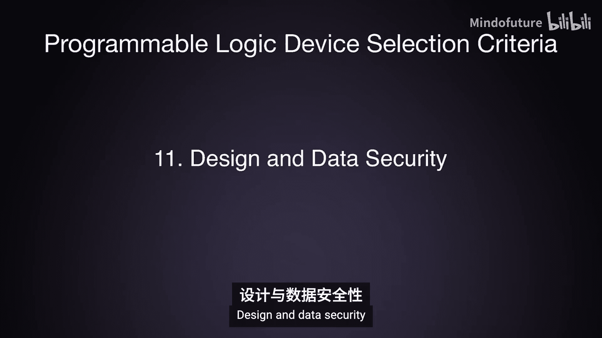
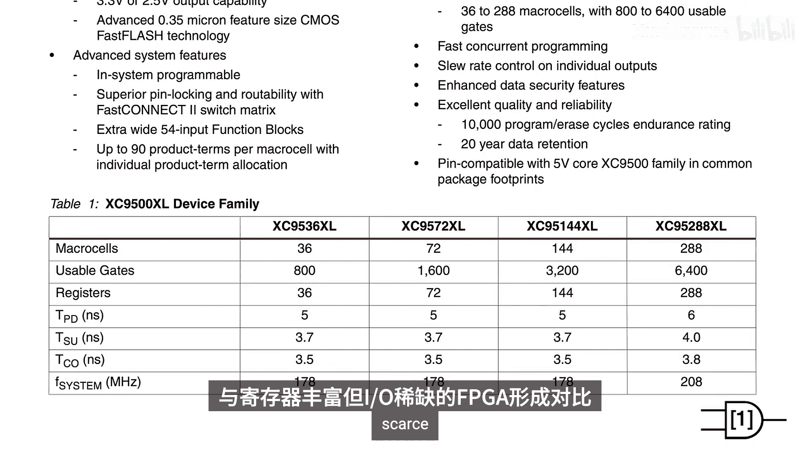
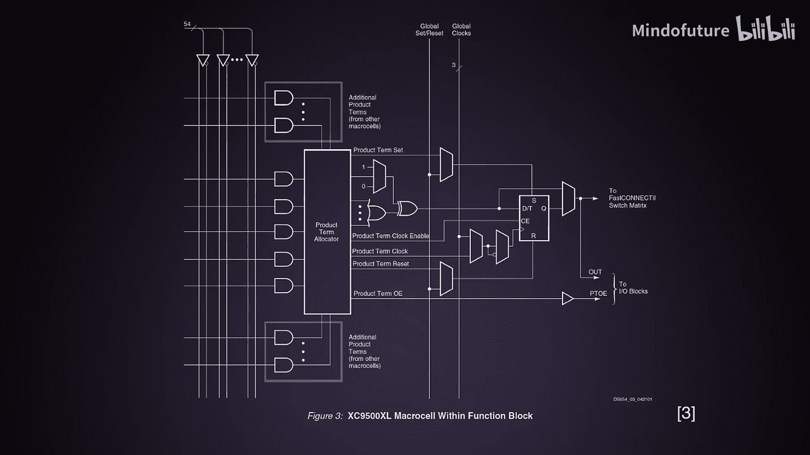
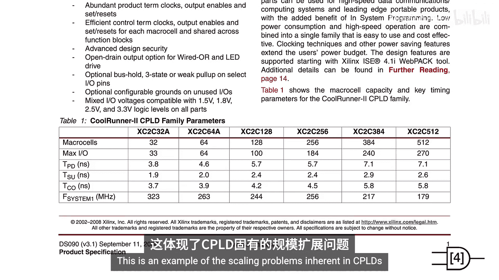

# 嵌入式系统FPGA设计入门：P21：Xilinx CPLD架构 🧩

在本节课中，我们将开始对现代可编程逻辑器件进行概览，首先从Xilinx的CPLD开始。我们将使用之前建立的可编程逻辑器件选择标准来评估这些器件。

## 概述

我们将依据11项标准来评估Xilinx的CPLD器件，这些标准包括：逻辑密度、每逻辑门成本、速度、功耗、可重编程性、每I/O成本、片上硬IP、确定性时序、可靠性、耐久性以及设计和数据安全性。

## 器件选择标准

以下是评估可编程逻辑器件的11项核心标准：

*   **逻辑密度**：以系统门、逻辑单元、切片或自适应逻辑模块的数量来衡量。
*   **每逻辑门成本**。
*   **速度**：最大时钟频率。
*   **功耗**：包括静态功耗和动态功耗。
*   **可重编程性**。
*   **I/O密度或每I/O成本**。
*   **片上可用硬IP**：如存储器、DSP模块、收发器等。
*   **确定性时序**：每次实现时，时序保持一致。
*   **可靠性**：可通过适配率衡量。
*   **耐久性**：编程周期数和数据保留年限。
*   **设计和数据安全性**。

## XC9500 XL CPLD系列

这是Xilinx XC9500 XL CPLD系列的数据手册，可以在Xilinx官网上找到。查看数据手册的目的是通过其指定的性能特性，判断该器件是否可用于我们的设计。

接下来，我们重点分析与选择标准直接相关的该器件的一些重要特性。

*   **确定性时序**：引脚到引脚的延迟为5纳秒。
*   **5V I/O容限**：这些器件可用作电压转换器，尤其是在许多传统设备仍运行在5V电压的汽车应用中。我本人在一个工业产品设计中就曾为此使用过XC9572XL。
*   **配置与可编程性**：该器件使用闪存单元进行路由配置，**可重编程**。数据保留20年，耐久性为10,000个编程周期，表现良好。
*   **逻辑容量限制**：最多288个宏单元，6400个门，288个触发器。
*   **速度限制**：最高208 MHz。
*   **I/O数量**：最多192个I/O引脚，每个寄存器几乎对应一个I/O，这是一个**I/O丰富**的器件，与寄存器丰富而I/O稀缺的FPGA不同。

### 架构总览

上一节我们介绍了XC9500 XL的基本特性，现在来看看它的整体架构。

其顶层架构视图显示，最多288个宏单元通过路由矩阵连接到I/O模块。

### 宏单元架构详析

下图展示了宏单元架构的更详细视图。

*   每个宏单元的与阵列可接收多达54个输入信号。
*   其中5个与项的输出可以被“或”在一起，此外还可以接收来自相邻宏单元的反馈信号，该反馈信号本身可能又包含了其他宏单元的输入。
*   时钟、使能、复位等信号的选择是**可编程**的，可以是局部信号，也可以是全局信号。
*   每个宏单元只有**两个输出**连接到I/O模块。

## Cool Runner-II CPLD系列

现在，我们来看看Xilinx的另一款CPLD系列：Cool Runner-II。

以下是该器件与选择标准直接相关的一些重要特性。

*   **低功耗设计**：该器件专为低功耗设计，因此得名，并包含多项低功耗特性。
*   **逻辑容量限制**：最多512个宏单元，512个触发器。
*   **I/O数量**：最多270个I/O引脚，大约每两个寄存器对应一个I/O，同样是一个**I/O丰富**的器件。
*   **确定性时序**：引脚到引脚的延迟为5纳秒。
*   **速度限制**：最高323 MHz，器件规模越小，速度越快。这是因为具有更多宏单元的部件需要更多路由，电容更大，因此速度更慢。这体现了CPLD固有的规模扩展问题。
*   **配置与可编程性**：该器件使用非易失性配置存储器，配置时传输到SRAM单元进行路由，**可重编程**。数据保留20年，耐久性为1,000个编程周期，表现良好。

### 架构总览

Cool Runner-II的整体架构视图显示，最多512个宏单元通过高级互连矩阵连接，每个功能块连接到I/O。

### 宏单元架构详析

Cool Runner-II的宏单元架构图与XC9500 XL非常相似。

*   宏单元的与阵列可接收多达40个输入信号。
*   其中5个与项的输出可以被“或”在一起，来自其他宏单元的前馈信号通过**与阵列**输入。
*   时钟、使能、复位等信号的选择是**可编程**的，可以是局部信号，也可以是全局信号。
*   每个宏单元只有**一个输出**连接到I/O模块。

## 应用效率分析

还记得4位比较器吗？理论上，由于5个信号可以组合，每个宏单元可以生成5位比较器，这是对可用逻辑相当高效的利用。由此也可以推断，地址解码器的实现将是高效的。

那么，一个宏单元能实现多少个全加器？只能实现一个，因为只有一个输出。如果异或输出用作“和”输出，那么“进位输出”可以路由到下一个宏单元，就像“进位输入”来自前一个宏单元一样。然而，这在一个宏单元中只使用了大约9个门，效率并不高。同样，在实现移位寄存器时，只使用了每个宏单元中的寄存器，庞大的可编程逻辑阵列结构就显得多余了。

## 总结

本节课中，我们一起学习了Xilinx提供的两个CPLD系列：XC9500 XL和Cool Runner-II。

*   两者都具有**可重编程性**、**确定性时序**和**丰富的I/O**，但在速度和逻辑密度上有限制。
*   XC9500 XL系列具有**5V容限I/O**，这在工业和汽车应用中可能很重要。
*   Cool Runner-II是一个**低功耗**的CPLD系列。
*   Xilinx的CPLD在实现**比较器**和**解码器**时效率很高，但在实现**加法器**或**移位寄存器**时效率不高。