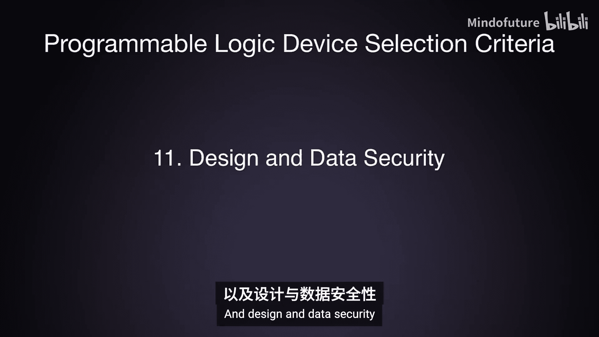
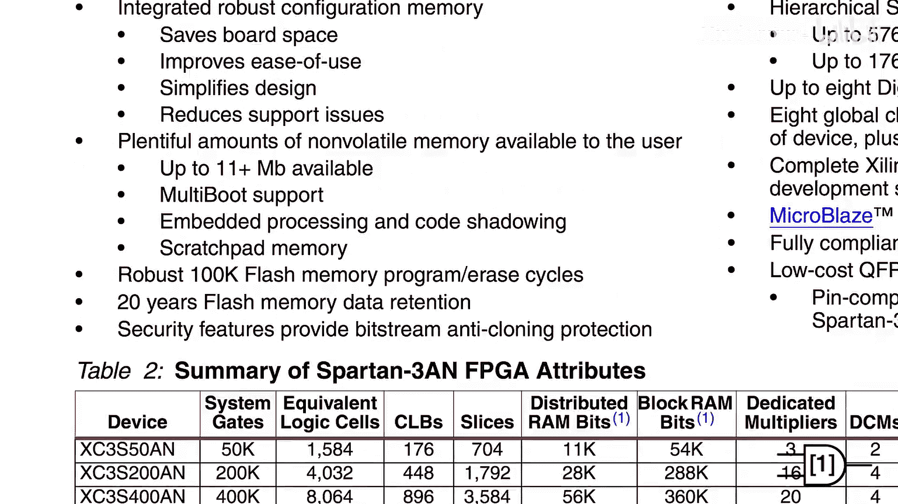
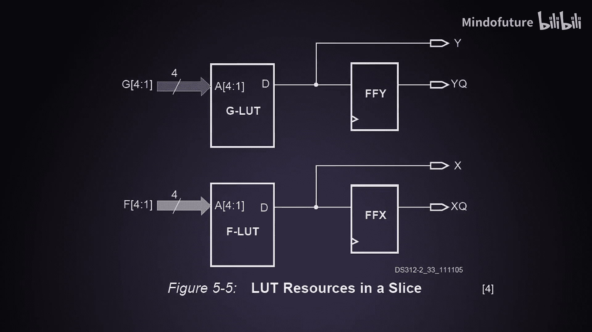
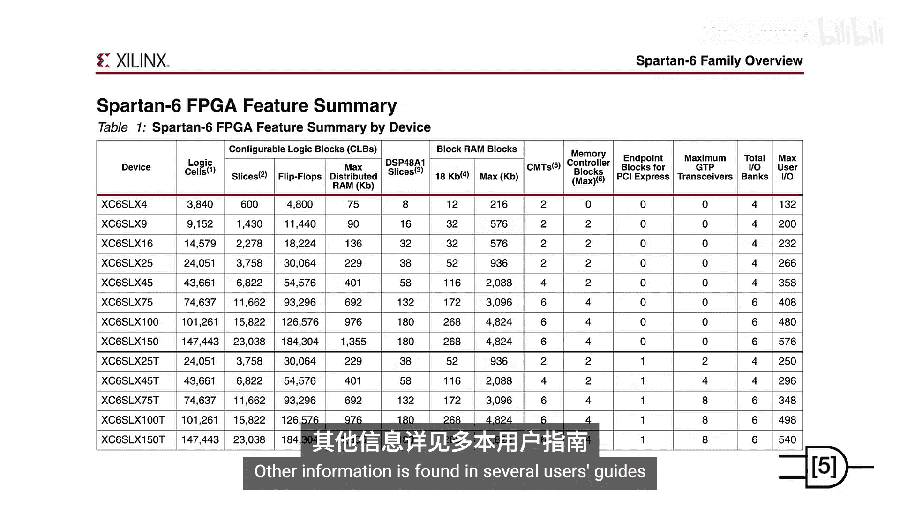
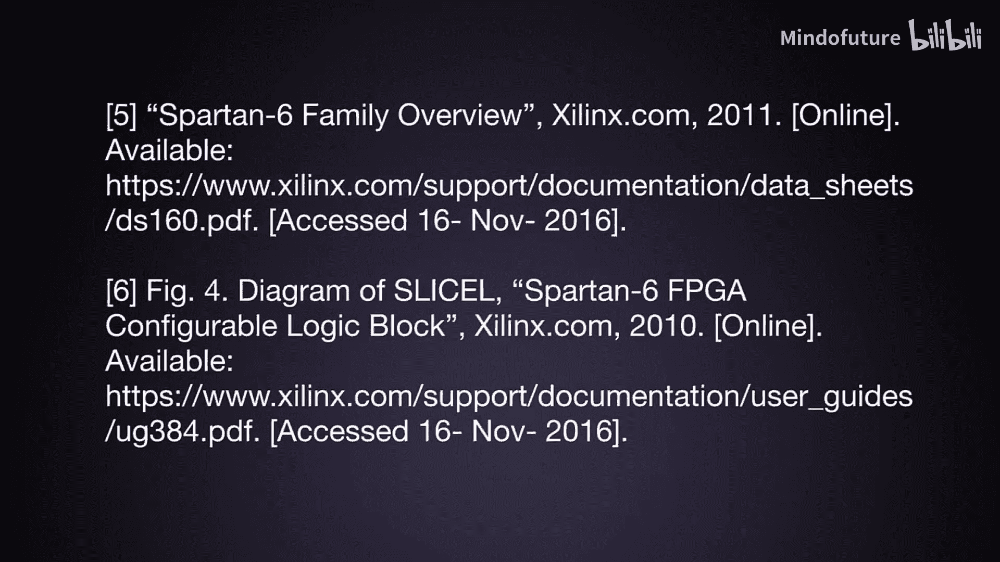

# 【科罗拉多大学】嵌入式系统-FPGA-设计入门-｜-intro-fpga-design-embedded-systems-p22-P22_03_02_02_3-Xilinx小型FPGA--BV19Tu6zGEMD_p22-

In this video， we will continue our survey of modern programmable logic devices。

With small FPGAs from Xylinks， including the Spartan 3AN and the Spartan6。

We will use the programmable logic device selection criteria we established earlier to evaluate these devices。

As a reminder， there are 11 criteria。Size or logic density。

 the amount of logic in system gates or LEs or slices or ALMs。Cost per logic gate。

The speed or maximum clock frequency。Power consumption， both static and dynamic。Reprogrammability。

 the configuration memory type cost per IO or IO density。Hard IP available on chip， memory。

 DSP blocks， transceives， etc ce。Deterministic timing， timing is consistent in every implementation。

Reliability measured by the fit rate。Enurance， the number of programming cycles in years of retention。

And design and data security。

Here's a portion of the Zillink Spartan 3AAN FPGA Family data sheet。

The Spartan 3AN has reprogrammable flash configuration and user memory。

Note the equivalent gates up to 1。4 million 25K logic cells。

 considerably more logic than the CPLDs have， this part is designed for low cost。

If you need more logic than this， then you need to select a larger part that will meet your requirements。

 we'll talk about larger parts as we continue in this module。

The speed is limited to 350 megahertz on global clock buffers， which is faster than CPLDs。

Maximum power draw is between 20 and 200 milliamps depending on part size。

This device has up to 502 IO pins， a 50 to one ratio of logic cells to IO。

 There are 23 supported IO standards。20 years data retention is good as is 100。

000 programming cycles endurance。

Design security is enhanced by the integration of the configuration memory on a single chip。

Hard IP blocks have been added， including RAM blocks。Multipliiers and digital clock managers。

Initially， programmableology devices specified most information in the data sheet。

 however now not all the information is found in the data sheet。

 some is found in the corresponding user's guide or handbook。

Here is the overall architecture of the Spartan III IO is on the outside and it includes logic blocks。

 RA， multipliers and clock manager。Here is a picture of a Spartan III slice。

 one half of a logic block。The heart of the slice is two， four input Lus and two flip flop outputs。

 it also has some carry chain logic for creating adders and shift clock generation to make shift registers。

This is a simplified picture of the lot resources in a slice。

 The lots can also be used as distributed memory， Each light is 16 bits of RA or as a 16 bit shift register。

Here's a portion of the Zylelink Spartan6 FPGA Family data sheet。

The Spartan 6 has reprogrammable SRAM configuration， which requires an external non volatilet memory。

 usually a flash memory， to load the configuration at power up。

 the delay before the device becomes active is several milliseconds。

Note it has up to 147 k logic cells， considerably more logic， this part is designed for low cost。

Additional hard IP blocks are included， including 180 DSP slices。Almost 5，000 kilobytes of block RAm。

And up to eight high speed transceivers。This device has up to 540 IO pins。

 a 300 to1 ratio of logic cells to IO， there are 55 supported IO standards。

Speed is limited to 400 Mgahertz on global clock buffers， which is faster than CPLDs。

Maximimum static power draw is between 20 and 51 milliamps depending on part size。

 dynamic power is not specified。Other information is found in several users' guides。

Here is a picture of a Spartan6 slice， one quarter of a logic block。 The heart of the slice is 4。

6 input Lus and 8 foot flos。 It also has some carry chain logic for creating adders。

 There are three types of slices with varying capabilities。 As you can see。

 the logic is becoming more and more complex。This is a simplified picture of the lut resources in a slice。

 the luts can also be used as distributed memory each slice can create up to a 256 by one raM or raM。

 or as a 32 bit shift register per slice。Recall the four bit comparator。

How many carvertor bits can be implemented in a L？In the 3 AN case， there are only four inputs。

 so only a2 bit comparator can be created。 Lager comparators require that the lets be cascaded。

Although the logic is efficiently used， there is an added delay relative to the CPLD implementation in the Spartan6 case。

 the six input lot will handle three bits of comparators so wider comparators can be made with less delay。

How many full adders can be made in a logic cell for a Spartan 3A at first blush。

 it would seem to require two luts per one adder， the logic on the left can be implemented in two Luts with three inputs each to generate the sum in the carry。

The problem with this implementation is that it requires two luts for every input bit and the carry propagates through the full lot delay for each bit。

A better implementation is to use look ahead and determine if the input carry signal needs to be propagated where the inputs are different or generated when both inputs are high。

This is shown on the left。To optimize the implementation of this logic。

 the Spartan III generation COB provides a dedicated Xor gate outside the lut to generate the sum called the X or CY。

 and a dedicated mus to provide the carry called the M CY in this way each luck can implement one full aterbit。

This structure makes more efficient use of logic resources than what was seen in the CPLDs。

 This is also true of shift registers， which can be implemented entirely using the lot。

 16 Bs per lot for a Spartan 3A 32 bits per slice for the Spartan 6。In this video。

 we have learned Zilinks offers several smaller FPG families。

 including the Spartan 3AN and Spartan V， which are both currently available。

The Spartan 3N uses an on chip flash configuration memory， so it is a single chip solution。

 The Spartan 6 uses SRAM configuration memory， so it needs an additional nonba memory device to hold the configuration。

The Spartan 3AN has a logic cell based on a4 input Lut and a flipflop with additional logic to help efficiently create adders and shift registers。

The Spartan6 has a six input let with two flip flops per logic cell。

Zionlink's small FPGAs are more efficient in implementation of adders or shift registers than CPLDs。

Zionlinks small FGAs include additional hard IP blocks， including multipliers and DSP， RAM blocks。

 clock generation， and high speed transceivers。

