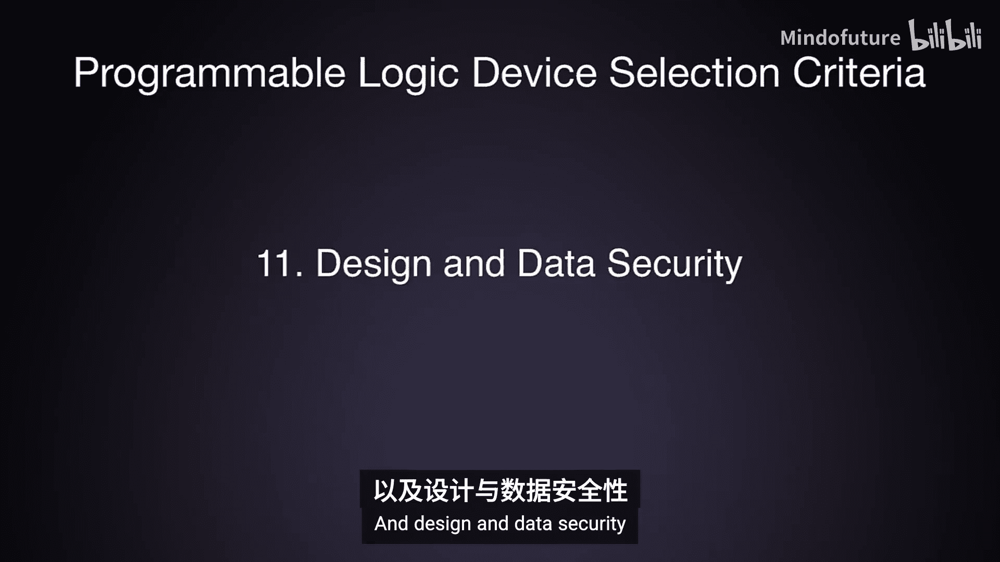
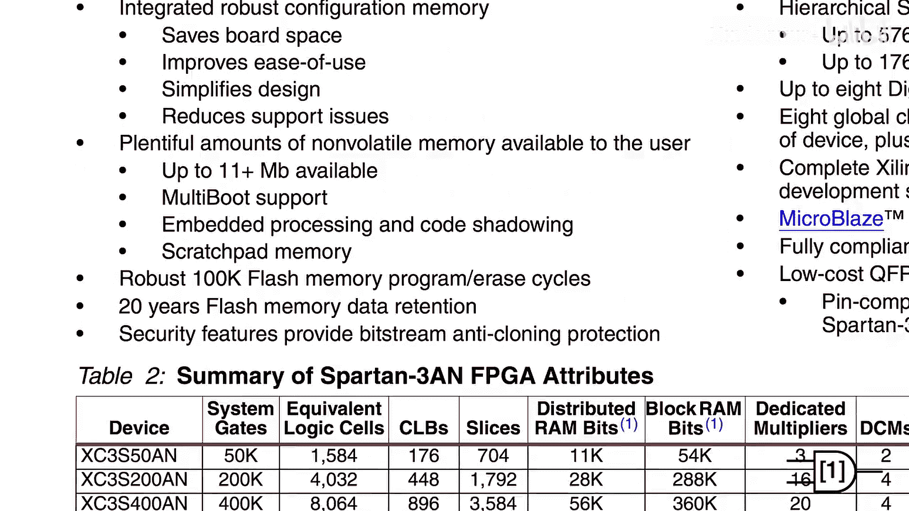
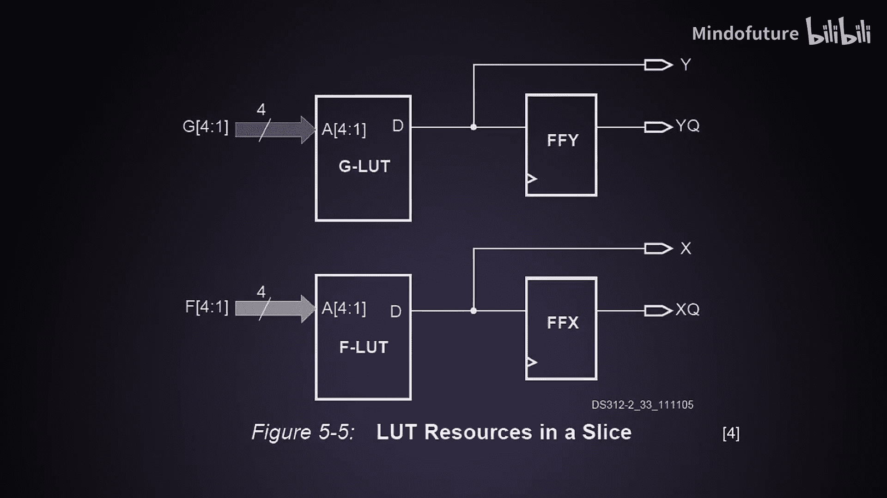
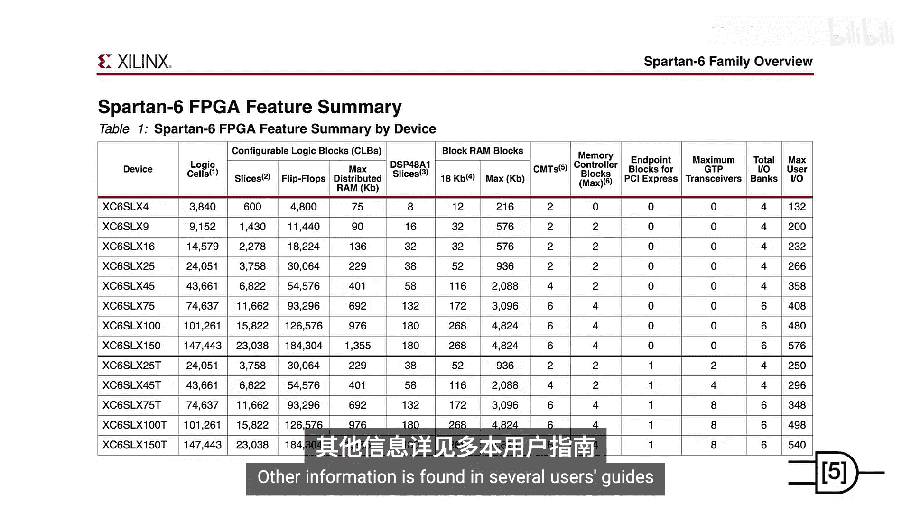
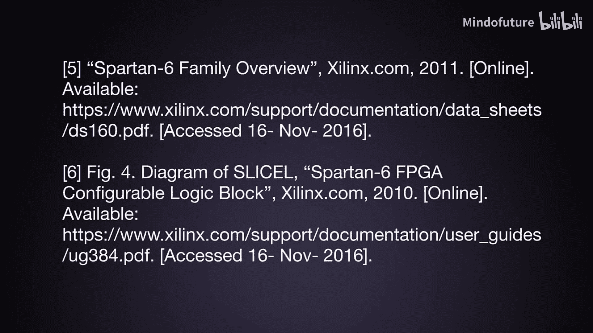

# 嵌入式系统FPGA设计入门：P22：Xilinx小型FPGA 🧩

在本节课中，我们将继续学习现代可编程逻辑器件，重点介绍赛灵思（Xilinx）的两款小型FPGA：Spartan-3AN和Spartan-6。我们将运用之前建立的11项可编程逻辑器件选择标准来评估这些器件。

## 器件选择标准回顾 📋

以下是评估可编程逻辑器件的11项核心标准：
1.  **规模或逻辑密度**：以系统门、逻辑单元、逻辑片或自适应逻辑模块的数量衡量。
2.  **每逻辑门成本**。
3.  **速度或最大时钟频率**。
4.  **功耗**：包括静态功耗和动态功耗。
5.  **可重编程性**：配置存储器的类型。
6.  **每I/O成本或I/O密度**。
7.  **片上硬核IP**：如存储器、DSP模块、收发器等。
8.  **确定性时序**：每次实现的时序保持一致。
9.  **可靠性**：以适配率衡量。
10. **耐久性**：编程周期数和数据保持年限。
11. **设计和数据安全性**。

## Spartan-3AN FPGA 分析 🔍

上一节我们回顾了选择标准，本节我们首先来看Spartan-3AN FPGA。

以下是赛灵思Spartan-3AN FPGA系列数据手册的部分内容。Spartan-3AN具有可重编程的闪存配置和用户存储器。

请注意其关键参数：
*   **等效门数**高达140万，**逻辑单元**达25K。其逻辑资源远多于CPLD。
*   该系列器件专为**低成本**应用设计。如果需要更多逻辑资源，则需要选择更大的器件。
*   **速度**：全局时钟缓冲器上的最高频率为350 MHz，快于CPLD。
*   **功耗**：最大功耗在20到200毫安之间，具体取决于器件规模。
*   **I/O**：最多502个I/O引脚，逻辑单元与I/O的比例约为50:1。支持**23种**I/O标准。
*   **耐久性**：数据保持**20年**，编程周期达**10万次**，表现良好。
*   **设计安全性**：通过将配置存储器集成在单芯片上得到增强。
*   **硬核IP块**：增加了包括RAM块、乘法器和数字时钟管理器在内的硬核IP。

最初，可编程逻辑器件的大部分信息都列在数据手册中。然而现在，并非所有信息都能在数据手册中找到，部分内容位于对应的用户指南或手册中。

以下是Spartan-3的整体架构图：I/O位于外围，内部包含逻辑块、RAM、乘法器和时钟管理器。

这是一张Spartan-3逻辑片的图片（一个逻辑块的一半）。逻辑片的核心是**两个4输入查找表**和**两个触发器输出**。它还包含一些用于创建加法器的进位链逻辑，以及用于生成移位寄存器的移位时钟生成逻辑。

这是一张逻辑片中查找表资源的简化图。查找表也可用作分布式存储器（每个查找表相当于16位RAM）或16位移位寄存器。

## Spartan-6 FPGA 分析 🔍

看过了Spartan-3AN，我们再来看看更现代的Spartan-6 FPGA。

以下是赛灵思Spartan-6 FPGA系列数据手册的部分内容。Spartan-6具有可重编程的SRAM配置，这需要外部非易失性存储器（通常是闪存）来在上电时加载配置。器件变为激活状态前的延迟为几毫秒。

请注意其关键参数：
*   它拥有高达**147K逻辑单元**，逻辑资源显著更多。该器件同样为**低成本**设计。
*   包含了额外的硬核IP块，包括**180个DSP切片**、近**5000KB的块RAM**以及最多**8个高速收发器**。
*   **I/O**：最多540个I/O引脚，逻辑单元与I/O的比例约为300:1。支持**55种**I/O标准。
*   **速度**：全局时钟缓冲器上的最高频率为400 MHz，快于CPLD。
*   **功耗**：最大静态功耗在20到51毫安之间，具体取决于器件规模。动态功耗未指定。
*   其他信息可在多本用户指南中找到。

这是一张Spartan-6逻辑片的图片（一个逻辑块的四分之一）。逻辑片的核心是**4个6输入查找表**和**8个触发器**。它还包含一些用于创建加法器的进位链逻辑。共有三种能力不同的逻辑片类型。正如你所见，逻辑结构变得越来越复杂。

这是一张逻辑片中查找表资源的简化图。查找表也可用作分布式存储器（每个逻辑片最多可配置为256x1 RAM或ROM）或每个逻辑片32位的移位寄存器。

## 逻辑资源效率对比 ⚙️

了解了基本架构后，我们通过具体例子来看看这些FPGA的逻辑资源利用效率。

回顾一下四位比较器。一个查找表能实现多少位比较器？
*   在Spartan-3AN的情况下，查找表只有4个输入，因此只能创建一个**2位比较器**。更大的比较器需要将多个查找表级联。虽然逻辑被有效利用，但相对于CPLD的实现，这会增加延迟。
*   在Spartan-6的情况下，6输入查找表可以处理**3位比较器**，因此构建更宽的比较器时延迟更小。

一个Spartan-3A的逻辑单元能实现多少个全加器？
初看之下，似乎一个加法器需要两个查找表（每个查找表3个输入）来生成和与进位。

这种实现方式的问题是，每位输入都需要两个查找表，并且进位信号需要经过每个位的完整查找表延迟。

更好的实现方式是使用超前进位，判断输入进位信号是需要传播（当输入不同时）还是生成（当两个输入都为高时），如左图所示。

为了优化此逻辑的实现，Spartan-3这一代的CLB在查找表外部提供了一个专用的异或门（称为XORCY）来生成和，以及一个专用的多路复用器（称为MUXCY）来提供进位。这样，每个查找表就能实现一个全加器位。

这种结构比在CPLD中看到的逻辑资源利用效率更高。移位寄存器也是如此，可以完全使用查找表实现（Spartan-3A每个查找表16位，Spartan-6每个逻辑片32位）。

## 总结 📝

本节课中，我们一起学习了以下内容：
*   赛灵思提供多个小型FPGA系列，包括目前仍在使用的**Spartan-3AN**和**Spartan-6**。
*   **Spartan-3AN**使用片上闪存配置存储器，因此是单芯片解决方案。
*   **Spartan-6**使用SRAM配置存储器，因此需要一个额外的非易失性存储器件来保存配置。
*   **Spartan-3AN**的逻辑单元基于一个**4输入查找表**和一个触发器，并带有额外的逻辑来帮助高效创建加法器和移位寄存器。
*   **Spartan-6**的逻辑单元基于一个**6输入查找表**，每个逻辑单元带有两个触发器。
*   赛灵思的小型FPGA在实现加法器或移位寄存器时比CPLD更高效。
*   赛灵思的小型FPGA包含了额外的硬核IP块，包括乘法器和DSP、RAM块、时钟发生器以及高速收发器。