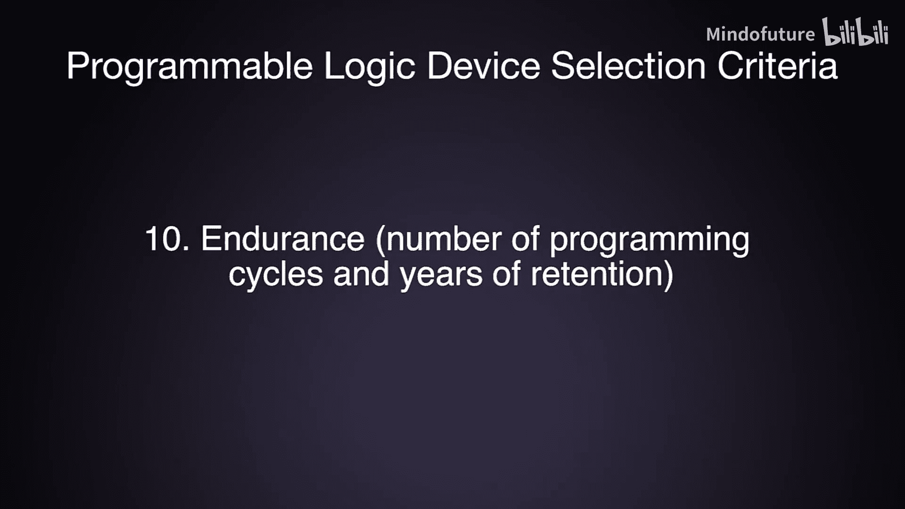
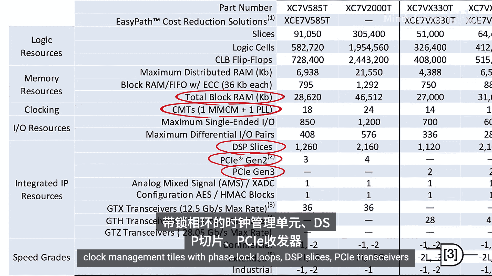
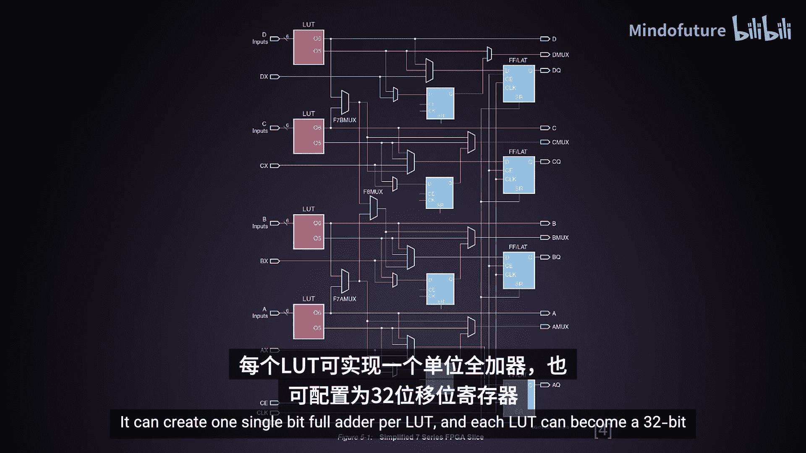
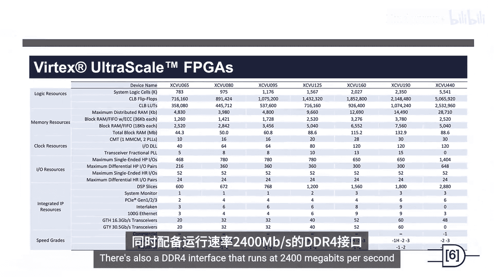
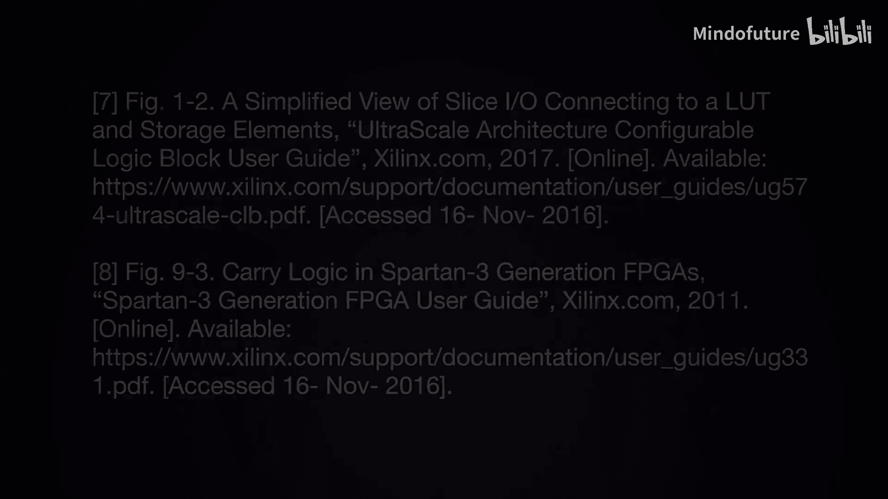

# 【科罗拉多大学】嵌入式系统-FPGA-设计入门-｜-intro-fpga-design-embedded-systems-p23-P23_03_02_03_4-Xilinx大型FPGA--BV19Tu6zGEMD_p23-

In this video， we will continue our survey of modern programmable logic devices with large FPGAs from Xylelinks。

 including the AX 7， Ktex 7， and the Vertex 7， and the KenTex and Vertex Ultrascale device F。

We will again use the programmmologic device selection criteria we established earlier to evaluate these devices。

To reiterate， there are 11 criteria。Size or logic density。

 which is the amount of logic consistent gates， LEs， slices or ALMs。Cost per logic gate。

Speed or the maximum clock frequency。Power consumption， both static and dynamic。

Reprogrammability of the configuration memory type。Cost per i O or i O density。

Hard IP available on chipI， which includes memory， DSP blocks， transceives， etca。

Deterministic timing or the timing is consistent in every implementation。

Reliability measured by the fit rate。Enurance。Or the number of programming cycles in years of retention。

And design and data security。Here's a portion of the Zion Lake 7 Series Product selection guide。

 providing an overview of the Arctic 7 midrange FPGA。At this stage of development。

 the FPGA selection process has become so bewildering that the vendors are producing selection guides in addition to the data sheets and users' guides。

The Arctic 7 has reprogrammable SM configuration， which requires an external nonball to memory。

 usually a flash memory to load the configuration at power up。

 the delay before the device becomes active is several milliseconds。

The size of these devices goes to 215，000 logic sales。

This is sufficient to build a large 302 B CPU on the FPGA。

Speed is limited to 628 meHz on clock buffers and a 1412 meHtz toggle frequency。

 which is much faster than previous devices， transceivers now run to 6。6 gigab per second。

Maximum static power draws between 48 and 328 milliamps at one volt depending on part size。

 dynamic power is not specified， power estimation tools are used to determine this now。

This device adds up to 500 IO pins a 400 to1 ratio of logic cells to IO。

There are 36 supported IO standards。Hard IP blocks have been added， including RAM blocks。

Clock management tiles， the face lock loops。DP slices。PCIe transceives。

 and even an analoged digital converter。There's also a DDR3 interface that runs at 1066 megabits per second。

Here's a portion of the Zylelink 7 Series Product selection guide providing an overview of the KenTch7 large FPGA。

The Kintech7 has reprogrammable SstrM configuration。

 which requires an external non volatileat memory to load the configuration at power up。

The size of these devices goes to 477，000 logic cells， twice as large as the Arctic7。

The speed is limited to 741 megahertz on clock buffers and an 1818 mehertz toggle frequency。

 which is much faster than previous devices， transceivers now run to 12。5 gigabs per second。

The maximum static power draw is between 201 and 1080 milliampmps at one volt depending on the part size。

 dynamicy power is not specified， power sumation tools are used to determine this now。

This device has up to 500 IO pins， almost a 1，000 to one ratio of logic cells to IO。

 there are 36 supported IO standards。Hard IP blocks are the same as the Aric7， including RAM blocks。

 clock management tiles， the clip face lock loops。D SPP slices， PCIE transceives。

 and an analog to digital converter。There's also a DDR3 interface that runs at 1866 megabits per second。

Here's a portion of the Xalic 7 series Product selection Guide。

 providing an overview of the Verdic 7 large FPDA。The Vertex 7 has reprogrammable eRAm configuration。

 which requires an external non volatileat memory to load the configuration at power up。

The size of these devices goes to almost2 million logic cells four times as large as it can take seven。

Speed is limited to 741 mehertz on clock buffers and in 1818 megahertz toggle frequency。

 which is much faster than previous devices， transceivers now run to 28。05 gigabs per second。

Maximum static power draw is between 1012 and 3，756 milliamps at one volt， depending on part size。

Dynamic power is not specified。 Power estimation tools are used to determine this。 Now。

 these devices consume up to a range of 100 W， so heat sinks are often necessary。

This device has up to 1100 IO pins， almost a 2000 to1 ratio of logic cells to IO。

 There are 36 supported IO standards。Hard IP blocks are the same as Aric7， including RA blocks。

 clock management tiles of phasease lock loops， DSP slices， PCIE transceives。

 and an analoged digital converter。

There is also a DDR3 interface that runs at 1，866 megabits per second。

Here' is a simplified diagram of the series 7 slice， which is the same as the slice in the Spartan 6。

 It's not a big surprise that it is the same， given the time and effort that designers have put into optimizing the logic cell。

 Once they find something that works， they tend to repeat it。It is based on four。

6 input Lus and eight foot flops， it can create one single bit full adder per lu。

 and each lu can become a 32 bit shift register。

Here's a portion of the Xallinks Ultrascale Product selection guide。

 providing an overview of the KenTex Ultrascale largege FPGA。

The Ktex Ultra scale has a reprogrammable SstrM configuration which requires an external non volatile memory to load the configuration at power Up。

The size of these devices goes to 1。4 million logic sales。

Speed is limited to 850 megaHtz on clock buffers， which is faster than previous devices。

 transceives run up to 16。3 gigabits per second。The maximum static power draw is between 1097 and 3。

181 milliamps at one volt depending on part size。Dynamic power is not specified。

 power estimation tools are used to determine this now。This device has up to 676 IO pins。

 almost a 2001 ratio of logic cells to IO。 there are 41 supported IO standards。

Hard IP blocks are the same as the seven series with a notable addition of the 100 gigabit ethernet interface。

 Theres also a DDR4 interface that runs at 2，400 megabits per second。

Everything is bigger and faster in ultra scale。Here's a portion of the Xlink Social scale Product selection guide providing an overview of the Vertex Ultrascale largerge FPGA。

The vertex ultralscale has repromable SstrM configuration。

 which requires an external non volatileat memory to load the configuration at power up。

The size of these devices goes to over 5 million logic sales two times as large as the Kintech Utra scale。

Speed is limited to 850 megahertz on clock buffers。Tranceivers now run to 30。5 gig per second。

 with aggregate bandwidth to an amazing 3。66terab per second。

 The maximum static power draw is between 1581 and 7988 milliamps at one volt。

 depending on part size。Dynamic power is not specified。

 Power estimation tools are used to determine this now。

 these devices consume up to the range of 100 wts， so heat sinks are often necessary。

This device has up to 1400 IO pins， almost a 4，000 to one ratio of logic cells to IO。

 there are 36 supported IO standards。Hard IP blocks are the same as the seven series with the notable edition of the 100 gigabit Ethernet interface block RAM now totals to 132 megabits。

There's also a DDR4 interface that runs at 2，400 megabits per second。

This is a picture of the logic cell in the Ulscale FPGA family It is very similar to the series 7 logic cell with a six input Lut and two foot flops with intervening carry logic。

 However， there are eight of these cells in a single logic slice set of four as there was in the series 7。

When used as distributed RAM， these lus are more capable providing up to 64 bits of RA per lut。

 up to 512 bits per slicelice。In a type M slice， the Lus can also provide 32 bits of shift register each。

You can find up to date information about all xylelinks FPGAs at www。ziillinks。

com/product/silidevics/fPG。Recall the four bit comparator。

 how many comparator bits can be implemented in a lot in the ultrascale architecture。

 the six input let will handle three bits of comparators so wider comparators can be made with less delay。

How many full adders can be made in ultrascale logic cell， given there are two outputs。

 each cell should be able to easily generate a full adder per cell using the standard approach。

 this is also true of the carry look ahead approach， which provides faster performance。In this video。

 we have learned。Xionlinks offer several large FPG families， including the Arttch 7。

 Ktech 7 and Vertex 7 as well as the KTtex Ultra scale and Vertex Ultra scale。

 these are large devices with up to 5 million logic cells。

Speed has increased greatly with these large FGAs with internal clock trees running up to 850 mehertz and transceives at 30 gigabits per second。

 with aggregate bandwidth to 3。66 terabbits per second。

Xionlinknk's large FPGAs are rich in added hard IP blocks， which include memory， PLLs， DSP， PCIE。

 Generation 12 and3 transceives， 100 gigabit ethernet interfaces， and even 12 bit ADCs in some cases。

