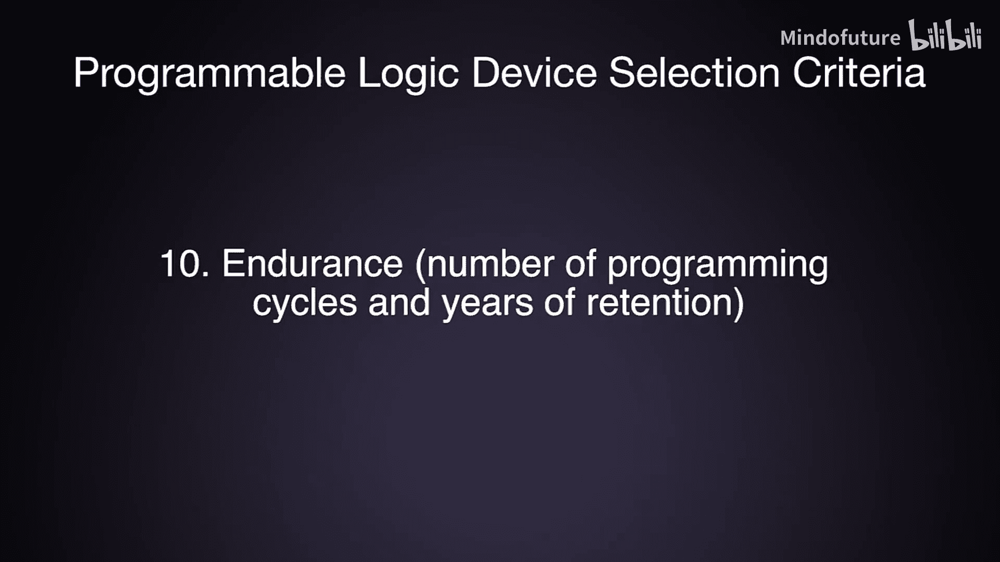
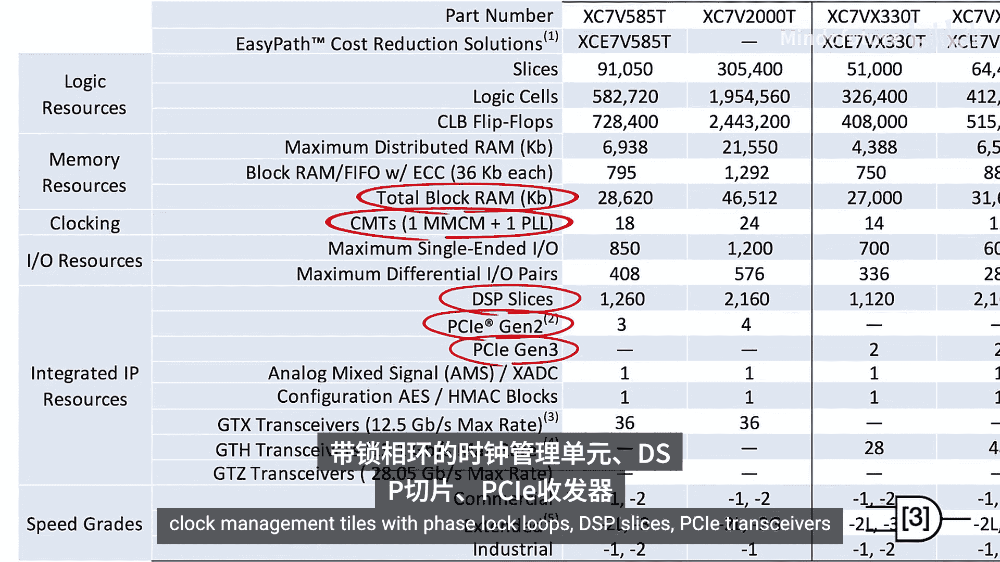
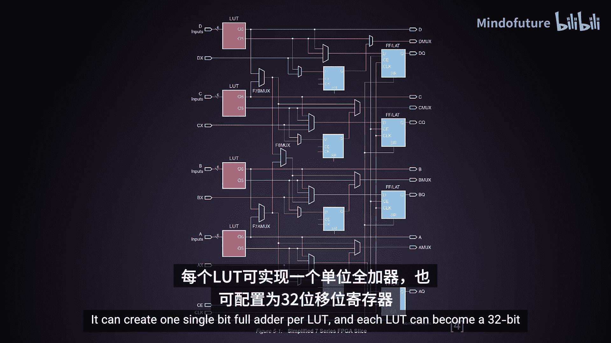
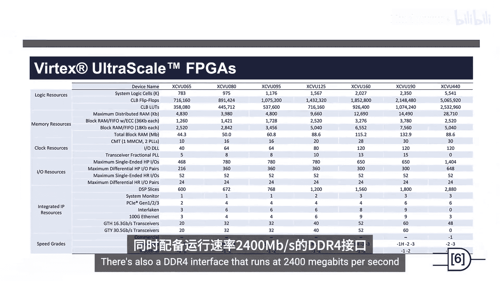
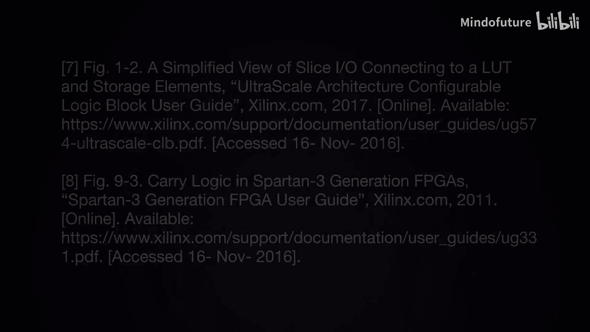

# 嵌入式系统FPGA设计入门：P23：Xilinx大型FPGA 🚀


在本节课中，我们将继续学习现代可编程逻辑器件，重点介绍赛灵思（Xilinx）公司的大型FPGA系列。我们将沿用之前建立的评估标准，对Artix-7、Kintex-7、Virtex-7以及Kintex和Virtex的UltraScale系列器件进行分析。

## 评估标准回顾

在开始具体分析前，我们再次明确用于评估可编程逻辑器件的11项核心标准：

1.  **规模或逻辑密度**：指可用逻辑资源的数量，通常以等效门、逻辑单元（LEs）、逻辑片（Slices）或自适应逻辑模块（ALMs）来衡量。
2.  **每逻辑门成本**。
3.  **速度或最高时钟频率**。
4.  **功耗**：包括静态功耗和动态功耗。
5.  **配置存储器的可重编程性**。
6.  **每I/O成本或I/O密度**。
7.  **片上可用的硬核IP**：包括存储器、DSP模块、收发器等。
8.  **确定性时序**：指每次实现时序的一致性。
9.  **可靠性**：通常以失效率衡量。
10. **耐久性**：指编程周期数或配置数据保持年限。
11. **设计与数据安全性**。

---



## Artix-7 中端FPGA

上一节我们回顾了评估标准，本节中我们首先来看看Artix-7系列。下图展示了赛灵思7系列产品选型指南中关于Artix-7的部分概览。


以下是Artix-7的关键特性：

*   **配置**：采用可重编程的SRAM配置，需要外部非易失性存储器（通常是闪存）在上电时加载配置。器件激活前的延迟为几毫秒。
*   **规模**：最大可达215，000个逻辑片。这足以在FPGA上构建一个大型的32位CPU。
*   **速度**：时钟缓冲器最高频率为628 MHz，触发器翻转频率为1，412 MHz，比前代器件快得多。收发器速率最高可达6.6 Gbps。
*   **功耗**：最大静态功耗在1V电压下为48至328 mA（取决于具体型号）。动态功耗未直接指定，需使用功耗估算工具确定。
*   **I/O**：最多500个I/O引脚，逻辑单元与I/O的比例约为400：1。支持36种I/O标准。
*   **硬核IP**：增加了多种硬核IP块，包括：
    *   RAM块
    *   时钟管理单元（CMT），含锁相环（PLL）
    *   DSP切片
    *   PCIe收发器
    *   模数转换器（ADC）
    *   运行速率达1066 Mbps的DDR3接口

---

## Kintex-7 大型FPGA

接下来，我们看看规模更大的Kintex-7系列。下图展示了其产品选型指南概览。


以下是Kintex-7的关键特性：

*   **配置**：采用可重编程的SRAM配置，需要外部非易失性存储器在上电时加载配置。
*   **规模**：最大可达477，000个逻辑片，是Artix-7的两倍。
*   **速度**：时钟缓冲器最高频率为741 MHz，触发器翻转频率为1，818 MHz。收发器速率最高可达12.5 Gbps。
*   **功耗**：最大静态功耗在1V电压下为201至1080 mA（取决于具体型号）。动态功耗需使用工具估算。
*   **I/O**：最多500个I/O引脚，逻辑单元与I/O的比例接近1000：1。支持36种I/O标准。
*   **硬核IP**：与Artix-7相同，包括RAM块、时钟管理单元、DSP切片、PCIe收发器、ADC以及运行速率达1866 Mbps的DDR3接口。

---

## Virtex-7 大型FPGA

现在，我们来了解顶级的Virtex-7系列。下图是其产品选型指南概览。



以下是Virtex-7的关键特性：

*   **配置**：采用可重编程的SRAM配置，需要外部非易失性存储器在上电时加载配置。
*   **规模**：最大可达近200万个逻辑片，是Kintex-7的四倍。
*   **速度**：时钟缓冲器最高频率为741 MHz，触发器翻转频率为1，818 MHz。收发器速率最高可达28.05 Gbps。
*   **功耗**：最大静态功耗在1V电压下为1012至3756 mA（取决于具体型号）。动态功耗需使用工具估算。这些器件的功耗可达100瓦范围，因此通常需要散热片。
*   **I/O**：最多1100个I/O引脚，逻辑单元与I/O的比例接近2000：1。支持36种I/O标准。
*   **硬核IP**：与Artix-7相同，包括RAM块、时钟管理单元、DSP切片、PCIe收发器、ADC以及运行速率达1866 Mbps的DDR3接口。

---

## 7系列逻辑片结构

在介绍了三个7系列的具体型号后，我们来看看它们共用的底层逻辑单元结构。下图是7系列逻辑片的简化图，它与Spartan-6中的逻辑片相同。



这并不令人意外，因为设计者在优化逻辑单元上投入了大量时间和精力，一旦找到高效的结构，往往会沿用。其核心基于：
*   **4个6输入查找表（LUT）**和**8个触发器（Flip-Flop）**。
*   每个LUT可以创建一个单比特全加器。
*   每个LUT可以配置为一个32位移位寄存器。


其基本结构可以用以下代码概念表示：
```verilog
// 一个7系列逻辑片包含：
module slice7_series (
    input [5:0] lut_inputs [3:0], // 4个6输入LUT
    output reg ff_outputs [7:0]   // 8个触发器输出
);
    // 每个LUT可实现任意6输入布尔逻辑函数
    // 或作为分布式RAM/移位寄存器
endmodule
```

---

## Kintex UltraScale 大型FPGA


接下来，我们进入更先进的UltraScale架构。首先看Kintex UltraScale系列。下图是其产品选型指南概览。



以下是Kintex UltraScale的关键特性：

*   **配置**：采用可重编程的SRAM配置，需要外部非易失性存储器在上电时加载配置。
*   **规模**：最大可达140万个逻辑片。
*   **速度**：时钟缓冲器最高频率为850 MHz，比前代器件更快。收发器速率最高可达16.3 Gbps。
*   **功耗**：最大静态功耗在1V电压下为1097至3181 mA（取决于具体型号）。动态功耗需使用工具估算。
*   **I/O**：最多676个I/O引脚，逻辑单元与I/O的比例接近2000：1。支持41种I/O标准。
*   **硬核IP**：与7系列基本相同，但显著增加了100千兆以太网接口。同时包含运行速率达2400 Mbps的DDR4接口。总之，UltraScale系列的一切都更大、更快。

---

## Virtex UltraScale 大型FPGA

最后，我们考察规模最大的Virtex UltraScale系列。下图是其产品选型指南概览。


以下是Virtex UltraScale的关键特性：

*   **配置**：采用可重编程的SRAM配置，需要外部非易失性存储器在上电时加载配置。
*   **规模**：最大可达超过500万个逻辑片，是Kintex UltraScale的两倍。
*   **速度**：时钟缓冲器最高频率为850 MHz。收发器速率最高可达30.5 Gbps，聚合带宽高达惊人的3.66 Tbps。
*   **功耗**：最大静态功耗在1V电压下为1581至7988 mA（取决于具体型号）。动态功耗需使用工具估算。这些器件的功耗可达100瓦范围，因此通常需要散热片。
*   **I/O**：最多1400个I/O引脚，逻辑单元与I/O的比例接近4000：1。支持36种I/O标准。
*   **硬核IP**：与7系列类似，同样增加了100千兆以太网接口块。块RAM总量达到132 Mb。同时包含运行速率达2400 Mbps的DDR4接口。

---

## UltraScale逻辑单元结构

了解了UltraScale系列的性能后，我们深入其逻辑单元结构。下图展示了UltraScale FPGA家族的逻辑单元。




它与7系列逻辑单元非常相似，包含一个6输入LUT和两个触发器，中间有进位逻辑。然而，在一个逻辑片中，这样的单元有8个（分为两组，每组4个），而7系列是4个。
*   当用作分布式RAM时，这些LUT功能更强，**每个LUT可提供最多64位RAM**，**每个逻辑片最多可提供512位**。
*   在M类型逻辑片中，每个LUT还可提供32位移位寄存器。

关于所有赛灵思FPGA的最新信息，可以访问：`www.xilinx.com/products/silicon-devices/fpga`。

---

## 思考与应用

基于所学的逻辑结构知识，让我们思考两个问题：

1.  **在UltraScale架构中，一个LUT能实现多少位比较器？**
    *   一个6输入LUT可以处理**3位比较器**（因为2^3=8种组合需要3个输入来判断相等或大小）。因此，构建更宽的比较器可以用更少的延迟完成。

2.  **在UltraScale逻辑单元中，可以制作多少个全加器？**
    *   考虑到每个单元有两个输出（和与进位），**每个逻辑单元应该能够轻松生成一个全加器**。这对于采用标准方法或提供更快性能的超前进位方法都是成立的。

---

## 总结

本节课中我们一起学习了赛灵思公司多个大型FPGA系列：

*   **产品系列**：赛灵思提供了多个大型FPGA家族，包括Artix-7、Kintex-7、Virtex-7以及Kintex UltraScale和Virtex UltraScale。这些都是大型器件，逻辑单元最多可达500万个。
*   **性能提升**：这些大型FPGA的速度大幅提升，内部时钟树频率最高达850 MHz，收发器速率达30 Gbps，聚合带宽高达3.66 Tbps。
*   **丰富硬核IP**：赛灵思大型FPGA集成了丰富的硬核IP块，包括存储器、锁相环（PLL）、数字信号处理器（DSP）、PCIe、Gen 2和3收发器、100千兆以太网接口，甚至在部分器件中集成了12位模数转换器（ADC）。


通过学习，我们对现代大型FPGA的关键特性和评估维度有了系统的认识。