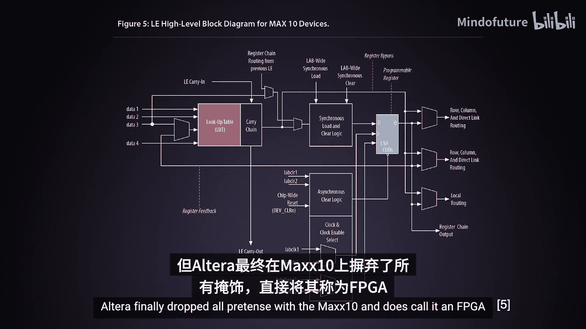
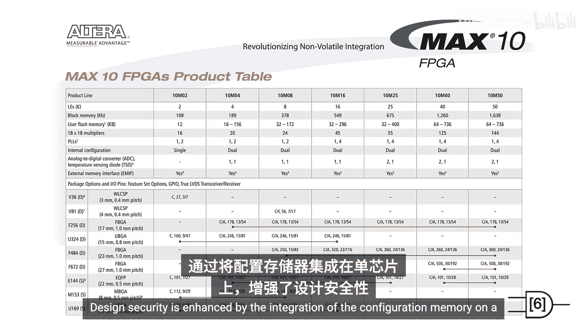

# 【科罗拉多大学】嵌入式系统-FPGA-设计入门-｜-intro-fpga-design-embedded-systems-p24-P24_03_02_04_5-Altera-CPLD与小型FPGA--BV19Tu6zGEMD_p24-

In this video， we will continue our survey of modern programmable logic devices with CPLDs and small FPGAs from AlTra。

 including the MA 5， the Max 10， and the cyclone 5。

The goal in programmable logic device selection is to pick the best fit part for our requirements。

 We will use the programmable logic device selection criteria we established earlier to evaluate these devices as listed here。

Here's a portion of the Altra Max5 CPLD family device Handbook。

 the Altra Max 5 has reprogrammable flash configuration and user memory。

 although the routing switches are based on SRAM， on power up the device transfers the configuration memory in flash to the SRAM in about half a millisecond note that the logic available is up to 2210 logic elements。

 more logic than the other CPLDs we have considered。

Speed is limited to 304 meHtz on global clock buffers， which is about par with other CPLDs。

Maximum static power draws between 0。09 and 2 milliamps depending on the part size。

 so these are low power parts， Dyna power is not specified。

 we use the Power play analyzer tool to determine it。

This device has up to 271 IO pins and8 to one ratio of logic cells to IO。

 there are nine supported IO standards。Data retention is not specified。

 hunt0 programming cycles endurance is somewhat minimal。There is deterministic timing。

 seven nanoseconds pin to pin delay。Design security is enhanced by the integration of the configuration memory on a single chip。

This is a picture of the max5 logic element， it looks more like an FGA logic element than a CPLD。

 as the heart of this LE is a four input lead and a flip fl。

This is because the max5 was designed as a crossover device between a CPLD and an FPGA， in reality。

 it's more like an FPGA than a CPLD。This next picture shows the overall layout of the max5 device。

 which is basically a C of logic array blocks or labs connected by row and column routing。

 each lab contains 10 logic elements。Contrast the max 5 floor plan with this floor plan for the max 10。

 it looks more sophisticated which it is， and better yet it's in color。

 the max 10 is a more recent part and consistent with the trend includes more hard IP blocks like the PLLs and in ADC。

 this is a mixed signal part with both analog and digital functions on a chip。

Here is the logic element diagram for the Max 10。 It is almost identical to the max 5 logic element with four input Lut and a flipflop at their heart and some carry change in mock signal selection。

 even though the Max family has been a CPLD family。

 Aleriio finally dropped all pretense with the max 10 and does call it an FPGA。

Here's a portion of the Altra Max10 FPJ Family device handbook。

 The Altra Max 10 has reprogrammable flash configuration and user memory although the routing switches are based on SRAM on power up。

 the device transfers the configuration memory and flash to the SRAM in about half a millisecond。

Note， there are up to 50，000 logic elements， a good size for a small FPGA。

Speed is limited to 450 megahertz on global clock buffers， very fast for a small FPGA。

Power is not specified， use the Power Play analyzer tool to determine it。

5 watts is the limit for this part。This device is up to 500 IO pins。

 a 10 to one ratio of logic cells to IO。 There are 31 supported IO standards。

Notice there are migration paths between pin compatible parts with different logic amounts。

This is a very beneficial arrangement， especially when requirements change during a project。

 as no board layout is required， even if the amount of logic used increases。

A number of hard IP blocks have been added， including block memory multipliers。PLLs， ADCs。

 and an external memory interface。Data retention is 20 years with 10。

000 programming cycles endurance， which is good。Design security is enhanced by the integration of the configuration memory on a single chip。

Next， let's look at the product table for the Cyone5 small FPGA。

The cycle of 5 has reprogrammable SRAM configuration and routing。

 so it needs an external nonvaal configuration memory on power up。

 the device transfers the configuration information to the internal SRAM。Notice there are up to 300。

000 logic elements， a considerable amount for a small FPGA。

Speed is limited to 550 megahertz on global clock buffers， very good for a small FBGA。

Power is not specified， use the PowerP analyzer tool to determine it。

This device has up to 480 IO pins， a 600 to1 ratio of logic sales to IO。

 there are 34 supported IO standards。A number of hard IP blocks have been added。

 including block memory。Multiplis。PLLs， DSP blocks。

 high speed transceivers and external memory interfaces。

This shows the layout of the overall cyclone 5 with the logic cells， RA blocks， DSP blocks， PLLs。

 transceiver and memory interfaces。The basic logic element for the cyclone5 is the adaptive logic module or ALM。

It consists of an eight input adaptive Lut， two full adders， and four foot fl registers。

This register rich logic element allows more design packing capability than previous generations。

The luckt can also be configured as a 32 by2 dual port SRAM。

The ALM can become a three input adder by combining the full adders with let arithmetic。

This is a picture of the ALM in the normal mode。This is the same ALM as previously shown。

 it's just another view of it as it operates in a particular mode。Recall the four bit comparator。

How many comparator bits can be implemented in a LT in the max 10 case there are only four inputs so a two bit comparator can be created。

 larger comparators require that the Ls be cascaded， although the logic is efficiently used。

 there's an added delay relative to the CPLD implementation。In the  Cyone 5 case。

 the six independent input lu will handle three bits of comparators so wider comparators can be made with less delay。

How many full adders can be made in a logic cell for the max 10。

 each let can create one full bit adder because of the addition of the carry chain logic。

 so one L equals 1 bit adder。 however， from a previous video we use3 cyclone ALMs to implement a4 bit adder。

 so each ALM creates about 1。33 adders。In this video， we have learned。

AlTRA offers the MA 5 CPLD and Max 10 and cyclone 5 FPGA families for smaller logic designs。

The Max5 and max10 are single chip solutions with more IO combined with reasonable logic density and an efficient four input logic cell。

The max 10 adds analog signal processing VN on chipI ADC。

The cycle of5 is a good entry level FPGA with good speed and logic density combined with a considerable amount of hard IP blocks。

 including block memory， PLLs， multipliers and DSP blocks。

 high speed transceivers and external memory interfaces。

