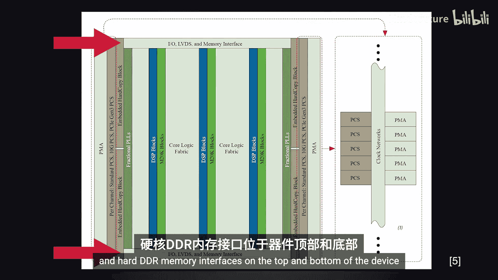
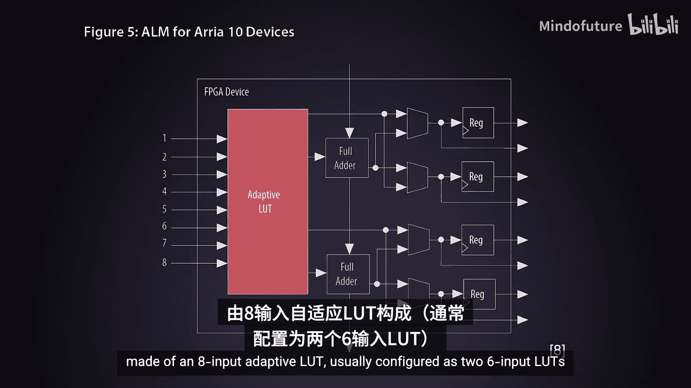
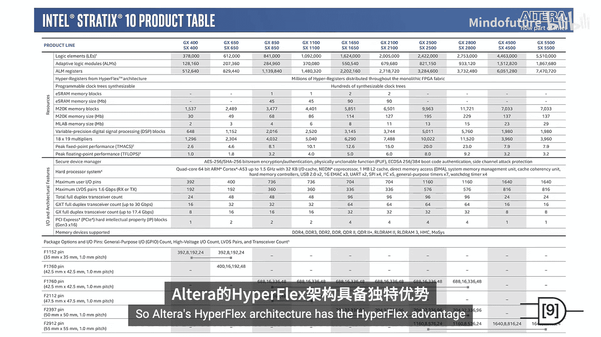
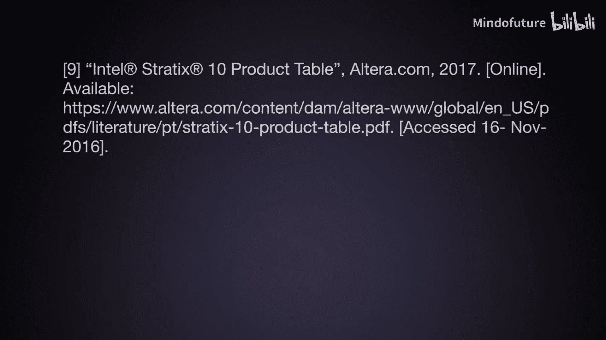

# 【科罗拉多大学】嵌入式系统-FPGA-设计入门-｜-intro-fpga-design-embedded-systems-p25-P25_03_02_05_6-Altera大型FPGA--BV19Tu6zGEMD_p25-

In this video， we will continue our survey of modern programmable logic devices with large FPGAs from Al Terra。

 including the AIA 5， the Strats 5， the AIA 10， and the Strats 10。

The goal in programmable logic device selection is to pick the best fit part for our requirements。

We'll use the programmableable logic device selection criteria we established earlier to evaluate these devices as listed here。

To start， let's look at the product table for the R5 mid range FPGA。

The Alerra RO5 has reprogrammable SRAM configuration and routing。

 so it needs an external non volatileat configuration memory on power up。

 the device transfers the configuration information to the internal SRAM。Notice there are up to 500。

000 logic elements about double that of a cyclone 5。

Speed is limited to 625 megahertz on the global clock buffers， power is not specified。

 use the Power Play analyzer tool to determine it。This device has up to 704 IO pins。

 a 715 to one ratio of logic sales to IO。A number of hard IP blocks have been added。

 including block memory， DSP blocks。High speed transceives is 6。6 gigabit per second standard。

 with transceiver parts up to 12。5 gigabit per second。

 and an external memory interface up to DDR 3 at 1600 mebits per second。

Here is a picture of the A5 layout with an array of logic blocks interspersed with memory and DSP blocks。

 and the transceives and hard DDR memory interfaces on the outside。This is a diagram of the RA 5 ALM。

 which looks just like the cycle 5 ALM， made of two，6 input lus driving four foot fl registers。

Once the FGA designer develops a logic cell architecture they like， they tend to repeat it。

Now consider the Stradix 5 large FPGA。The Alero Strs 5 has reprogrammable SRAM configuration and routing。

 so it needs the external nonvolat configuration memory。

 power up the device transfers the configuration information to the internal SRAM。

Notice there are up to 950，000 logic elements about doubled that of an REF5。

Speed is limited to 717 megahertz on the global clock buffers， power is not specified。

 we use the Power Play analyzer tool to determine it。

This device has up to 840 IO pins and 1100 to1 ratio of logic cells to IO。

A number of hard IP blocks have been added， including high speed transceivers up to 28。

05 gigabits per second in the GT part。Block memory。Multipliiers to 227 precision。

DSP blocks and external memory interfaces to DDR3 at 1600 megabits per second。

Here is a picture of the Strats 5 layout with an array of logic blocks interspersed with memory and DSP blocks and the transceivers on the left and right sides and hard DDR memory interfaces on the top and bottom of the device。

This is a diagram of the Strads 5 ALM， which looks just like thecyclone 5 or AA 5 ALM。

 made of two6 input lots driving four foot plot registers。You know how this one works already。

 thanks to Altira's lack of imagination。Actually， we know their imagination is very good。

 but they know a good design when they see one and so they repeat it。

Now consider Aria 10 large FPGAs the Alterra Aria 10 has reprogrammable SRAM configuration and routing。

 so it needs the external non volatileat configuration memory power up the device transfers the configuration information to the internal SRAM。

Notice there are up to over 1 million logic elements about double that of an R5。

Speed is limited to 644 meHtz on the global clock buffers， not much faster than an RA 5。

Power is not specified， we use the Power Play analyzer tool to determine it。

This device is up to 840 IO pins， an 1100 to1 ratio of logic cells to IO。

A number of hard IP blocks have been added， including high speed transces up to 28。

3 gigabits per second， block memory， multipliers， DSP blocks， 10 gigabit ethernet interfaces。

 and external memory interface with DDR4 up to 2，666 megabits per second。

This is a diagram of the AA 10 ALM， which is the same as the cyclone 5 ALM。

Made of an eight input adaptive Lu usually configured as two， six input lus。

 driving four foot flop registers。

Lastly， let's look at the Strattic's 10 large FPGA。

The Alerero Strix 10 has repromable SRAM configuration and routing。

 so it needs an external non volatileat configuration memory on power up。

 the device transfers the configuration information to the internal SRAM。

Notice there are up to over 5。5 million logic elements， five times that of an Aria 10。

The speed is limited to 1100 megahertz on global clock buffers。

 the fastest FBGA in existence at this time。Power is not specified。

 use the Power Play Anar tool to determine it。The device is up to 1640 IO pins。

 a 3300 to1 ratio of logic cells to IO。A number of hard IP blocks have been added。

 including high speed transceivers up to 30 gigabits per second。Block memory， multipliers。

 DSP blocks， 10 gigabit ethernet interfaces， and external memory interfaces with DDR4 up to 2。

666 megabits per second。This part is a beast。Imagine for a moment what you can do with something this powerful。

 So Altra's Hyflex architecture has the hyperflex advantage。

The key innovations that contribute to the hyperflex advantage are registers everywhere。

 the registers everywhere in the interconnect routing called hyperreisters are distinct from the conventional registers that are contained within the adaptive logic modules。

 a hyper registergister is associated with each individual routing segment in the device。

 enhanced core clocking。The programable clock tree synthesis allows system designers to create localized clock trees。

 reducing skew and timing uncertainty to obtain maximum core clocking performance This capability is a key feature that allows the hyperperflex architecture to reach two times the performance。

Hyperware design flowlow。The Hyware design flow includes three new improvements。

 a fast forward compile tool， a hyperre step， and enhanced synthesis in place and route algorithms that use the hyper registeristers。

Here's a picture of the Hyperflex architecture with registers in orange at every routdy node。

 this is what makes the Hyperflex architecture different from conventional architectures。

For more about the Hyperflex architecture， please see this Hyperflex video。At www。altra。

com/support/training/vios， slash hyperperflexarchitecture overviewviewvio。tablet。html。

Recall the four bit comparator example。How many comparator bits can be implemented in a lot？

In the Strads 10 case， the six independent lut will handle three bits of comparators so wider comparators could be made with less delay。

How many full adders can be made in a logic cell for the Strats 10。

 the ALM is very similar to thecyclne 5 ALM， and from a previous video we used threecyclone 5 ALMs to implement a four bit adder。

 so each ALM creates about 1。33 adders。In this video， we have learned。AlTRA offers the AIA 5。

 Stratix 5， Aria 10， and Strattix 10 FBGAs for large designs。

R5 and Stratix5 are large devices with up to a million logic elements and integration of many hard IP blocks to create very powerful parts with great processing power。

The REA 10 increases the processing power further with 28 gigabits per second serial transceives and 2。

666 megabit per second DDR 4D RAM interfaces。The Stratix 10 is the largest and fastest FBGA currently in production with over 5。

5 million logic elements and core clock speed of 1，100 megahertz。

Altro's Hyperflex architecture is a revolutionary change that will increase FPGA performance further。

 doubling performance at equivalent power levels。

