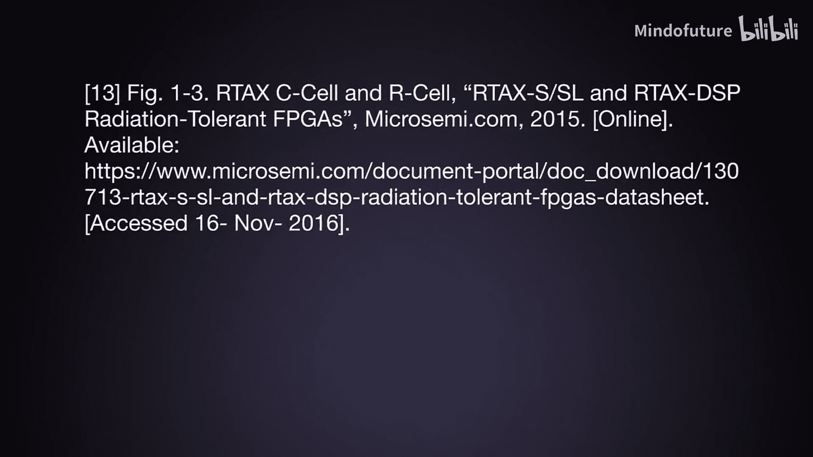

# 【科罗拉多大学】嵌入式系统-FPGA-设计入门-｜-intro-fpga-design-embedded-systems-p26-P26_03_02_06_7-Microsemi单芯片FPGA解决方案--BV19Tu6zGEMD_p26-

In this video， we will continue our survey of modern programmable logic devices this time with FPGAs for microcrosemi。

 including the Igloo， the Iglolu2 and the accelerator， but before we begin looking at the parts。

 some background in FPGA process technology and interconnection is helpful。

The goal in programmable logic device selection is to pick the best fit part for our requirements。

We will use the programr role logic device selection criteria we established earlier to evaluate these devices。

Microsemi has both flash based and antifuse based FPGAs。

 and there are performance differences based on the interconnect as we can see by the chart。

AndFU parts are OTP or one time programmable， while flash parts can be reprogrammed many times。

Flash parts don't have high speed performance， but are very good for low power applications。

Aniffuse parts are very rugged and have been used in the most extreme of conditions。

 If we take a closer look at the technology， we can better understand how these performance differences arise。

SRM cells can be programmed to either close or open a switch between routing paths on the FGA。

 similarly in flash FGAs， the routing switch is controlled by a flash cell programmed to a1 or zero。

In antifuse parts， the connection between routes is permanently fixed by melting an interconnection in place during programming。

 this connection cannot be reversed。Flash cells can be programmed once and will remain this way permanently until reprogrammed as they are nonvolat。

 estrRM cells must be programmed at power up every time as they are volatile and lose their information when power is off。

There are many other ramifications to the interconnect type in addition to volatility and reprogrammability。

 and we will look at some of them next。If we look at an asM cell more closely。

 it typically is made with six transistors in the circuit shown on the left。

This circuit has a number of pathways between power and ground。

 which will have some finite current flowing through them。

 even though during operation the cell is in a static state。

This leakage current is significant and can lead to power consumption on the order of many watts and larger SM FGDAs。

The flash sale has fewer pathways and 1000 times lower leakage current with a very low static power consumption on the order of millwatts。

Micro semimiite's flash process also allows the part to be placed in a suspended state which they call flash freeze。

 which reduces the power further into the microWt range。Because of this low power capability。

 Microsmi called the first parts like thisiggloo as they don't generate any heat from power loss。

The flash based FGAs for microcrosmi have a number of inherent advantages that flow directly from the technology。

 including。True flash based technology， they are reprogrammable and non volatileat。

 no extra memory is required to create the interconnections。Live at power Up， no startup delay。

Integration provides lower total system cost， addition of other IP blocks to create SOC devices that replace multiple ICs and designs。

Low power across the board， every part is lower power。

 and some have additional very low power flash freeze operating modes。

Best design security with no external program memory。

 reverse engineering the device program file is more difficult。Superior reliability。

 flash cells are immune to radiation effects and can more easily be radiation hardened。

Here is a summary of microcro semi Iguan FPGA family。As they are flash based。

 they are reprogrammable and nonvolat， which means they are ready at power up and need no external memory。

 a single chip solution。These are smaller density parts with only up to 6，000 footflop cells。

Speed is limited to 250 megahertz on global clock buffers， slow compared to other FPGAs。

 but still usable。The most interesting aspect of these devices is low power consumption on the order of microwaWts in the flash freeze mode。

This device has up to 77 IO pins and 80 to one ratio of logic cells to IO。

 more like a CPLD in that respect。A few hard IP blocks have been added， including block memory。

 flash ro bits， and PLLs。Here's a diagram of the microcro semimiiglin nanofPGA showing the C of versatile logic elements。

 RAM blocks across the top， aisle blocks around the outside。

 also shown as the AES decryption which can be used to protect the reading of the programmable contents。

The user flash roOM， flash freeze control， and charge pumps to enable in circuit programming of the part。

The microseiglu nanono uses versatiles as the main logic element；

 this is a finer grain logic element than what we see from other FPGA vendors。

 which can lead to a better utilization of the logic but may also increase routing requirements。

There's always a trade off between architectures。Here the versatile can be configured either as any three input combinatorial logic or a D flip flop or a D flip flop with a enable。

 this is a much simpler logic element than others we have considered。

When used this combinational logic， the versatile can implement any three input function。

 including all the ones shown here， it can be an or gate and an an gate， an X or gate， a amongsts。

 etc。Here is a summary of the microsma Iglo2 FPGA family made on a 65 nanometer process。

As they are flash based， they are reprogrammable and non volatileat。

 which means they are ready to at power up and need no external memory， a single chip solution。

These are medium density parts with up to 150 k logic elements。

Speed is limited to 400gahertz on global clock buffers， adequate compared to other FPGAs。

 an interesting aspect of these devices is the low power consumption。

 less than 11 milliwatts even on the largest part in the flash freeze mode。

This device has up to 574 IO pinNs， a 250 to1 ratio of logic sales to IO。

 more IO intensive than other FPGAs of this size。One characteristic that distinguishes this device is that it's chock full of hard IP blocks relative to its predecessor。

Added IP includes DSP math B， DMA。Embbedded non volatileat memory or EN VM。

Three different types of RA， DDR， DWM controllers， and up to 16 lanes of5 gigabit per second 30s transceivers and PCIE controllers。

With this part， the layout of the device has become very complex。

 so we first look at the block diagram， it consists of five major sections。

The high speed memory subsystem， which includes 667 megabit per second DDR controllers。

The FPG fabric with up to 150K logic elements。The transceives， which include PCIE and Zoe interfaces。

The system controller with design security features and the GPIO blocks。

The Iglo2 has been engineered not only to provide a low power mid range F PGA。

 but also to have excellent design and data security and reliability as listed here。

Design security features include program data encryption， Tmper detection， and zeroization。

Data security features include a non deterministic random bit generator or NRBG and physically andclonable function or Puff。

 like the magicic Dragon。The FPJ fabric is single event upset immune。

 and the memory includes single error correct double error detect protection。

The G2 logic element can be used as a combinational logic element， CLE。

 and or sequential logic element SLE。Each logic element consists of a four input lut。

 a dedicated carry chain based on the carry Look ahead technique。

 a separate footflop which can be used independently from the lott。

The four input Lut can be configured to implement any four input combinational function or to implement a arithmetic function where the Lt output is Xored with the carry input to generate the sum output。

Here is a summary of the microcrosmi Acelerator FPGA family。As they are antifuse base。

 they are a non volatile single chip solution but cannot be reprogrammed。

You only get one chance to program these right， which is not a problem in production。

 but can hamper development。These are smaller density parts with up to 21，000 flipflop cells。

Speed is limited to 870 megahertz on global clock buffers very fast compared to other FGAs。

Power consumption is fairly low， less than 50 millitts static power for the small parts。

 and less than 300 millwatts for the large parts， although not near as low as the flash parts。

This device has up to 684 IO pins， a 30 to one ratio of logic cells to IO。

 so this is an IO rich part。A few hard IP blocks have been added。

 including up to 292 kilobits of block memory and up to8 PLLs。

Here's a diagram of the microsmi Acccelerator FPGA showing the layout of the device。

 it consists of a C of supercs， each made of four combinational cells and two register cells with routing transmitters and receivers。

 several columns of block RAs and IO blocks on the outside edges。

There are two types of accelerator logic elements， the register cell or R cell and the combinatorial cell or C cell depicted here。

 the C cell can implement more than 4，000 combinatorial functions of up to five inputs。

Here is a summary of the microcrosemi RTAX FPGA family， as they are antifu based。

 they are an nonvolat single chip solution but cannot be reprogrammed。

 you only get one chance to program these right， which is not a problem in production but can hamper development。

These are smaller density parts with only up to 21，000 flipflop cells。

Speeds limited to 870 meHz on global clock buffers very fast compared to other FPGAs。

 power consumption is fairly low， less than 50 millwatts static power for the small parts and less than 300 millwatts for the large parts。

 although not near as low as the flash parts， this device is up to 684 IO pins。

 a 30 to1 ratio of logic cells to IO， so this is an IO rich parts。

A few hard IP blocks have been added， including up to 292 kilobits of block memory and up to 8 PLLs。

The RTX layout and logic elements are the same as the accelerator family。

 the accelerator family can be used in development to model the RTAX parts which are much more expensive。

 and this is typically done to save the cost of these OTP devices。Recall the4 bit comparator。

How many comparative bits can be implemented in an Iot2 lit？In the Iglo2 case。

 the four independent input Lu will handle two bits of comparator and will take three lus to make this four bit comparator in the Iloo it will take five versatiles。

How many full adders can be made in a logic cell for the micro semiigloo。

 each bit of adder requires two versatiles where the tiles in the picture are the and or arrays and the three input Xor gates highlighted in red。

A four bit adder will then require eight versatiles as shown。

The Ig24 input lot architecture will also require eight logic elements， eight lus in this case。

 Other four input lot architectures require only four lots and six input ALM architectures require only three ALMs。

In this video， we have learned Micro semimi offers both flash and anfuse FPGAs。

Each type has different capabilities and limitations。The current microcro semi flash FPG offering。

 the Iglo and the Iglo2， are instant on single chip solutions that are reprogrammable with very good low power performance and high reliability and security。

Microsemi anfuse FPGAs are designed for rugged environments and high reliability。

 including the Acccellerator family and the RTAX radiation Tolerant family。

The microcro semimiigglo2 has a wealth of hard IAPP cores， including memory controllers。

 high speed transceives， RAs， DSP blocks， and many security enhancements。

If security or reliability or low power are design requirements。

 micro semiFGAs are worth consideration。

