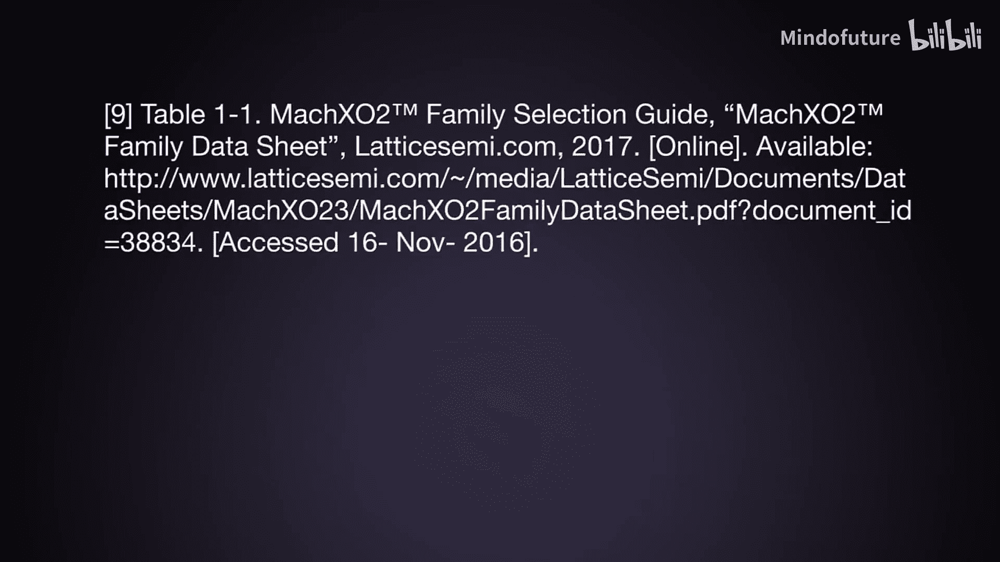

# 【科罗拉多大学】嵌入式系统-FPGA-设计入门-｜-intro-fpga-design-embedded-systems-p27-P27_03_02_07_8-Lattice单芯片FPGA解决方案--BV19Tu6zGEMD_p27-

In this video， we will continue our survey of modern programmable logic devices this time with FPGs and CPLDs from lattice。

 including the ECP5， the ECP3， the Mo X03， the Mo X O2 and I 40。

 proceeding from bigger to smaller devices this time。

 The goal programmable logic device selection is to pick the best fit part for our requirements。

 We will use the programmable logic device selection criteria we established earlier。

 to evaluate these devices。

Latts offers both small CPLDs and mid range FPGA parts available at low cost and low power consumption。

 sometimes in very small packages， typicallyy applications include portable consumer and mobile devices。

Here is a summary of the lattice ECP5 FPGA family made on a 4 nanometer process。

As they are SRM based， they are reprogrammable and volatile。

 and therefore require an external memory to hold configuration data。

These parts are optimized for cost and low power with moderate density。

These are medium density parts with up to 85 k logic elements。

Speed is limited to 40 megahertz on global clock buffers adequate compared to other FPGAs power consumption is fairly low。

 about 250 milliwatts， even on the largest part。This device is up to 365 IOPs。

 a 230 to one ratio of logic cells to IO， more IO intensiveive than other FPGAs of this size。

This device includes several hard IP blocks。Added IP includes DSP math blocks， RAM blocks。

DDRDRAM memory support and up to four lanes of5 gigabit per second 3 transceivers。

Each ECP5 device contains an array of logic blocks surrounded by programmable IO cells or pick。

Interssperse between the rows of logic blocks or rows of embedded block RA or EBR。

 and rows of digital signal processing slices。In the ECP5， the basicik logic element is the slice。

 each slice contains two lut fours feeding two registers。In distributed SRAM mode。

 slice0 through slice 2 are configured as distributed memory， and slicelic 3 is used as logic or roM。

The ECP5 SsdSP slice is very versatile and supports many functions that include the following。

Full double data rate support for higher operation frequency。

 a throughput of up to 370 megabits per second。Dual multiplier architecture This lowers accumulator overhead to half and the latency to half compared to single multiplier architectures。

Fully cascadedable DSP across slices support for symmetrical。

 asymmetrical and non symmetrical filters。A multily 1 18 by 36， or 2， 18 by 18， or4。

9 by9 multiplies per slice。You can multiply 36 by 36 by cascading across two ssdsp slices。

A multiply accumulate which supports 118 by 36 multiplier result accumulation or 218 by 18 multiplier result accumulation。

Here is a summary of the lattice ECP3 FPJ family made on a 65 nanometer process。

 so it'll cost more than an equivalent ECP5。Like the ECP5， they are SM based。

 so they are reprogrammable and volatile and therefore require an external memory to hold configuration data。

These are medium density parts with up to 150 k logic elements larger than the later ECP5。

Speeds limited to 500 megahertz on global clock buffers， adequate compared to other FPGAs。

Power consumption is moderate， about 450 millitts even on the largest part。

This device is up to 586 IO pins， a 250 to1 ratio of logic cells to IO。

 more IO intensives than other FPGAs of this size。This device includes several hard IP blocks。

 added IP includes DSP math blocks， RAM blocks。DDRDRA memory support and up to 16 lanes of 3。

2 gigabits per second3 transceivers。Each lattice CCP3 device contains an array of logic blocks surrounded by programmable logic cells。

Interperse between the rows of logic blocks or rows of embedded block RAM or EBR and rows of digital signal processing slices。

In the ECP3， the basic logic element is the slice slicelic 0 through slice 2 contains two let4s feeding two registers。

 whereas slice3 contains two let fours only slicelic 0 through slice 2 can be configured as distributed memory。

The lattice ECP3 S DSP S supports many functions that include the following。Multiply 1。

 18 by 36 to 18 by 18 or4，9 by9 multiplies per slice。

You can multiply 36 by 36 by cascading across two StheSP slices。

A multiply accumulate up to 18 by 36 multipliers feeding an accumulator that can have up to 54 bit resolution。

Here's a summary of the lattice mock XO2 CPLD family made in a 65 nanometer process。

They are SM based and therefore reprogrammable and volatile。

 however they have nonvolat configuration memory storage， which loads the SRM cells on power up。

 which means they need no external memory and are a single chip solution。

These are small density parts。With up to 7 k logic elements。Generally competing with CPLDs。

 although they have an FPGA like architecture。The XO and the product name stands for crossover as these parts are intended to cross over from CPLDs to FGAs。

Speed is limited to 388 MHtz on global clock buffers， adequate compared to other CPLDs。

Static power consumption is very low， about 200 microtts， even on the largest part。

This device is up to 334 IO pins， a 20 to1 ratio of logic cells to IO。

 a very rich IO part like other CPLDs， one of the best aspects of these parts comes from packaging with part sizes as small as 2。

5mm by 2。5mm， a1th of an inch on a side。One interesting characteristic of this device is the amount of hard IP blocks available for a programmable part of this small size addeded IP includes RAM blocks。

 user flash memory， both Iqua C and spy serial ports， and DDR DRAM memory support。

The Mo Exo2 family architecture contains an array of logic blocks surrounded by programmable IO or PIO and non volatile configuration memory blocks。

The larger logic density devices ices in the family have PLLs and blocks of embedded block RAM or EBRs。

 the embedded function block includes the serial port hard IP。

The mock Xo2 logic element is a slice with two lut fours and two flip flops。

 the register in the slice can be configured for positive or negative edge triggered or level sensitive clocks。

All slices have 15 inputs from routing and one from the carry chain from the adjacent slice or PFU。

There are seven outputs， six for routing， and one to carry change to the adjacent PFU。

 it is very similar to the ECP3 slice。Here's a summary of the lattice Mo XO3 CPLD family made in a 65 nanometer process。

They are Sam based and therefore volatile。 However。

 they have nonvault to configuration memory storage， which loads the SRAM cells on power up。

 which means they need no external memory in our single chip solution。 In some cases。

 the nonvault to memory is flash that is reprogrammable。 In others。

 it is a lower cost memory that is two times programmable。

 The part numbers that end with F or the flash parts。

These are small density parts with up to 9 k logic elements。

 more than the mock XO2 but generally competing with CPLDs。

 although they have an FPGA like architecture， the ExO in a product name stands for crossover as these parts are intended to crossover from CPLDs to FPGAs。

Speed is limited to 388 mehertz on global clock buffers adequate compared to other CPLDs。

 power consumption is low， about 20 millwatts even on the largest part。

This device has up to 384 IO pins， a 25 to1 ratio of logic cells to IO。

 a very rich IO part like other CPLDs。One of the best aspects of these parts comes from packaging。

 with part sizes the small as 2。5 by 2。5 millm， a tenth of in inch on a side。

One interesting characteristic of this device is the amount of hard IP blocks available for a programmable part of this small size。

Added IP includes RA blocks。Mippi D P for video interfacing。Both I squared C and spy cereal ports。

And DDRD ranM memory support。The mock X03L/LF family architecture contains an array of logic blocks surrounded by programmable IO or PIO and nonvolt configuration memory blocks。

 The larger logic density devices in this family have PLLs and embedded block RAM EBRs。

The embedded function block includes the serial port and the MIpi videoide port hard IP The mock XO3 logic element is a slice with two lut4s and two flip flops identical to the slice of the mock XO2。

Here's a summary of the lattice Ice 40 Ultra FPGA family made on a 4 nanometer low power process。

They are em based and therefore volatile。 However， they have nonvault to configuration memory storage。

 which loads the asstrm cells on power up， which means they need no external memory in our a single chip solution。

Loated in the configuration from the NVCM can take tens of milliseconds。

These are small density parts with up to 3K logic elements， generally competing with CPLDs。

 although they have an FPGA architecture。Speed is limited to 185 meHtz on global clock buffers slow compared to other devices。

 but this is to be expected and a part tuned for low power consumption。

As you might expect with the name IC， power consumption is very low。

 about 95 microwatts static power and 11 millwatts dynamic power。

 even on the largest part and even lower on the smaller parts。This device is up to 39 IO pins。

 a 90 to one ratio of logic sales to IO， it's an IO rich part。

One of the best aspects of these parts comes from the packaging。

 with part sizes as small as two by2 millimeters or a tenth of an inch on a side。

One interesting characteristic of this device is the abundance of hard IP blocks available for programm mobile parts of this small size。

Added IP blocks include RAM blocks， DSP blocks， both Iquad C and spy serialal ports。

 on chip oscillators， 24 milliamp LED drivers， an IR LED drive and PWM module IP。

The IceE 40 Utrafa architecture contains an array of programm mobile logic blocks or PLBs。

Two oscillator generators， two user configurable iquad C controllers。

 two user configurable spy controllers， DSP blocks， LED drivers。

 an embedded block RA or EBR surrounded by programmable IO。The basic logic cell， the I 40。

 is a Lt 4 and a D flip flop with each programmable logic block consisting of eight logic cells。

So recall the four bit comparator， how many comparator bits can be implemented in the typical lattice logic element。

 which is based on a Lut 4， the four input Lu will handle two bits of comparator and it will take three lus to make this four bit comparator。

How many full adders can be made in a logicg cell for lattice Mo XO2。

 each bit of adder requires two lotsts to generate both the sum in the carryout。

 so eight lotss will be used in a four bit adder。In this video。

 we have learned lattice specializes in low cost， high value。

 small to medium programmable logic parts， including the IE 40， the Mo XO2， the Mo XO3， the ECP3。

 and the ECP5 families。The Mo XO2 and Moch XO3 families are single chip solutions with on chip nonvolatt configuration memory storage。

 but routing controlled by SRAM cells that must be loaded on power up。

These devices feature low power， very small size down to 2。5 by 2。5 millimeters。

 and several hard IP blocks。The IceE 40 family includes an abundance of hard IP functions for such a small part and very low power consumption lattice devices all have logic elements based on the four input Lu and a register adequate but somewhat less capable than other FPGA offerings。

