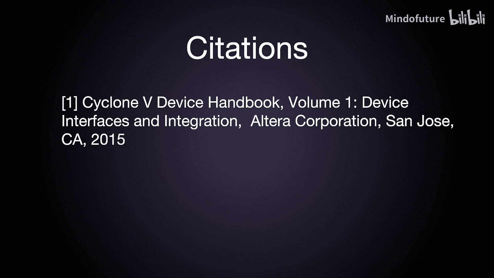

# 【科罗拉多大学】嵌入式系统-FPGA-设计入门-｜-intro-fpga-design-embedded-systems-p28-P28_04_01_01_1-FPGA设计专业技能--BV19Tu6zGEMD_p28-

Now that you have had some basic training FGA design。Next。

 you will likely want to develop some design capabilities。In the long term。

 I tell my students I want them to become dangerous。

So expert at their craft that competitors will fear them。

 this module will help you become much more effective at FPGA design。In the first module。

 we introduced programmable logic devices in the FBGA。In module2。

 we use Cortis Prime to work through a sample FPGA design。In module 3。

 we learned more about EPG architectures and capabilities， adding a number of weapons to our arsenal。

In this module， we will practice using those weapons and extend our knowledge of FPGA design by using additional design tools。

In the next video， you will further your knowledge of schematic entry for FPGAs by adding an adder circuit to the pipeline multiplier design。

You will learn how to add input and output ports to a schematic。

How to use the basic symbol library to create low level circuits and how to create hierarchy in a schematic design。

Next， we will improve design entry productivity by the use of IP blocks。

We will contrast your previous design entry experience with schematics to the use of IP blocks to more quickly create your design。

 you will add IP blocks to your design to add some functionality akin to a basic ALU。

We will learn to improve timing with pipelining。Large combination of delays between the input and output can dramatically lower the design maximum frequency。

 in some cases commonator delays can be broken into pieces by insertion of flip flops known as retimeing or pipeing。

We learn how pipeing in principle can be applied to improve timing in FPGA designs and how to use pipeing in IP blocks to improve timing。

Next， we'll look at FPGIO。Getting in and getting out。

FPGAs have extensive IO capabilities including many IO standards and controllable circuit characteristics。

 but keeping track of the wealth of options can lead to errors。

We can reduce IO pin assignment errors by the use of methods that help document and track IO usage。

Differential logic standards like LVDS and LV PEO are increasingly popular in FGAs as they allow increased speed and better noise immunity at the same time。

 we will learn how to handle these interfaces。We'll also learn about making pin assignments spot on。

To do this， you will learn how to do P assignments using the PI planner in the assignment editor。

 how to meet IO standards and control IO properties using the assignment editor。

 and how to check IO assignments using the IO assignment Anar。Essentially。

 we will learn about programming the FPGA。The Cortis Prime software contains an assembler。

 which creates the programme file and a programmer which downloads the file using a download cable like a USB Blaer 2。

 Bte Blaer2 or ethernet Blalastster 2， you will learn how to create the right type of programming file for a given situation how to set up your hardware chain for programming and which programming mode to use and how to download a programming into the target device。

And finally， we will become one with Q。We'll do accusis system design。

Your training continues with an introduction to Ksis， a system design tool。

 you will learn how to create acSis system， how to build a NeEOS2 soft corere processor。

 and how to add memory and peripherals to the NeEos2 Ksis design。

You'll learn how to build a bridge between the processor and the FPG fabric and how to bring the Cis design into the top level to be compiled。

In summary， we will learn about the EGA design flow by working through more example designs in detail using Cortus Prime。

Videos in this module will cover。FPGA design expertise， advanced schematic entry for FPGA design。

Including both drawing and hierarchy。Improving productivity with IP blocks。

 improving timing with pipe planning。FPGAIO， getting in and getting out。

Pin assignments making them spot on。Programming the FPGA， becoming one with Q， the QIS system design。

 and becoming one with Q part two， QS system design with finishing touches。

I hope you're ready to prepare for your mission and make good use of this arsenal of tools in becoming an expert in FPGA design。

