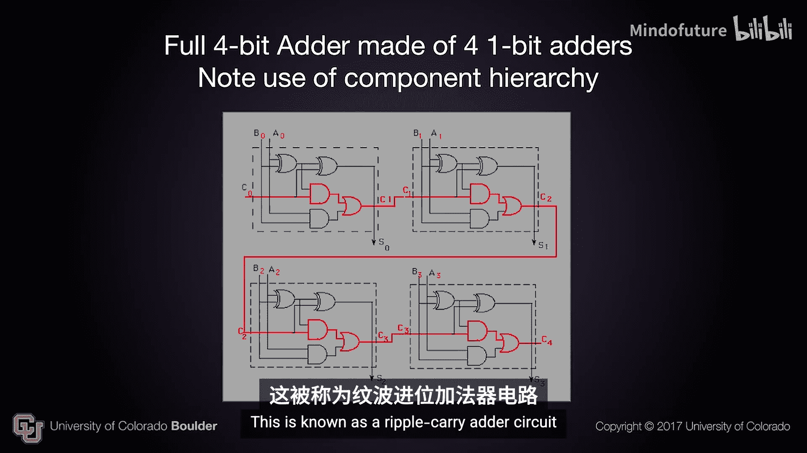
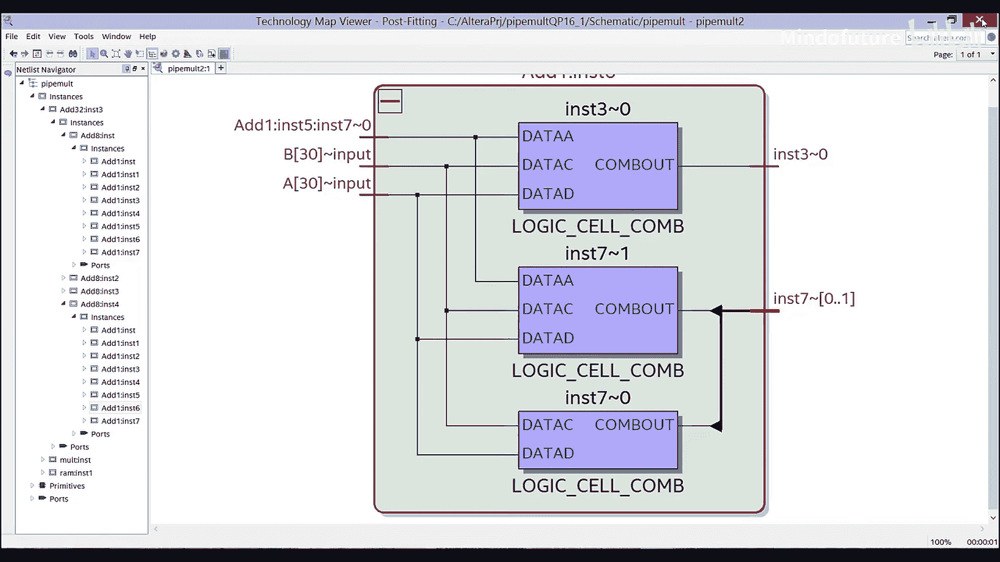

# 【科罗拉多大学】嵌入式系统-FPGA-设计入门-｜-intro-fpga-design-embedded-systems-p29-P29_04_02_01_2-FPGA设计进阶：原理图绘制与层次化设计--BV19Tu6zGEMD_p29-

Let's revisit schematic design entry in FPGAs。In this presentation。

 you will further your knowledge of schematic entry for FPGAs by adding an adder circuit to the pipeline's multiplier design。

You will learn how to add input and output ports to a schematic。

 how to use the basic symbol library to create low level circuits。

 and how to create hierarchy in a schematic design。Here's what we will cover in this video。First。

 we'll create a one bit adder circuit。Then we'll replicate it to make an a bit adder and then replicate a bit adders to make a 32 B adder。

 We'll add the adder to the pipe Mt project。 We'll add output ports to the project。

 then will view the results of the design in the RTL viewer， and then will compile the new design。

In preparation， here are some preliminary things you need to do first start Corus prime。Next。

 open the Pipe Mt project we worked on in Moule2。Lastly。

 download additional files listed here if they're not already present in the project。

We want to add a 32 bit added to the circuit in the Pi Mo project。

We can start with a one bit adder and then replicate it。

 A full bit adder can be constructed of as few as five gates as shown here。

We can place the gate primitives in a schematic。This is the result of an implementation of an adder in the Altra Max 10 FPGA。

 shown here using the RTL ViewR tool， which is part of the Cortis Prime FPGA design Su。

It looks just like the gate diagram。We can use full 1 bit adders as components to create M bit adders by connecting them together。

 Here we see the connection for a4 bit adder made of four full 1 B adders。

 This is known as a ripple carry adder circuit。😊。

We can make bite wide 8 bit adders using a full 1 bit adder。

 Our aim is to combine the 48 bit adders to make a 32 B adder and add this to the pipe malt circuit With both multiplication in addition。

 we will have the beginnings of an ALU。Before you launch Cortus Prime to assure that everyone is working with the same design files。

 please unzip the pipepeMt QP16 under1 timing2。 zipip file that was provided to you into the C Colen backslash Altero PRJ directory。

Your directory should look something like this one on the screen here。

Launch Cortis Prime and open the Pipe Mt project。Double click on Pipe B in the project Navigator。

If the VHDO file opens， then also open the schematic file by using open pipepemt。

bdf from the file menu。Select the Fi tab in the Project Navigator。If pipepemult。bdf is not listed。

 add it by clicking on the project menu and then add remove files to project。

Click on the browse button to the right of the file name box and select pipepemt。bdf。

Click add and then O at the bottom of the settings dialog box。the Project Navigator files tab。

Right click on Pipemt。bdf and select set as top level En。

Go back to the Hierarchy tab in the Project Navigator and double click on PipeMt。

 the schematic should appear。Now clickFile then new and select Block diagramia Schematic file and click OK。

Click on the schematic window。Now， if you hover over the mouse pointer over the toolbar icons at the top of the schematic editor。

 you should see from left to right。Detach window。Selection tool。Zoom tool。Hand tool。Symbol tool。

P tool。Block tool。And a number of others that we won't cover now for sake of time。

If you right clicking the schematic space and insert symbol， the symbol editor appears。

You should see the project in the Intel FPGA libraries。Click to expand the Intel FPGA library。

 you should see mega functions， others and primitives。If you expand primitives。

 you should see a logic directory。Expand the logic directory。

 scroll down and select XOR the last entry。A picture of the Xorgate appears in the symbol editor。

Click ok and place the Xor gate roughly at location10100。

The coordinates are given at the bottom right corner of the Corice window。

You may want to hit control space to zoom in Now from the toolbar， click on the symbol tool。

 which looks like an and gate。Again， the symbol editor appears， click OK to place another X or gate。

 place it at 208-108。By clicking and then hit escape to return to the mouse pointer。

Now click on the symbol tool again。And scroll up to select an and to gate。

Click on OK and place it at 182164， and then another at 182218。Hit escape and then click。

Repeat this process to add an or2 gate at 267190。You have now added the gates necessary for a full bit adder。

Now click on the orthogonal node tool， which is to the right of the block tool and use it to complete all the wiring as shown。

At this point， save the design as add1。bdf by clicking on the Quas prime file menu and then save as add1。

bdf。Now we want to add pin names to our full adder component。These aren't actually pins。

 but more like ports for this entity。They may eventually be connected to pin on the device。

 but this is done in a separate process known as P assignment which will be covered in the video after next。

To make room for the pins， we need to select the entire drawing and move it to the middle of the screen。

Click in the blank space of the schematic editor and hit control A。This selects everything。

 and now we can move it to the middle。Click and drag the entire drawing into the middle of the screen。

From the tool menu， click on the P tool and select input。

Place the input pin on the topmost Xor gate input。Hit escape。

Double click on the pin name and enter a bracket，0 clothes bracket。

On the other input of the Xor gate， add another input pin and name it B bracket0 close bracket。

Now add another input pin connected to the far right Xor gate and name it C bracket0 close bracket。

Now add the output pins again from the pin tool in the toolbar menu， select output。

 place one pin on the X or output and another on the or output。

Name the X or output sum bracket0 closed bracket， and the or output C out bracket zero close bracket。

Click file and then save congratulations you have completed the full Adder circuit。At this point。

 it should become clear that the Corus Prime schematic tool is useful for drawing logic diagrams based on gates。

Not only do the diagrams look nice， but this logic can be synthesized and simulated。

 it isn't just a drawing， it's a live diagram。Now we want to create a B white adder using the add one component we just created。

First， we need to make add1 a symbol。Do this by clicking on file and then create slash update。

The Cate symbol file dialog box appears。Set the file name to add1。

bssF if it isn't already and click saveve。Click， Ok to confirm。

Start a new block diagram file by selecting file and then new。

Select the block diagram s schematic file。Right click and select insertsert symbol。

Scroll up in the library's window and click on Project。

It should expand and show available dobsSF files， including Add1。Select add1 and click O。

Place the block in the top middle of the schematic at about 488，40。

Repeat this process seven times until you have a column of eight adders。

Why are the top most carry out to the next carry in？Ordinarily。

 you would continue to do this until you get to the bottom at。

 The top add would have carry anti to an input pin。

 and the bottom add would have carry out connected to an output pin。 However。

 the remaining wiring is somewhat tedious， and it's not my objective to make you suffer。

 So we will use the completed files you downloaded instead。

The Add8 and the Add 32 files should be placed in the schematic directory along with the add 1。bdf。

For the block diagram you started click on the red x to close this tab。Say no to save changes。

Now go to the project menu and select Add Remove files in Project。

Hit browse at the top of the dialog box and select add 8。bDf and add 32。bDf and click open。Click， O。

Tap over to the pipemt。bdf schematic。Right click and select insertst symbol。

From the project directory， select add 32。Insert the new block below the RA in the diagram。

If you double click on this new block， the schematic for it should appear and you can see it is made of four8 bit adders。

 and if you double click on one of these， you will see81 bit adders。

The hierarchy is effective at simplifying considerable underlying complexity。

Now I have pins to the inputs and output of this new adder block。For carry in。

 add an input pin and name it C。CN can be wired as before。For the A inputs。

 add a single pin and name it a bracket 31 dot do0 close bracket。This name must be precise。

 It will be connected to the block A input using a bus。

Do the same for the B input name it B bracket 31 dot dot zero close bracket。

To connect the A pins to the AE inputs， select the orthogonal bus tool from the toolbar and draw the connection。

Use the same tool to connect the B inputs。In the same manner。

 connect the sum outputs to a bus to the sum output pins。Also provide an output for carryout。

Hit C S to save the new pipepeMt。bDf schematic。In the task window。

 double click on compileile the design。The compile may take some time。

 but the result should have a lot of green， the sign of success。

Now we can look at the RTL and technology viewers to see the results。From the To menu。

 click onNelist Viewers and then RTL Viewer。The RTL viewer should appear。

Click on the plus sign on the Add 32 component。You see that it is made of four add eight components。

Click on the plus sign of one of these and the ate one bit adder drawing appears。

Click on one of the Add one components and see your original schematic drawing。

Which looks just as you would expect。Close the RTL viewer。

Now let's look at the technology view from the tools menu。

 click on the Nelist viewers and then technology map viewer post fittingtting。

In the Neless Navigator on the left， click on PipeM to expand the list of components。

Expand the add 32 component。Expand the add8 and then expand instances to see eight add one components。

Double click the add8 fourth instance。You should see the four add eight components。

Click on the plus sign of the add8 fourth instance。

You should see eight add one components click on the plus sign of the seventh component。

Here you will see the inputs to the logic cell are 2 A and B inputs as expected。

 but also two more inputs。 instead of two lut threes， we see two lut fours。

View another add one and it is different like the sixth instance。Clearly。

 the logic and limitation is different from the RTL representation。

This is unlikely to limit the delay of the carry through the chain。Close the technology viewer。

After compilation， your design should look something like this， a completed circuit。

To summarize this video。Schematic entry can be a useful design entry method。

 allowing investigation of low level gate diagrams， as well as larger blocks。

The use of hierarchy can simplify designs and make the functionality easier to understand。

Implementation of the logic may be different from the RTL model as it is applied to the underlying FGA technology to improve performance。

In this video， we have learned how to add input and output ports to schematic。

 how to use the basic symbol library to create low level circuits。

How to create hierarchy and a schematic design and how to verify logic design by use of the technology viewers。

