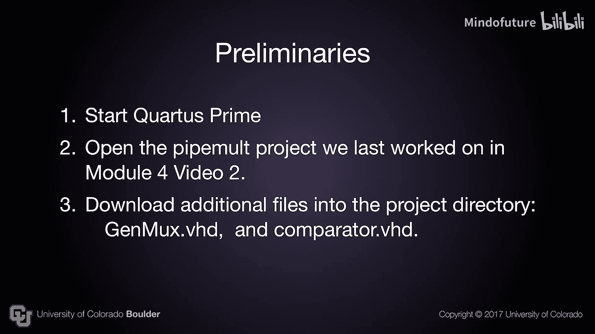
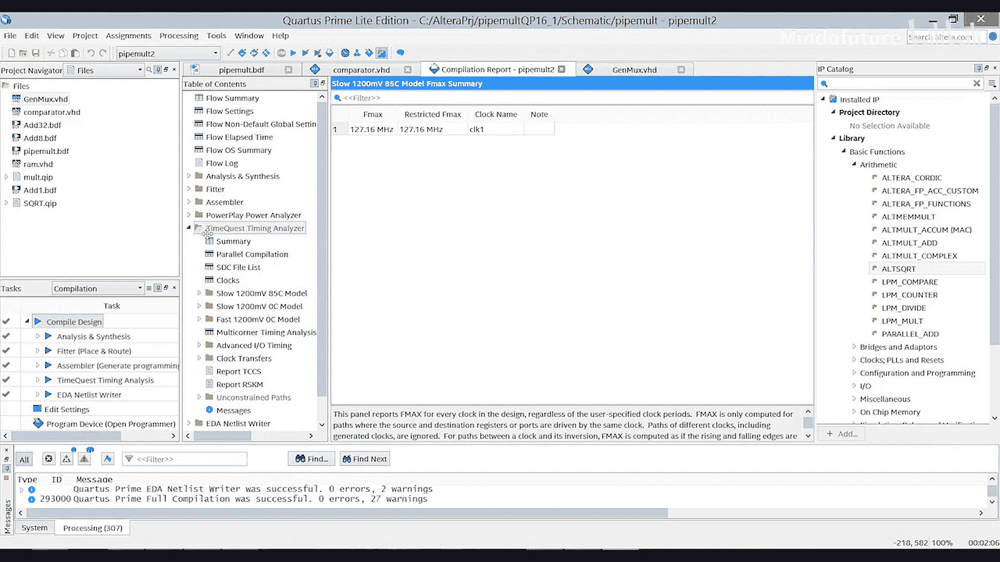

# 【科罗拉多大学】嵌入式系统-FPGA-设计入门-｜-intro-fpga-design-embedded-systems-p30-P30_04_02_02_3-利用IP模块提升效率--BV19Tu6zGEMD_p30-

There's a better way to do design entry even when using schematics and that's with IP in this presentation you will contrast your previous design entry experience with schematics to use of IP to more quickly create your design。

You add IP blocks to your design to create some functionality akin to a basic ALU。

 you will learn how to add and configure library IP blocks。

How to make your own IP blocks from HDL code and how to concatenate and split buses in a schematic design。

Here's what we'll cover in this video。We'll finish our Proto ALU by adding a comparator。

 a square root function， and a amongst driven by an instruction code。

Review the results of the design in the RTL viewer and compile the new design。In preparation。

 here's some preliminary things you need to do。First， start Corus prime。Next。

 open the Pipe M project we last worked on in moduleule4 video 2， and then lastly。

 download these additional files。Jinm。vhd and comparator。

vhd if they're not already present in the project。

Before you launch Cortis Prime， to assure that everyone is working with the same design files。

 please unzip the pipeMt QP16 under1 M4V2。 zipip file that was provided to you in the C colon backslash Aleriia PRJ directory。

Your directory should look something like this one on the screen here。

Launch Cortis Prime and open the Pipe mold project。Double click on Pipe Mot in the Project Navigator。

If the VHDL file opens， then also open the schematic file by using open pipepemult。

bdf from the file menu。Select the Fi tab in the Project Navigator if PipeMult。bdf is not listed。

 add it by clicking on the project menu and then add remove files to Project。

Click on their browse button to the right of the file name box and select Pipemt。bdf and click open。

 click add then OK at the bottom of the settingstting dialog box。In the Project Navigator Fi tab。

 right click on the Pipemt。bdf and select set as top level En。

Go back to the Hierarchy tab in the Project Navigator and double click on Pipe Mo。

 the schematic should appear。Next， we will add a square root function to our design。

 like the multiplier， creating a square root function in a schematic or HDL will be a considerable amount of work。

However， in this case， we can use included Alerra IP to create one in minutes。

Open the IP catalog using View utilityity Windows IP catalog。

Select basic functions and then arithmetic and then double click on out square root。

Add square root in the IP Va file name， select VHDO。Press OK and the outskir root dialog box appears。

Change the bus input to 32 bits and hit next。Hit next again。Make sure the docmpP。

bssf and underscorebb。v files are checked。Hit finish。

Say yes to adding the Corus Prime IP file to the project。

If you look at IP components in the project Navigator。

 you should see the Alt square root file has been added。

Scroll down in the schematic window to create space for a new block below the 32 bit adder。

Double click in the empty schematic space and the symbol editor appears。

You should see the project and Intel FPGA libraries。

Click on the project directory and then select Square root。

Click OK to begin placement of the square root block。Place it centered under the addd 32 block。

 about four grid marks below it。Starting with the radical input port on square root。

 move over left about two grids and then connect this up to the A input of add 32。🤧Yeah。

Click in the empty space to finish the connection。We'll connect the outputs after we add a couple more functions。

Now we add a comparator， a common low level function in an ALU to the design。From the project menu。

 click on Add Remove files from Project。Click on the browse button to the right of the file name box and navigate to where you placed comparator。

vhd， probably in the project directory。Select and open this file to add it to the project and click OK。

If you look at the project Navigator on the files tab， comparator。vhD is now added。

Double click on comparator。vhd to open it in the editor。From the file menu。

 select createate updated and then create symbol files for current file。

You should see a message in the message window that the symbol file was created。

Return to the schematic window and double click in empty schematic space and the symbol editor appears。

Click on the project directory and then select Biary_ Comparator。

Click OK to begin placement of the comparator block， place it centered under the square root block。

 about four grid marks below it。Starting with the A input port on the binary comparator。

 move over left about four grids and then connect this up to the A input of a 32。

Repeat with the B input a couple more spaces to the left。

Click in the empty space to finish the connections。

The other connections will be made after we add a register to hold an instruction and a multipleer to select the output。

To add the instruction register， double click in empty schematic space and the symbol editor appears。

Under libraries on the left， select the bottom Intel FPGA underscore light directory。

 then primitives， then scroll down to storage。Select the D flip fl。

Click O and place the D flip fl centered below the comparator。

 Repeat this process to add another D flip flop about 10 grid marks to the right and level with the top of the comparator as shown。

Next， we will add the mus to select the output。From the project menu。

 click on Add Renew Fi from Project。The Settings dialog box appears。

Click on the browse button to the right of the file name box and navigate to where you placed genmx。

vhd， probably in the project directory。Select and open this file to add it to the project and click OK。

If you look at the project Navigator on the files tab， comparator。bhD is now added。

Double click on Genmx。vhd to open it in the editor。From the file menu。

 selectCreate updated and then create symbol files for current file。

You should see a message in the message we that the symbol file was created。

Return to the schematic window and double click in empty schematic space and the symbol editor appears。

Scroll up in the library's window and click on the project directory and then selectMX4X。

Click OK to begin placement of the Mus block， place it about 20 marks to the right and level with a square root block。

You have done adding blocks for this design， now it is time to wire them all together。

Scroll up to where you see the clock line to the left of the round device。

Place your cursor at the corner of this line and draw a line down and then to the right to connect the IR flipflop。

Continue this line to the condition code flipflop to the right of the comparator。

To the left of the IR fliplipflop， double click in empty schematic space and the symbol editor appears。

Under libraries on the left， select the bottom Intel FPGA_ Light directory。

 then primitives then scroll down to P。Select input。

 click OK and place the pin to the left and even with the D input of the R footflop。

Double click on the pin and enter IR bracket1。Dot dot0 close bracket as the pin name and click OK。

Draw a line from the pin to the D input on the I flip fl。

Add another pin just below this input pin and double click and name it， Re underscore n。

Draw a line from this pin to the clear end pin of both D flip flos。From the Ram D flip flop。

 draw a line down and then to the right and then down to the reset pin。

Now connect the output of the IRD flip Fop to the Muux input S。

This will allow the coded instruction Op code input to select which operation， multiply， add。

 compare， or square root as output。Right click on this line and verify that it is a bus line。

 not a node line， change it to bus line if need be。

Extend the Q output of the square root block to the D input of the mugs。

Now we will create a condition code register using the outputs from the comparator。

 extend each of the comparator output lines by a couple of grid marks。

You may want to zoom in to help do this。Right click on the greater line。

 select properties and enter the name CC bracket0 Close bracket。

Right click on the equalqu output extended line， select properties and enter the name CC bracket 1 Close bracket。

Repeat this four more names， naming the output consecutively。

 CC bracket2 closed bracket through CC bracket 5 closed bracket。At the output of the comparator。

 draw a short vertical bus by selecting the orthogonal bus tool from the toolbar。

Extend each of the CC lines to this bus section。Draw a line from this bus to the D input just to the right。

Add an output pin about 40 grid marks to the right of the CCD flipflop by double clicking in the empty space and selecting the bottom Intel FPGA directory。

 then pin， then output and clicking OK。No。Connect the CC flipflop output to this pin。

Right click on the pin， select Proper and enter the name CC out bracket 5。t。0 Cos bracket。

Add another output pin to the left of the mus and connect the output of the mus to it。

Right click on the pin， select propertiesper and enter the name ALU out bracket 15。0 close bracket。

We're almost done。Pull the sum and C out output pins from the add 32 block further to the right。

For the MC C input， draw a line to the B input of the Add 32 block。

Right click on this line and enter the name， B bracket 31 dot do 16 Close bracket。

From the MuXB input， draw a line to the sum output of the ad 32 block。

Right click on this line and enter the name， sum bracket 31 do。16 Close bracket。Lastly。

 observe that the output pin of the multiplier uses a different bit ordering convention to make it consistent。

 click on this pin and hit the delete key to delete the output pin on the multiplier。

Now double click in the empty space， select output pin and place this to the right of the multiplier flip fl。

Right click on this pin and enter the name， Q bracket 15。t。0 close bracket。

Connect the pin to the foot flop。From the A input of the Mus。

 connect to the multiplier output line before the output pin。Congratulations。

 you have finished entering this design。From the View menu on the Cors toolbar。

 select fit intoto windowow to look at it and admire the entirety of your work。

It control us to save pipepemt。bdf。In the task window， double click on compile the Design。

If you have any connection errors， they will be identified in the compilation process and you'll need to edit the schematic to fix them。

Once your design compiles， you may notice that the time Que entry in the compilation report is read。

This is because you've added many pins and have unconstrained routes in the design。

We will address this in a future video。

After compilation， your design should look something like this， a completed circuit。

To summarize this video。Use of IP blocks can vastly improve productivity by simplifying design entry。

AlTRA provides a wealth of freely available IP blocks for use in your designs。

 you can also create your own blocks from HDL code。

In this video we have learned how to add and configure library IP blocks。

 how to make your own IP blocks from HDL code， and how to concatenate and split buses in a schematic design。

