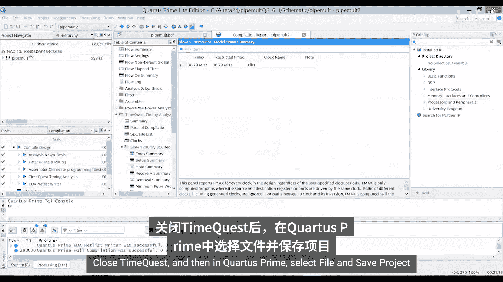

# 【科罗拉多大学】嵌入式系统-FPGA-设计入门-｜-intro-fpga-design-embedded-systems-p31-P31_04_02_03_4-通过流水线优化时序--BV19Tu6zGEMD_p31-

If we have a timing problem， we can improve it by using pipe planning。In this presentation。

 you will use timing constraints to constrain your design， analyze the result。

 and then apply pipeing to get improved performance。

You will learn how pipe planning in principle can be applied to improved timing in FDA designs。

And how to use pipelining and IP blocks to improve timing。Here's what we will cover in this video。

First， we'll add timing constraints to our Proto ALU。Then view the results in time Que。

We'll change the design to improve performance and finally update the time Que timing analysis。

This diagram helps describe the problem with long logic paths and how they can be mitigated by pipe in the top circuit。

 the maximum speed of the clock is restricted by the long delay due to propagation through the logic。

For example， if this delay is 100 nanoseconds， then the fastest clock could go in this case is 10 mehertz without creating a setup violation in Reg B。

We can improve the maximum clock frequency by inserting a flip flop to split the long logic delay into two smaller ones。

If we could do it evenly in our example， then each delay would be 50 nanoseconds。

 so the maximum clockg speed is now 200 mehertz。In general， if we insert n flip flops。

 then we get an end time speed up。The drawback is the time from when the data is first presented at the input until it reaches the output will now be n clock cycles longer added latency that we may not want。

The latency is not as bad as it may seem at first as the clock can be driven faster and once data enters the left end of the pipeline at each clock cycle。

 new data progresses through the pipeline such that new data is produced at the output every clock cycle as before。

In practice， the trade off for speed versus latency is usually a good one。

 although we generally can't split the logic delay evenly or may not be able to do this at all if the logic function changes。

 giving an invalid output。Pipelining can only be applied in some cases， but it is useful when it can。

In preparation， here are some preliminary things you need to do first start Corus prime。

And then open the Pi Mt project we worked on in the last video。

Before you launch Cors Prime to assure that everyone was working with the same design files。

 please unzip the pipepeMt QP16 under1 M4v3。 zipip file that was provided to you into the C colon backslash AlTra PRJ directory。

Launch Cortis Prime and open the Pipe M project。Double click on PipeM in the project Navigator。

 the schematic should appear。Next， we will complete the timing analysis of our Proto ALU circuit。

Open the compilation report by clicking in the top menu on Pro compilation Report。

Note that the time Que timing analysis is read。If we expand this。

 we see that the problem is unconstrained paths。Many inputs and outputs were added where the design was upgraded。

 we will use time quests to add constraints to all the new paths。

Open TimeQus by clicking tools and then Time Que timing Anar。In Time Ques， in the task window。

 double click on createre T Nelist。After this completes。

 scroll down to the diagnostic section and double click on report unconstrained Passs。

Here we see there are many input and output paths that are unconstrained。

Add input De Con by clicking in the top menu Consts set input De。In the S input De dialog box。

 select clock1 for the clock Da。And maximum for the input delay。

Enter delay value of three nanoseconds。Click on the Browse button to the right of the targets box。

In the Na Findder dialog box， click on listist。Scroll down to a0。

 click on it and then scroll down to B31 and hit Shi and click。

Hit the right arrow to add the selected names。Scroll further and then control and click on C IR 0 and IR1。

 and then hit the right arrow again to add these names as well。

Scroll down and select resets under N and then move it to the selected window。

Click OK and then click Run。Click in the tickle console in the line after the command just entered。

 hit the up arrow key to replicate the command。Hit the home key to move the cursor to the beginning of the line and then change the max to min and the three to two and hit En。

Now both max and min input delays have been added。Next， add the output delays。From the Consts menu。

 select set output De。Select clock1 and maximum in the set output De dialog box。

Enter two for the De value and then click on the browserow button to the right of the targets box。

In the Na Findder dialog， click on list。Click on ALU out0， scroll down to ALU out 15。

And then shift and click on it。Click on the right arrow to move these names to the selected Na box。

Scroll down further to the CC out bus and also see out and select these signals。

Scroll down and select and move the sum signals as well。Hit OK and then run。

Click in the tickle console in the line after the command just entered。

Hit the up arrow key to replicate the command。Hit the home key to move the cursor to the beginning of the line and then change the max to min and the two to one and hit enter。

Now both maximum output delays have been added。In the tasks window。

 double click on Report SDC to verify the entry of the constraints。In the report window。

 click on SDC assignments and then set input De to view those constraints and similarly for set output delay。

Now let's put on our secret agent hat and do some detective work。

Scroll down to the bottom of the test window and click on Report All summaries。

You should see the clock constraint is still set to 125 megahertz。

If you scroll up in the report window， note that the setup summary is now read。

Double click on this and the worst case Slack appears in the view window。Wow。😮，What is this？

A slack of negative 66。39 now secondscond or thereabouts。How did this get to be so bad？

The F max is about 14 megahertz， and we wanted 125。For some of you。

 this may feel like an o grit moment。However， you can look at this as an opportunity to prove your true grit by understanding this and making it better。

The input delay assumes that an external device has an output flipflop clocked by your clock。

 which delivers data to the input of the FPGA。The output delay assumes that your output is driving the input flipflop of another external circuit that is also referenced to the clock。

In essence， the timing analyzer assumes there is one clock delay to move the data from the input of the EGA to the output。

In this design there are two circuits with large combinatorial logic delay。

The square root IP block and the Add 32 circuit。If you can determine where the longest path is。

 you might be able to improve it。Scroll to the bottom of the test window and double click report Top Fa paths。

Pass from the A or B input bus to the AU outputs will be listed with greater than 60 nanoseconds of negative slack。

You now have some idea as to the source of the problem。Next。

 scroll up in the task window and under custom reports， double click on report timing。

In the dialo that opens， select C1 in the from clock box and scroll down and click report timing。

You should see that the data required path is six nanoseconds。

 but the data arrival path is 72 nanoseconds for a difference of minus 66 nanoseconds。

If you scroll down the data arrival path， you will see that the path goes through the alt square root block。

啊ha。The worst delay is through the square root function。What can be done to improve this？

As this so happens， the square root IP block can be pipelined。To save your work thus far in time Que。

 select the Consts menu and then write SDC file。Delete the dot out from the file name that appears in the dialog box and click OK。

Click file and then close to close time Que If asked you to write another SDC file， click No。

Return to Cortius Prime and view the pipepemt。bdf。Double click on the square root block。

When the dialogue for the alt square root appears， answer yes to the question。

 do you want to pipeline the function？And then enter8 for the number of clock cycles of latency。

This means you are effectively inserting eight foot flops in the square root logic path。

Hit next two times， verify that the square root。 BSF box is checked and hit finish。Hit OK overrite。

Hit yes to update the square root block and OK for the selected block。

The square root block now has a clock input。Connect this to the clock line at the left。

From the top menu， selectF and then save to save pipepemt。bdf。Now compile the design。

After compilation， you will see that the time Que timing analysis is still read。However。

 if you expand this and look at the slow 85 degrees C model。

 you will see the slack has improved to negative 19 nanoseconds， three times better than before。

 and the F max is now around 37 MHz。Much improved， but still not as good as expected。

To understand why start time Que again。Double click on createre timing Ne list。

Scroll down and double click on report all summaries。

Look at the setup summary to see the slack is now about minus 19 nanoseconds。

Double click on report Top failing pass。Now you should see passs from the A and B inputs as before and may also see CN as a source input。

 the outputs are sum or ALU out。This is an indicator that the limiting critical path is now within the add 32 block。

 not the square root。Scroll up underCustom Reports and double click on report timing。

Select clock1 and then scroll down and hit report timing。

Now the worst case path goes through instance 4， which is the add 32 block to the sum or the ALU output。

Can we improve this by pipelining the adder？The answer is yes。

 but this is somewhat beyond the scope of what we want to do at the moment。

It was easy to do with the square root function because it is built into the configuration of the IP block。

 yet another reason to use IP blocks。To do the same with the adder will require significant circuit redesign。

However， there are other changes that we can make that will improve the situation。

You could pipe the path through the design at the top level by registering the ALU out and the sum outputs。

Much like the pipeline multiplier has a register output。

This divides out the delay of the output buffers， Similarlyly， you could register the A。

 B and CN inputs， which would separate out the input buffer delays。

A registergi could be placed at all inputs to the Mus block。

But looking at the data arrival path previously。The delay through the mus is sub down second。

 so this wouldn't help very much。You could also edit the clock constraint in time Que。

 which may give a slightly faster FMax。After the register changes， 50 megahertz might be a good goal。

Without pipelining the adder， this might be as fast as we can go in this FBGA。

We've done enough slew thing for today。Rather than add the registers at the inputs and outputs now。

 we will leave this as a student exercise。Close time Que and then incorus Prime。

 select File and Save project。

To summarize this video， large combinatorial delays between the input and the output can dramatically lower the design maximum frequency。

In some cases， combinatorial delays can be broken into pieces by insertion of flip flops。

 which is known as reiming or pipelining depending on how it is done。

IP blocks can be configured to use pipeing in some cases。

 which will add latency but improve overall speed of the design。

In this video， we have learned how pipe planning in principle can be applied to improve timing in FPGA designs。

How to use pipeing and IP blocks to improve timing。

And how to analyze timing analyzer results to identify critical paths that may benefit from pipelineing to improve timing。

