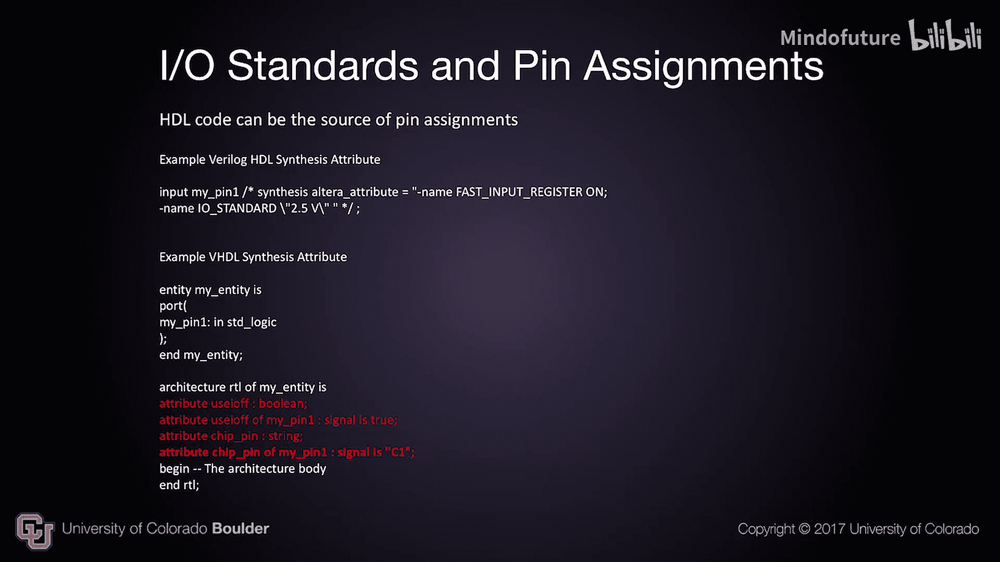

# 【科罗拉多大学】嵌入式系统-FPGA-设计入门-｜-intro-fpga-design-embedded-systems-p32-P32_04_03_01_5-FPGA输入输出设计--BV19Tu6zGEMD_p32-

In this video， you will learn how IO standards drive the assignment of internal signals to the external pins of the FPGA。

When you assign a signal from your design to a particular pin on the device。

 this is known as P assignment。IO assignment is how you design interfaces with the outside world。

 so it's important to get it right。You will learn details of commonly used IO standards and FGAs and how they are important to overall performance and system requirements。

How to determine the type of vi that needs to be used for various applications and the five methods for making pin assignments and tracking IO attributes。

We will start by reviewing IO standards and structures and we'll then discuss the five methods for IOP assignment and attribute control in FPGAs。

IO standards affect pin assignments。What do you suppose are most common source of FPJ failures or delays In my experience。

 it is first time en closure， Secondly， high speed interfaces like PCIe and DDR3， and then third。

 pin assignments and I O errors。This is a little surprising。

 given that pin assignments would seem to be a fairly easy task， and it is。

 but people sometimes don't pay attention to all the details， and then mistakes are made。

IIO standards vary greatly even within one FPGA， although the wide variety of IO capabilities and characteristics in FPGAs allows for great flexibility。

 it creates challenges in keeping track of all the IO assignments。

Iow is organized in banks with one voltage reference for each bank。Plus 3。3 volts，2 and a half volts。

 1。8 volts are common， the next bank may be different from the adjacent pan。

The single ended IO are LV TTL or LVCMoss， with many variations including HL， SSTL， GTL， etc cetera。

 There are also differential IO standards， typically LVDS， but also LV PEO， CML， etc cetera。

 that require two pins per signal。One of the most important things to remember is that global nets are usually assigned to specific pins that can also be IO Board layout must use these pins as clocks are reset if global nets are to be used。

 One of the most common mistakes I've seen as a consultant is the PCB connection of a clock signal to a pin that has no access to the global network in the FPG。

 This can be easily avoided。Singleend signals have different voltage swings。

 even at the same voltage， depending on whether they are TTLRC moOSs as shown in this table。

 although V input high and V input low are the same， V output high and V output low are not。

For example， V output high minus V output low is 2。0 volts for TTL， but at least 2。

6 volts for LVC moss。Some parts have PCI compant IO with a clamp diode。3。

3 volt PCI inputs can be5 volt tolerant with an addition of a resistor in series。

LVC Moss has extensions to lower voltages for less power consumption at 1 and a half volts the swing as v output high minus v output low。

 which is equal to 1。025 volts minus 0。4 volts or 0。625 volts。

There are also singleend reference logic families， including SSTL and HSTL。

 These are stub series termininated logic and high speed transceiver logic respectively。

 The I's reference not to ground like TTL or LV TTL， but to a common reference voltage。

 This increases the speed of the logic， but reduces the noise margin。

So can you get increased speed and better noise immunity at the same time， Yes。

 with differential logic standards like LvDS and Lv Pco。 However。

 this comes at the cost of needing two pins for each signal use of differential logic standards is a growing trend as the speed of interfaces continues to increase。

Here is a simplified version of the circuitry at a typical EGIO pin。

When driven by the external source as an input， the signal propagates to the input register or can bypass directly to the FPGA logic fabric。

When configured as an output， the bin can be driven directly by a register and the output can be enabled or disabled to create a tribe state bus output。

Here's a more detailed look at the IO pin circuitry for the max 10。

 including a number of added delays。The core of the circuit is still three registers in an output enable。

 the IO has characteristics like s rate and current strength control that can be programmed at a variety of values。

Other I characteristics are also important and need to be assigned on a bank basis。

 as they can vary from bank to bank。 Drive strength can vary from 2 to 24 mamp or even more。

 Slew rates can be set fast or slow。Some pins are hot swappable or input only or output only。

 while others are not。 Some are DDR or PCI compatible， while most are not。

Some are trittable so they can be used to create external buses， others are not。

How do we keep track of all of this？Like all good engineers would tend to do。

 we can use the spreadsheet。Cors Prime comes with tracking tools that use a spreadsheet to make and document assignments。

In Alerra FPGAs， you can do pin assignment one of five ways。First， using Corus GuUI tools。

 either the PI planner or the assignment editor， second importing from an SDC file or an Excel spreadsheet file。

Third， writing directives in an HDL， either Vera log or VHDL file。

 fourth automating by the use of a tickle script， and lastly， importing from a PCB layout CAD tool。

We will look at each of these in reverse order。Integrating the PCB layout CAD tool with the FPG design flowlow can help reduce pin assignment errors as design rule checks can help assure the circuit board and the FPG assignments match。

Many FPGA designers like to automate the pin assignment process with Tle scripts as shown here。

It is often helpful to include pin assignments in HDL code。

 as then the source file for the design and the pin assignments is together in one place。

 This can be done in both Vlog and VHDL as shown in these examples。

Perhaps the most efficient way to make pin assignments is to make use of the FPJ vendor graphical tools。

 Here is a picture of the Alta P planner。Summarizing what we've covered about FPGAIO。

FPJs have extensive IO capabilities including many IO standards and controllable circuit characteristics。

 but keeping track of the wealth of options leads to frequent errors。

 we can reduce IO pin assignment errors by the use of methods that help document and track IO usage。

Differential logic standards like LVDS and LV PEle are increasingly popular in FPGAs as they allow increased speed and better noise immunity at the same time。

 however， these standards require conductor pairs， further complicating the pin assignment process。

In this video， we have learned。Details of commonly used IO standards and FPGAs and how they are important to overall performance and system requirements。

How to determine the type of IIO that needs to be used for various applications。

And the five methods for making pin assignments and tracking IO attributes。

