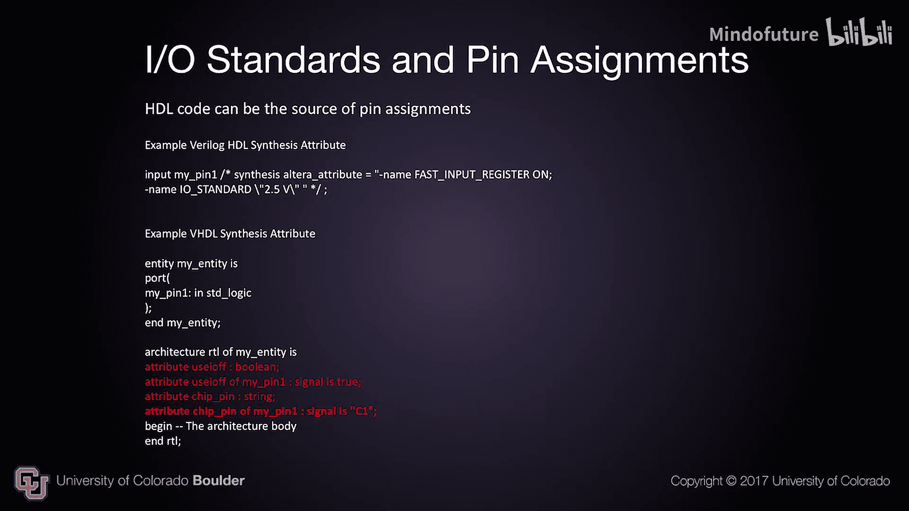

# 嵌入式系统FPGA设计入门：P32_04_03_01_5：FPGA输入输出设计 🧩


在本节课中，我们将要学习FPGA输入输出（IO）设计的关键知识。具体内容包括：IO标准如何驱动内部信号分配到FPGA的外部引脚、常用IO标准的细节及其对系统性能的重要性、如何为不同应用选择合适的IO类型，以及进行引脚分配和跟踪IO属性的五种方法。

## IO标准与结构回顾 🔌

上一节我们介绍了FPGA的基本架构，本节中我们来看看FPGA与外部世界通信的桥梁——输入输出单元。IO标准直接影响引脚分配。

根据经验，FPGA项目失败或延迟最常见的三个原因是：首次上电调试、高速接口（如PCIe和DDR3）设计，以及**引脚分配和IO错误**。这有些令人意外，因为引脚分配看似简单，但若忽视细节，就容易出错。

FPGA的IO能力非常灵活，即使在同一芯片内，IO标准也可能大不相同。这带来了跟踪所有IO分配的挑战。

IO在FPGA中以**Bank（组）** 的形式组织，每个Bank有一个电压参考。常见电压有3.3V、2.5V、1.8V，相邻的Bank可能使用不同的电压。

## 常用IO标准详解 ⚡

以下是FPGA中常用的IO标准类型：

*   **单端IO标准**：如LVTTL或LVCMOS，包含许多变体（如HSTL、SSTL、GTL等）。它们使用一个引脚传输一个信号。
*   **差分IO标准**：如LVDS、LVPECL、CML等。它们需要两个引脚（一对导体）来传输一个信号，能提供更好的抗噪性和更高的速度，但代价是占用更多引脚资源。

一个重要的原则是：**全局网络**（如全局时钟、复位）通常必须分配到特定的、能接入FPGA内部全局网络的引脚上。一个常见的PCB设计错误是将时钟信号连接到无法访问全局网络的FPGA引脚上，这可以避免。

单端信号即使在相同电压下，其电压摆幅也可能不同，这取决于它们是TTL还是CMOS标准。例如：
*   TTL的 `V_OH - V_OL` 约为2.0V。
*   LVCMOS的 `V_OH - V_OL` 至少为2.6V。

有些部件具有PCI兼容的IO，带钳位二极管。通过串联一个电阻，3.3V的PCI输入可以容忍5V电压。

为了降低功耗，LVCMOS有扩展到更低电压的版本。例如在1.5V时，其电压摆幅计算如下：
`V_OH - V_OL = 1.025V - 0.4V = 0.625V`

还有基于参考电压的单端逻辑系列，如SSTL（存根系列终端逻辑）和HSTL（高速收发器逻辑）。它们的输入参考点不是地，而是一个公共的参考电压`V_REF`。这提高了速度，但降低了噪声容限。

## FPGA IO引脚内部电路 🏗️

一个典型的FPGA IO引脚内部电路简化版如下：
*   当配置为**输入**时，外部信号可以传播到输入寄存器，或直接旁路到FPGA逻辑阵列。
*   当配置为**输出**时，引脚可由一个寄存器直接驱动，并且输出可以被使能或禁用，以创建三态总线输出。

以Max 10器件为例，其IO引脚电路更为详细，核心仍是三个寄存器和一个输出使能。IO具有可编程的特性，例如：
*   **转换速率**：可设置为快或慢。
*   **驱动强度**：可从2mA到24mA或更高不等。

其他IO特性也同样重要，并且需要以Bank为单位进行分配，因为它们可能因Bank而异。例如：
*   有些引脚支持热插拔，或仅为输入/输出，而有些则不支持。
*   有些引脚兼容DDR或PCI，而大多数不兼容。
*   有些引脚是三态的，可用于创建外部总线，有些则不是。

## 引脚分配与属性跟踪的五种方法 📋

面对如此多的选项，我们如何有效管理？像所有优秀的工程师一样，我们可以使用工具来跟踪。Quartus Prime等工具提供了使用电子表格来制定和记录分配的工具。

在Altera（现Intel）FPGA中，你可以通过以下五种方法之一进行引脚分配：

1.  **使用图形用户界面工具**：如Pin Planner或Assignment Editor。
2.  **从文件导入**：从SDC文件或Excel电子表格文件导入分配。
3.  **在HDL代码中编写指令**：在Verilog或VHDL源文件中直接指定引脚分配。
4.  **使用Tcl脚本自动化**：编写Tcl脚本来自动化分配过程。
5.  **从PCB布局CAD工具导入**：将PCB设计工具与FPGA设计流程集成。

我们将按相反的顺序简要了解这些方法。

**从PCB布局CAD工具导入**有助于减少引脚分配错误，因为设计规则检查可以确保电路板和FPGA的分配相匹配。

**使用Tcl脚本自动化**是许多FPGA设计师喜欢的方式，它可以实现流程的自动化。

**在HDL代码中包含引脚分配**通常很有帮助，因为这样设计的源文件和引脚分配就位于同一处。这在Verilog和VHDL中都可以实现，例如：
```verilog
// Verilog 示例
(* chip_pin = "A1" *) input wire clk;
(* chip_pin = "B2" *) output reg [7:0] data;
```



或许最高效的引脚分配方法是利用**FPGA供应商的图形化工具**，例如Altera的Pin Planner界面，它提供了直观的引脚映射和属性设置功能。

## 总结 📝

本节课中我们一起学习了FPGA输入输出设计的核心内容。

我们了解到，FPGA拥有广泛的IO能力，包括多种IO标准和可控的电路特性，但丰富的选项也导致了频繁的错误。我们可以通过使用有助于记录和跟踪IO使用情况的方法来减少引脚分配错误。

像LVDS和LVPECL这样的**差分逻辑标准**在FPGA中越来越流行，因为它们能同时提高速度和抗噪性。然而，这些标准需要导体对，这进一步复杂化了引脚分配过程。

具体而言，我们学习了：
1.  FPGA中常用IO标准的细节及其对整体性能和系统要求的重要性。
2.  如何确定各种应用所需使用的IO类型。
3.  进行引脚分配和跟踪IO属性的五种方法。