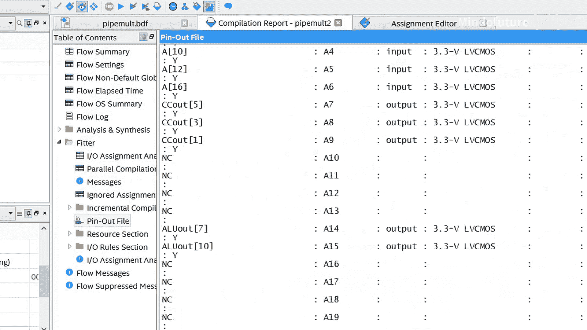

# 【科罗拉多大学】嵌入式系统-FPGA-设计入门-｜-intro-fpga-design-embedded-systems-p33-P33_04_03_02_6-精准引脚分配--BV19Tu6zGEMD_p33-

In this presentation， you will learn how to assign internal signals to the external pins of the FPGA IOP assignment is how your design interfaces with the outside world。

 so it's important to get it right。You will learn how to do PI assignments using the PIN planner and the assignment editor。

 how to meet IO standards and control IO properties using the assignment editor。

 and how to check IO assignments using the IO assignment Anar。

Here's what we will cover in this video。We'll assign pins to your design using the pin planner。

 then we'll assign pins to your design using the assignment editor and then check your P assignments using the I assignment Anar。

Recall that in Aler EGAs， you can do pin assignments in one of five ways。First， using Cors GuI tools。

 either the PI planner or the assignment editor， second by importing from an SDC file or an Excel spreadsheet file。

 third by writing directives in an HDL like Verlog or VHDL file fourth。

 automating by the use of a tickle script and tickle commands， and fifth。

 importing from a PCB layout tool in this video we will show how to do the first method using the PI planner and the assignment editor。

Before you launch Cortis Prime， to assure that everyone is working with the same design files。

 please unzip the pipepeMt QP16 under one M4V4。 zipip file that was provided to you into the C Co and backlash Altra PRj directory。

Launch Cortis Prime and open the Pipe M project。Double click on Pipe Mot in the project Navigator。

 the schematic should appear。Before you can make assignments， analysis and elaboration。

 the first step of compilation must be performed。Do this now if it is not already done。

Assignments can be made any time after this point， but changes will require steps in the flow after the synthesizer to be run to update the design to reflect the changes。

The PI planner is an interactive graphical tool for making pin assignments and setting IO constraints。

Pin Planner makes it easy to make I assignments for all the IO in your design。

 access it from the assignments menu， the toolbar， or the task window。

Click on the Asigns menu and select Pm Planner。The planner presents a picture of your device pin layout in the center window。

With a list of signals or nodes that need pin assignments known as the All pins list in the bottom window。

The pin legend in a window on the right。A task window in the lower left。

And a list of signal groups in the upper left window。If any of the windows are missing。

 you could add them from the View menu， for example， to add the groupss list。

 you would click on View and then the groups list。There are a number of ways to make pin assignments。

 you can drag and drop a no name from the Sign list into a pin in the package view。

You can also double click a location cell。And location。

 either a pin or a bank will be assigned to the signal。However。

 you must assure that the correct signals are tied to the correct pins， particularly the clock。

Check your evaluation board， user manual， or user guide for the pinout of your device。

 or look at the schematic for the circuit board you are using。

It is very important that you get the pin assignments done correctly or damage to the FGA could occur when the board is powered on。

 particularly if you have an input signal tied to an output pin。

Global signals must be connected correctly as well， typically clocks and reset。

You must also make sure the IO voltage and standard is correct for the assigned pins。

 if the IO standard in the signal list says it is a default。

 then this means you did not explicitly define that IO。For example。

 imagine you are using the B microcro Maxax 10。You can determine what pins and signals should be connected together by looking at the B microcromax 10 schematic。

On page 2 of the schematic， you would find a 50 meHtz clock tied to P N14 and a 24 meHtz clock tied to P N15。

In the All pins list， scroll down to the clock1 signal。

 click on it and drag it to the N14 pin in part layout。

The symbol turns blue and then brown once you click in empty space to indicate that this node has been assigned。

Notice that the pin symbol is a rising edge， indicating that this pin is tied to an internal clock network。

Select the View menu and click on Zoom in a couple of times to see the different properties of each pin。

Each pin's shape， color and text provide information about the properties of that pin。For example。

 note the unique colors that help identify eachIO bank。Triangles represent power and ground pins。

 circles represent special functions， squares are clock pins， Pentagons are for Jtag pins。

 and hexagons are for general IO pins。This information and more is shown in the pin legend window。

If you double click on N15。You will see the pin properties window。

 which allows you to assign a node to this pin as opposed to dragging the node to the pin。

We have no more clocks， so close the pin properties' window。

You can see all the clock pins available on this device by going to the task window and clicking on highlightlight pins。

 then clock pins， and then clock。From this， you can see there are eight dedicated clock pins。

Uncheck the clock pins box in the report window to remove the highlighting。

Back in the All pins window， the clock1 note has been shaded with the color of the I Bank 6。

 and the location is now shown。You also want to set the IO standard in the drive string。

In the IL standard column， double click on the clock1 entry and a drop down menu should appear。

Select 3。3volt LV CMmoss as this is the voltage used in the schematic。

Double click on the current strength entry for clock1 and select 2 milliamps from the menu。

Another global signal is reset。Pin D9 is tied to a global reset network。

Scroll down to find reset under N in the All pins window and drag and drop it to pin D9 on the chip layout。

Change the IO standard to 3。3 volt LVCOSs。Instead of changing IO standard assignments one at a time。

You can click on the IO standard in the group's window and set the standard for an entire bus at once。

In the groups window， scroll over to the IO standard column and select 3。3volt LV CMmoss。

Pin Planner stores the changes as you make them。 you can't exit thinking the changes haven't been saved because they are saved as you make them。

Now， repeat assigning IO standards by assigning all the IO buses to 3。3 volt LV Seamons。

To make pin assignments for a bus， select the bus from the group's window and drag and drop it to an I bank box at the outside of the chip layout。

If you do not see the IO Bank， right click in the empty space and selectShow IO Banks。

Assign a bus to an Iowa bank with Bu A， drag it to the I Bank 8。

 release it and then click in the empty space to finish placement of this bus。

This allows the fitter to assign the individual pins within the bank。

If you hover the mouse over the bank box， you can see the IO usage。In the All pins window。

 the location is listed as IoBa 8。Through the remaining buses， drag ALU out to Bank 7。

The B bus to bank 6。C out to Bank 7。Data A and data B to bank 5。IR to Bank6。Q to Bank 4。

And some to bank3。To see the results of all this work from the View menu， select IOBa U。

You can change the view of the device either by rotating the chip or looking at it from a top or bottom view by right clicking in the empty space and selecting rotate or top or bottom view。

We can also use the assignment editor to make pin assignments。To start the assignment editor。

 return to Corus and from the top level menu， click on assignmentsments and then assignmentsigns Ed。

The assignments editor should appear in the center window。

The assignments editor looks like a spreadsheet。Each row represents an assignment。

Many spreadsheet like operations can be done in the assignment editor， copy and paste， etc。

 entries can be made directly or from drop down menus。

You can enter the signal name or use the node finder to find the signal。

 scroll down to the bottom and double click on the two column。

Click on the binocular icon to open the node finder。

You can use the wildcard characters question mark for a single character wildcard or asterisk for multiple wildcard characters。

En her RD asterisk in the named box and hit enter。In the matching nodes， RD address should appear。

 click on it and then the right arrow to move it to the nodes found box and click OK。

Double click on assignment name and scroll down and select Lo。

Double click on value and IO Bank for the element and then select Bank 5 for the location。Click， O。

You can also cross Pro from other windows and Qs to get a particular signal or entity in the assignment editor。

Click on the PipeMt。bdf schematic tab。Right click on the right address Sign port and then select Locate node and then locate node in the assignment editor。

The right address signal appears in the assignment editor by itself because it is automatically filtered out。

Click on the top right address in the two column。Hit C C and then click in the two column at the bottom row where it says new。

Next to this in the assignment name， enter our location。Next to this in the value column。

 double click and select IOBa for the element and IOBa 5 for the location。

Clear the filter on node Na checkbox to see all the signals in the assignment editor。

In the next line， enter WREN in the two column。Next to this in the assignment name， enter location。

Next to this in the value column， double click and select IOBa for the element and IOBa5 for the location。

We have two more pins to assign， See in and see out。In the next two rows in the two column。

 type C in and C out。Scroll up to the S location entry。

 click and select the location and the IBa3 entries and hit Control C。

Select the two cells to the right of CN and hit C V to paste the location in IOBa 3。

Repeat for See out。In the file menu， select Save to save the assignments made in the assignments editor。

Assignments can be saved directly or will be saved automatically when you do a compilation to a dot QSF file。

You can also enter pin assignments directly in the Corus settingsttings file or QSF。

 you can create a separate tickle file with all the pin assignments and then source this file in the QSF file。

You can export pin assignments to an Excel CSV file for later use in this or other designs。

To do this， from the file menu， click on exportport and save as a dot CSV file。If changes are made。

 you can update the constraints in quous。Now that I assignments are complete。

 you can do an IO analysis which checks to see that all pin assignments are legal with respect to each other and to the device。

You can do this by clicking on I assignment analysis in the task window under analysis and synthesis in Cortus。

Or from the processing menu on the pin planner。Once the analysis is complete。

 you may see an error message about too many pins in IowaOBa 8。

Let's go back to the pin planner and fix this。In the pin planner。

 change the A bracket 31 Cose bracket location to IBa 6 by clicking on the drop down menu。

Now you have to reset the rest of bus A to IBa 8 by changing a bracket 30 close bracket to IBa 8。

 and then hitting Control C， selecting the rest of the A signal and hitting control V to paste IBa 8 to them all。

Once this is done from the processing menu in the PI planner， select Start IO assignment Ana。Success。

You now have a complete P assignment for your FPGA。

The pin assignments are also recorded in a dot pin file。

 Take a look at our dot pin file by looking at the compilation report in Corus under fitter and then pin out file you can see the pin assignments for every pin。

To summarize this video， pin assignments can easily be done in Corus Prime using either the P Planner graphicraal tool or the assignment editor spreadsheet。

It is important to assign global signals like clocks and reset to global network pins。

The I assignment Anar can check the pin assignments to make sure they are complete incorrect correct。

In this video， we have learned how to do PI assignments using the PI planner and the assignment editor。

 how to meet IO standards and control IO properties using the assignment editor。

 and how to check IO assignments using the IO assignment Anar。

