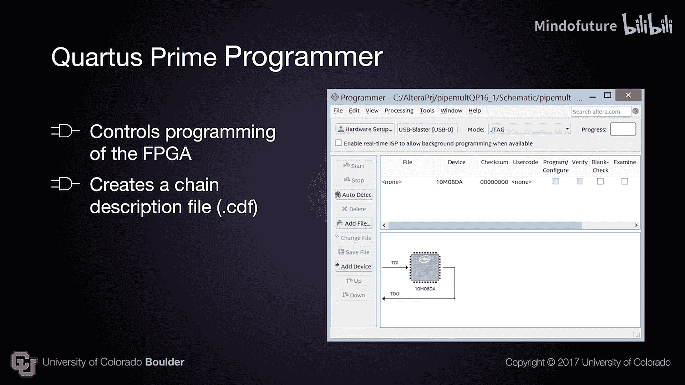
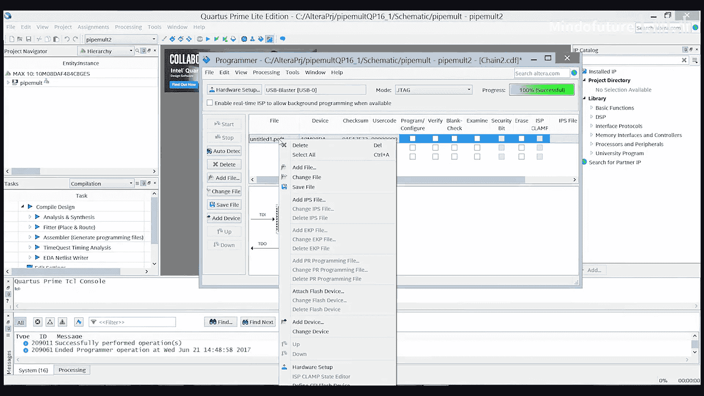

# 【科罗拉多大学】嵌入式系统-FPGA-设计入门-｜-intro-fpga-design-embedded-systems-p34-P34_04_03_03_7-FPGA编程配置--BV19Tu6zGEMD_p34-

In this video， you will learn how to program and configure your FPGA for use。

You will learn how EGAs are configured using a variety of schemes。

 including the hardware design and the software required for each。

 which programming file types to use in each configuration situation and how to use the Corus prime programmer to examine and program FGAs and PLDs in a chain。

Now that you've done all this wonderful logic design work in the FPGA tool。

 you would naturally like to see it in action and hardware to do this。

 you need to program or configure the FPGA programming usually describes the action of placing into memory the contents of a file that will be used to define the behavior of the device。

 whether it be a microcontroller or a programmable logic device。

Configuration is the process of loading that memory into the device to establish the characteristic behavior。

There are a number of configuration modes that are necessary to accommodate a variety of configuration situations and requirements。

For Alterra FPGAs， the configuration memory is typically loaded either directly through the JTAG programming cable or via a memory on the board connected to the FPGA。

Configuration modes include JTag。Active cereal。Passive serial。

 fast passive parallel and configuration via protocol or CVP。For example。

 there are several configuration modes forcycl5 devices as seen in the table。

The JTag mode must use a cable。 The other modes typically load the FPGA from an onboard memory。

 CPLD or microprocessor。Obviously， the fast parallel is faster than the serial modes。

 but requires more onboard resources。Some of the modes allow special features like partial reconfiguration and remote system updates。

The hardware design of each of these configuration modes is different。

The partial schematic shown here depicts the harbor design for a JTag configuration interface。

 which is commonly used on evaluation boards。JTag configuration can be used in conjunction with other configuration modes。

 but it always has precedence。In JTag configuration。

 JTAC commands and data are sent to the EGA directly to program the internal configuration memory。

 and once the transfer is complete the EGA is configured and ready to run。

The next most common configuration mode is active serial。

 in which a serial flash memory device stores the configuration image。

 and the FPG loads it into configuration memory on power up。

A schematic for this mode is shown along with the JTG cable connector。

 which in this case is used to program the memory device。Typically。

 this connector may not be populated in production， but is used in development。

Production flash memories are usually pre programmed and don't need to be programmed from a cable。

 Some board designs will have multiple Egas in a chain supported by a single large flash memory with multiple images。

Another common configuration scheme is fast passive parallel as shown here。

 A CPLD or microprocessor tied to a memory device actively transfers the data to the EG on power up。

 This allows more control of the configuration process and is faster。

The max 10 is unique to Alter and that it has internal flash memorym for a configuration。

 and so there are two ways to program it。 One is with JTag as with other FGs using a dot soft file directly to the SRAM configuration cells。

The other method also uses JTEG but programs the configuration flash memory。

 which is transferred to the SRM configuration cells on Powerup。

JTG programming requires a programming cable like USB Blalastster2 or Ethernet Blalastster 2。

In addition to correctly designed hardware for a particular configuration scheme。

 you must also have a programming file to program the part。

There are several types of programming files。There's the dot So or SRM object file。

 which is used to configure EJs directly from Corusprid software through a download cable。

 This is the most common type of programming file， as it is used for development when first testing the design by downloading it directly through the JTag cable。

There's also a dot Pf or programming object file which is used to program CPODs， flash FPGAs。

 and configuration flash memories。Also there's a dot jamm or dot JBC。

 which is an ASI file used by processors and test equipment to program devices via JTAag。

 a dot JicC or a JTag indirect configuration file is used to program EPCS parts。

 Alerus serial configuration devices through their dedicated configuration connection to an EPGA as configuration devices do not have JTAag interfaces。

The Cortis Prime programmer is a software tool that controls the programming of the FPGA When you open the programmer from a tools manual toolbar。

 it creates a chain description file or CDf that stores device programming chain information as there can be more than one FPG and a programming chain。

A picture of this chain is shown in the programming window。 Let's look at an example。

Open Qus Prime and select toolss and then Programgramr。The programmer window should open。

At this point， you should have a board connected to program for this demonstration when we use the B Micromax 10 board shown here。

 note that the LEDs are blinking in accounting pattern。Before you can program a device。

You must set up your programming hardware to do this。

 click the hardware setup button in the upper left corner and select the hardware you want to use。

After selecting the USB Blaer cable， click Close。A programming device must have drivers installed and be detected correctly to be listed。

Next， select the programming mode the most common is JTAG。

 the JTEag chain can consist of both non Altera and Alerura devices。Once the hardware is set up。

 a toolbar in the programmer provides all the commands needed to control the programming of devices。

For example， the order of programming devices on the chain can be arranged。

Other common operations include auto detectect。In which the chain is scanned and the devices found are reported and change file。

Which selects the new file to program into the selected target device。

Clicking on Auto detectect makes the programmers show the device chain。

You can also verify a device after it has been programmed。Or blank check advice。Aasea device。

Or set a security bit， if available。To select the programming file， click add fileile。In this case。

 LED under counter。poF and click on the file name。You may have to delete any other files that are listed。

When all the devices are defined and options set correctly， click on start in the upper left。

The progress bar shows the status of programming and the Meage window provides detailed status and information about any errors that may occur。

When the progress bar reaches 100%， the programming is complete。Look at the board。During programming。

 the LEDs did not blink， but start blinking again once programming is complete。

You can also upload a programming file by selecting Examine。While the board is being examined。

 notice the LEDs quit blinking as it is in the upload state。Once uploaded。

 you can save this file and use it to program other boards。

In this video you have learned how FPGAs are configured using a variety of configuration schemes from JTag to active serial to fast passiveel parallel。

 each scheme has a unique hardware design and software required you've also learned what programming file types to use in each configuration situation and how to use the Corus prime programmer to examine and program FPGAs and PLDs in a chain。

