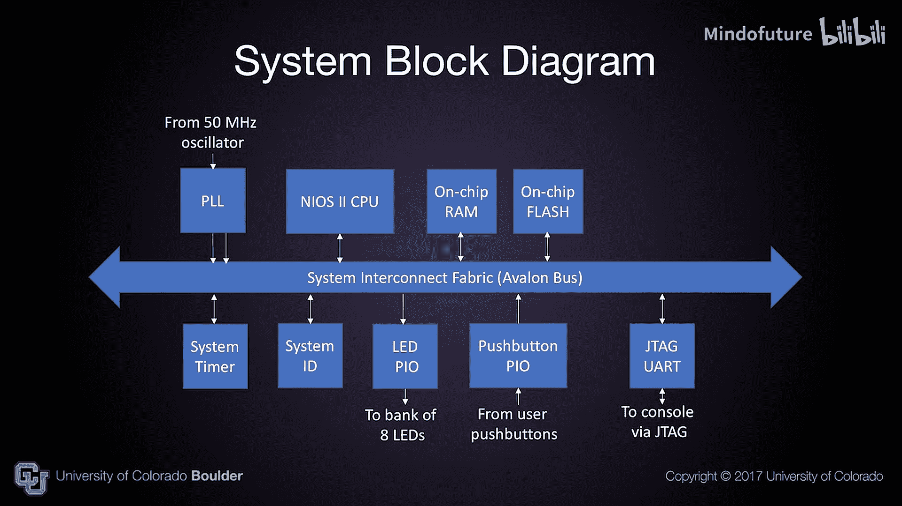
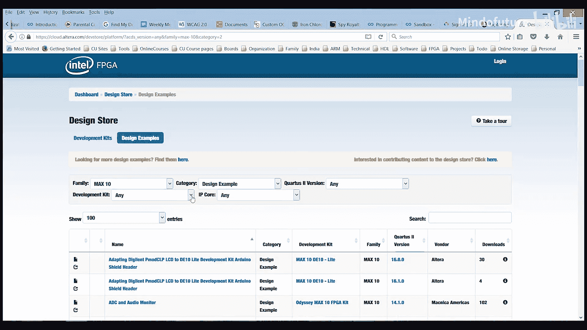
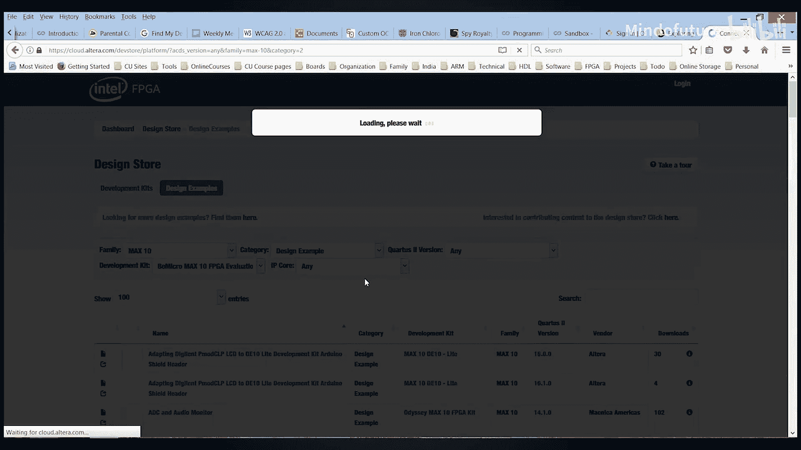
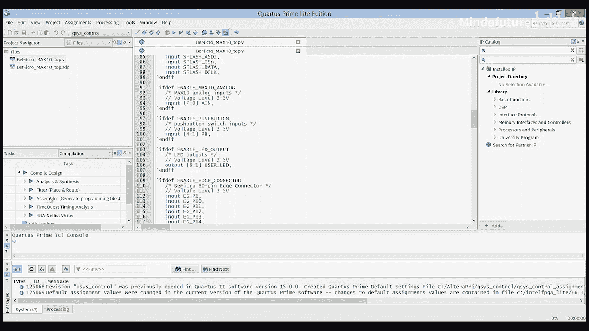
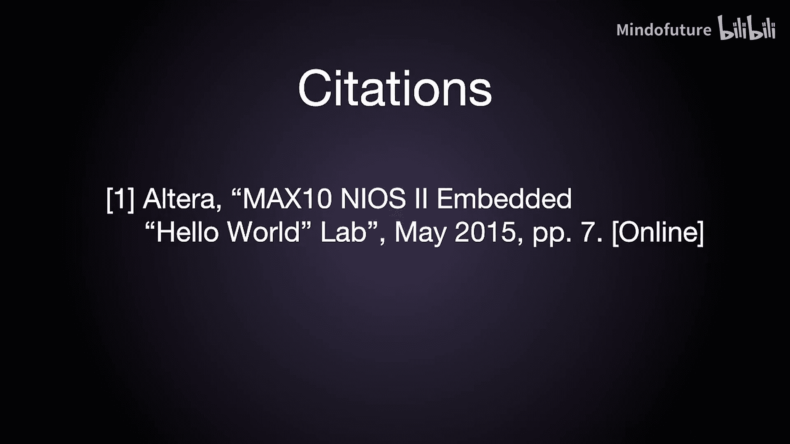

# 【科罗拉多大学】嵌入式系统-FPGA-设计入门-｜-intro-fpga-design-embedded-systems-p35-P35_04_04_01_8-Qsys系统设计入门（第一部分）--BV19Tu6zGEMD_p35-

In the previous sessions， we have learned how to design some logic to create a protoalLU， however。

 we can leverage the power of Corus to make a true ALU very quickly and can in fact make an entire So Core CPU in the EGA using a design tool known as QUSis。

In this presentation you will learn how to design a system within the FPGA using the system design tool CUSis。

 but the time you are done， people may mistake you for Q。

You will learn how to use a project template to accelerate the beginning of a design effort。

 how to create acusis system， how to add clocks， and how to add a NeEOS2 processor。

Here's what we will cover in this video。First， we'll create a new project using a board specific project template。

Then we'll create acA system by adding first a PLL as a clock generator and add a soft corere processor to the system。

This diagram depicts the typical flow for NeOS2 system design。

There is both a hardware branch and a software branch。

 We will focus on the hardware development in this video。

Hardware system definition is performed using QUSis。

 the resultant HDL files from the KUUSis system are used by the Cortius FPGA design software to map。

 fit and download the hardware image into the FPGA device。

Cors also generates information that describes the configuration of the system design in CUSIS so that the NEOS 2 software development tool can create a software library that matches the hardware system and contains all the correct peripheral drivers。

The output of the harbor flow is an EGA image that is used to configure the EGA。

The output of the software flow is inexecutable from which the NeEos2 processor executes instructions。

Here is a block diagram of the system we will construct。

It includes the P LL driven by an external 50 MHz oscillator on the Dev Kiboard。

 the Neos 2 So Co CPU on chip Ram and flash memory for program and data storage。

 a 1 millisecond system timer， system ID D block， LED and push button interfaces and Jtag connections to the software development and FPG configuration tools。

 all connected together by an Avalon bus or bus bridge。

Create a directory in your Alterara PRRJ directory called CuUSis under control。Download the file。

Qis under control to SDC and store it here。Launch Corus Prime and select file and then new project wzard。

For the working directory， enter C Co and backlash AlTRA PRRJ backslash QUSis under control。

 and name the project QUSis under control。Hit next。In the project type dialog box。

 choose the project template， This is different from what we have done before， hit next。

On the next box， select Max 10 for the Family and B Micro Max10 FPGA evaluation kit for the kit。

If the BMicro Maxax 10 FPG evaluation kit is not listed in the choices。

 you may have to download the design templates from the design store。If you need to do this。

 a link is given at the bottom of this dialog box that allows you to do this。

 click on Design Store and the link takes you to the Design Store webpage。

Be sure to select design examples。Select Max 10 for the Family， design example for the category。

 and then B microcro Max 10 FPJ evaluation kit for the kit。

Select the B Micromax 10 baseline pinout for Qus version 16。1。Download the installation package。

Save the dot par file in the project directory。After downloading。

 return to Corus where you will have to install the design template in the second step as indicated。

Click on installs the Design template， give the location of the dot par file in the dialog box。

Click OK， select the B Micro Maxax10 kit baseline pin out from the design template list and hit next。

Hit finish in the summary box。When your project opens under files in the Project Navigator。

 you will see two files， an SDC file， and a top level V file。This is the basis for you design。

 it has all the external signals defined and pins assigned。If you open the pin planner。

 you will see these signals present and pin assignments。Close the pin planner。

Double click on the V log file in the project Navigator。In it。

 you will see code that defines all the interfaces to the various components on the board that connect to the FPGA。

We are now ready to create our first QSIS system。To create our CUSis system， selectFile。

 and then new and then CUSis system file。The Qis system integration tool starts in a new window。

It may take some time the first time it starts。In the CUSSis window on the left。

 you see an IP catalog with library functions that can be imported into your CUSCis system。

Take some time to survey them to see what is there in particular。

 the basic functions in the university program have a number of useful functions。

The system above can be created in CUSsis using a standard library of reusable IP blocks。

The system interconnect fabric is automatically generated by Csis and binds the blocks together。

The system interconnect manages dynamic bus with matching， interrupt priorities。

 arbitration and address mapping。When ANeo's two soft corere processor is included。

 this system is a full featured processor system capable of running operating systems such as microcroCOOS2 or Linux。

We will guide you through the process of building a basic embedded system。

 you will build up a subset of the system block diagram we showed earlier， one block at a time。

 one step at a time。So for the first step， add an Avalon alt PLL as a clock source for the processor peripherals and memory。

This peripheral instantiates a PLL which will generate the clock for the system。

From the IP catalog pane， expand basic functions， then expand clocks， PLLs and resets。

Then expand PLL and double click on Avalon Alt PLL。This will add the Avalon Alt PLL module。

The alt PL L mega wizard opens， change the input clock frequency to 50 megaHz。

 click next to move to the next tab of the wizard。On the next page。

 uncheck both create an a reset input to asynchronously reset the PLL and create locked output options。

Click next and also click next on the bandwidthm page， the switchover page。

 and the configuration page。You should now see the C0 core external output clock。

On the C0 core/ external output， click on the enterter output clock frequency button and enter 80 megahertz。

This clock will be used as the processor system clock， clocking the Neos2 processor。Hit next。

Check the Use this clock button。Click on the enter output clock frequency button and enter 40 MHz。

 This clock will be used to clock various peripherals in the system。 Click next。For the clock C2。

 accept the defaults and hit next， do the same for C3 and C4。On the summary page， click finishish。

The Alt PLL under zero is now added in Cusis。Some errors and warnings will appear in the bottom console indicating that various ports are not connected。

 ignore these for now。We will address these connections in the upcoming steps。

 you will continue to see these messages after every component is added。But not to worry。

 as they are good reminders of the connections that are yet to be made。Next。

 we'll connect the incoming clock and reset to the PLL。

CesIS needs to know what clock and reset sources to use as the input to the PLL component。

The clock and reset sources can come from an external source or from another component within the QUSis system。

 in our case， we will be connecting them to an external clock and reset。

Click on the System Contents tab to see the view of the components in our system。At this point。

 there are two components， a clock source component that was in the system by default when QUSis first launched and the Avalon Alt PLL component that we added in the first step。

The clock source component is a Cis component which brings in a clock and a reset source from outside of the CUSis system。

We will connect its nodes to the corresponding nodes on the Avalon PLL component。

In the Connections column， hover over the connections and you will be able to fill in connection dots to make connections。

Connect the clock clock output port of the clock source to the inC interface of the out PLL component and the inC interface of the al PLL component。

Similarly， connect the under reset output port of the clock source to the endclock under interface under reset of the Avalon Al PLL component。

Your resulting connection should look as follows。We have not yet saved our system。

 let us use this opportunity to save our work。Click on SaveAs from the file menu and save the system as NeOS2 under control。

Qis。Close the window after the save completes。So next we're going to add a NeOS2 processor。

A CPUU is needed to run the control algorithms。The NeOS2 is a 32 B CPU built in FPG programmable logic with a number of distinct benefits。

Obviously， it can easily be configured and can be customized to include just the functions you desire。

Many functions of the core are optional， as we shall see。Additionally。

 combined with available bus interconnections in QUSis。

 it is very easy to extend the processor system to include a wide range of memory and peripherals。

You can include only what you need so the resource usage can be very efficient。

The performance is optimized so your speed is reasonable。

 although not what you would expect from a hardcore processor。However， unlike hard corere processors。

 obsolescence is not a problem， once designed， the soft corere system can be applied to EGAs now and into the future。

From the IP catalog pane under library， expand processors and peripherals and then embedded processors and double click on NeOS2 processor。

The Neos2 processor configuration window opens。In the main tab。

 ensure that the NeOS2/lash F core is selected。Click on the JTG debug tab and change the number of hardware break points from 0 to2。

In the Cas and memorymory Interfaces tab， reduce the size of the instruction cache to2 kilobytes。

In the vectors tab， set the reset vector memory to Neos2 under CPU。

 debug under MAm under S and do the same with the exception vector memory。

There are numerous other options on the various pages of the dialog box。

 including the ability to add an MMU and hardware divider， etc。We will keep things simple for now。

 all the remaining defaults should be accepted， click finish。

You will likely see two error messages asking for the Neos 2 to be connected to a clock and a reset。

Connect the Neos clock input to the alt PLL under C 0 output。

Connect the NeEOS2 reset input to the clock under zero reset output。

The error messages should now go away， yay， see how easy this is。

Right click on the name field and rename the NeEos2 component from NEOS2 under Gen 2 under0 to NeEos2 under CPU。

You may need to double click on the NeS2 CPU to revise the reset and exception vectors in the parameter window。

Change them to NeOS2 under CPU。 debug under Mam under S。

The Neos2 can reconfigure the PLL on the fly through the Avalon Mem Maped bus interface。

 connect the NeEos2 data master to the Alt PLL S。At this point， the system should now look like this。

We have made the fundamental components needed to make a CPU system， reset， clocks， and a processor。

In the next video， we will learn how to add memory and peripherals and then compile this system and analyze the results。

Hit file and then save。Close the safe box。And then file an exit to close Cusis。Save the project。

 save all and close Corus。

To summarize this video， KUSis is a powerful and easy to use tool to create complete systems using block diagram concepts with detailed connections。

Rather than design a CPU and on logic from scratch。

 a better alternative is to use existing CPU designs like Altros Neos 2。

 the design can be done very quickly and is optimized for performance and resource usage。

In this video， we have learned how to use a project template to accelerate the beginning of a design effort。

How to create acis system。How to add phasease lock loops as clock sources and how to create a NeEOS2 soft corere processor。

