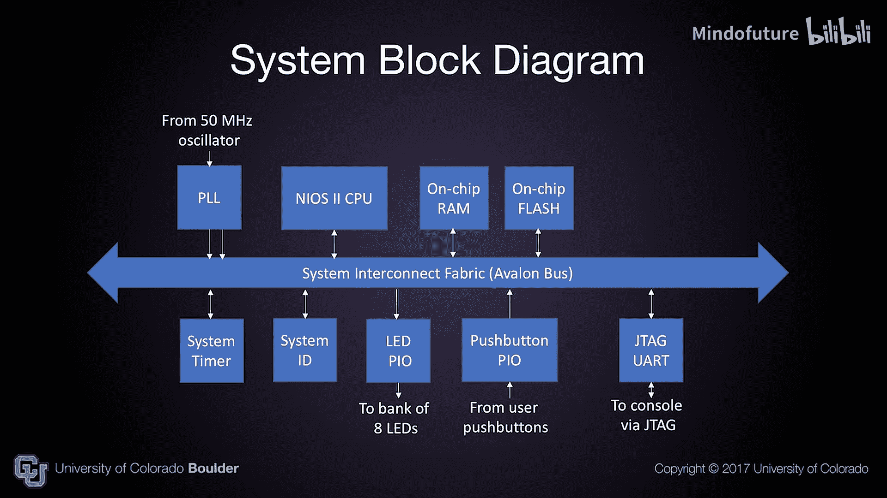
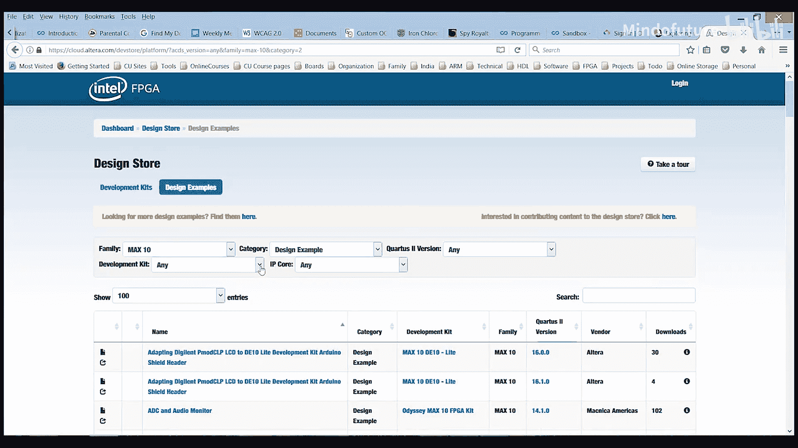
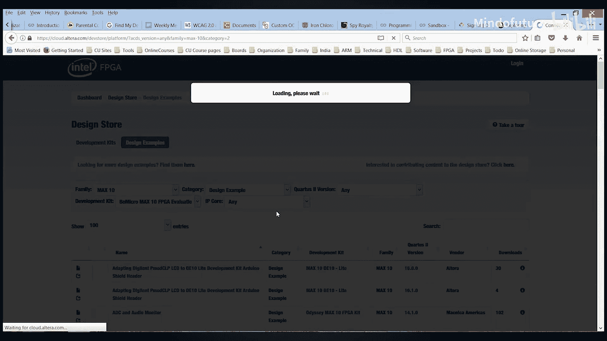
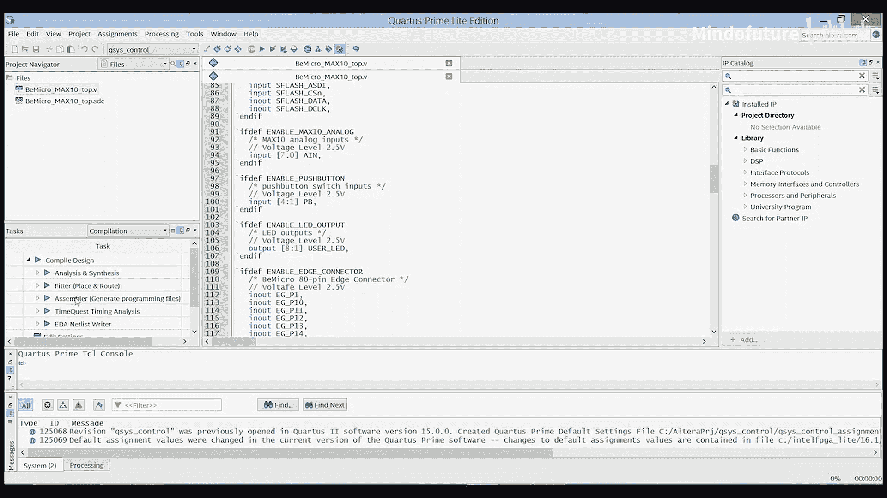
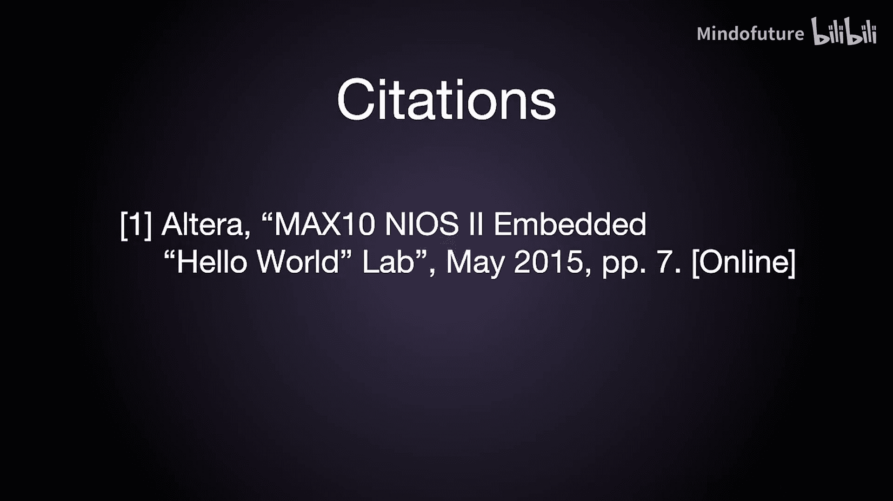

# 嵌入式系统FPGA设计入门：P35_04_04_01_8：Qsys系统设计入门（第一部分）🚀

在本节课中，我们将学习如何使用Altera的Qsys系统设计工具，在FPGA内部快速构建一个包含Nios II软核处理器的完整系统。我们将从创建项目模板开始，逐步添加时钟源和处理器核心。

---

## 概述 📋

在之前的课程中，我们学习了如何设计逻辑来创建一个原型ALU。然而，我们可以利用Qsys的强大功能，非常快速地创建一个真正的ALU，甚至可以在FPGA中使用Qsys设计工具构建一个完整的片上系统CPU。

在本演示中，你将学习如何使用系统设计工具Qsys在FPGA内设计一个系统。完成学习后，你可能会被误认为是Qsys专家。

你将学习：
*   如何使用项目模板加速设计工作的开始。
*   如何创建一个Qsys系统。
*   如何添加时钟。
*   如何添加一个Nios II处理器。

---

## 系统设计流程概览 🔄

上一节我们介绍了课程目标，本节中我们来看看典型的Nios II系统设计流程。

下图描绘了Nios II系统设计的典型流程。它包含硬件分支和软件分支。在本视频中，我们将专注于硬件开发。

硬件系统定义使用Qsys完成。Qsys系统生成的HDL文件由Quartus FPGA设计软件使用，用于映射、适配并将硬件映像下载到FPGA器件中。

Quartus还会生成描述Qsys中系统配置的信息，以便Nios II软件开发工具能够创建一个与硬件系统匹配并包含所有正确外设驱动程序的软件库。

硬件流程的输出是一个用于配置FPGA的映像文件。软件流程的输出是一个可执行文件，Nios II处理器将执行其中的指令。

---

## 目标系统框图 🎯

以下是我们要构建的系统框图。它包括：
*   由开发板上外部50 MHz振荡器驱动的锁相环。
*   Nios II片上CPU。
*   用于程序和数据存储的片上RAM和闪存。
*   一个1毫秒的系统定时器。
*   系统ID模块。
*   LED和按键接口。
*   连接到软件开发和FPGA配置工具的JTAG连接。

所有这些组件都通过Avalon总线或总线桥连接在一起。

---

## 第一步：创建新项目 📁

现在，我们开始动手创建项目。以下是创建新项目的具体步骤。

1.  在你的Altera项目目录下创建一个名为`Qsys_intro`的文件夹。
2.  下载文件`Qsys_intro.sdc`并存储在此处。
3.  启动Quartus Prime，选择 **File** -> **New Project Wizard**。
4.  在工作目录中，输入 `C:\Altera_Project\Qsys_intro`，并将项目命名为 `Qsys_intro`。点击 **Next**。
5.  在项目类型对话框中，选择 **Project template**。这与我们之前的操作不同。点击 **Next**。
6.  在下一个框中，为系列选择 **MAX 10**，为开发套件选择 **BeMicro MAX 10 FPGA Evaluation Kit**。

---

## 安装设计模板（如需） ⚙️

如果“BeMicro MAX 10 FPGA Evaluation Kit”未出现在选项中，你可能需要从设计商店下载设计模板。如果需要这样做，此对话框底部提供了一个链接。

1.  点击 **Design Store**，链接将带你进入设计商店网页。
2.  确保选择 **Design Examples**。
3.  为系列选择 **MAX 10**，为类别选择 **Design Example**，然后为套件选择 **BeMicro MAX 10 FPGA Evaluation Kit**。
4.  选择 **BeMicro MAX 10 Baseline Pinout for Qsys version 16.1**。下载安装包。
5.  将 `.par` 文件保存在项目目录中。
6.  下载后，返回Quartus，按照指示第二步安装设计模板。
7.  点击 **Install a Design Template**，在对话框中指定 `.par` 文件的位置。
8.  点击 **OK**，从设计模板列表中选择 **BeMicro MAX10 Kit Baseline Pin Out**，然后点击 **Next**。
9.  在摘要框中点击 **Finish**。

---

## 项目基础文件 📄

项目创建完成后，我们来看看生成的基础文件。

当你的项目在项目导航器的“Files”下打开时，你会看到两个文件：一个 `.sdc` 文件和一个顶层 `.v` 文件。这是你设计的基础，它定义了所有外部信号并分配了引脚。

如果你打开引脚规划器，你将看到这些信号和引脚分配。关闭引脚规划器。

在项目导航器中双击 `.v` 文件。在其中，你将看到定义连接到FPGA的开发板上各种组件接口的代码。

我们现在准备好创建第一个Qsys系统了。

---

## 创建Qsys系统 🛠️

上一节我们准备好了项目环境，本节中我们来创建第一个Qsys系统。

要创建我们的Qsys系统，请选择 **File** -> **New** -> **Qsys System File**。Qsys系统集成工具在一个新窗口中启动。第一次启动可能需要一些时间。

在Qsys窗口的左侧，你会看到一个IP目录，其中包含可以导入到你的Qsys系统中的库函数。花些时间浏览一下，看看里面有什么。特别是，“University Program”基本函数下有许多有用的功能。

上述系统可以使用可重用IP块的标准库在Qsys中创建。系统互连结构由Qsys自动生成，并将各个模块绑定在一起。系统互连接口管理动态总线宽度匹配、中断优先级、仲裁和地址映射。当包含Nios II软核处理器时，该系统是一个功能齐全的处理器系统，能够运行诸如µC/OS-II或Linux等操作系统。

我们将指导你完成构建一个基本嵌入式系统的过程。你将逐步构建我们之前展示的系统框图的一个子集，一次一个模块，一步一个脚印。

---

## 添加锁相环作为时钟源 ⏰

对于第一步，添加一个Avalon alt PLL作为处理器、外设和存储器的时钟源。这个外设实例化了一个PLL，它将为系统生成时钟。

以下是添加和配置PLL的步骤：
1.  从IP目录窗格中，展开 **Basic Functions**，然后展开 **Clocks, PLLs and Resets**。
2.  接着展开 **PLL**，并双击 **Avalon alt PLL**。这将添加Avalon alt PLL模块。
3.  alt PLL MegaWizard打开，将输入时钟频率更改为 **50 MHz**，点击 **Next** 进入向导的下一页。
4.  在下一页，取消选中 **“Create an ‘areset’ input to asynchronously reset the PLL”** 和 **“Create ‘locked’ output”** 两个选项。
5.  点击 **Next**，并在带宽页面、切换页面和配置页面上也点击 **Next**。
6.  你现在应该看到 **c0 core/external output clock**。
7.  在 **c0 core/external output** 上，点击 **“Enter output clock frequency”** 按钮并输入 **80 MHz**。该时钟将用作处理器系统时钟，为Nios II处理器提供时钟。点击 **Next**。
8.  选中 **“Use this clock”** 按钮。点击 **“Enter output clock frequency”** 按钮并输入 **40 MHz**。该时钟将用于为系统中的各种外设提供时钟。点击 **Next**。
9.  对于时钟 **c2**，接受默认值并点击 **Next**，对 **c3** 和 **c4** 执行相同操作。
10. 在摘要页面，点击 **Finish**。

现在，alt PLL（`under_0`）已添加到Qsys中。底部控制台将出现一些错误和警告，指示各种端口未连接。暂时忽略这些。我们将在接下来的步骤中处理这些连接。在添加每个组件后，你将继续看到这些消息。但不用担心，它们是提醒你还有哪些连接需要完成的好提示。

---

## 连接时钟和复位信号 🔌

接下来，我们将传入的时钟和复位信号连接到PLL。Qsys需要知道使用什么时钟和复位源作为PLL组件的输入。时钟和复位源可以来自外部源，也可以来自Qsys系统内的另一个组件。在我们的例子中，我们将把它们连接到外部时钟和复位。

1.  点击 **System Contents** 选项卡，查看系统中组件的视图。此时，有两个组件：一个是Qsys首次启动时默认存在于系统中的时钟源组件，另一个是我们在第一步中添加的Avalon alt PLL组件。
2.  时钟源组件是一个Qsys组件，它从Qsys系统外部引入时钟和复位源。我们将把它的节点连接到Avalon PLL组件上的相应节点。
3.  在 **Connections** 列中，将鼠标悬停在连接点上，你将能够填充连接点以建立连接。
4.  将时钟源的 **clk_in** 输出端口连接到alt PLL组件的 **inclk** 接口。
5.  类似地，将时钟源的 **clk_in_reset** 输出端口连接到Avalon alt PLL组件的 **areset** 接口。

你完成的连接应如下所示。我们尚未保存系统，让我们借此机会保存工作。从文件菜单中点击 **Save As**，并将系统保存为 `Nios2_intro.qsys`。保存完成后关闭窗口。

---

## 添加Nios II处理器 🧠

接下来，我们要添加一个Nios II处理器。需要一个CPU来运行控制算法。Nios II是一个用FPGA可编程逻辑构建的32位CPU，具有许多独特的优势。显然，它可以轻松配置，并且可以定制为仅包含你所需的功能。正如我们将看到的，该核心的许多功能是可选的。此外，结合Qsys中可用的总线互连，可以非常容易地扩展处理器系统以包含广泛的内存和外设。你可以只包含你需要的部分，因此资源使用可以非常高效。性能经过优化，因此速度合理，尽管不如硬核处理器。然而，与硬核处理器不同，过时不是问题，一旦设计完成，软核系统现在和将来都可以应用于FPGA。

以下是添加和配置Nios II处理器的步骤：
1.  从IP目录窗格中，在 **Library** 下展开 **Processors and Peripherals**，然后展开 **Embedded Processors**，并双击 **Nios II Processor**。
2.  Nios II处理器配置窗口打开。在 **Core Nios II** 选项卡中，确保选择了 **Nios II/f (fast)**。点击 **JTAG Debug Module** 选项卡，将硬件断点数量从 **0** 更改为 **2**。
3.  在 **Caches and Memory Interfaces** 选项卡中，将指令缓存大小减少到 **2 KB**。
4.  在 **Vectors** 选项卡中，将复位向量存储器设置为 **`nios2_cpu.debug_mem_slave`**，并对异常向量存储器执行相同操作。
5.  对话框的各个页面上还有许多其他选项，包括添加MMU和硬件除法器等。我们现在保持简单，接受所有剩余的默认设置，点击 **Finish**。

你可能会看到两条错误消息，要求将Nios II连接到时钟和复位。
1.  将 **Nios II** 的时钟输入连接到 **alt PLL** 的 **c0** 输出。
2.  将 **Nios II** 的复位输入连接到 **clock source** 的 **clk_reset** 输出。

错误消息现在应该消失了。看，这有多简单。
3.  右键单击名称字段，将Nios II组件从 `nios2_gen2_0` 重命名为 `nios2_cpu`。
4.  你可能需要双击Nios II CPU，在参数窗口中修改复位和异常向量。将它们更改为 **`nios2_cpu.debug_mem_slave`**。
5.  Nios II可以通过Avalon内存映射总线接口动态重新配置PLL，将 **Nios II** 的 **data_master** 连接到 **alt PLL** 的 **s1**。

此时，系统应该看起来像这样。我们已经创建了构成一个CPU系统所需的基本组件：复位、时钟和处理器。

在下一个视频中，我们将学习如何添加内存和外设，然后编译该系统并分析结果。

点击 **File** -> **Save**。关闭保存框。然后点击 **File** -> **Exit** 关闭Qsys。保存项目，保存所有并关闭Quartus。

---

## 总结 🎓

本节课中我们一起学习了Qsys系统设计的第一部分。

总结本视频，Qsys是一个功能强大且易于使用的工具，可以使用框图概念和详细连接来创建完整的系统。与其从头开始设计CPU和片上逻辑，更好的替代方案是使用现有的CPU设计，如Altera的Nios II。设计可以非常快速地完成，并且针对性能和资源使用进行了优化。

在本视频中，我们学习了：
*   如何使用项目模板加速设计工作的开始。
*   如何创建一个Qsys系统。
*   如何添加锁相环作为时钟源。
*   如何创建一个Nios II软核处理器。