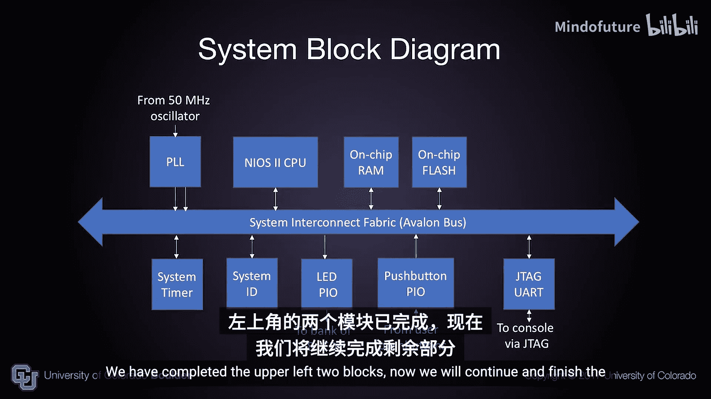
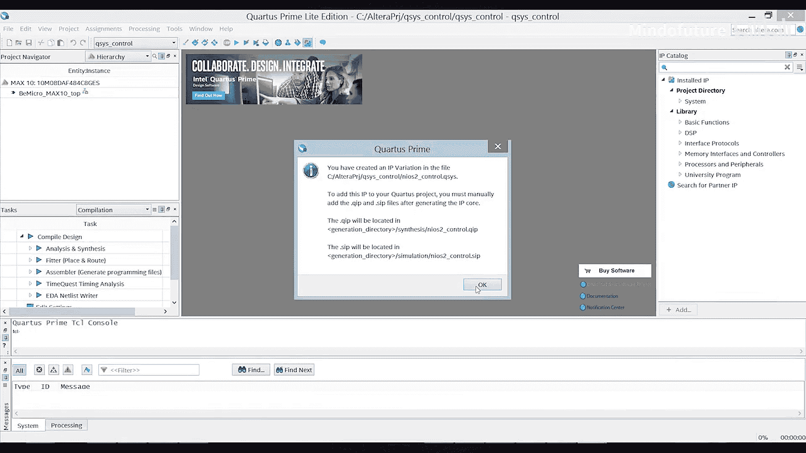
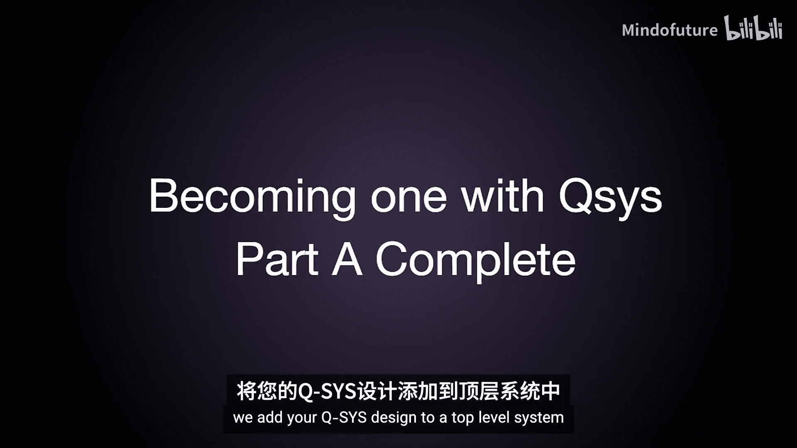

# 【科罗拉多大学】嵌入式系统-FPGA-设计入门-｜-intro-fpga-design-embedded-systems-p36-P36_04_04_02_9-Qsys系统设计精修（第二部分）--BV19Tu6zGEMD_p36-

In the previous session， we introduced the Cusis system design tool and the Neos2 soft processor。

 We started Acsis design， including the processor。 In this presentation。

 we will complete the design by adding memory and peripherals to the embedded system and do some analysis of the result。

 You will learn how to add memory and peripherals to a Neos2 Cusis design。

 The purpose of a bus bridge and how to implement it in an Acsis design。

How to bring the Cusis design into the top level to be compiled。

Here's what we would cover in this video。We will complete the CuUSis project by adding memory in several simple peripherals。

 including a UA and a timer。We'll instantiate the Cuis design at the top level by making it into a schematic symbol。

Well compile the CuUSis design and analyze the design using the RTL viewer。

This diagram depicts the typical flow for a Neos2 system design。

 We are in the middle of the defined system stage in Cusis。

 we will complete that and then move to the FPGA design。

Pen sciences have been taken care of for us by the use of a project template and timing and constraints were provided by an included SDC file。

This is a block diagram of the system we are building， we have completed the upper left two blocks。

 now we will continue and finish the rest。

Launch Cortis， open the Cusis under control project， it should be listed in recent projects。

And start Qsis by selecting the To menu and then QUSis。Select NeOS2 under control。

Qis and select Open。We went through four steps in CUS previously， so now on to step five。

Add an on chip Ram。Alterira FPGAs provide internal on chip memory blocks that can be used to build up an internal RAM or RAM block of memory。

This provides a processor with access to very low latency。

 high speed memory for code or variable storage。In the IP library on the left。

 expand basic functions， then expand on chip memory， and double click on on chip memorym RA or RAM。

In the On chip memorym dialog that appears， uncheck the initialized memory content box and then accept all the other defaults and click finishinish。

Back in the Qis window， right click on the name field and choose Rename from the P up menu。

Name this RAM component on ship under RAM。Connect the memory clock input to the Alt PLL C0 clock。

Also connect the memory Re one signal to the clock under Re output。Using the Connections column。

 connect the S1 Avalon memory mapped S interface of the on chip under RA to the NEOS2 under CPU/ instruction under master and NeEos2 under CPU/ data under master。

Set the base address of the on chip SRAM S1 to 0 x10000。For the next step， add an on chip flash。

The Max 10 FPGA contains an on chip flash which is used to store the FPGA configuration and can also be used to store NeEos2 code or other nonvolat data。

In the library， expand basic functions。Expand on chip memory and double click on Altera on chip Flash。

Change the clock frequency to 80 megahertz。Change the CFM access mode to read and write。

And hit finish。In the clock column， select AltPLL under0 under C0 as the clock for the onH flash。

 connect the on chip F reset to the clock under resets signal。

Connect the data to both NeEOS2 under CPU/ data under master and NeEOS2 under CPU/ instruction under master。

Connect the CSR control and status Regs to the NeEOS2 under CPUU s data under Master only。

Change the base address of on chip flash data to 0 x 0020，0000。

Change the base address of On chip flash CSR to0 x0030-0000。For the next step。

 we'll add Avalon memory mappped clock crossing bridge peripheral for the slow peripherals。

We will replaced several slope peripherals in a separate clock domain from the NeES2 processor。

With the bridge， a single clock crossing bridge is built into the system for all of the slow peripherals。

Pphers often have requirements to work with a different clock。

 creating a bridge to them as a general technique to handle the different clock domains。

A bridge takes data， addressing， and control systems on the Avalon bus。

 and translates them to signals needed by the peripheral so that the data can be exchanged between the devices。

From the IP catalog menu， expand basic functions， expand bridges and adapters。

 expand memory mapped and double click on Avalon MM clock crossing bridge。

Change the address units to words。Change the command PIFO depth to8 and the response PIFO depth to 32。

Click， finish。Connect the memory mapped bridge M0 clock to the PLLC1 clock and the S0 clock to the PLLC0 clock。

Connect both resets to clock under reset as usual。Connect the Neos2 under CPU's data under Masterport to the S0 Avalon memory Maps S of this bridge。

The MZ master port will be connected in the upcoming steps。

Change the base address of the Avalon memory map S to 0 x 00002000。And now to step eight。

 add a GPIO peripheral for LEDs。The B micro Max 10 has eight Ls。

You can drive these LEDs either collectively or individually with an output PIO peripheral。

From the IP catalog menu， expand processors and peripherals， expand peripherals。

 and double click on PIO or parallel IO。Set the width to eight bits。

 ensure that the direction is set to output only， click finish。Rename the peripheral LED under PIO。

Change the connection on the S1 slave port of the peripheral to be connected to the M0 master port of the slow under peripheralpheral bridge。

In the clock column， select Alt PLL under C1 as the clock for the clock clock input。

Use clock on a reset for the reset input。channge the base address to o x zero050，Finally。

 double click in the click to export field next to the external underconnection Condu at endpoint and change the name to LED under PIO under external。

And now for step nine。Add a PIO peripheral for push button switches。

The B Micromax 10 has four push button switches labeled SW1， SW2。

 SW 3 and SW4 connected to four of the FPGAIO pins。

You can use an input PIO peripheral to detect when any of these push buttons have been pressed and signal and interrupt to the processor。

When press these signals are active low。From the IP catalog menu， expand processes and peripherals。

 expand peripherals and double click on PIO for parallel IO。Set the width to four bits。

 set direction to input。Check the synchronously capture and following Edge options in the Edge capture Register section。

Check the generaterate RQ and Edge options in the interrupt section。

Check the hardwire PIO inputs in the test benchch option and drive the inputs to OXF。Click finish。

Rename the peripheral to button under PIO。Change the connection on the S1 slave port of the peripheral to be connected to the M0 master port of the S under peripheralpher underbri。

In the clock column， select Alt PLL C1 as the clock for the clock clock input and clock under reset as the reset as before。

Change the base address to 0 x0040。Finally， double click in the click to export field next to the external connection Con at endpoint and name button under PIO under external。

Next is step 10。At a1 millisecond interval timer peripheral。

 many software applications require periodic interrupts to maintain various time bases and timing requirements within the application a timer is a common and essential peripheral in most processor systems。

From the IP catalog menu， expand processors and peripherals， expand peripherals。

 and double click on interval timer。Confirm the interval timer is one millisecond。Click， finish。

Connect the S1 slave port of the peripheral to be connected to the M0 master port of the S under peripheralpher under bridge。

In the clock column， select Alt PLLC1 as the clock for the clock A input and attach the reset to clock under reset。

Change the base address to 0 x 0020。When you move your mouse cursor away the connection should look as shown。

 double check these connections carefully。And now on to step 11。Add a Jtag Ut peripheral。

Many software developers like to have access to a debug serial port from the target to leverage printf debugging。

 input control commands， log status information， etc。

 the JTAG UA peripheral connects to the Deep Arger console is useful for these purposes。

From the IP catalog menu， expand interface protocols， expand serial， and double click on JTAG UAt。

The default settings are acceptable， click finishinish。

Change the connection on the Avalon under JTEG under S Port of the peripheral to be connected to the MZro master port of the S under peripheralpher under bridge。

In the clock column， select Alt PLLC1 as the clock for the clock clock input。

 connect the reset to clock under reset。Change the base address to 0 x 0060。Okay。

 and now for step 12。Add a system ID。The reason for this。

 this is a very important peripheral to have in your system。

 it allows the NeOS2 development tools to validate that the software application is being built for the correct hardware system。

From the IP catalog menu， select basicsic functionss simulation。Dbug and verification。

 debug and performance， and then system ID peripheral。

Double click to add the component to the system。The SsID dialog box appears， click finishinish。

Rename this as Cis I。The component must be named CsID to be compatible with NOS2 software drivers and build tools。

Change the connection of the control under slave port of the peripheral to be connected to the M0 master port of the slow under peripheralpheral bridge。

In the clock column， select Alt PLL under C1 as the clock for the clock clock input。

 connect the reset input to clock under reset。Change the base address to 0 x0068。

We're now finished with the first part of building our system now for part two to confirm the system configuration。

For the clocks， only the PLL should have clock under zero。

 the external clock has an input in the clock column。Only the Nos2 CPU。

 the bridge and the on chip memories should use Alt PLL C0 as a clock。

All other components should use Alt PLLC1。Interrup request lines or IRQs in the IRQ column on the right。

 click on the circle by the timer IRQ to connect it to the processor， then connect the JTEG UA IRQ。

 and finally the button PIO IRQ。Next， create a global reset network。

KUSis provides an easy menu item to do exactly this and will save us from having to manually connect the reset inputs to each component。

From the system menu， choose createreate Global Reet network。

The tool will automatically connect all the resets in the system together。

 this reset is generated by the processor in a wired ord fashion combined with the external reset。

Next， we'll set base addresses and interrupt priorities。

QUSis provides two easy menu items that help clean up address map issues and interrupt priority issues。

Although we can enter them manually， we could have skipped this step and let CuUSis automatically assign them。

 either will work。From the system menu， choose assign based addresses。

 the tool will assign appropriate base addresses for the components by taking their widths into consideration。

I used undo or control Z to revert to the manual assignments。From the system menu。

 choose assignsign interrupt numbers， the tool will update the IRQ mapping accordingly。

 in this case no change from the manual assignment。

And now we'll establish the Nes2 boot configuration。In the event of a reset。

 the software must begin executing from a predefined memory location。

 This is set by setting the reset vector。 Similarly， when a software exception event occurs。

 the software must jump to a predefined location where the exception handling software resides。

 This location is set by setting the exception vector。

Double click on the CPU peripheral to launch the NeEos2 Gen2 processor preview parameter settings GuUI。

Click on the vectorctors tab。Set the reset vector to point to the on chip under RA with an offset of 0 x0。

When the Neos2 processor comes out of reset， it will begin executing software at this memory location。

Set the exception vector to 02 the on chip under RA memory with an offset of 0 x20。

When the NeEOS2 processor experiences software exceptions or interrupts。

 it will jump to this location in memory。The end result should look something like this。

SelectFile and click on Save to save the design at this point。Select generate， generaterate HDL。

 then click the generaterate button if it asks you to save select yes。

Qyis will now create first the HDL for various components in your system in either Vlog or VHDL。

 the default is Vlo， second， the system interconnect to connect the components together， third。

 a block symbol file for inclusion in schematics， and fourth a system description file used by the Neos2 software development tools or the Neos2 SBT to build the software project。

The HDGL generate process will take a couple minutes。

Once your system has been successfully generated， you will see the info message In system generation was successful。

Hit close and then click on finish in the lower right hand corner。Congratulations。

 you have just built your first Qis system。

You have completed Part A of this video， save the Cors project as we will open it again at the start of part B of this video as we add your acis design to a top level system。

