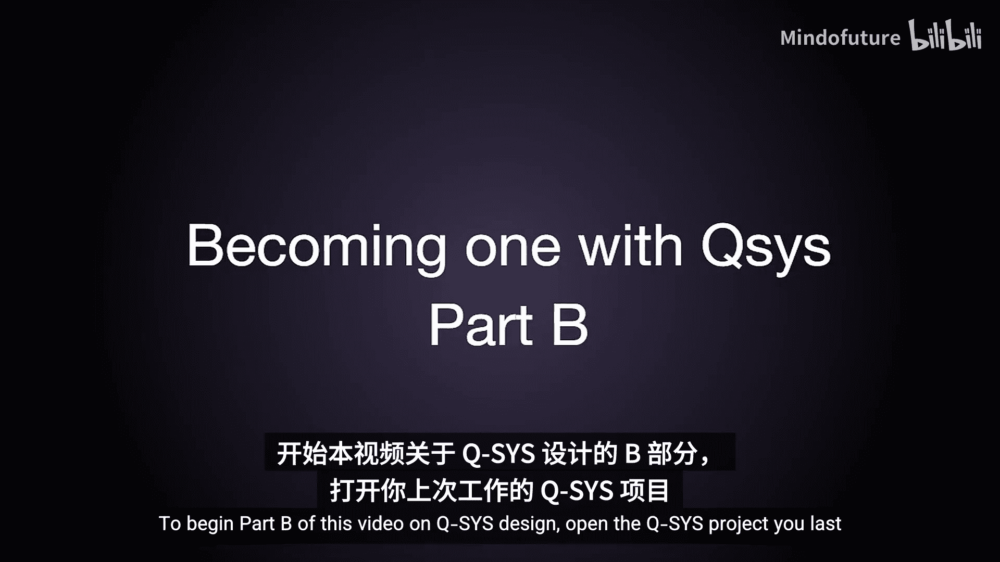
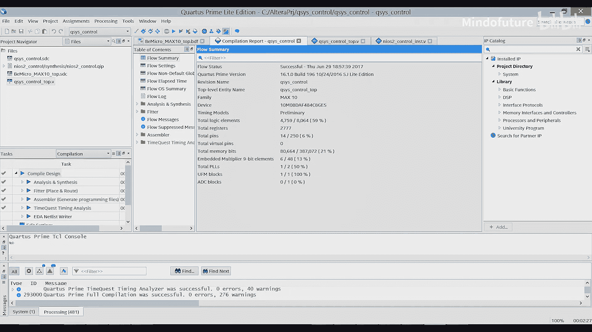
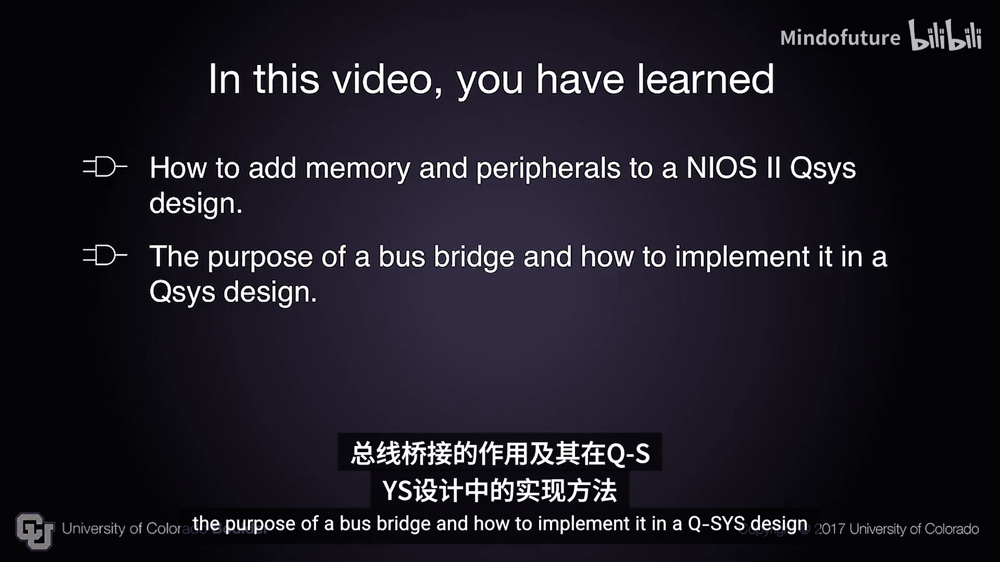

# 【科罗拉多大学】嵌入式系统-FPGA-设计入门-｜-intro-fpga-design-embedded-systems-p37-P37_04_04_03_9-Qsys系统设计完善（第三部分）--BV19Tu6zGEMD_p37-

To begin part B of this video on Cusis design， open the Cors project you last worked on。

 the Cusis under control Project。

Back in Cors， you will see instructions to add the dot QIP file to your project， click OK。

Now we can complete the Cortius Pri project by adding the generated Qis system to the top level entity。

We then compile in the Corus Prime software to perform analysis， synthesis， fitting， place and route。

 as well as timing analysis。At the end of the compilation。

 an FPGA image or SRM object file or starDt SOF will be generated。

The FPGA image can be downloaded to the B Micromax 10。

 at which point the onboard FPGA will function as a processor custom made for your application。

An IP variation file is a file with an extension of doqI that is generated by QSIS systemss or also by standalone IP catalog blocks。

The dot QIP file keeps track of the generatedative files so that your Corus project knows what files are needed for FPGA compilation。

To add the Neos to under B microcroundersystem。qIP file。

 go to the project menu and select add Remove files in the project。

You will be taken to a dialog box with a list of project files。

 click on the dot dot dot button to the right of the file name。

Double click into the NeEos2 under control folder and then double click into the synthesis folder and select the Neos2 under controltrol。

 QI file and click open。Click apply and then click OK。

CUSis automatically generated SDC files for the components which will provide timing information。

In our system， only the Neos2 CPU has generated SDC files， in addition。

 an SDC file called B microcro under M10 under NeEOS2 under top that SDC is included with the lab files and instructs time Que to determine our clock rates by analyzing the PLL。

We must set up our Corus project to point to these SDC files。

From the assignmentsigns menu in the Cortius Prime software， select Ses。Expand time Ques timing Anar。

In the SDC files to include in the project， click on the dot dot dot。

In the select fileile dialog box， navigate to the Cuis under control project directory and select the B microcro under Max 10 under top。

sc file and the Cuis under control。 SDC file and then click open。Next。

 we need to incorporate all of our CUSIS work into the top level FBGA design。

There are a couple of ways of doing this。 First， we can instantiate the ver log Neos 2 component into the top level B micro under max 10 under top file。

 However， this may require more v log work than we are ready to deal with at this point。

The second alternative is to use the block symbol created by Cuis in a schematic。

 something we are very familiar with in this course。To do this。

 clickFile and then new and then block diagram s thematic file。The schematic window should appear。

Double click in this to get the symbol editor and click on the lower left name window Brow button。

Navigate to see。Colon backlash Alerra PRJ backlash Qis under control backlash NeOS2 under control。

 and select Neos2 under control。bssF and click open。

Click OK and place the Ne2 block in the middle of the drawing。We need to add external signal ports。

Click on the P tool， select input and place one input pin to the left of the button PIO external input and one to the left of the clock input。

Hit escape and then click in the empty space to finish the placement。

Click again on the pin tool and select outputput， place it to the right of the Neos2 block。

To get the names of the ports exactly right， double click on B microcro under Max 10 under top。

 v to see the port names。From this we see the input clock name is ciss under clock。

Scroll down to the Enable under Push button section。Where we find PB bracket 4， colon1。

 close bracket is the name of the push button signals。

Just beneath this is the user under LED bracket 8 colon1 closed bracket output。

Return to the schematic and double click on the first input pin name and type PB bracket 4。t。

1 Close bracket， rename the clock input port to cis underclock。

Change the output pin name to user under LED bracket 8。t dot1 close bracket。

Why are these ports to the corresponding block signals？This leaves us with just the reset line。

We will create a reset circuit using the orR of two push buttons。

Select the symbol tool and under library， select the Intel library， then primitives， then logic。

 then or2。Place it by the reset input， draw a line from each or two input and label the top one PB bracket1 closed bracket and the bottom one PB bracket 4 closed bracket。

W are both inputs to the PB bracket 4。1 closed bracket line？Why are the R2 output to the reset input？

Hit file and then save to save the schematic。In the Project Navigator select files。

 right click on the B microcro under Max 10 under top。bDf file and click set as top En。

Now we have two top level entities， this won't work。

 so remove the B micro under Max10 or top dot V file by using project then add remove files in project。

In the file list， select B microcro under Max 10 under top。v and hit OK。

Verify with the pin planner that the pin assignments have not changed。

Now the design is ready to be compiled。Double click on compile design in the task window。

Let's analyze the results。Do you expect the circuit to be large and use lots of logic？

The compilation report indicates 60% of the logic in the device is used。

Select tools and then netless viewers， then RTL viewer。In the NeL Navigator。

 click to expand the instances to NeOS 2 under control colon instance。

The CPU is on the upper left part of the expanded screen。You can explore this design at your leisure。

 perhaps with a cup of tea。Close the RTL viewer。Obviously。

 to analyze this further you should write a simulation and run some test code；

 this is beyond the scope of this course， but will be discussed in more detail in Co 3 of the specialization。

Now as an option， you can also include the NeEos2 in the Ver log top level design to use V log to create the top level design。

 add B micro under Max 10 under top。 V back to the project by using project。

 add remove files and project。Click on the browserow button。

 select B microcro under Max 10 under top。 V and click open。Click OK Now in the project Navigator。

 double click on B microcro under Mac10 or top dot V and save as Qis under control under top dot V。

Right click on Qsis under controll under top dotv and set as top level En。

Right click on Bet Micro under Max 10 under top do V and click Remove from Project。

Right click on B microcro enter Max 10 under top。bdf and click Remove from Project。

Double click on Qis under control under top do V to make this look like our system。

 we need to remove parts that are not used。Remove all the sections of the file except for the clock inputs。

 push button and LED sections。Remove the comma after user under LED about line 46。

After the LED section and after the closed parenthesis， add a line that says wire。

 reset under N semicolon。Add another line after this that says assign sign reset under n equals。

PB bracket1 closed bracket or PB bracket 4 closed bracket semicolon。Now from the file menu。

 select open， double click on Neos 2 under control and select NeOS2 under control under instance。v。

Click on open。This file should now be opened in the main window。

 it was created by CuUSis to aid in instantiating the Neos2 processor system into your top level V log file。

Click in this file and hit Cr A and control C。Go back to Qsis under control under top。

 v and paste this in before the end module。Now you will need to complete the instantiation by specifying the port signal connections。

Replace the connected to button parenthetic expression with PB bracket 4， colon1， closed bracket。

Replace the connected to clock under clock with cis under clock。

Replace the connected to LED with user under LED bracket 8， colon1， close bracket。

Replace the connected to reset with reset under N。Lastly。

 change the moduleular name to Qis under control under top。Hit file and then save。Now。

 if you manage to do all that exactly as stated， then the design is ready to be compiled。

 double click on compiled design in the task window。

The result you see should be the same as with the schematic implementation。

 and it probably was a little easier to do。If you are unfamiliar with Verlo。

 you may wonder how of this works。The next course in this series。

 hardware description languages for logic design would give you all the understanding you need to do these instantiations without guidance and also give you a powerful and more efficient way to do logic design。

To summarize this video， the highly functional Nes2 soft processor hardware can be created and customized quickly in Altra FPGAs by using the QUSSIS system design tool。

QUSis empowers designers by leveraging IP， incorporating a wide variety of processors， peripherals。

 and memory components into a system connected together by buses and bridges。In this video。

 we have learned how to add memory and peripherals to Aos2 aousis design。

The purpose of a bus bridge and how to implement it in Accusis design。

How to bring the Cusis design into the top level to be compiled either by creating a block symbol schematic or by instantiation in a top level V file。

