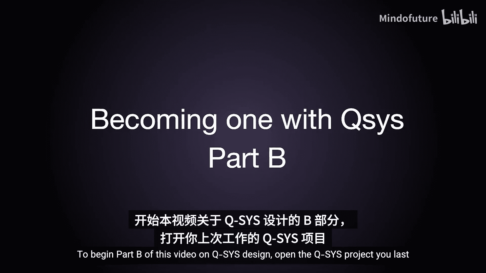
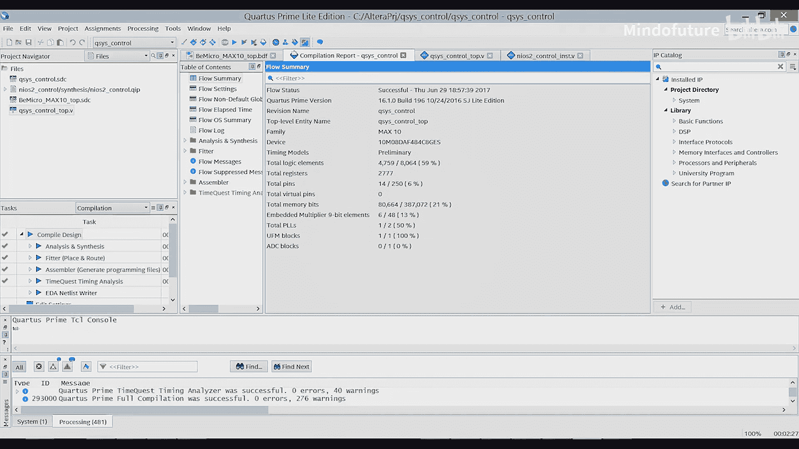
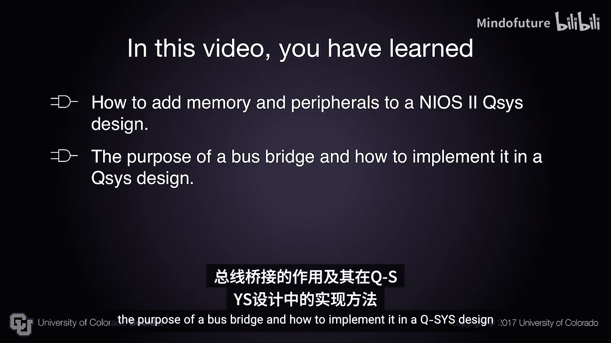

# 嵌入式系统 FPGA 设计入门：P37：Qsys 系统设计完善（第三部分）🏗️




在本节课中，我们将学习如何将 Qsys 中生成的 Nios II 处理器系统集成到顶层的 FPGA 项目中，并进行编译，最终生成可下载到 FPGA 的配置文件。我们将通过两种方法实现：一种是使用原理图符号，另一种是使用 Verilog 代码实例化。

---

## 概述 📋

上一节我们完成了 Qsys 系统中处理器、外设和总线的配置。本节中，我们将把生成的 Qsys 系统添加到 Quartus Prime 项目中，设置必要的时序约束文件，并通过原理图或 Verilog 代码将其与顶层设计连接，最终完成整个 FPGA 设计的编译。

---

## 步骤一：添加 .qip 文件到项目

首先，打开你上次工作的 Qsys 项目。在 Quartus Prime 软件中，需要将 Qsys 生成的 `.qip` 文件添加到项目中。`.qip` 文件记录了生成系统所需的所有文件，确保 Quartus 在编译时能找到它们。

以下是具体操作步骤：

1.  在 Quartus 菜单栏，点击 **Project**，然后选择 **Add/Remove Files in Project**。
2.  在弹出的对话框中，点击 **File name** 右侧的 **...** 按钮。
3.  导航到你的 Qsys 项目目录（例如 `Qsys_control`），进入 `synthesis` 子文件夹。
4.  选择 `nios2_control.qip` 文件，点击 **Open**。
5.  点击 **Apply**，然后点击 **OK**。

现在，Qsys 系统已成为 Quartus 项目的一部分。

---

## 步骤二：设置时序约束文件 (.sdc)

Qsys 会自动为某些组件（如 Nios II CPU）生成时序约束文件。此外，实验文件还提供了一个顶层 SDC 文件，用于指导时序分析器通过分析 PLL 来确定时钟速率。

我们需要在 Quartus 项目中指定这些 SDC 文件：

1.  从菜单栏选择 **Assignments** -> **Settings**。
2.  在设置窗口中，展开 **Timing Analysis Settings**。
3.  在 **SDC File List** 区域，点击 **...** 按钮。
4.  在弹出的文件选择对话框中，导航到你的项目目录。
5.  选择 `bemicro_max10_top.sdc` 和 `Qsys_control.sdc` 文件，然后点击 **Open**。

---

## 步骤三：将 Qsys 系统集成到顶层设计

有两种主要方法可以将 Qsys 系统集成到顶层 FPGA 设计中。我们将分别介绍。

### 方法 A：使用原理图符号（推荐初学者）

这种方法利用 Quartus 的图形化原理图工具，操作直观。

1.  **创建原理图文件**：点击 **File** -> **New** -> **Block Diagram/Schematic File**。
2.  **添加 Qsys 符号**：在原理图空白处双击，打开符号编辑器。点击左下角的 **Name** 输入框旁的 **...** 按钮。
3.  **选择符号文件**：导航到你的 Qsys 项目目录，选择 `nios2_control.bsf` 文件，点击 **Open**。将生成的符号块放置在原理图中。
4.  **添加输入/输出引脚**：
    *   使用 **Pin Tool** 添加两个输入引脚，分别连接到符号的 `button_pio_external_connection` 和 `clk_clk` 端口。
    *   添加一个输出引脚，连接到符号的 `led_pio_external_connection` 端口。
5.  **正确命名引脚**：参考顶层 Verilog 文件 `bemicro_max10_top.v` 中的端口名称。
    *   将按钮输入引脚命名为：`PB[4:1]`
    *   将时钟输入引脚命名为：`CLOCK_50`
    *   将 LED 输出引脚命名为：`USER_LED[8:1]`
6.  **连接引脚**：将引脚连线到符号对应的端口。
7.  **创建复位电路**：我们需要一个复位信号，它由两个按键（PB1 和 PB4）的“或”逻辑产生。
    *   使用 **Symbol Tool**，从库 `Primitives` -> `Logic` 中选择一个 **or2** 门。
    *   将其放置在复位输入附近。
    *   将其两个输入端分别连接到 `PB[1]` 和 `PB[4]`。
    *   将其输出端连接到 Qsys 符号的 `reset_reset_n` 端口。
8.  **保存并设置顶层实体**：
    *   点击 **File** -> **Save** 保存原理图文件（例如 `Qsys_control_top.bdf`）。
    *   在 **Project Navigator** 的 **Files** 标签页，右键点击该 `.bdf` 文件，选择 **Set as Top-Level Entity**。
9.  **移除旧的顶层文件**：由于一个项目只能有一个顶层实体，需要移除旧的 Verilog 顶层文件。
    *   点击 **Project** -> **Add/Remove Files in Project**。
    *   在文件列表中，选择 `bemicro_max10_top.v`，点击 **Remove**，然后点击 **OK**。

### 方法 B：使用 Verilog 代码实例化

这种方法直接修改 Verilog 代码，适合熟悉硬件描述语言的设计者。

1.  **准备顶层 Verilog 文件**：
    *   将 `bemicro_max10_top.v` 重新添加到项目中，并另存为 `Qsys_control_top.v`。
    *   将其设置为新的顶层实体。
    *   移除文件中除时钟、按键和 LED 部分外的所有代码。
2.  **添加复位逻辑**：在模块内部，添加复位信号的生成逻辑。
    ```verilog
    wire reset_n;
    assign reset_n = PB[1] | PB[4]; // 复位信号低电平有效，这里生成的是 reset_n
    ```
3.  **实例化 Qsys 系统**：
    *   打开 Qsys 生成的 `nios2_control_inst.v` 文件。
    *   复制其内部的模块实例化代码。
    *   将其粘贴到 `Qsys_control_top.v` 文件的 `endmodule` 语句之前。
4.  **连接端口**：修改实例化语句中的端口连接，使其对应顶层模块的信号。
    ```verilog
    nios2_control u0 (
        .button_pio_external_connection_export (PB[4:1]),    // 连接到按键
        .clk_clk                               (CLOCK_50),   // 连接到50MHz时钟
        .led_pio_external_connection_export    (USER_LED[8:1]), // 连接到用户LED
        .reset_reset_n                         (reset_n)     // 连接到生成的复位信号
    );
    ```
5.  **修改模块名**：将顶层模块的名字改为 `Qsys_control_top`。
6.  **保存文件**。

---

## 步骤四：编译设计并分析结果

无论使用哪种方法，集成完成后，即可进行编译。

1.  **启动编译**：在 **Tasks** 窗口中，双击 **Compile Design**。
2.  **查看编译报告**：编译完成后，查看报告。对于一个包含 Nios II 处理器的系统，逻辑资源使用率可能会较高（例如达到器件容量的 60%），这属于正常现象。
3.  **查看 RTL 视图**（可选）：通过 **Tools** -> **Netlist Viewers** -> **RTL Viewer** 可以查看综合后的电路结构。你可以展开实例，观察 Nios II 处理器及其外设在设计中的连接情况。

---

## 总结 🎯



本节课中，我们一起学习了如何将 Qsys 设计的处理器系统集成到 FPGA 顶层项目中。我们掌握了两种集成方法：
*   **使用原理图符号**：通过图形化界面连接，易于理解和操作。
*   **使用 Verilog 实例化**：通过代码直接连接，更灵活，适合复杂设计。

关键操作包括：添加 `.qip` 文件、配置时序约束 `.sdc` 文件、在原理图中使用符号块或是在 Verilog 中实例化组件，以及最终编译生成 FPGA 配置文件（`.sof`）。完成这些步骤后，你的定制处理器系统就已在 FPGA 硬件上准备就绪。



通过 Qsys 工具，设计者能够快速创建并定制功能强大的 Nios II 软核处理器系统，极大地提高了嵌入式系统开发的效率。