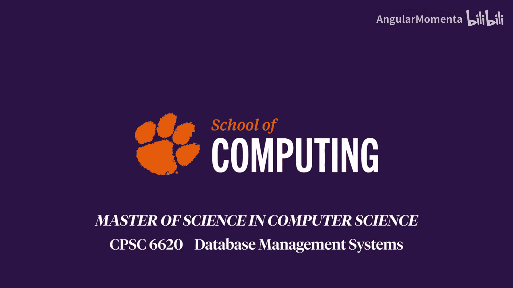
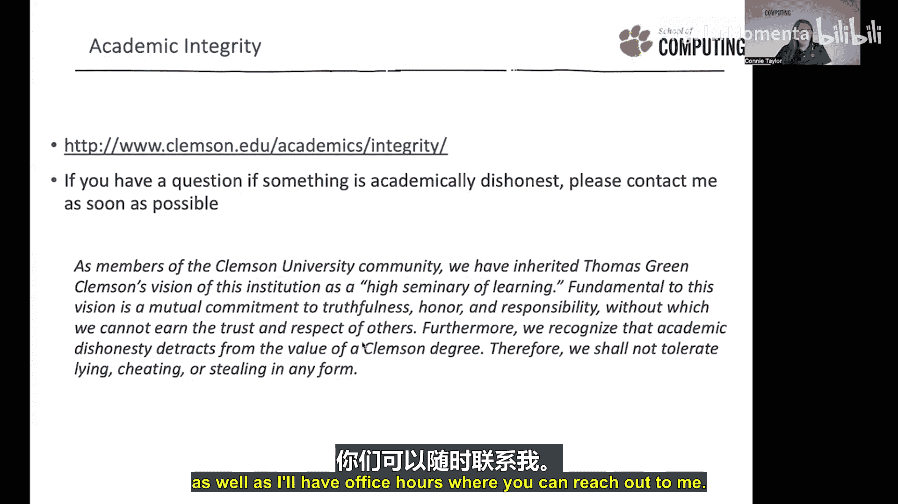

**数据库管理系统：01：课程介绍** 🗄️

在本节课中，我们将对《数据库管理系统》这门课程进行整体介绍，了解课程目标、核心内容、学习安排以及评估方式。

大家好，欢迎来到CPSC 6620数据库管理系统课程。我是康妮·泰勒，是一名实践教授，自2020年起在克莱姆森大学任教。在此之前，我在工业界工作了30年，致力于构建使用复杂分布式数据库的大型应用程序。

在本课程中，我们将学习数据库与数据通信，以及如何设计、创建和维护大规模的多用户数据库。我们也会关注一些新兴的数据库技术，例如你可能听说过的NoSQL。然而，课程的重点将主要放在关系型数据库的设计与使用，以及结构化查询语言（SQL）上。

那么，为什么在众多新兴数据库技术涌现的今天，我们仍要聚焦于关系型数据库呢？因为关系型数据库仍然是当今工业界的核心。从这张图表中可以看到，使用最广泛的数据库系统都是关系型的。即使你未来想使用NoSQL或进入可能不直接构建关系型数据库的技术领域，你的数据也很可能来源于关系型数据库。因此，掌握这项技术至关重要。如果你已有一些关系型数据库或SQL的知识，本课程将帮助你更深入地理解其底层原理。

SQL在工业界被广泛使用。在IEEE的编程语言排名中，SQL位列第一，这或许有些令人惊讶，你可能甚至不认为它是一种编程语言。但它确实被用于编写访问数据的脚本。在当今数据驱动、人工智能兴起的时代，掌握SQL技能将对你的职业发展大有裨益。

以下是本学期我们将要学习的主题列表，这些主题与课程模块基本对应。本课程需要一本指定教材，我会在每个模块中告知需要阅读的章节，通常一个模块对应教材的一章。对于每个模块，你需要阅读指定章节，完成一些家庭作业和练习（这些练习不计入成绩），最后参加一次测验。请注意，模块7和模块8包含多个更深入的SQL实验作业，它们需要更多时间完成，但对于你建立SQL熟练度至关重要。

本课程的评分构成如下：项目占25%，SQL实验作业占25%，测验和家庭作业各占15%，期中考试和期末考试合计占20%。接下来谈谈项目，你将构建一个连接MySQL关系型数据库的Java应用程序。如果你不擅长Java，也无需过分担心，因为我们会提供大部分代码，我们希望你将重点放在使用数据库连接功能和嵌入式SQL来访问数据库上。项目是分阶段进行的，你将基于前一部分的成果继续构建，过程中我们会提供反馈。

同样重要的是，提醒大家注意本课程的学术诚信政策。我们对此非常重视，请务必独立完成作业。我保证，只要你专注于学习，跟上作业进度，你就能在这门课程中取得好成绩。此外，你也有机会与助教合作，我也会安排办公时间为你答疑。

最后，我想用这句话结束本次介绍：“谁掌握了数据，谁就掌握了力量。”在当今人工智能和大数据的时代，这句话比以往任何时候都更加真实。我期待着指导你们，并赋予你们掌握数据、理解数据、构建卓越数据库的能力。