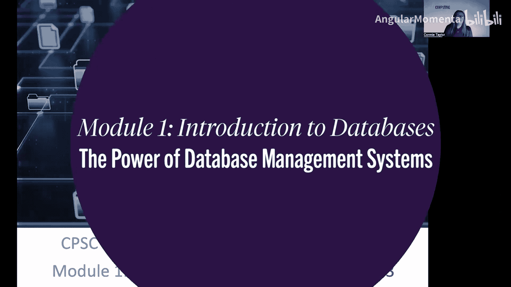
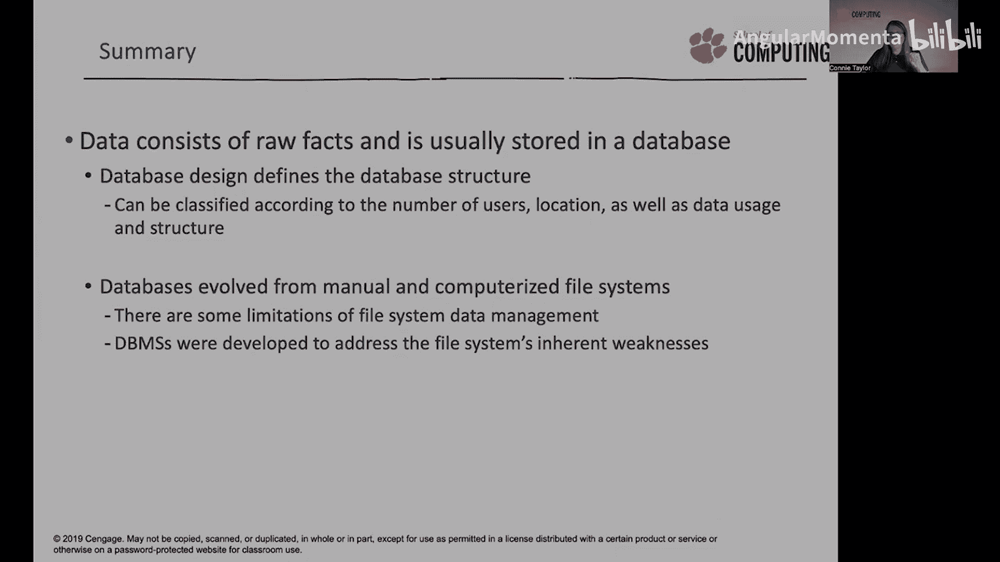

# 004：数据库管理系统的优势与构成

在本节课中，我们将学习数据库管理系统（DBMS）的核心优势、基本构成以及它在现代数据管理中的关键作用。我们将从文件系统的局限性出发，理解为何DBMS成为必要，并探讨其核心功能与相关职业角色。

## 概述

上一节我们探讨了文件系统的各种缺陷。本节中，我们将了解数据库管理系统如何解决这些问题，并深入解析其核心概念、功能组件以及相关的职业机会。

## 结构依赖与数据依赖

在讨论数据库系统之前，需要明确两个关键术语：结构依赖/独立与数据依赖/独立。

*   **结构依赖**：在文件系统中，访问数据的程序依赖于文件的具体结构。如果文件结构改变，访问它的程序也必须随之修改。这被称为结构依赖。
*   **结构独立**：在理想的系统中，数据结构的改变不应影响访问它的程序。这种特性被称为结构独立，它明显优于结构依赖。
*   **数据依赖**：这意味着程序需要知道数据在磁盘上的确切物理位置（如哪个扇区）才能访问它。这种方式并不理想。
*   **数据独立**：我们期望能够访问数据，而无需关心其物理存储位置。系统应向用户隐藏这些细节。即使磁盘发生故障更换，用户仍能获取数据。

关于数据依赖，另一种理解方式是区分逻辑格式与物理格式。你在数据库中看到和访问的所有数据都物理地存储在磁盘的某个位置，但你无需知晓或关心这个物理位置。你只需要在逻辑上知道数据存在于数据库中，并在需要时能够获取它。

## 什么是数据库系统

现在我们可以定义什么是数据库系统。一个数据库系统将逻辑上相关的数据存储在单一的存储库中。它消除了我们在文件系统中讨论的所有不一致性问题，这得益于它同时提供了结构独立性和数据独立性。

当前的DBMS软件负责处理数据之间的关系、数据的结构以及数据的访问方式。因此，用户只需专注于确保系统中的数据可被访问，而无需担心数据的物理位置或结构变更，这通过抽象层来实现。

下图展示了一个物理表示的示例：底部是文件系统，人事部、销售部、会计部各自在文件中管理数据。当这些数据被整合到一个共享的数据库系统中后，通过共享的结构和系统，信息可以保持同步。将数据从文件系统迁移到数据库能带来诸多好处。

## 数据库系统环境

考虑数据库系统时，必须考虑整个环境。这包括DBMS软件本身，以及管理它的硬件和人员。数据库管理涉及大量流程，以确保数据安全、一致——你不能允许任何人随意向数据库中插入数据。此外，还有数据本身，即你允许进入系统的数据。

以下是在企业DBMS软件中涉及的一些角色：

*   **流程与标准制定者**：负责规定人们可以对数据执行哪些操作。
*   **应用程序员**：编写访问数据的各种程序。
*   **最终用户**：通过应用程序访问数据。
*   **系统管理员**：负责管理存放数据库的硬件，无论是在公司内部还是在云端。
*   **数据库设计者与数据库管理员**：共同负责设计实际的数据库结构，并确保其结构合理、性能最优。

这是一个示例。在某些环境中，许多角色可能由一人兼任。特别是随着向云端迁移，一些角色发生了显著变化，部分职责转移给了云服务提供商。但最终，总需要有人来执行这些任务。

## 数据库管理系统的功能

数据库管理系统具体做什么？以下是其核心功能：

*   **存储元数据**：它存储关于数据本身的信息，即元数据。这通常被称为**数据字典**或**系统目录**。拥有DBMS就意味着它拥有一个数据字典。
*   **管理存储**：通过数据存储管理来确保结构独立性。
*   **数据格式化**：确保数据以正确的格式呈现。例如，底层数据是比特和字节，但用户希望以日期或十进制数的形式查看它。
*   **安全管理**：强制执行数据的安全性和隐私性。DBMS本身不会自动实现这一点，但它为数据库管理员提供了管理信息、角色和数据访问权限的能力。
*   **多用户访问控制**：处理成千上万用户同时访问数据的情况，确保用户不会相互覆盖操作，并授予他们所需的访问权限。
*   **备份与恢复**：这是DBMS极其重要的功能。如果数据库发生问题，它需要有能力提供可访问的副本进行恢复。
*   **保证数据完整性**：在底层管理数据，确保数据的一致性。
*   **提供数据访问语言**：通常通过某种查询语言提供数据访问。对于关系型数据库，这通常是**SQL**。即使是非SQL（NoSQL）数据库，许多也尝试支持SQL，因为SQL是一种非常流行且广为人知的语言。
*   **提供接口**：支持从不同位置连接数据库。如果数据库位于异地或云端，DBMS具备网络通信能力，使用户可以访问该数据库。

## 数据库系统的潜在缺点

在讨论缺点之前，我想再评论一下数据库系统。其中一个缺点正是其**复杂性**。我认为数据库在某种程度上类似于操作系统，它们都非常复杂。在未来的模块中，我们会讨论数据库管理和维护，其中可调整的参数和配置极其繁多，管理数据库非常复杂，需要精通特定技术（如关系型理论）以及具体产品（如MySQL或Oracle）的专家。

数据库是非常复杂的系统，它们提供了强大的功能。关系型数据库久经考验，许多大公司放心地将数据存储其中。但相应地，它们也带来更高的成本。

过去，供应商较少时，Oracle曾是关系型数据库的王者。人们在数据库技术上的花费有时甚至超过运行其上的应用程序编程。如今成本已变得更可控，但随着向云端迁移，支付云服务费用可能非常昂贵。此外，如前所述，存在复杂性问题，以及确保数据库为所有不同用户保持更新的挑战。

还需要考虑**供应商依赖**。例如，如果系统基于MySQL，是否需要担心它与PostgreSQL或其他供应商产品的兼容性？这也是一个问题。许多人选择云服务的原因之一就是不想操心这些，例如MySQL是运行在这个Linux版本还是那个Linux版本上，在云端它直接运行，用户无需考虑。

最后，就像操作系统一样，数据库也有非常频繁的升级和替换周期。它们需要持续进行安全更新、错误修复等。如果你自己管理数据库而不在云端，你将需要负责处理这些升级。

## 数据库管理领域的职业角色

这张幻灯片展示了数据库管理中的各种工作岗位。当你考虑职业发展时，如果对数据感兴趣，这个领域机会众多。其中一些角色可能会合并，一个人可以身兼多职。但请看底部的**数据科学家**，这是当前非常热门、高薪的职位，许多人正投身于此。掌握SQL和关系型数据库知识，我相信是数据科学家以及所有相关角色的基础技能。你可以作为数据库开发人员构建应用程序，也可以更偏向数据库的系统端，因为如前所述，它们非常复杂。还可以成为安全官、数据库管理员或云架构师。

因此，在学习本课程时，如果你对此感兴趣，未来有大量机会可以将这些技能应用到实际工作中。这是一个充满活力、技术快速变化的激动人心的领域。如果你愿意，随时可以联系我探讨相关机会。我展示这些只是想说明，这个领域存在着非常多的可能性。

## 总结

在本节课中，我们一起学习了数据库管理系统相较于文件系统的核心优势，即提供了结构独立性和数据独立性。我们探讨了DBMS的基本构成、其关键功能（如元数据管理、安全控制、备份恢复等），也简要提及了其复杂性和成本等潜在缺点。最后，我们了解了数据库管理领域内丰富的职业角色。在下一个模块中，我们将更深入地探讨数据库设计。

我们将在模块2中深入更多数据库设计的内容，到时再见。

