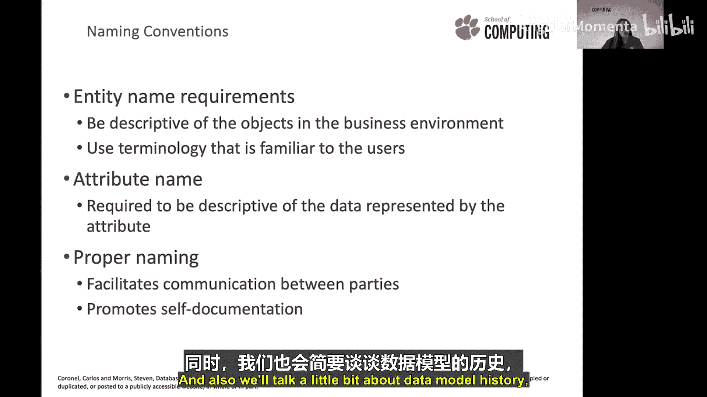

# 005：数据建模概述 🗺️

在本节课中，我们将要学习数据建模的基础知识。我们将探讨数据模型的重要性、其基本构成要素，以及如何通过业务规则来指导建模过程。

## 为什么数据模型很重要？🤔

上一节我们介绍了数据库和数据库管理系统的基本概念。本节中，我们来看看数据建模的核心价值。

数据模型是对复杂现实世界的抽象。在构建任何实际系统之前，创建模型有助于沟通和规划。对于数据库而言，数据建模是设计数据库结构的关键步骤。

数据模型的重要性主要体现在以下几个方面：

*   **沟通**：在开始构建数据库之前，数据模型是开发人员与需求方之间沟通的桥梁，确保双方对要构建的内容有共同的理解。
*   **视图定制**：数据模型允许为不同的最终用户（如高层管理者与开发人员）创建不同详细程度的视图，以便他们更好地理解。
*   **规划与抽象**：通过抽象，数据模型帮助设计者提前思考和规划整个系统的结构。

一个实际的例子是，一家大型零售企业曾将核心软件的数据模型制作成巨幅海报，张贴在整个数据中心，因为它对公司的业务流程至关重要。

## 数据模型的基本构成要素 🧱

理解了数据模型的重要性后，我们来剖析它的基本组成部分。

数据模型主要由以下三个核心要素构成：

1.  **实体**：实体是指人、地点、事物或事件。它通常是一个名词。例如，“汽车”、“学生”或“订单”都是实体。
2.  **属性**：属性是实体的特征或性质。例如，对于“汽车”这个实体，其属性可能包括 `颜色`、`车门数量`、`品牌` 等。
3.  **关系**：关系描述了不同实体之间的关联。例如，“汽车”实体与“车轮”实体之间存在关系。一辆汽车有四个车轮，这是一种 **“一对多”** 的关系（1辆车 : 4个车轮）。同时，一个车轮只属于一辆汽车，这又是 **“多对一”** 的关系。关系通常是双向的。
4.  **约束**：约束是对数据规则的限定。例如，在汽车模型中，一个约束可以是“一辆汽车必须有且只有四个车轮”。在数据库中，这可以通过代码或规则来实现，例如在定义表结构时设置非空和唯一性约束。

## 什么是业务规则？📋

要构建一个准确的数据模型，我们需要清晰的需求指导，这就是业务规则的作用。

业务规则实质上就是系统需求的具体描述。它明确了我们要用数据模型表达的业务逻辑和策略。理想情况下，业务规则应提供足够的信息，让我们能够推导出所需的实体、关系和约束。

获取业务规则的途径包括：

*   与业务用户或领域专家（如人力资源经理、产品经理）直接沟通。
*   分析现有系统的文档。
*   研究相关的业务流程和政策文件。

即使无法获得现成的业务规则，在建模时也应主动总结和创建清晰的需求描述。业务规则中的名词通常会转化为**实体**，动词则会转化为**关系**。例如，规则“一名客户可以下多个订单”中，“客户”和“订单”是实体，“下”描述了它们之间的“一对多”关系。

在定义实体和属性时，务必使用业务方能够理解的、描述性强的名称，这能极大地提升模型的沟通效率。

## 总结 📝

本节课中我们一起学习了数据建模的概述。我们了解到数据模型是数据库设计的蓝图，对于沟通和规划至关重要。其核心构件包括**实体**、**属性**、**关系**和**约束**。而**业务规则**则是指导我们进行数据建模的需求基础，它帮助我们识别出模型中的关键元素。

下一节，我们将深入探讨如何进行数据建模，并简要回顾数据模型的发展历史。