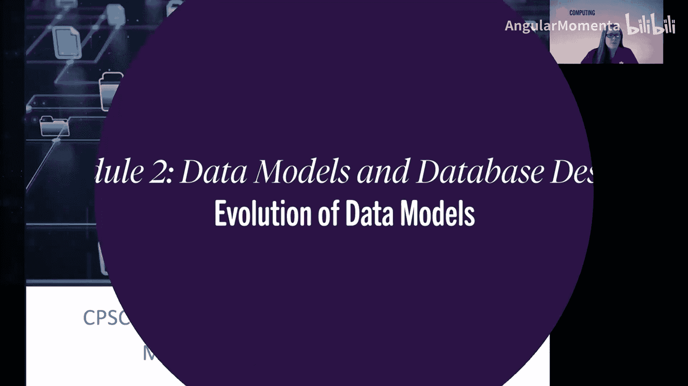
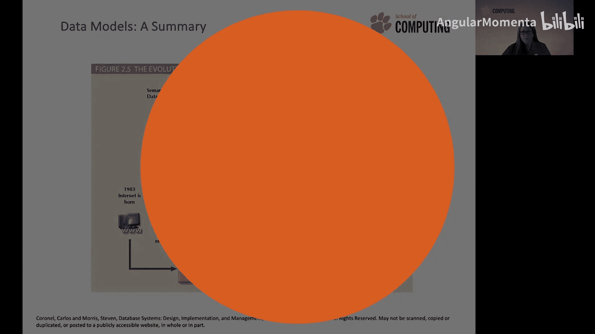

# 006：数据模型演进与关系模型详解 🗂️

在本节课中，我们将学习数据模型的历史演进过程，并深入了解关系数据模型的核心概念。我们将从早期的层次和网络模型开始，逐步过渡到现代的关系模型，并简要介绍面向对象模型、扩展ERD以及NoSQL等新兴数据模型。

## 数据模型演进历史 📜

上一节我们从宏观层面讨论了数据建模的重要性。本节中，我们来看看数据模型是如何演进的。

最初出现的是层次模型。该模型源于复杂的制造业，特别是物料清单的概念。数据被组织成一种层级结构，类似于构建某物所需的零部件。例如，一辆汽车包含底盘、车轮、发动机等组件，而发动机本身又包含其子部件。这种模型使数据模型具有结构依赖性。

层次模型随后演变为网络模型。与层次模型相比，网络模型能够表示更复杂的关系。尽管性能有所提升，但它仍然存在结构依赖性问题。

从这些早期模型中，理解一些关键术语非常重要：
*   **模式**：指数据库管理员或数据库管理者所看到的整个数据库。
*   **子模式**：指整个模式中，被特定应用程序或公司内特定领域用户所看到的那一部分。子模式可以根据你希望从整个模式中获取的信息而变化。

另一个非常重要的术语是**数据操纵语言**。实际上，还应引入**数据定义语言**。我们将在未来的模块中更详细地讨论DDL和DML。目前需要了解的是：
*   你可以使用各种工具和能力来操纵数据。例如，如果数据库中定义了一辆汽车，你想将其颜色从蓝色改为红色，就需要使用数据操纵语言来实现。
*   如果你想添加一个全新的部件，或者从两门轿车扩展到四门轿车，需要向数据库中添加更多列或信息，那么就必须使用数据定义语言。它允许你改变数据模型的结构和组件。

## 关系数据库模型详解 🔗

现在，我们进入关系数据库的讨论。正如引言中所说，关系数据库将是本课程的主要重点。

什么是关系数据库？它基于一种称为“关系”的概念。如果你有数学背景，这个术语可能对你更有意义。你可以将其视为一个**表**。如果你使用过Excel，每个工作表标签下都是一个包含行和列的表。在关系模型中，行被称为**元组**，列被称为**属性**。

关系模型有一套非常精确的数据操纵和访问方式，我们后续会深入探讨。当你使用一个关系型数据库管理系统时，它被称为**RDBMS**。使用RDBMS为你提供了许多能力，让你能够理解、使用和访问数据，而无需了解底层系统的所有细节。

让我们看一个关系模型的例子。在这个例子中，有两个表。第一个表名为`agent`，第二个表名为`customer`。`agent`表和`customer`表通过一个名为`agent_code`的列相关联。在`agent`表中，包含了所有销售代理的信息。例如，代理Alex Alby的姓氏、名字、中间名首字母、区号和电话号码。他们通过`agent_code`链接到`customer`表，该表包含所有客户信息。通过查看`agent_code`，你可以根据该代码与`agent`表的连接，找出Alex Alby的客户。这就是通过查看表格来理解的关系模型。

你将有一个构建在RDBMS之上的应用程序，允许你使用DDL和DML（通过**SQL结构化查询语言**）来访问数据。你将拥有一个用户界面或命令行，可以实际与数据交互并查看独立的表。后台有一个引擎在运行，执行所有针对该数据库的查询。这些都是关系模型的要求。

在将数据库构建到RDBMS中之前，我想用图形表示我的数据库模型。我将使用一种称为**实体关系图**或**ERD**的工具来实现。ERD是数据库模型的图形化表示。它显示了实体、属性以及这些实体之间的连接。

创建ERD有各种方法，具体来说有各种符号：
*   有一种符号称为陈氏表示法。
*   有一种鸦脚表示法。
*   如果你有面向对象的背景，也可以使用UML来绘制。

在本课程中，我们将使用**鸦脚表示法**。这也是我在行业中主要看到的方法。之所以叫鸦脚表示法，是因为当你看到“多”这一端的符号时，它看起来像乌鸦的脚。例如，在员工与技能的多对多关系中，“多”的符号就像乌鸦的脚。这就是我们将要使用的表示法。

## 其他数据模型概览 🌐

除了ERD，还有其他数据模型。过去更流行的是**面向对象数据模型**。当人们创建数据库来支持面向对象的应用程序时，能够直接使用已经创建的面向对象模型来建模数据库是非常方便的。同样，与实体和属性非常相似，你有对象和属性。这更多地是为了让你有所了解，我们不会在本课程中进行任何面向对象的数据建模。它使用你在面向对象开发中看到的概念，如类、层次结构、继承，并使用统一建模语言作为创建图表的机制。这只是一个例子，正如我所说，我不会将其作为课程的重点。

数据建模的另一种机制是**扩展你的ERD**。你可以使用面向对象的特性来扩展它，也可以使用XML（一种标记语言，用于交换数据）来扩展它。数据库确实允许你拥有非结构化数据，这只是模型支持该功能的能力。同样，这更多是为了让你了解，我们不会在本课程中这样做。

我想讨论的最后一个主题是，如果你对数据建模和数据科学感兴趣，可能也听说过更多关于**大数据**和**NoSQL**的内容。这些是在过去大约10年或更长时间里兴起的，当时我们必须处理快速移动的大量数据，即所谓的“三V”：数据量大、速度快、种类多。你需要超越关系型的不同机制来管理具有这些特征的数据。

当你思考这些新的数据模型时，它们需要不同的工具和不同的方式来呈现和存储这些数据，并且有许多新技术。在未来的课程中，我们将更多地关注NoSQL，而不是其他一些模型，尽管Hadoop和MapReduce今天肯定仍在使用。NoSQL正成为新兴数据模型中的热门领域，我们将作为本课程的一部分来重点学习。

具体来说，关于NoSQL的更多信息，正如我所说，我们将在未来的模块中涵盖。它们不基于关系模型。具有非常分布式的数据库架构。如果你考虑到巨大的数据量，跨多个位置访问这些数据必须具有高可用性和可扩展性，以便随时可用。可能存在一种称为**稀疏数据**的概念。即我有大量数据是空的，没有任何内容，但我有其他部分有数据。例如，如果你在Excel中有一个数据表，假设你只有五列填充了数据，这就被认为是稀疏数据。NoSQL的真正重点是高性能和高可用性。这只是对NoSQL的初步介绍，在未来的模块中，我们将更详细地讨论它。

## 课程总结 📝

本节课中，我们一起学习了数据模型的历史演进。从具有结构依赖性的层次和网络模型开始，然后进入关系模型。关系模型已经发展到包含实体关系语义。你可以采用关系数据库，实际上还有用于面向对象的扩展关系技术，这些技术随着应用程序编程世界进入面向对象领域而发展。现在我们又进入了整个NoSQL世界，它与关系模型非常不同。然而，除非你了解基于关系模型的数据库，否则你无法理解NoSQL，因为对NoSQL的很多解释和理解都是基于关系世界中的概念。

这就是我们第二部分的内容总结：一些数据模型的历史、数据模型的重要性，以及使用实体关系图来表示关系数据库，这将是我们进入未来模块时进一步构建的基础。