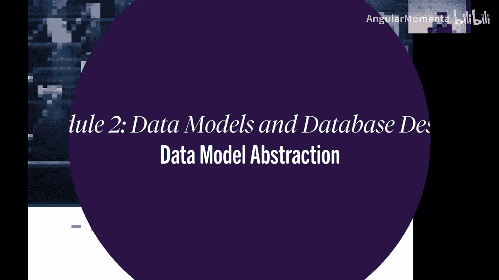
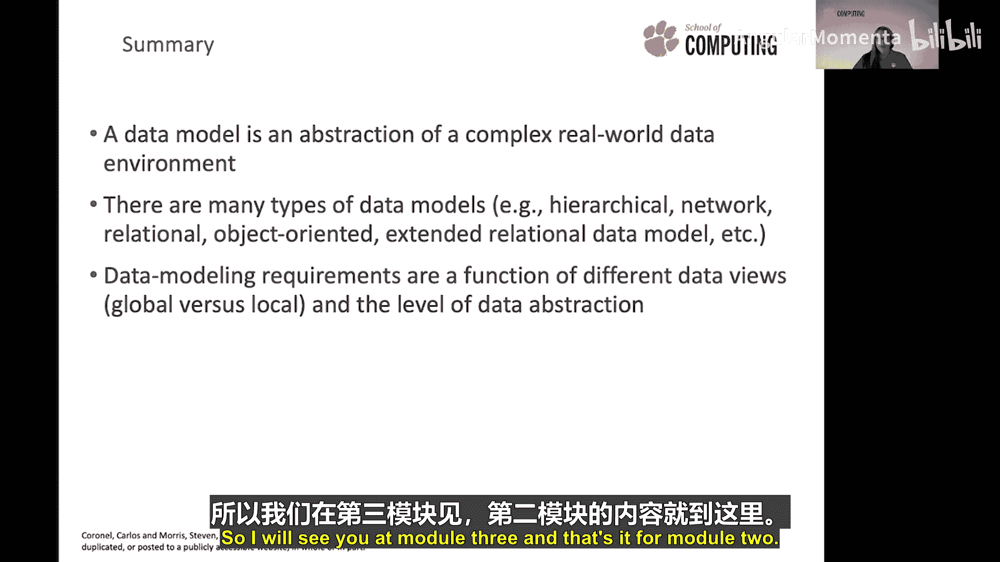

# 007：数据模型抽象 🎯

在本节课中，我们将学习数据模型抽象的概念。我们将探讨数据模型的不同视图和抽象层次，理解如何根据不同的受众和目的来呈现数据模型。

## 概述

数据模型抽象是指从不同层次和视角来看待和表示数据模型的过程。通过抽象，我们可以简化复杂的数据结构，使其更易于理解和沟通。在数据库设计中，理解并应用不同层次的抽象至关重要。

## 数据模型的抽象层次

上一节我们介绍了数据模型的基本概念，本节中我们来看看数据模型的四个主要抽象层次。从最高层到最底层，它们分别是：外部模型、概念模型、内部模型和物理模型。

### 外部模型 👥

外部模型是最高层次的抽象，它是概念模型的一个子集，专门展示给特定的最终用户。例如，为一个公司构建整个企业系统时，你只会向人力资源部门展示他们关心的数据模型部分。

以下是外部模型的关键特点：
*   它完全独立于具体的实现技术（如编程语言、数据库软件）。
*   最终用户只关心数据模型是否包含了他们需要的实体和属性。
*   通常使用实体关系图来表示，并可能附上文字说明以解释业务规则和约束。

### 概念模型 🧠

概念模型代表了整个组织或问题域的数据需求，提供了数据对象和它们之间关系的高级视图。

以下是概念模型的核心要点：
*   它仍然是硬件和软件独立的。
*   它关注“是什么”（主要数据对象和关系），而不是“如何实现”。
*   逻辑设计阶段创建的就是概念模型。

### 内部模型 💻

内部模型将概念模型映射到特定数据库管理系统的具体实现。它开始依赖于所选的数据库软件。

以下是内部模型的主要特征：
*   它使用数据定义语言来创建表、定义属性和数据类型。
*   例如，SQL语句 `CREATE TABLE Professor (...)` 就是内部模型的一部分。
*   它软件依赖，但硬件独立。

### 物理模型 💾

物理模型处于最底层，关注数据在物理存储设备（如磁盘）上如何实际存储和访问。

以下是物理模型的要点：
*   它同时依赖于硬件和软件。
*   数据库管理系统会处理这些细节，使开发人员无需关心。
*   物理存储的变更不会影响上层的概念模型和外部模型。

## 抽象层次的重要性

理解这些抽象层次的核心价值在于**逻辑数据独立性**。这意味着我们可以修改内部模型（如改变属性数据类型）或物理模型（如更换存储硬件），而不会影响上层的概念模型和基于它构建的应用程序。数据库管理系统负责维护这种独立性，让开发者能专注于解决业务问题。

## 总结

本节课中我们一起学习了数据模型抽象的四个层次：
1.  **外部模型**：面向最终用户的定制化视图。
2.  **概念模型**：整个系统的高级、技术独立的蓝图。
3.  **内部模型**：依赖于特定DBMS的具体实现方案。
4.  **物理模型**：数据在存储设备上的具体实现方式。

数据建模是数据库开发中极其重要的一步。通过提前创建模型，我们可以更好地理解需求，并与利益相关者进行有效沟通。在本课程中，我们将主要使用Crowfoot记法的实体关系图来创建概念模型和外部模型，同时也会实践内部模型的构建。

模块二的讲解到此结束，我们模块三再见。