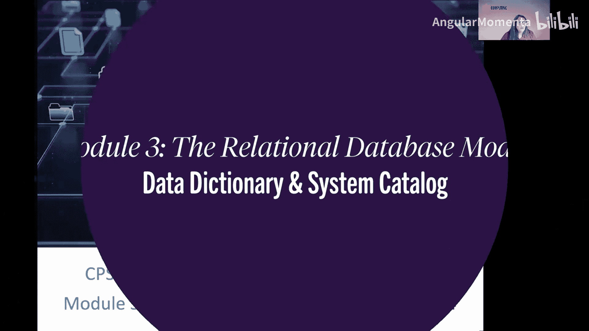
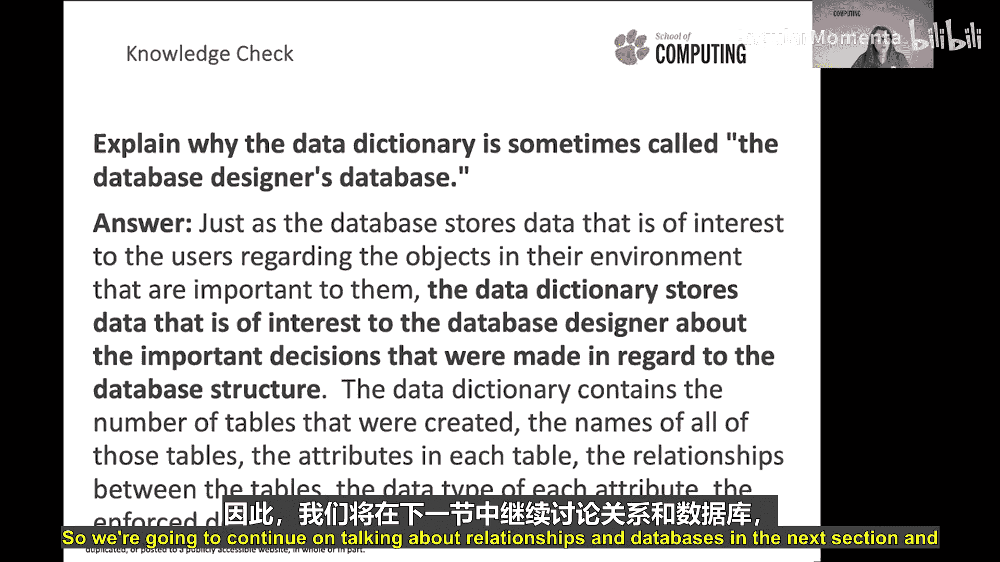

数据库管理系统：第3章：数据字典与系统目录 📚

在本节中，我们将继续探讨关系数据库模型，并重点介绍**数据字典**和**系统目录**这两个核心概念。这是一个较高层次的概述，后续模块中我们会深入更多细节。

---

### 什么是数据字典？

数据字典是对数据库中所有用户和设计者创建的表的描述。它包含了数据库中所有表及其结构的完整信息。

### 什么是系统目录？

系统目录是一个系统级的数据字典。它不仅包含用户创建的所有内容，还包含了数据库自身使用的表。关系数据库管理系统会管理许多用户并未直接创建的表和结构，所有这些信息都存储在系统目录中。

由于系统目录包含了数据字典所需的所有信息，这两个术语经常被互换使用。在实际使用数据库时，我们通常只接触由DBMS提供的系统目录，因为数据字典的信息可以从系统目录中派生出来。

---

### 数据字典与元数据

在第一模块的第一课中，我们讨论过**元数据**的概念。数据字典本质上提供的就是元数据，即**关于数据的数据**。

请看以下数据字典示例，它清晰地展示了元数据的含义：

*   **表名**：`CUSTOMER`
*   **属性名**：`Cus_Code`, `Cus_Lname`, `Cus_Fname`, `Agent_Code`
*   **内容描述**：客户唯一标识符、客户姓氏、客户名字、负责代理的代码
*   **数据类型**：数字、字符
*   **格式与约束**：是否必填
*   **键信息**：指明哪些属性是主键或外键

例如，在我们的客户表和代理表例子中，`Agent_Code` 是 `CUSTOMER` 表中的一个外键，数据字典中会明确标识这一点。同时，它也会包含 `AGENT` 表的所有相关信息。

> 注：上图仅为示意，并非真实数据字典或系统目录的确切外观，但它展示了您能从中获取的信息类型。

在实际工作中，很多时候可能没有现成的文档说明数据库结构。这时，我首先查看的就是包含数据字典信息的系统目录，以了解所有表及其内容。这在后续课程中极为有用，届时我们将查看真实案例。目前，我们只需理解它是什么以及为何如此重要。

---

### 为什么数据字典被称为“数据库设计者的数据库”？

正如之前所说，数据字典是“关于数据的数据”。它包含了数据库设计者做出的所有决策以及他们如何设置结构。因此，它是一个记录了数据库设计者所有工作的“数据库”。

---

### 总结

本节课我们一起学习了关系数据库中的两个重要概念：**数据字典**和**系统目录**。数据字典描述了用户创建的表结构，而系统目录则在此基础上，还包含了数据库系统自身使用的所有元数据。它们是理解数据库结构的蓝图，对于设计、开发和维护数据库都至关重要。

在下一节中，我们将继续探讨数据库中的关系。