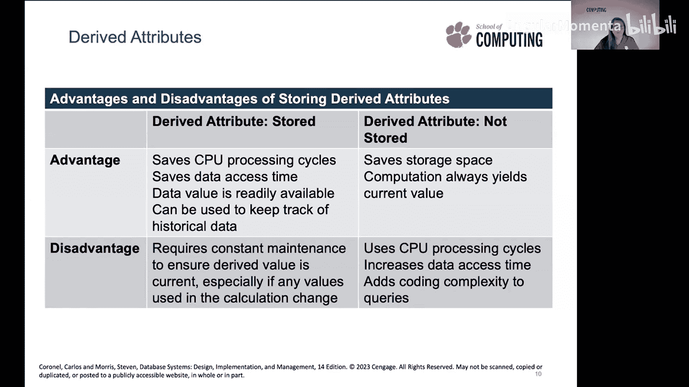

# 014：实体-关系模型概述 🗺️

在本节课中，我们将要学习实体-关系模型的基础知识。实体-关系模型是数据库设计中的核心概念工具，用于以图形化的方式描绘数据库的结构。我们将了解其主要组成部分、它们之间的关系，以及如何将这些设计转化为实际的数据库实现。

## 实体-关系模型简介

上一节我们介绍了数据库设计的基本概念，本节中我们来看看实体-关系模型的具体构成。

实体-关系模型常与实体-关系图互换使用。在业界，ERD是更常用的术语。ERD描绘了数据库的主要组成部分，即实体、属性和关系。

*   **实体**：是用户感兴趣的对象。在模型中，实体对应数据库中的整个表，而非表中的某一行。
*   **实体实例**：表中的每一行数据就是一个实体实例或实体出现。
*   **表示法**：构建ERD有多种表示法，实体本身通常用名词表示，并常用大写字母书写。

## 实体的属性

实体由各种属性构成。属性的命名和表示方式在ERD中具有特定含义。

以下是实体中可能包含的各种属性类型：

*   **必需属性**：在Crow‘s Foot表示法中，用**粗体**表示。例如，创建“学生”实体时，必须提供**姓氏**和**名字**。
*   **可选属性**：非粗体表示。例如，中间名首字母、邮箱和电话，在插入数据时可以没有值。
*   **域**：指某个属性所有可能取值的集合。例如，“姓氏”属性的域是所有可能的字符组合。
*   **主键**：唯一标识每个实体的属性，在ERD中用下划线标出。可以由单个或多个属性组成，称为复合主键。
*   **复合属性**：可以进一步细分为多个部分的属性。例如，“学生姓名”可细分为“姓氏”、“名字”和“中间名首字母”。
*   **简单属性**：不能再细分的属性。
*   **单值属性**：只能有一个值的属性。
*   **多值属性**：可以有多个值的属性。
*   **派生属性**：可以从其他属性计算得出的属性。

## 多值属性的处理

在Chen表示法中，有专门的符号表示多值属性。然而，在数据库中，有更好的方法来建模和表示多值属性。

通常，更倾向于为多值属性创建一个新的实体。例如，将“汽车颜色”建模为一个独立的实体，其主键包含“汽车ID”和“部位”，然后有一个“颜色”属性。这种方法提供了更大的灵活性，可以轻松添加或删除部位，而无需修改“汽车”表的结构。

## 派生属性的考量

派生属性有时也称为计算属性。Crow‘s Foot表示法没有专门指示派生属性的方式。

派生属性是指可以通过其他属性计算得出的属性。例如，“员工年龄”可以通过当前日期和“员工出生日期”计算得出。

关于派生属性，需要考虑是将其存储在表中，还是在需要时每次计算。

*   **存储派生属性的优点**：查询时无需计算，可直接获取，节省CPU处理时间。
*   **存储派生属性的缺点**：当基础数据变化时，需要更新存储的值，增加了维护成本。例如，每天都需要检查并更新员工的年龄。
*   **不存储派生属性的优点**：不占用存储空间，总能得到基于最新数据的计算结果。
*   **不存储派生属性的缺点**：每次查询都需要进行实时计算，增加了查询的复杂度和处理开销。

选择哪种方式取决于属性变化的频率、计算的成本以及对数据实时性的要求。

---

本节课中我们一起学习了实体-关系模型的核心概念。我们了解了实体、属性（包括必需、可选、主键、复合、多值及派生属性）以及它们在图中的表示方法。我们还探讨了处理多值属性的最佳实践，以及存储与计算派生属性的权衡考量。这些基础知识是进行有效数据库设计的第一步。