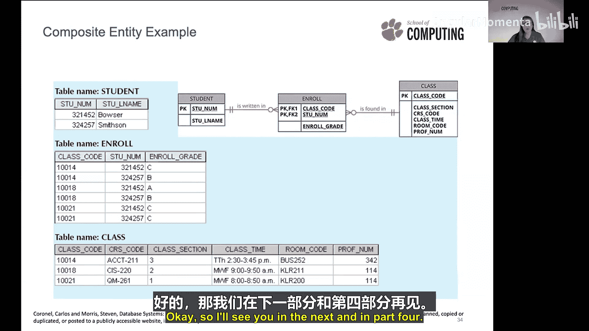

# 016：实体参与度与关系度数 🗂️


在本节课中，我们将继续学习如何描述关系，重点探讨**实体参与度**与**关系度数**这两个核心概念。我们将通过具体示例来解释这些概念，并学习如何在实体关系图中表示它们。

## 实体参与度：可选与强制

上一节我们介绍了关系的基数。本节中，我们来看看关系的另一个重要属性：参与度。参与度用于描述一个实体是否**必须**与另一个实体相关联。

*   **强制参与**：表示一个实体**必须**与另一个实体存在关联。
*   **可选参与**：表示一个实体**可以**与另一个实体关联，但这不是必须的。

让我们通过一个例子来使其更清晰。考虑“课程”与“班级”之间的关系。

*   一门“课程”可以存在，但可能暂时没有任何“班级”开设。例如，大学课程目录中可能有一门新设计的课程，但尚未安排任何班级。因此，“课程”对“班级”的参与是**可选**的。在基数表示法中，这体现为 `0..n`（零到多）。符号中类似“0”的圆圈就表示可选。
*   相反，如果业务规则要求每门课程都必须至少有一个班级，那么参与就是**强制**的。这体现为 `1..n`（一到多）。符号中的短竖线“|”表示强制。

参与度的设计取决于你试图支持的**具体业务规则**。好消息是，你可以在设计数据库时根据需求做出这些决定。

以下是表示不同基数与参与度的符号总结，你现在应该能理解图中所有线条的含义了：

*   `1..1`：一对一，强制参与
*   `0..1`：一对一，可选参与
*   `1..n`：一对多，强制参与
*   `0..n`：一对多，可选参与

此外，连接实体的线可以是虚线（表示弱关系）或实线（表示强关系）。

## 关系度数：涉及多少个实体？

理解了参与度后，我们接下来探讨**关系度数**。关系度数指的是一个关系中涉及的**实体类型数量**。

*   **一元关系**：也称为递归关系。关系中只涉及**一个**实体类型，该实体与自身相关联。
*   **二元关系**：涉及**两个**实体类型。这是ER图和数据库设计中最常见的关系。
*   **三元关系**：涉及**三个**实体类型。多于三元的关系在数据库中较为罕见。

我们之前讨论的“教授-班级”、“课程-班级”都是二元关系的例子。对于三元关系，例如“医生”、“病人”和“药物”之间的关系，通常需要一个**桥接实体**（如“处方”）来连接三者，因为这是一个多对多关系。

在这个“处方”桥接实体中，主键通常由所连接实体的主键组合而成。例如：

```sql
CREATE TABLE Prescription (
    doctor_id INT,
    patient_number INT,
    drug_code VARCHAR(10),
    -- 其他属性如剂量、日期等
    PRIMARY KEY (doctor_id, patient_number, drug_code),
    FOREIGN KEY (doctor_id) REFERENCES Doctor(id),
    FOREIGN KEY (patient_number) REFERENCES Patient(number),
    FOREIGN KEY (drug_code) REFERENCES Drug(code)
);
```

### 递归关系示例

递归关系在实际中有多种形式。以下是几个例子：

*   **员工与配偶**：在“员工”表中，可能有一个属性指向另一位员工（其配偶）。
*   **员工与经理**：在“员工”表中，“经理ID”字段指向同一张表中的另一个员工记录。
*   **课程先修关系**：“课程”表可以包含一个指向自身（先修课程）的外键。

## 重温多对多关系与桥接实体

现在，让我们再次回顾ER模型中的多对多关系。记住，处理两个实体间的多对多关系时，需要在它们之间创建一个**桥接实体**（也称为复合实体、关联实体或连接实体）。

这个桥接实体包含其父实体（即那两个多对多实体）的**主键属性**作为其自身的**复合主键**。它也可以包含其他描述性属性。

关于术语：桥接实体、复合实体、关联实体、连接实体这些词经常混用。在本课程中，你可以使用其中任何一个，它们都是指代同一个概念。

以下是一个典型示例：学生与课程之间的多对多关系。

*   许多学生选修许多课程。
*   为了在关系数据库中表示这种关系，我们创建了一个名为“选课”的桥接实体。
*   这个“选课”实体包含：
    *   `class_code`（课程表的主键）
    *   `student_number`（学生表的主键）
    *   这两个属性共同构成了“选课”表的**复合主键**。
    *   同时，它们也是**外键**，分别引用“课程”表和“学生”表。
    *   此外，你还可以在这个表中添加其他属性，例如该学生在这门课中获得的`grade`（成绩）。

---

本节课中，我们一起学习了**实体参与度**（可选与强制）和**关系度数**（一元、二元、三元）。我们通过符号理解了如何表示不同的参与约束，并探讨了递归关系的实际例子。最后，我们再次巩固了如何使用**桥接实体**来解决多对多关系，并了解了其主键和外键的构成。




下一部分，我们将通过一个完整的示例，一步步学习如何将业务规则转化为实体关系图。