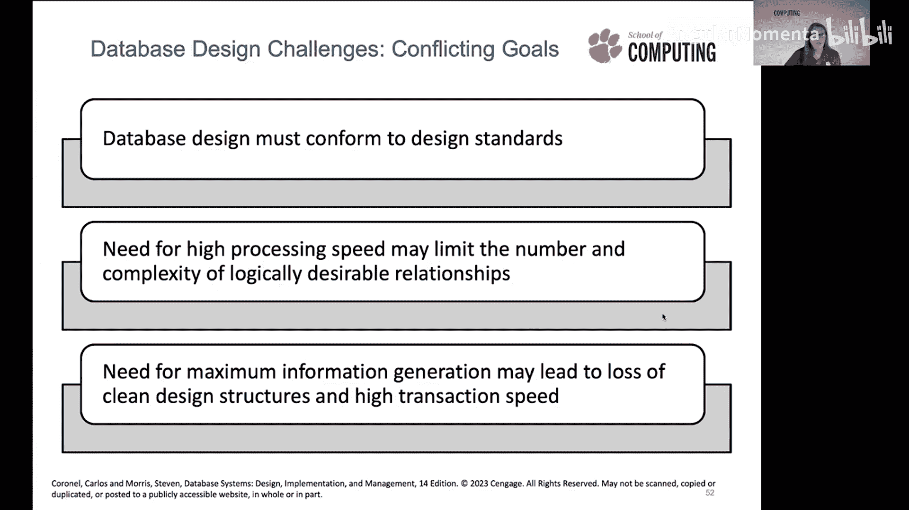

# 017：开发实体关系图 (ERD) 🗺️


在本节课中，我们将通过一个“微型学院”的完整示例，学习如何从零开始开发一个实体关系图。我们将识别实体、定义关系，并讨论设计过程中的权衡与决策。

## 概述

开发ERD是数据库设计的关键步骤。它要求我们深刻理解业务规则，并将这些规则转化为可视化的数据模型。本节将通过一个逐步构建的案例，展示从需求分析到完整ERD的整个过程。

## 构建ERD的准备工作

在开始绘制图表之前，你需要充分理解要构建的系统。这包括了解业务角色、各实体间的交互以及具体的业务规则。

有时你可能需要基于现有系统创建新数据库。在这种情况下，你需要亲自观察系统的使用方式，查阅现有文档，以捕获必要的信息。

获取准确的需求并非易事，你可能会遗漏一些细节。因此，你需要基于手头的信息尽力而为。

通常，当你对业务规则有了大约80%的理解时，就可以开始识别主要的实体和关系。建议先将这些内容记录在电子表格或其他文档中，与业务方沟通确认，然后再开始绘制初始的ERD。

接下来，你需要迭代地添加更多属性、定义主键，并确定关系中所需的外键。在整个过程中，与业务相关方保持评审至关重要。ERD通常是技术人员与业务人员沟通的主要工具，因此保持其高层次和概念性非常重要，以便于理解。

---

## 案例：微型学院数据模型

我们将基于以下“微型学院”的业务描述来构建ERD。

### 1. 学院、院长与教授 🏛️

学院下设多个学院（如商学院、艺术学院等）。每个学院有一位院长，该院长同时也是一名教授。一位教授只能担任一个学院的院长，但教授并非必须担任院长。

**关系分析**： 这是教授与学院之间的一对一关系。但由于教授可以不担任院长，所以从学院的角度看，关系是可选的（0..1）。

在ER图中，这表现为一个弱关系（无传递性）。学院实体中包含一个指向教授的外键。

**核心关系公式**：
```
学院 (1) —— (0..1) 院长/教授
```

### 2. 学院与系 🏢

每个学院由多个系组成。例如，商学院可能包含会计系、管理系、经济系。一个学院至少有一个系，且可以有很多系。每个系只属于一个学院。

**关系分析**： 这是学院与系之间的一对多关系。

以下是学院、系与教授部分的ERD片段示意：
```
[学院] —1———< 包含 >———0..*— [系]
```

### 3. 系与课程 📚

每个系提供多门课程。但根据业务规则，有些系可能只进行研究，不提供任何课程。

**关系分析**： 这意味着课程对系是可选的。一个系可以提供零门或多门课程。

**设计技巧**： “多”的符号（鸦足）通常放在拥有外键的一方。在此关系中，`课程`实体拥有外键`系代码`，所以“多”在课程这边。

**关系表示**：
```
[系] —1———< 提供 >———0..*— [课程]
（外键：系代码 位于 课程 实体中）
```

### 4. 课程、班级与学期 🗓️

一门课程可以对应多个班级（如不同时间段的同一门课）。此外，引入了“学期”实体来定义班级开设的年份和学期。

业务规则指出，学院的校历（学期开始和结束日期）可能在班级课程表创建之前就已设定。

**关系分析**： 这意味着班级对学期是可选的。一个学期可以在没有任何班级信息的情况下先行建立。

**关键点**： `课程`和`学期`实体之间没有直接外键。外键（`课程代码`和`学期ID`）都存在于`班级`这个桥接实体中。

**关系结构**：
```
[课程] —1———< 对应 >———0..*— [班级]
[学期] —1———< 包含 >———0..*— [班级]
```

### 5. 系与教授（雇佣与领导） 👨‍🏫

一个系雇佣多位教授。其中一位且仅有一位教授担任系主任。教授并非必须接受系主任职务。

**关系分析**： 这里存在两个跨越相同实体的关系：
1.  `雇佣`： 系与教授之间的一对多关系（一个系雇佣多位教授）。
2.  `领导`： 教授与系之间的一对一关系（一位教授领导一个系），且对教授是可选的。

**外键位置**：
*   `雇佣`关系：外键`系代码`位于`教授`实体中。
*   `领导`关系：外键`教授编号`位于`系`实体中（用于标识系主任）。

### 6. 教授与班级 🧑‍🏫

一位教授最多可以教授四门课。教授也可能处于研究合约中，不教授任何课程。

**关系分析**： 班级对教授是可选的（0..4）。外键`教授编号`位于`班级`实体中。

### 7. 学生与班级（选课） 🧑‍🎓

一名学生可以选修多门课（最多六门）。一个班级可以有多个学生（最多35人）。班级可以在没有学生选课的情况下存在。

**关系分析**： 这是学生与班级之间的多对多关系，因此必须创建一个桥接实体（如`选课`）。

**桥接实体结构**：
```
[学生] —0..*—< 选课 >—0..*— [班级]
           （桥接实体：选课记录）
```
在`选课`实体中，包含来自`学生`和`班级`的主键作为复合主键及外键。

### 8. 系与学生（专业） 🎯

每个系有多个学生，这些学生的主修专业由该系提供。每名学生只有一个主修专业，且只与一个系关联。学生允许在一段时间内不声明专业。

**关系分析**： 系对学生是可选的。外键`系代码`位于`学生`实体中。

**重要提示**： 所有关系都基于给定的业务规则。即使现实中大学允许双专业，本例中仍按“单一专业”规则建模。

### 9. 学生与教授（指导） 💬

所有指导老师都是教授，但并非所有教授都指导学生。

**关系分析**： 教授对学生（指导关系）是可选的。外键`教授编号`位于`学生`实体中。

### 10. 班级、教室与建筑 🏫

一个班级安排在一个教室上课。一个教室可以安排多个班级（在不同时间）。一栋建筑包含多个教室。

**关系分析**：
*   建筑与教室：一对多关系。
*   教室与班级：一对多关系。

**业务细节**： 在“微型学院”的上下文中，只关心用作教室的房间。因此，可能存在没有教室的建筑（如仓库），这使得教室对建筑的关系在业务模型上是可选的。

---

## 实体与关系总结表

以下表格汇总了所有讨论的实体及其连接关系：

| 实体1 | 关系 | 实体2 | 连通性 (实体1:实体2) |
| :--- | :--- | :--- | :--- |
| 教授 | 担任 | 学院 | 1:0..1 |
| 学院 | 包含 | 系 | 1:1..* |
| 系 | 提供 | 课程 | 1:0..* |
| 课程 | 对应 | 班级 | 1:0..* |
| 学期 | 包含 | 班级 | 1:0..* |
| 系 | 雇佣 | 教授 | 1:1..* |
| 教授 | 领导 | 系 | 0..1:1 |
| 教授 | 教授 | 班级 | 0..1:0..* |
| 学生 | 选修 | 班级 | 0..*:0..* (需桥接实体) |
| 系 | 提供专业给 | 学生 | 1:0..* |
| 教授 | 指导 | 学生 | 0..1:1..* |
| 建筑 | 拥有 | 教室 | 1:0..* |
| 教室 | 安排 | 班级 | 1:0..* |

---

## 完整ERD一览

将以上所有部分组合起来，就形成了“微型学院”的完整实体关系图。完整的图表包含了多个相互关联的实体和关系，初次观看可能信息量很大。这也说明了将复杂问题分解为小块逐一解决的重要性。

## 数据库设计的其他考量

进行数据库设计时，还需要考虑以下方面：
*   **命名标准**： 团队或组织通常会对实体、属性的命名有统一规范。
*   **设计偏好**： 设计团队可能对关系的强度（如是否必须为强关系）有特定偏好。
*   **性能影响**： 初步的设计在现实中可能会遇到性能瓶颈。有时为了满足性能要求，可能需要对理想化的设计进行调整，例如改变关系或实体的结构。我们将在后续关于数据库性能的模块中详细讨论这一点。

---

## 总结




本节课中，我们一起学习了如何从头开发一个实体关系图。我们以“微型学院”为例，逐步识别了核心实体（如学院、系、教授、学生、课程、班级等），并根据业务规则定义了它们之间的关系（一对一、一对多、多对多）和可选性。我们强调了将大问题分解、先梳理再绘图的方法，并讨论了外键放置的实用技巧（“多”的一方常持有外键）。最后，我们了解到ERD是一个重要的沟通工具，并且设计可能需要根据性能等实际因素进行迭代调整。